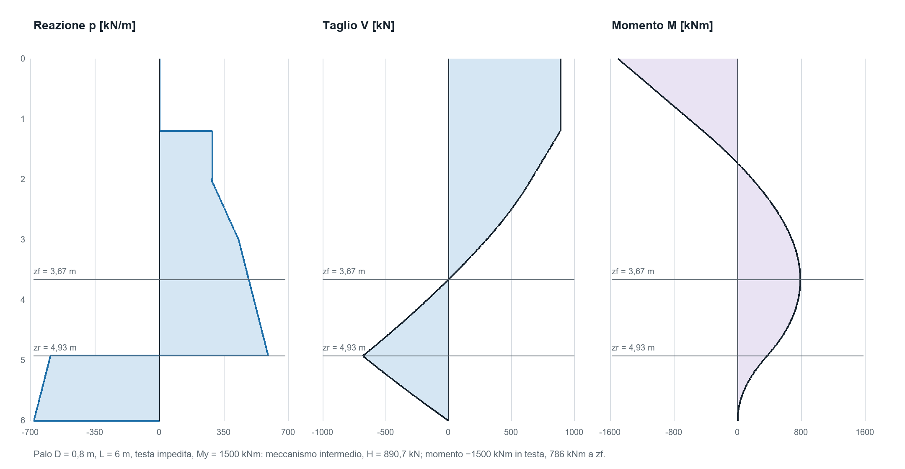

# Capacità orizzontale del palo in terreno stratificato

Il metodo di G. Pacini: estensione della teoria di Broms con diagrammi limite per strato ed equilibrio globale

Edizione 1 del 29 ottobre 2026 — ANTHEA 1.16.0, libreria GPCChecker.Geotechnics

Questo articolo espone la teoria del metodo «Stratificato» dei moduli Palo orizzontale e Micropalo orizzontale di ANTHEA, ideato da Gabriele Pacini come estensione della teoria di Broms ai terreni stratificati. Descrive le ipotesi, la costruzione del diagramma limite strato per strato, le equazioni di equilibrio dei meccanismi, il confronto con le formule di Broms e alcuni esempi numerici controllati con la libreria e con un calcolo indipendente. La guida teorica ne riporta un riassunto nel capitolo «Capacità orizzontale in terreno stratificato»; la guida pratica descrive i dati e i risultati del foglio.

## Scopo e campo di applicazione

Il metodo calcola la forza orizzontale ultima $H_u$ di un palo verticale isolato, con momento resistente della sezione $M_y$ assegnato, in un terreno a strati orizzontali coesivi (comportamento non drenato, resistenza $c_u$) o granulari (comportamento drenato, angolo $\varphi'$, coesione nulla) in qualunque successione, con falda e con la testa anche interrata. Restituisce la capacità, il meccanismo che la governa, le profondità caratteristiche e i diagrammi della reazione del terreno, del taglio e del momento allo stato ultimo.

La teoria di Broms (1964) tratta il terreno omogeneo: fissa una legge della reazione limite per ciascuna famiglia di terreno, individua tre meccanismi di collasso (palo corto, intermedio e lungo) per la testa libera e per quella impedita e ricava formule in forma chiusa. L'estensione mantiene le leggi locali e i meccanismi di Broms e cambia tre cose:

1. il diagramma della reazione limite è costruito strato per strato, ciascuno con la propria legge, e resta un diagramma lineare a tratti di forma qualsiasi;
2. tutte le condizioni di equilibrio sono scritte con tre integrali del diagramma, $Q$, $S$ e $A$, che valgono per qualunque diagramma lineare a tratti: il terreno stratificato non richiede formule nuove, cambiano solo i valori degli integrali;
3. sotto la profondità di taglio nullo le reazioni si chiudono con due tratti distribuiti di verso opposto e risultanti uguali, separati da una profondità d'inversione che si ricava dall'equilibrio globale, invece che con la forza concentrata al piede che Broms adotta nei terreni granulari.

| Caso | Comportamento del programma |
| --- | --- |
| Terreno omogeneo coesivo | Broms e Stratificato coincidono: si ritrovano le formule di Broms |
| Terreno omogeneo granulare | Broms: chiusura concentrata al piede; Stratificato: chiusura distribuita, capacità minore per il palo corto a testa libera e per l'intermedio a testa impedita |
| Strati della stessa famiglia | Broms (modello multistrato sperimentale) oppure Stratificato |
| Successioni di strati coesivi e granulari | solo Stratificato; con Broms il calcolo è rifiutato |
| Falda sotto il piano campagna | considerata nelle tensioni verticali efficaci |
| Falda sopra il piano campagna | rifiutata |
| Testa interrata alla profondità $d > 0$ | considerata, senza tratto libero sopra il terreno |
| Testa impedita | solo con eccentricità nulla, $e = 0$ |
| Granulare con $c' \neq 0$ oppure $\varphi' \geq 60°$ | rifiutato |

## Ipotesi

1. Il palo è rigido e perfettamente plastico: resta rigido finché in una sezione il momento non raggiunge $M_y$, dove si forma una cerniera plastica. La capacità di rotazione della cerniera si assume sufficiente e non viene verificata.
2. Il terreno è rigido e perfettamente plastico: al collasso ogni tratto del palo che si sposta contro il terreno mobilita la reazione limite $p(z)$. Non c'è una legge reazione–spostamento e non si calcolano spostamenti.
3. La reazione limite per unità di lunghezza dipende solo dallo strato e dallo stato tensionale alla profondità considerata, non dal meccanismo.
4. Carico statico, palo isolato, analisi al primo ordine. Lo sforzo normale $N$ resta costante ed entra solo nel calcolo di $M_y$. L'effetto di gruppo non modifica il meccanismo: l'efficienza $\eta$ riduce la resistenza di progetto.
5. Strati orizzontali, falda con pressioni idrostatiche.

## Notazione e convenzioni

| Simbolo | Significato | Unità |
| --- | --- | --- |
| $z$ | profondità dalla testa del palo, positiva verso il basso | m |
| $d$ | profondità della testa sotto il piano campagna; $z_g = z + d$ è la profondità dal piano campagna | m |
| $D$, $L$ | diametro geotecnico e lunghezza del palo dalla testa | m |
| $e$ | eccentricità: altezza del punto di applicazione di $H$ sopra la testa | m |
| $H$, $H_u$ | forza orizzontale in testa e sua capacità ultima | kN |
| $M_y$ | momento resistente della sezione del palo | kNm |
| $M_0$ | momento nella sezione di testa: $He$ con testa libera, $-M_y$ o $-S(L)$ con testa impedita | kNm |
| $p(z)$ | reazione limite per unità di lunghezza, positiva se contrasta $H$ | kN/m |
| $Q$, $S$, $A$ | integrali del diagramma limite | kN, kNm, kNm |
| $z_f$ | profondità di taglio nullo, $Q(z_f) = H$ | m |
| $z_r$ | profondità d'inversione delle reazioni | m |
| $t$ | profondità alla quale finiscono le reazioni mobilitate | m |
| $F$ | forza concentrata di chiusura di Broms, positiva nel verso di $H$ | kN |

La reazione $p$ è una forza per unità di lunghezza del palo, non una pressione: la pressione media equivalente sul diametro vale $p/D$.

## Reazione limite per strato

Nei terreni coesivi la reazione limite è nulla vicino al piano campagna e costante più in basso; nei granulari cresce con la tensione verticale efficace. Sono le leggi di Broms, applicate in ogni strato con i parametri dello strato. Nei coesivi la reazione è nulla per $z_g < 1{,}5\,D$ e più in basso vale:

```math
p(z) = 9\,c_u\,D
```

Nei granulari, con il coefficiente di spinta passiva di Rankine:

```math
p(z) = 3\,K_p\,D\,\sigma'_v(z_g)
K_p = \frac{1+\sin\varphi'}{1-\sin\varphi'} = \tan^2\left(\frac{\pi}{4}+\frac{\varphi'}{2}\right)
```

La tensione verticale efficace è l'integrale dei pesi di volume efficaci di tutti gli strati soprastanti, compresi quelli coesivi e quelli sopra la testa interrata, con $\gamma' = \gamma$ sopra la falda e $\gamma' = \gamma_{sat} - \gamma_w$ sotto. In un profilo interamente coesivo i pesi non intervengono.

```math
\sigma'_v(z_g) = \int_0^{z_g} \gamma'(s)\,ds
```

Due scelte distinguono il diagramma stratificato da una semplice sovrapposizione di diagrammi omogenei.

1. La zona coesiva senza reazione, profonda $1{,}5\,D$, è una proprietà della superficie del terreno, dove manca il confinamento: si misura dal piano campagna e non ricomincia a ogni strato. Un banco coesivo sotto uno strato granulare spesso più di $1{,}5\,D$ reagisce subito con $9\,c_u D$. Con la testa interrata la zona si riduce a $1{,}5\,D - d$ dalla testa.
2. Le tensioni verticali si accumulano attraverso tutti gli strati: uno strato granulare sotto uno coesivo parte dalla tensione efficace prodotta dal peso del coesivo.

Il terreno sopra la testa interrata dà le tensioni verticali ma nessuna reazione. Il diagramma risulta lineare a tratti: ogni tratto appartiene a un solo strato e sta tutto sopra o tutto sotto la falda e la profondità $1{,}5\,D - d$. Nel tratto $a \leq z \leq b$:

```math
p(z) = p_0 + k\,(z-a)
```

con $k = 0$ nei coesivi e $k = 3\,K_p D \gamma'$ nei granulari. Alle interfacce il diagramma può avere un salto: il metodo non lo raccorda e non introduce medie fra strati.


## Integrali del diagramma limite

L'equilibrio di qualunque tratto del palo si scrive con la risultante delle reazioni, $Q$, il loro momento statico rispetto alla testa, $S$, e il loro momento rispetto alla sezione alla profondità $z$, $A$:

```math
Q(z) = \int_0^z p(s)\,ds
S(z) = \int_0^z s\,p(s)\,ds
A(z) = \int_0^z (z-s)\,p(s)\,ds = z\,Q(z) - S(z)
```

Per un diagramma lineare a tratti gli integrali sono esatti. Nel tratto $[a, b]$, con $u = \min(\max(z-a, 0), b-a)$, i contributi sono:

```math
\Delta Q = p_0\,u + \frac{k\,u^2}{2}
\Delta S = a\,\Delta Q + \frac{p_0\,u^2}{2} + \frac{k\,u^3}{3}
```

Finché tutte le reazioni sopra la sezione contrastano $H$, taglio e momento valgono:

```math
V(z) = H - Q(z)
M(z) = M_0 + H\,z - A(z)
```

Il taglio si annulla alla profondità $z_f$ in cui la risultante delle reazioni eguaglia la forza applicata. Lì il momento è massimo e, poiché $A(z_f) = z_f H - S(z_f)$, assume una forma che non dipende da $z_f$ esplicitamente:

```math
Q(z_f) = H
M(z_f) = M_0 + S(z_f)
```

Dentro un tratto la profondità $z_f$ si ottiene invertendo l'area del trapezio, con la forma stabile della radice dell'equazione di secondo grado che resta precisa anche quando $k$ tende a zero. Detta $r = H - Q(a)$ la parte di $H$ che resta da equilibrare nel tratto:

```math
z_f = a + \frac{2\,r}{p_0+\sqrt{p_0^2 + 2\,k\,r}}
```

È l'operazione che il prototipo del metodo chiamava «profondità per la forza»: la ricerca della profondità in cui l'area cumulata del diagramma limite raggiunge un valore assegnato.

## Chiusura delle reazioni sotto la profondità di taglio nullo

Sotto $z_f$ il palo riceve dalla parte superiore il momento $M(z_f)$ e taglio nullo. Con le reazioni al valore limite, l'equilibrio è possibile solo se una parte delle reazioni continua a contrastare $H$, fra $z_f$ e una profondità d'inversione $z_r$, e la parte successiva, fra $z_r$ e $t$, agisce in verso opposto, con la stessa risultante. L'equilibrio alla traslazione fissa $z_r$; quello alla rotazione richiede che la coppia formata dalle due risultanti equilibri $M(z_f)$:

```math
Q(z_r) = \frac{Q(z_f) + Q(t)}{2}
C(z_f, t) = S(t) + S(z_f) - 2\,S(z_r)
C(z_f, t) = M(z_f)
```

$C$ è la differenza fra il momento statico, rispetto alla testa, del tratto inferiore e quello del tratto superiore. Poiché i due tratti hanno risultanti uguali e opposte formano una coppia: il suo momento non dipende dal polo scelto, e la testa è solo il polo più comodo.

Nel palo corto e nell'intermedio le reazioni arrivano al piede, $t = L$. Nel palo lungo la cerniera a $z_f$ trasmette $M_y$ e le reazioni mobilitate finiscono alla profondità $t \leq L$ in cui la coppia raggiunge quel momento; sotto $t$ il palo non spinge sul terreno.

Nel palo corto, sostituendo $Q(z_f) = H$ e $t = L$, le due condizioni diventano l'equilibrio globale del palo rigido che ruota attorno a $z_r$, con le reazioni limite da una parte e dall'altra:

```math
H = 2\,Q(z_r) - Q(L)
M_0 + 2\,S(z_r) - S(L) = 0
```

È la stessa struttura del metodo dei pali rigidi di Brinch Hansen (1961), che usa però leggi diverse della pressione limite. Nei terreni granulari Broms sostituisce invece il tratto rovesciato con una forza concentrata al piede, $F = Q(L) - H$, che agisce con il braccio massimo; nei coesivi la sua soluzione è già quella distribuita, come si vede più avanti.

## Meccanismi e capacità

### Testa libera

Il palo corto ruota rigidamente: nessuna sezione raggiunge $M_y$ e le reazioni arrivano al piede. Con la chiusura concentrata di Broms, nei granulari, l'equilibrio alla rotazione attorno al piede dà direttamente la capacità:

```math
H\,(L+e) = A(L)
```

Con la chiusura distribuita la capacità è la radice dell'equazione di equilibrio, unica fra zero e $Q(L)$:

```math
H\,e + S(z_f) - C(z_f, L) = 0
```

Il palo lungo forma una cerniera alla profondità di taglio nullo, dove il momento è massimo:

```math
H\,e + S(z_f) = M_y
```

Il ramo lungo è ammesso solo se la cerniera può formarsi dentro il palo, cioè se con $H = Q(L)$ il momento massimo supera $M_y$. La capacità del palo lungo non dipende dalla chiusura: chiusura concentrata e distribuita cambiano solo il diagramma delle reazioni sotto la cerniera.

### Testa impedita

Con la testa impedita il vincolo e la forza sono nella sezione di testa, con $e = 0$. Il palo corto trasla senza ruotare e mobilita tutto il diagramma; è ammesso se il momento d'incastro non supera $M_y$:

```math
H = Q(L)
M_0 = -S(L)
S(L) \leq M_y
```

Se $S(L) > M_y$ si forma una cerniera in testa, con $M_0 = -M_y$, e il palo intermedio ruota attorno a una profondità interna. Con la chiusura concentrata di Broms vale la prima equazione, con quella distribuita la seconda:

```math
H\,L = M_y + A(L)
-M_y + S(z_f) - C(z_f, L) = 0
```

Il palo lungo ha due cerniere, in testa e a $z_f$, dove il momento vale $-M_y + S(z_f) = M_y$:

```math
S(z_f) = 2\,M_y
```

### Scelta del meccanismo

Per ogni verticale indagata si calcolano i candidati ammissibili: corto e lungo con la testa libera; corto, intermedio e lungo con la testa impedita. La capacità è il minore dei candidati e il meccanismo è quello che lo realizza, come nella procedura di Broms; un candidato non attivabile (la cerniera non si forma dentro il palo, oppure $S(L) \leq M_y$ per l'intermedio) non concorre.

```math
H_u = \min\left(H_{corto};\ H_{intermedio};\ H_{lungo}\right)
```


## Il caso omogeneo coesivo: le formule di Broms

Con testa al piano campagna, $d = 0$, e $c_u$ costante il diagramma è nullo fino a $1{,}5\,D$ e vale poi $9\,c_u D$. Posto $f = H/(9\,c_u D)$, la profondità di taglio nullo e i primi integrali, per $z \geq 1{,}5\,D$, sono:

```math
z_f = 1{,}5\,D + f
Q(z) = 9\,c_u D\,(z - 1{,}5\,D)
S(z_f) = 9\,c_u D\,\frac{z_f^2 - (1{,}5\,D)^2}{2} = H\left(1{,}5\,D + \frac{f}{2}\right)
```

Sotto $z_f$ il diagramma è costante: indicata con $g = t - z_f$ la lunghezza del tratto che si chiude, la profondità d'inversione è a metà, $z_r = z_f + g/2$, e la coppia è quella di due rettangoli di base $g/2$ distanti $g/2$:

```math
C(z_f, z_f + g) = 9\,c_u D\,\frac{g}{2}\,\frac{g}{2} = 2{,}25\,c_u D\,g^2
```

Sostituendo nelle condizioni dei meccanismi si ottengono le relazioni di Broms per i terreni coesivi:

| Meccanismo | Condizione del metodo | Relazione di Broms che ne risulta |
| --- | --- | --- |
| Testa libera, corto | $He + S(z_f) = C(z_f, L)$ | $H(e + 1{,}5D + 0{,}5f) = 2{,}25\,c_u D g^2$, con $L = 1{,}5D + f + g$ |
| Testa libera, lungo | $He + S(z_f) = M_y$ | $M_y = H(e + 1{,}5D + 0{,}5f)$ |
| Testa impedita, corto | $H = Q(L)$, $M_0 = -S(L)$ | $H = 9\,c_u D(L - 1{,}5D)$, $M_0 = -H(0{,}5L + 0{,}75D)$ |
| Testa impedita, intermedio | $-M_y + S(z_f) = C(z_f, L)$ | $H(1{,}5D + 0{,}5f) - M_y = 2{,}25\,c_u D g^2$ |
| Testa impedita, lungo | $S(z_f) = 2M_y$ | $2M_y = H(1{,}5D + 0{,}5f)$ |

Nel terreno coesivo omogeneo il metodo stratificato è quindi la teoria di Broms, senza alcuno scostamento: per questo la libreria usa la chiusura distribuita in ogni profilo interamente coesivo anche quando si sceglie il metodo Broms. Il calcolo della libreria coincide con le formule in forma chiusa entro $10^{-11}$ in tutti i casi provati (tabella degli esempi).

## Il caso omogeneo granulare

Con terreno asciutto, testa al piano campagna e $\varphi'$ costante il diagramma è lineare, $p = k\,z$ con $k = 3\,K_p\,\gamma D$, e gli integrali sono potenze di $z$:

```math
Q(z) = \frac{k\,z^2}{2}
S(z) = \frac{k\,z^3}{3}
A(z) = \frac{k\,z^3}{6}
z_f = \sqrt{\frac{2H}{k}}
S(z_f) = \frac{2}{3}\,H\,z_f
```

Tre meccanismi danno esattamente le formule di Broms per i terreni incoerenti, perché non dipendono dalla chiusura sotto $z_f$: il palo lungo a testa libera, $M_y = H\,(e + 0{,}544\sqrt{H/(\gamma D K_p)})$; il palo corto a testa impedita, $H = 1{,}5\,\gamma D L^2 K_p$ con $M_0 = -\frac{2}{3}HL$; il palo lungo a testa impedita, $2M_y = \frac{2}{3}H z_f$. Anche il palo corto a testa libera (prima equazione) e l'intermedio a testa impedita (seconda) di Broms si ritrovano con il metodo Broms, che usa la chiusura concentrata:

```math
H = \frac{0{,}5\,\gamma D L^3 K_p}{L+e}
H = \frac{M_y + 0{,}5\,\gamma D L^3 K_p}{L}
```

Con la chiusura distribuita questi due meccanismi cambiano. Nel palo corto a testa libera, posti $\zeta = z_r/L$ ed $\varepsilon = e/L$, le due equazioni dell'equilibrio globale si riducono a una cubica in $\zeta$:

```math
2\,\zeta^3 + 3\,\varepsilon\,\zeta^2 - \frac{3}{2}\,\varepsilon - 1 = 0
H = k L^2\left(\zeta^2 - \frac{1}{2}\right)
\frac{H_{distribuita}}{H_{Broms}} = 6\,(1+\varepsilon)\left(\zeta^2 - \frac{1}{2}\right)
```

Con $e = 0$ si ha $\zeta = 2^{-1/3} = 0{,}794$ e la capacità è il 78,0 % di quella di Broms; il rapporto scende al crescere dell'eccentricità e tende a 0,586 quando $e/L$ tende all'infinito. Nell'intermedio a testa impedita, $2\,S(z_r) = M_y + S(L)$ dà $z_r^3 = (3M_y/k + L^3)/2$ e $H = k\,(z_r^2 - L^2/2)$.

| $e/L$ | $z_r/L$ | Rapporto | Scostamento |
| --- | --- | --- | --- |
| 0 | 0,794 | 0,780 | −22,0 % |
| 0,25 | 0,774 | 0,739 | −26,1 % |
| 0,5 | 0,761 | 0,712 | −28,8 % |
| 1 | 0,746 | 0,679 | −32,2 % |
| 2 | 0,732 | 0,646 | −35,4 % |
| → ∞ | 0,707 | 0,586 | −41,4 % |

La differenza misura l'effetto dell'ipotesi di chiusura. La forza concentrata di Broms agisce al piede, con il braccio massimo rispetto al centro di rotazione; la reazione rovesciata distribuita ha la risultante più in alto e, a parità di momento da equilibrare, consente una forza in testa minore. Broms confrontò le sue soluzioni con i risultati di prove disponibili; il modello distribuito, invece, non ha una validazione sperimentale indipendente. Lo scostamento va letto come sensibilità del risultato all'ipotesi di chiusura, non come correzione di un errore della formula classica. Una chiusura con reazioni opposte distribuite per i pali rigidi corti nei terreni granulari è discussa anche da Wood (2021).


## Terreno stratificato: esempio passo per passo

Il profilo è quello della figura 1: argilla con $c_u = 40$ kPa e $\gamma = 18$ kN/m³ fino a 2 m, poi sabbia con $\varphi' = 32°$, $\gamma = 19$ kN/m³ e $\gamma_{sat} = 20{,}5$ kN/m³, falda a 3 m, $\gamma_w = 9{,}81$ kN/m³. Il palo ha $D = 0{,}8$ m, $L = 5$ m, testa libera al piano campagna ed eccentricità $e = 0{,}5$ m; $M_y$ è abbastanza grande da escludere la cerniera.

Con $K_p = 3{,}2546$ il diagramma limite ha quattro tratti:

| Tratto [m] | Legge | $p_0$ [kN/m] | $k$ [kN/m²] | $Q$ a fine tratto [kN] | $S$ a fine tratto [kNm] |
| --- | --- | --- | --- | --- | --- |
| 0–1,2 | argilla entro 1,5 D | 0 | 0 | 0 | 0 |
| 1,2–2 | $9\,c_u D$ | 288,0 | 0 | 230,40 | 368,64 |
| 2–3 | $3K_pD\sigma'_v$, $\sigma'_v = 36$ kPa a 2 m | 281,20 | 148,41 | 585,80 | 1269,51 |
| 3–5 | sotto falda, $\sigma'_v = 55$ kPa a 3 m | 429,61 | 83,50 | 1612,01 | 5430,02 |

Il palo è corto: si cerca $z_r$ tale che $H = 2\,Q(z_r) - Q(L)$ soddisfi $He + 2\,S(z_r) - S(L) = 0$. La soluzione è $z_r = 3{,}8498$ m, dove $Q(z_r) = 981{,}05$ kN e $S(z_r) = 2627{,}49$ kNm; forze in kN e momenti in kNm:

```math
H = 2 \cdot 981{,}05 - 1612{,}01 = 350{,}09
H\,e = 350{,}09 \cdot 0{,}5 = 175{,}05
S(L) - 2\,S(z_r) = 5430{,}02 - 5254{,}97 = 175{,}05
```

La profondità di taglio nullo è $z_f = 2{,}3863$ m, nel tratto sabbioso sopra la falda, e il momento massimo vale $M(z_f) = He + S(z_f) = 175{,}05 + 631{,}86 = 806{,}90$ kNm. Il momento massimo resta sotto $M_y = 5000$ kNm, quindi nessuna cerniera si forma e il meccanismo corto è coerente; il candidato lungo, attivabile con questo $M_y$ solo con una forza di 1378,84 kN, è maggiore e non governa.

Nella tabella seguente gli esempi sono stati calcolati con la libreria GPCChecker.Geotechnics del set distribuito con ANTHEA 1.16.0 e, in modo indipendente, con un programma che valuta $p(z)$ punto per punto, integra con quadrature di Gauss e risolve ogni meccanismo nelle sue incognite (profondità di rotazione per i pali corti e intermedi, $H$ con la ricerca del momento massimo per i lunghi), senza usare $Q$, $S$, $C$ né la funzione di inversione della libreria. Lo scarto massimo fra i due calcoli, su 33 casi, è $1{,}2 \cdot 10^{-11}$ in valore relativo.

I casi della tabella hanno tutti $D = 0{,}8$ m e testa al piano campagna:

1. argilla su sabbia (profilo della figura 1), testa libera, $e = 0{,}5$ m;
2. lo stesso profilo con un palo più lungo, testa libera, $e = 0{,}5$ m;
3. lo stesso profilo, testa impedita;
4. lo stesso profilo con un palo più lungo, testa impedita;
5. sabbia ($\varphi' = 32°$, $\gamma = 18$ kN/m³) fino a 3 m su argilla con $c_u = 60$ kPa, senza falda, testa libera, $e = 0{,}5$ m;
6. argilla omogenea con $c_u = 50$ kPa, testa libera, $e = 0{,}5$ m, confrontata con la forma chiusa di Broms;
7. la stessa argilla, testa impedita, confrontata con la forma chiusa di Broms;
8. sabbia omogenea asciutta con $\varphi' = 33°$ e $\gamma = 19$ kN/m³, testa libera, $e = 0$: Broms e Stratificato danno lo stesso risultato.

| Caso | $L$ [m] | $M_y$ [kNm] | Palo | $H_u$ [kN] | $z_f$ [m] | $z_r$ [m] |
| --- | --- | --- | --- | --- | --- | --- |
| 1 | 5 | 5000 | corto | 350,09 | 2,386 | 3,850 |
| 2 | 10 | 1500 | lungo | 567,86 | 2,958 | 4,799 |
| 3 | 6 | 1500 | intermedio | 890,66 | 3,667 | 4,930 |
| 4 | 10 | 1500 | lungo | 1075,52 | 4,036 | 5,720 |
| 5 | 6 | 5000 | corto | 508,97 | 2,691 | 4,357 |
| 6 | 6 | 5000 | corto | 468,57 | 2,502 | 4,251 |
| 7 | 5 | 1000 | intermedio | 647,80 | 3,000 | 4,000 |
| 8 | 12 | 600 | lungo | 397,16 | 2,266 | — |

Nel caso 4 le reazioni finiscono a $t = 7{,}10$ m, sopra il piede; nel caso 2 a $t = 6{,}25$ m. Nel caso 8 il metodo Broms chiude con la forza concentrata e lo Stratificato con l'inversione a 3,528 m, senza cambiare la capacità. In tutti i casi i residui di equilibrio alla fine delle reazioni sono dell'ordine di $10^{-9}$ kN e kNm. Suddividere uno strato in due sottostrati identici non cambia il risultato: 153,234 kN con la chiusura distribuita e 207,360 kN con Broms per il palo della figura 2, con uno strato o con due.



## Dalla capacità alla resistenza di progetto

La capacità è calcolata per ogni verticale indagata. La resistenza caratteristica combina la media e il minimo con i fattori di correlazione $\xi_3$ e $\xi_4$ delle NTC 2018 (tabella 6.4.IV, in funzione del numero di verticali); la resistenza di progetto applica il coefficiente parziale dei carichi trasversali $\gamma_T = 1{,}3$ (tabella 6.4.VI) e l'efficienza di gruppo $\eta$:

```math
R_k = \min\left(\frac{H_{u,media}}{\xi_3};\ \frac{H_{u,min}}{\xi_4}\right)
R_d = \frac{\eta\,R_k}{\gamma_T}
H_{Ed} \leq R_d
```

$H_{Ed}$ è un'azione di progetto già combinata. I diagrammi si riferiscono alla capacità ultima, non all'azione assegnata.

## Implementazione e controlli numerici

Il metodo è implementato nella libreria GPCChecker.Geotechnics (classe LateralPileCapacity, metodo «Stratificato») e il foglio di ANTHEA ne mostra i risultati. Le radici delle equazioni dei meccanismi sono cercate per bisezione fra zero e $Q(L)$, con al più 100 iterazioni e tolleranza $\min(\tau; 10^{-12}) \cdot \max(1; b - a)$ sull'intervallo $[a, b]$, dove $\tau$ è la tolleranza richiesta (predefinita $10^{-8}$, ammessa fra $10^{-12}$ e $10^{-5}$). La profondità d'inversione usa la stessa inversione del diagramma della profondità di taglio nullo.

Prima di restituire il risultato la libreria ricostruisce i diagrammi e controlla l'equilibrio alla fine delle reazioni e il momento massimo; se un controllo fallisce la soluzione è rifiutata, non corretta:

```math
|V(t) + F| \leq 10^{-5}\,\max\left(1;\ Q(L)\right)
|M(t)| \leq 10^{-5}\,\max\left(1;\ M_y;\ Q(L)\,L\right)
|M(z)| \leq M_y\,(1 + 10^{-5})
```

con forze in N e momenti in Nmm, le unità interne della libreria. I diagrammi sono campionati con il passo assegnato, al più 20 000 intervalli, più tutte le profondità caratteristiche; ai salti della reazione e del taglio si riportano i due lati della quota.

## Limiti e campo d'impiego

1. Il modello è sperimentale: nessuna validazione sperimentale indipendente, come dichiarato anche negli avvisi del risultato. Il terreno coesivo omogeneo è l'unico caso in cui coincide con un metodo classico consolidato.
2. Nei terreni granulari il palo corto a testa libera e l'intermedio a testa impedita danno capacità minori di Broms, dal 22 al 41 % per il palo corto omogeneo a seconda di $e/L$.
3. L'inversione brusca della reazione a $z_r$ è un'idealizzazione dello stato limite, non una legge pressione–spostamento.
4. Le leggi locali sono quelle di Broms per il terreno omogeneo. Applicarle strato per strato è un'ipotesi: vicino a un'interfaccia la reazione reale risente dello strato adiacente, in particolare per strati sottili e molto diversi.
5. Non si calcolano spostamenti e rotazioni: per l'esercizio serve la risposta elastica del palo (trave su suolo elastico), disponibile nello stesso modulo.
6. Non sono verificati la duttilità delle cerniere, il taglio, gli effetti del secondo ordine, i carichi ciclici, lo scalzamento e l'interazione nel gruppo oltre l'efficienza $\eta$.
7. Restano esclusi i terreni con coesione e attrito insieme, la falda sopra il piano campagna e la testa interrata con un tratto libero sopra il terreno.

## Origine del metodo

L'estensione è di Gabriele Pacini. La prima versione, un prototipo di calcolo del marzo 2026, costruiva il diagramma limite strato per strato con le leggi di Broms e trovava la profondità di taglio nullo invertendo l'area cumulata del diagramma; la scelta del meccanismo confrontava il momento in testa e quello in campata con il momento resistente. Il calcolo è stato poi riscritto nei fogli di ANTHEA e trasferito nella libreria GPCChecker.Geotechnics, dove ha preso la forma generale di questo articolo: tre integrali per tutte le condizioni di equilibrio, chiusura distribuita con la profondità d'inversione ricavata dall'equilibrio globale, controllo finale dei residui. La dimostrazione che nel terreno coesivo omogeneo si ritrovano esattamente le relazioni di Broms è la verifica di coerenza principale del metodo.

## Bibliografia

1. B. B. Broms (1964), Lateral resistance of piles in cohesive soils. Journal of the Soil Mechanics and Foundations Division, ASCE, 90(SM2).
2. B. B. Broms (1964), Lateral resistance of piles in cohesionless soils. Journal of the Soil Mechanics and Foundations Division, ASCE, 90(SM3).
3. J. Brinch Hansen (1961), The ultimate resistance of rigid piles against transversal forces. Danish Geotechnical Institute, Bulletin n. 12.
4. C. Viggiani, Fondazioni. Hevelius, §§13.2.2–13.2.5 (pali soggetti a forze orizzontali: teoria di Broms).
5. H. G. Poulos, E. H. Davis (1980), Pile Foundation Analysis and Design. Wiley.
6. K. Fleming, A. Weltman, M. Randolph, K. Elson (2009), Piling Engineering, 3ª edizione. Taylor & Francis.
7. J. Wood (2021), Cantilever Pole Retaining Walls. New Zealand Geotechnical Society, Geomechanics News 101.
8. FHWA (2018), Design, Analysis, and Testing of Laterally Loaded Deep Foundations that Support Transportation Facilities. Geotechnical Engineering Circular n. 9, FHWA-HIF-18-031.
9. Norme tecniche per le costruzioni, DM 17 gennaio 2018, §6.4.3, tabelle 6.4.IV e 6.4.VI; Circolare 21 gennaio 2019 n. 7, §C6.4.3.
10. EN 1997-1:2004, Eurocodice 7, §7.7 (pali soggetti a carichi trasversali).
