# Guida teorica dei calcoli di ANTHEA

Modelli formule ipotesi ed esempi dei moduli disponibili

Edizione 6 aggiornata il 29 ottobre 2026 — revisione documentale 62

Questa guida descrive modelli, formule, ipotesi e limiti dei calcoli di tutti i moduli di ANTHEA. Procedure e interfaccia sono descritte nella guida pratica.

## Spettri di risposta e isolamento sismico

Il modulo descrive la domanda sismica mediante spettri di accelerazione e un sistema traslazionale equivalente per l’isolamento. La parte Spettri riproduce le convenzioni numeriche del riferimento NTC 2008; l’estensione per isolamento applica la distinzione degli smorzamenti del §7.10.5.3.2 delle NTC 2018, Italia. Le due parti sono identificate separatamente per evitare di attribuire alla riproduzione numerica una validità normativa più ampia.

### Pericolosità e periodo di riferimento

Il reticolo originale contiene 10.751 nodi, con ag, F0, Tc∗ e ordinate spettrali per TR pari a 30, 50, 72, 101, 140, 201, 475, 975 e 2475 anni. Le coordinate in gradi decimali sono arrotondate a cinque decimali secondo il riferimento. L’interpolazione locale utilizza la distanza inversa oppure la superficie rigata; nodi e pesi effettivi sono esposti nei risultati. Non si estrapola al di fuori del reticolo. La localizzazione attraverso il catalogo comunale non identifica necessariamente il sito dell’opera.

La vita di riferimento e il tempo di ritorno derivano da:

```math
V_R = \max(V_N C_U,35)
T_R = -\frac{V_R}{\ln(1-P_{VR})}
```

VN e VR sono in anni; CU è adimensionale. Le probabilità PVR sono 0,81, 0,63, 0,10 e 0,05 per SLO, SLD, SLV e SLC. Il TR adottato è limitato al campo dei dati; per compatibilità si conservano il confronto inferiore 30,11 anni dello SLV e il limite superiore 2474,9 anni dello SLC. Negli altri casi i limiti sono 30 e 2475 anni.

Tra due TR tabulati, i parametri sono interpolati logaritmicamente. Posti p1 e p2 i valori agli estremi:

```math
\ln p = \ln p_1 + \frac{\ln(T_R/T_{R1})}{\ln(T_{R2}/T_{R1})}\ln(p_2/p_1)
```

Il riferimento usa lo stesso rapporto per i tre parametri; nel caso particolare $a_{g2}/a_{g1} = 1$ il denominatore viene posto pari a 1. Questa convenzione è conservata nella modalità compatibile. L’assegnazione manuale delle quattro terne sostituisce l’interpolazione per gli stati limite e viene dichiarata nei risultati.

### Forma dello spettro

ag è espresso come frazione di g, F0 è adimensionale e Tc∗ è in secondi. Le categorie di sottosuolo determinano SS e CC; ST deriva dalla categoria topografica e dalla quota relativa h/H. I periodi caratteristici sono:

```math
T_B = \frac{T_C}{3}
T_C = C_C\,T_C^*
T_D = 1{,}6 + 4\,a_g
```

Il valore numerico di $a_g$ nell'ultima espressione è in g.

| Sottosuolo | SS | CC |
| --- | --- | --- |
| A | 1 | 1 |
| B | 1,4 − 0,4 F0 ag, limitato a 1–1,2 | $1{,}1\,(T_c^*)^{-0{,}2}$ |
| C | 1,7 − 0,6 F0 ag, limitato a 1–1,5 | $1{,}05\,(T_c^*)^{-0{,}33}$ |
| D | 2,4 − 1,5 F0 ag, limitato a 0,9–1,8 | $1{,}25\,(T_c^*)^{-0{,}5}$ |
| E | 2 − 1,1 F0 ag, limitato a 1–1,6 | $1{,}15\,(T_c^*)^{-0{,}4}$ |

Il coefficiente topografico vale $S_T = 1 + (S_{T,max} - 1)\,h/H$, con $S_{T,max}$ pari a 1, 1,2, 1,2 e 1,4 per T1–T4. Il fattore $\eta$ vale, nell'ordine, per lo spettro elastico, con $\xi$ in percentuale, e nel ramo Progetto, con $q = q_0 K_r$ e $K_r$ pari a 1 per regolarità in altezza oppure 0,8 negli altri casi:

```math
\eta = \max\left[0{,}55;\ \sqrt{\frac{10}{5+\xi}}\right]
\eta = \frac{1}{q}
```

Posto $A = a_g S_S S_T$, la forma elastica orizzontale senza soglia inferiore è:

```math
S_a(T)=A[1+(\eta F_0-1)T/T_B] \ \ (0\leq T<T_B)
```

```math
S_a(T)=A\eta F_0 \ \ (T_B\leq T<T_C)
```

```math
S_a(T)=A\eta F_0 T_C/T \ \ (T_C\leq T<T_D)
```

```math
S_a(T)=A\eta F_0 T_C T_D/T^2 \ \ (T\geq T_D)
```

La parte compatibile conserva la soglia $0{,}2\,a_g$ per SLV e SLC, anche nella scelta Elastico, secondo le celle del riferimento. Per la componente verticale conserva $T_B = 0{,}05$ s, $T_C = 0{,}15$ s, $T_D = 1$ s, $F_v = 1{,}35\,F_0\sqrt{a_g}$, valore iniziale $a_g F_v S_T/F_0$ e plateau $a_g F_v S_T/q_v$. La componente verticale del riferimento dipende dal proprio qv. Queste particolarità sono convenzioni di compatibilità, non prescrizioni da estendere ad altri profili normativi.

Le curve delle fasi 2 e 3 hanno 45 punti ciascuna fino a 4 s, con ascisse distinte per orizzontale e verticale. Il reticolo conserva anche gli 11 periodi delle ordinate tabulate. Esportare le coppie T, Sa della componente richiesta: non assumere che due righe con lo stesso indice abbiano lo stesso periodo.

### Sistema equivalente con isolamento

Il modello fisico è una massa M con dispositivi in parallelo, in una direzione traslazionale. Non comprende torsione né risposta verticale. Con nj dispositivi di rigidezza kj per gruppo e fattore di rigidezza α:

```math
K = \alpha\sum_j n_j k_j
T_{is}=2\pi\sqrt{\frac{M}{1000K}}
```

M è in kN·s²/m; kj e K sono in kN/mm. Il fattore 1000 converte K in kN/m, rendendo $M/(1000K)$ dimensionalmente un tempo al quadrato. SLO e SLD utilizzano αSLE; SLV e SLC utilizzano αSLU. I fattori sono assegnati dal progettista e non rappresentano una legge universale del dispositivo.

Per T minore di 0,8 Tis lo spettro usa lo smorzamento della struttura; da T uguale a 0,8 Tis usa quello equivalente dell’isolamento, secondo NTC 2018 §7.10.5.3.2. La transizione può essere discontinua. Il calcolo adotta la forma elastica senza la soglia inferiore della modalità compatibile e non applica q0. I due smorzamenti sono ammessi tra 5% e 30%; il programma non estende il modello oltre questo intervallo.

```math
F=M\,g\,S_a(T_{is})
d=\frac{F}{K}
F_j=\frac{F k_j}{\sum_i n_i k_i}
```

$g = 9{,}81$ m/s², $S_a$ è in g, F e la forza Fj del singolo dispositivo sono in kN, d è in mm. I fattori comuni di rigidezza si elidono nella ripartizione. La curva visualizzata contiene un campionamento uniforme e i punti caratteristici, compresi i due lati della soglia; forza e spostamento sono valutati direttamente a Tis, senza ricerca del campione precedente.

### Pendolo e esempio riproducibile

Il pendolo equivalente usa carico verticale N, attrito μ, spostamento positivo d e raggio equivalente R positivo:

```math
F_\mu=\mu N
K_e=N\left(\frac{1}{R}+\frac{\mu}{d}\right)
\xi_e=\frac{2}{\pi}\frac{1}{1+d/(\mu R)}
```

```math
T_e=2\pi\sqrt{\frac{1}{g(1/R+\mu/d)}}
```

N è in kN, d e R in mm, Ke in kN/mm. ξe è una frazione, convertita in percentuale in interfaccia. Per il periodo del pendolo si conserva $g = 9806$ mm/s² dell’esempio; è distinto dal valore 9,81 m/s² usato per la forza globale. Il modello implementato richiede attrito strettamente positivo; l’eventuale impiego del risultato nel calcolo dell’isolamento resta soggetto al campo di smorzamento ammesso da quest’ultimo. Il raggio non viene ricavato dalla corsa.

Un caso riproducibile usa M = 412,6 kN·s²/m, otto dispositivi da 1,01 kN/mm, αSLU = 1, sottosuolo B, ST = 1, ξ struttura = 5% e ξ isolamento = 10%. Allo SLC assegnare ag = 0,24191837917593156 g, F0 = 2,3947171362491604 e Tc∗ = 0,3155006983889627 s. Si ottengono K = 8,08 kN/mm, Tis = 1,4198380147 s, SS = 1,1682695647 e CC = 1,3854556248.

| Grandezza allo SLC | Valutazione analitica | Ricerca del campione dell’esempio |
| --- | --- | --- |
| Sa [g] | 0,1701275566 | 0,1762843725 |
| F [kN] | 688,6093189 | 713,5296840 |
| d [mm] | 85,2239256 | 88,3081292 |

Il confronto campionato riproduce il campionamento dell’esempio, compreso il suo test del ramo di plateau sulla riga seguente; serve alla tracciabilità e non governa il risultato principale. Gli attesi indipendenti sono conservati separatamente dalle uscite del motore.

### Campo di applicazione

Le NTC 2018 §3.2.3.2 limitano l’impiego di questi spettri a periodi fondamentali non superiori a 4 s. Il modulo ammette $0 < T_{is} \leq 4$ s in tutti gli stati limite e limita il grafico a 4 s. Se anche un solo periodo supera il limite, il calcolo viene rifiutato: servono apposite analisi oppure storie temporali del moto del terreno, non un’estrapolazione della formula.

Sono calcolati domanda spettrale e risposta del sistema equivalente. Non sono verificate distribuzione spaziale e torsione, eccentricità accidentali, irregolarità, capacità e stabilità dei dispositivi, risposta verticale, spostamenti di progetto con relative amplificazioni o condizioni complessive di applicabilità dell’analisi. Il confronto numerico con un foglio di riferimento verifica le quantità confrontate, non l’idoneità del modello per una struttura reale.

## Modello della stratigrafia del terreno

Il modulo stratigrafico rappresenta una colonna di strati orizzontali, contigui e omogenei nei dati assegnati. Gli spessori positivi sono la sola definizione della geometria: il limite superiore del primo strato è a profondità zero e i limiti successivi derivano dalla somma degli spessori precedenti. Non sono ammessi vuoti o sovrapposizioni. L’ultimo strato può essere indefinito; questa scelta costituisce un’ipotesi di modellazione e non estende la profondità effettivamente indagata.

Il riferimento delle profondità è il piano campagna, con verso positivo discendente e unità metro. L’eventuale quota altimetrica del piano campagna resta distinta. La falda assegnata è un singolo livello al piano campagna o al di sotto; Non nota esprime assenza di informazione, Non considerata una scelta esplicita del modello. Questa versione non calcola pressioni interstiziali, tensioni geostatiche, resistenze o cedimenti.

I dati efficaci φ′ e c′ e la resistenza non drenata cu possono coesistere. Il successivo modulo di verifica dovrà scegliere le condizioni di analisi e richiedere i parametri necessari. Non vengono effettuate conversioni fra resistenza drenata e non drenata né correlazioni automatiche con la descrizione litologica.

I pesi dell’unità di volume sono espressi in kN/m³, le resistenze in kPa e l’angolo in gradi. Un campo vuoto significa dato non disponibile, non zero. I pesi assegnati devono essere positivi; resistenze e angolo non negativi, con angolo minore di 90°. Questi sono controlli del contratto dati, non prescrizioni normative. Il caso γsat minore di γ genera un avviso per il controllo dei dati e delle condizioni di misura.

La qualificazione inserita dall’utente documenta l’origine interpretativa dei valori e non costituisce una trasformazione automatica in valori caratteristici o di progetto. Non vengono applicati coefficienti parziali. La gestione di moduli di deformabilità, permeabilità e acquiferi multipli è rinviata a sviluppi successivi. Lo scambio verso i moduli di verifica è descritto nel paragrafo sul trasferimento dei dati.

### Significato delle famiglie grafiche

La famiglia prevalente è un attributo descrittivo dello strato, usato per il retino e per riconoscere il materiale nel profilo. Le famiglie ammesse comprendono riporto, ghiaia, sabbia, limo, argilla, terreno organico e roccia, oltre ai casi non classificato e altro. La descrizione libera conserva componenti secondarie, stato, alterazione e altre particolarità. Una sabbia limosa può quindi usare il retino Sabbia senza perdere la descrizione della miscela.

I retini sono convenzioni grafiche proprie di ANTHEA; non rappresentano una classificazione granulometrica normativa e non sostituiscono prove o criteri di classificazione. Il loro passo è espresso in dimensioni di visualizzazione e non descrive la dimensione reale dei grani o delle discontinuità. Cambiare famiglia o colore non modifica alcun parametro geotecnico.

### Insiemi di parametri

La stratigrafia conserva un insieme principale di valori medi e un insieme opzionale di valori minimi per strato, con identica geometria e falda. Fonte e qualificazione sono distinte. La scelta Medi, Minimi o Entrambi rappresenta lo scenario richiesto, senza attribuire automaticamente natura caratteristica o di progetto ai dati. I coefficienti parziali di sicurezza non appartengono a questi insiemi.

L’assenza dei minimi non equivale ai medi. Per l’impiego futuro, il modulo di verifica dichiara i parametri necessari: il contratto richiede sempre i medi pertinenti e, per gli scenari che li usano, anche i minimi corrispondenti. Le copie degli scenari sono indipendenti e la stratigrafia originale resta integra. Non è imposto un obbligo normativo generale di doppio calcolo: la scelta dipende dal problema, dalle ipotesi progettuali e dal metodo della verifica.

### Trasferimento dei dati fra moduli

Lo scambio crea copie indipendenti, senza correlazioni né applicazione di coefficienti parziali. Il documento stratigrafico conserva entrambi gli insiemi; un modulo con un solo insieme riceve quello esplicitamente scelto. Per confrontare medi e minimi si creano due fogli di verifica distinti, mantenendo tracciabile lo scenario trasferito. La copia conserva una fotografia dei dati sorgente come provenienza; non costituisce un collegamento che si aggiorna automaticamente.

La famiglia litologica usata dal retino non determina il comportamento Granulare o Coesivo, che deve essere assegnato esplicitamente. L’estensione indefinita dell’ultimo strato non è convertita automaticamente in uno spessore di calcolo. Falda non nota, parametri mancanti e incompatibilità del modello richiedono completamento; le profondità non vengono traslate fra riferimenti diversi. Il trasferimento riutilizza dati, non certifica l’applicabilità del modello di destinazione.

### Limiti dell’estrazione assistita

L’importatore produce una trascrizione proposta e non una caratterizzazione geotecnica autonoma. Non calcola statistiche, correlazioni o coefficienti; richiede la revisione del progettista. I valori minimi esplicitamente forniti dalla relazione possono essere acquisiti senza ricavarli dai medi. Valori caratteristici o di progetto non identificabili come medi o minimi devono essere classificati in sede di revisione.

Il termine di un sondaggio non dimostra l’estensione indefinita dell’ultimo strato. Una relazione con più profili non autorizza a fonderli in una sola colonna. La fonte associata a un valore è proposta dal modello e va verificata, incluse conversioni di unità e numerazione delle pagine PDF. L’impronta del documento importato consente di identificare il file sorgente, ma non dimostra la correttezza dell’interpretazione.

## Architettura del calcolo e convenzioni

### Separazione fra modello e interfaccia

La tavola delle armature è una proiezione dei pezzi longitudinali, delle zone di staffatura e delle sezioni restituiti da Checker. Marche e coordinate grafiche non alterano quantità, quote o resistenze. Il modello attuale fornisce barre longitudinali rettilinee e posizioni nominali delle staffe: il disegno non aggiunge ganci o sagomature non calcolati. Le lunghezze di taglio delle staffe restano da definire e i dettagli costruttivi non completati sono segnalati. Le sezioni trasversali rappresentano l’armatura nominale del tratto, senza attribuire resistenza aggiuntiva alle barre sovrapposte.

I nuovi fogli del palo inizializzano l’acciaio B450C dal catalogo comune alla sezione in c.a., includendo l’intero legame costitutivo. La riapertura di archivi precedenti conserva invece i parametri salvati: la sola resistenza fyk di 450 MPa non identifica automaticamente tutte le proprietà di B450C.

Il riferimento GPC Engine nel palo orizzontale identifica il motore delle librerie di calcolo; la presentazione dei materiali usa i nomi Calcestruzzo e Acciaio. Formulazioni, parametri e risultati rimangono quelli descritti nelle sezioni teoriche del modulo.

ANTHEA.Application gestisce documenti, preparazione dei fogli, revisioni e coordinamento dei calcoli senza dipendere da WPF. ANTHEA.Reports compone i report e condivide lo scrittore Word; ANTHEA.Wiki gestisce catalogo, ricerca e lettura delle guide. X.Desktop presenta editor, grafici e schede dei materiali. X.Core conserva soltanto un ingresso di compatibilità per strumenti precedenti. I metodi ingegneristici sono nelle librerie GPC e negli adattatori residui di X.Calculations, ancora in refactoring; la separazione completa dei contratti delle viste non è conclusa. Il disegno non è il modello resistente: la discretizzazione della vista può essere diversa da quella usata per l’equilibrio.

Ogni ricalcolo lavora su una fotografia degli ingressi. La pubblicazione richiede che la revisione sia ancora corrente; la sola interruzione di una richiesta non garantisce che ogni motore smetta subito di lavorare. Questo controllo riguarda la coerenza del documento e non modifica formule, coefficienti o criteri di verifica. I capitoli di progetto usano gli stessi esiti dei moduli, con un renderer dedicato alle sole figure.

Bridge Design utilizza un proprio motore puro, BridgeConcept.Calculate. Riceve input, listino e ipotesi e restituisce un risultato con geometria, quantità, dettagli, diagrammi e avvisi. Lo stesso risultato alimenta interfaccia e report. Il motore non modifica gli input: un parametro impostato a zero per richiedere la scelta automatica resta zero nell'archivio, mentre il valore adottato è riportato nel risultato.

I calcoli dei report di progetto vengono eseguiti su copie dei dati, evitando di cambiare i fogli aperti. La gestione delle revisioni congela input e contesto necessario; non congela un eseguibile storico. Ricalcolare un vecchio archivio con un motore aggiornato può quindi produrre risultati diversi, che devono essere identificati con versione e data.

### Unità e segni

| Ambito | Lunghezze | Tensioni e resistenze | Azioni | Convenzione da ricordare |
| --- | --- | --- | --- | --- |
| Geotecnica verticale | m | kPa | kN | Compressione e trazione trattate in rami distinti |
| Broms | m per il terreno; mm per la sezione | kPa nel terreno; MPa nei materiali | kN e kNm | N positivo a compressione |
| Sezione CA | mm | MPa | kN e kNm | N negativo a compressione; trazione positiva |
| Sezione composta | mm | MPa | kN e kNm | N negativo a compressione nelle fasi; appoggi con convenzione propria |
| Bridge Design | m salvo spessori metallici in mm | MPa e kPa secondo etichetta | kN e kNm | Carichi e momenti dell'intero impalcato |
| Modelli importati | m | — | kN e kN·m per le aste; kN/m e kN·m/m per le piastre | Mxx, Myy, Mxy e My nella convenzione della copia, uguale per ogni sorgente |

Vale 1 MPa = 1 N/mm² = 1000 kPa. Per trasformare Nmm in kNm si divide per un milione; per trasformare N in kN si divide per mille. Per passare da una curvatura espressa in 1/mm al valore numerico in 1/m si moltiplica per mille. Una deformazione di 0,001 equivale a 1 per mille e a 1000 microdeformazioni.

Le convenzioni del segno non sono intercambiabili fra i moduli. I colori dei diagrammi non costituiscono una convenzione universale dell'applicazione: leggere la legenda. Per confrontare due solver occorre allineare anche origine degli assi, verso dei momenti, punto di applicazione di N e trasformazione delle coordinate.

### Copie dei modelli importati

Il modulo Modelli conserva una copia del modello di calcolo: non esegue analisi, non ricalcola le sollecitazioni dei casi e non calcola reazioni vincolari. Sui dati della sorgente compie tre sole operazioni: copia, conversione delle unità e convenzione di segno. Le combinazioni sono l'unica grandezza costruita in ANTHEA, dalla libreria GPC, a partire dai casi importati.

Dai file di testo .mct e .mgt la libreria GPC traduce i comandi nelle stesse tabelle della copia acquisita dal modello aperto, con le unità dichiarate nelle tabelle (N e mm). Il file descrive il modello e non contiene risultati. Gli elementi senza un equivalente nella vista, come pareti, elementi piani e solidi, restano fuori dalla copia; un modello che la libreria GPC non accetta, per esempio per piastre quadrangolari non piane oltre la sua tolleranza, non viene importato.

Dai modelli .st7 con i risultati statici lineari .lsa la libreria GPC legge il modello in sola lettura, in un processo separato, e la copia riporta i risultati dei casi primari scelti: per le piastre i valori ai nodi di ogni elemento, come li estrapola il solutore, senza medie fra elementi adiacenti; per le aste i valori alle stazioni del solutore; per i nodi spostamenti e rotazioni globali. Il modello della libreria è in N, mm e rad. La copia usa m per coordinate e spostamenti, kN e kN·m per le aste, kN/m per forze di membrana e tagli delle piastre e kN·m/m per i loro momenti; le rotazioni restano in radianti. I fattori sono esatti: 1 N/mm = 1 kN/m, 1 N·mm/mm = 10⁻³ kN·m/m, 1 N·mm = 10⁻⁶ kN·m.

Lo stesso stato fisico si legge con lo stesso segno qualunque sia la sorgente: la convenzione è quella della copia acquisita dal modello aperto. Mxx, Myy e Mxy positivi tendono la faccia −z della piastra e My delle aste è l'opposto del momento M1 della libreria GPC. Nella libreria GPC i momenti delle piastre sono invece positivi con la faccia +z tesa, come nel programma di origine dei file .st7: per quei modelli Mxx, Myy, Mxy e My hanno nella copia il segno opposto a quello della sorgente. Le altre componenti conservano il segno della libreria GPC.

Le combinazioni della sorgente sono conservate come definizioni, cioè casi e coefficienti; quelle dei file .lsa non sono lette come risultati del solutore. Per calcolarne gli effetti la libreria GPC ricostruisce il proprio modello dalla copia, con posizioni, terne, casi e valori riportati nelle unità e nei segni GPC, e combina i risultati dei casi importati con i coefficienti della definizione: nell'analisi statica lineare è la somma pesata dei casi. Una combinazione che richiama un caso non importato non è calcolabile. Le combinazioni ricostruite comprendono lo sforzo normale delle aste reticolari e dei cavi e le reazioni vincolari, come descritto sotto; le combinazioni definite su più insiemi di vincoli o su altre combinazioni restano con un avviso.

Le reazioni vincolari della copia sono la forza e il momento che il vincolo, o la molla a terra, esercita sulla struttura, in assi globali, in kN e kN·m, con lo stesso segno per tutte le sorgenti. Per ogni caso statico lineare non per fasi la copia controlla che la risultante dei carichi applicati e quella delle reazioni si annullino, in forza e in momento rispetto all'origine globale, con una tolleranza pari a $10^{-6}$ volte la somma dei moduli dei termini, che assorbe gli arrotondamenti del solutore:

```math
\sum F_{carichi} + \sum R = 0
\sum M_{carichi} + \sum M_R = 0
```

I carichi comprendono forze e momenti nodali, carichi delle aste, pressioni e trazioni delle piastre e, nei casi di gravità, il peso delle aste, delle piastre e delle masse nodali e non strutturali secondo le opzioni di massa del caso, $W = m\,g$ con $m$ in t e $g$ in m/s², quindi in kN. Un caso non in equilibrio è segnalato: indica azioni della sorgente non rappresentate nella copia.

Le aste reticolari e i cavi trasmettono solo sforzo normale: nelle combinazioni ricostruite il loro sforzo normale è la somma lineare di quelli dei casi, con taglio, torsione e momenti nulli per formulazione. In un'analisi statica lineare i cavi si comportano come aste reticolari; le aste a sola trazione o a sola compressione, non lineari, restano escluse. Le reazioni vincolari si combinano allo stesso modo.

Un'analisi statica lineare con una fase attiva è l'analisi lineare della configurazione di quella fase: i suoi casi si combinano fra loro. Un'analisi statica non lineare per fasi, dai file .nla, dà lo stato alla fine di ogni incremento, con tutti i carichi applicati fino a quel punto e gli spostamenti accumulati dall'inizio: questi stati non si sovrappongono e non si combinano.

Le masse sono in t, cioè kN·s²/m, le masse distribuite in t/m e t/m², le inerzie rotazionali in t·m²; le temperature in °C e i gradienti termici in °C/m, lungo gli assi principali 1 e 2 per le aste e lungo l'asse z locale per le piastre.

### Dati mancanti e validità del risultato

La validazione degli input impedisce di utilizzare numeri non finiti, geometrie incompatibili e parametri fuori campo nelle procedure che li richiedono. Un valore mostrato con pochi decimali è una presentazione: calcolo ed esportazioni conservano precisione maggiore. L'arrotondamento grafico non deve essere usato per ricostruire un equilibrio con tolleranze molto strette.

I risultati precedenti eventualmente conservati a video sono marcati da aggiornare dopo una modifica. Un risultato incompleto o fuori campo non viene convertito in esito favorevole. La disponibilità va letta per ogni verifica: un equilibrio tensionale può riuscire mentre fessurazione, dettagli o instabilità restano non valutabili.

## Calcestruzzo armature e copriferro

### Resistenze e diagrammi

Per il calcestruzzo il passaggio dalla resistenza caratteristica a quella di progetto segue il coefficiente αcc e il parziale γc selezionati. Per l'armatura la resistenza di progetto deriva da fy e γs. I diagrammi possono essere di catalogo o personalizzati; l'uso di una classe nominale non autorizza a ignorare il diagramma effettivamente selezionato.

```math
f_{cd} = \frac{\alpha_{cc} f_{ck}}{\gamma_c}
f_{yd} = \frac{f_{yk}}{\gamma_s}
\varepsilon_{yd} = \frac{f_{yd}}{E_s}
```

Con fck = 30 MPa, αcc = 0,85 e γc = 1,50 si ottiene fcd = 17 MPa. Con fyk = 450 MPa e γs = 1,15 si ottiene fyd = 391,30 MPa. Assumendo Es = 200000 MPa, la deformazione elastica a fyd è 0,0019565, cioè 1,9565 per mille. Sono esempi dei passaggi algebrici, non una scelta universale dei coefficienti.

Il catalogo delle armature comprende classi attuali e storiche. I dati nominali delle classi storiche non sostituiscono prove e valutazioni di un materiale esistente. A5 e deformazione ultima del diagramma hanno definizioni diverse. Quando il motore richiede una deformazione ultima, essa deve provenire da una scelta documentata e coerente con il modello costitutivo.

### Esposizioni e requisiti del materiale

Il catalogo della durabilità comprende 18 esposizioni. Le prescrizioni combinate vengono ricavate assumendo il massimo dei requisiti minimi di resistenza, il minimo dei rapporti acqua cemento massimi e il massimo dei contenuti minimi di cemento pertinenti. Classi minime, rapporti acqua cemento massimi e contenuti minimi di cemento sono quelli del prospetto 5 della UNI 11104:2016, richiamata dalle NTC 2018 al §11.2.11. L'edizione 2025 della UNI 11104 non è adottata: i suoi valori saranno considerati solo dopo il riscontro sul testo della norma. Descrizioni ed esempi delle classi mostrati nella scheda Materiali sono testi di ANTHEA basati sulla classificazione del prospetto 1 della UNI EN 206.

| Esposizione | Classe minima implementata |
| --- | --- |
| X0 | C12/15 |
| XC1 e XC2 | C25/30 |
| XC3 | C30/37 |
| XC4 | C32/40 |
| XD1 | C30/37 |
| XD2 | C32/40 |
| XD3 | C35/45 |
| XS1 | C32/40 |
| XS2 e XS3 | C35/45 |
| XF1 | C32/40 |
| XF2 e XF3 | C25/30 |
| XF4 | C30/37 |
| XA1 | C30/37 |
| XA2 | C32/40 |
| XA3 | C35/45 |

L'aria inglobata per XF2, XF3 e XF4 dipende anche dalla dimensione dell'aggregato. L'implementazione documenta il 4% per dimensioni superiori a 20 mm e il 5% nell'intervallo 12–16 mm; gli altri intervalli non devono essere interpolati tacitamente. La proposta Cl 0,4 per armatura ordinaria non deriva semplicemente dal massimo codice di esposizione. Il prospetto aiuta a formulare requisiti, senza calcolare una miscela industriale completa.

Per XC3 la classe indicativa è C30/37: nel prospetto E.1N, sia dell'EN 1992-1-1 sia del DM 31/07/2012, XC3 sta nella cella di XC4 (letto in precedenza come C25/30). Per il profilo UNI il riscontro è sul testo del DM; per il profilo EN la fonte è una riproduzione del prospetto, fonte secondaria da riscontrare sul testo.

### Copriferro minimo e nominale

Il minimo deve soddisfare aderenza, durabilità e condizioni aggiuntive. Il nominale comprende il margine esecutivo e gli eventuali limiti per la superficie di getto. Nel ramo implementato, il requisito di aderenza parte dal diametro e aumenta di 5 mm quando l'aggregato supera 32 mm. Rugosità e abrasione aggiungono i contributi assegnati.

```math
c_{\min} = \max(10; c_{bond}; c_{dur}) + c_{rugosita} + c_{abrasione}
c_{nom} = \max(c_{\min}+\Delta c_{dev}; c_{controterra})
```

Il ramo EC2 determina la classe strutturale secondo esposizione, vita e opzioni ammesse, poi consulta la tabella di durabilità. Le esposizioni che non definiscono da sole quel requisito richiedono un'associazione pertinente, anziché essere trasformate in una classe equivalente arbitraria.

Il ramo NTC utilizza tre livelli di severità. Il valore tabellare di base è (15 mm per elemento a piastra, 20 mm negli altri casi) più 10 mm per livello di severità; si aggiungono 5 mm se fck è inferiore a C0 = 35 + 5 × severità. La vita di 100 anni aggiunge 10 mm, una resistenza sotto il minimo pertinente aggiunge 5 mm e l'opzione di qualità del copriferro riduce di 5 mm. Il minimo pertinente può essere assegnato nel campo ammesso dal motore e non coincide necessariamente con tutte le prescrizioni di composizione. Se non è assegnato, il minimo pertinente è la classe minima UNI 11104 delle esposizioni, la stessa della tabella precedente, e non più il valore 25 + 5 × severità: il nominale può cambiare di 5 mm. Con Δcdev = 10 mm e vita 50 anni, XF2 con C25/30 dà 45 mm invece di 50 e XC3 con C28/35 dà 40 mm invece di 35.

Come esempio del ramo NTC, XF2, fck = 30 MPa, elemento non a piastra, vita 50 anni, barra 16 mm, aggregato 20 mm e Δcdev = 10 mm danno 45 mm nominali senza riduzione di qualità. Se si passa a vita 100 anni, lo stesso caso dà 55 mm. I valori sono esempi riproducibili del codice NtcCover, utili per controllare l'input.

## Palo verticale

### Geometria e tensioni geostatiche

Per un palo circolare di diametro D si usano area di base Ab e perimetro u. La stratigrafia è integrata per tratte; la falda può suddividere una stessa tratta in una parte asciutta e una immersa. Sotto falda la tensione efficace cresce con il peso sommerso, mentre la tensione totale continua a usare il peso saturo.

```math
A_b = \frac{\pi D^2}{4}
u = \pi D
\gamma' = \max(0; \gamma_{sat}-9{,}81)
\sigma'_v(z) = \int \gamma'(z)\,dz
```

La media della tensione efficace in una tratta è ottenuta integrando il profilo effettivo, compreso il cambio di pendenza in corrispondenza della falda. Usare la sola tensione al centro dello strato può dare un valore diverso se il tratto attraversa quella discontinuità. Il peso del terreno di uno strato continua a influire sugli strati sottostanti anche quando la sua resistenza laterale viene esclusa.

La testa del palo può trovarsi a una profondità $d$ sotto il piano campagna; $d = 0$, il valore dei fogli precedenti, dà il calcolo con la testa al piano campagna. La stratigrafia resta riferita al piano campagna e la punta è alla profondità $z_g = d + L$. Il terreno sopra la testa, il ricoprimento, entra nelle tensioni verticali con il proprio peso e con la falda, ma non dà resistenza laterale: alla testa $\sigma'_v$ vale il peso efficace del ricoprimento, per esempio 36 kPa con $d = 2$ m e $\gamma = 18$ kN/m³ sopra falda. Le quote $z$ dei risultati partono dalla testa e la base usa $N_q$ con $z_g/D$, la profondità dal piano campagna; poiché $N_q$ decresce con $z/D$ la scelta è a favore di sicurezza.

### Laterale drenato

La tensione tangenziale limite drenata è espressa in funzione di coesione efficace, coefficiente K, attrito palo terreno μ e tensione verticale efficace media. Negli strati granulari il termine c′ viene posto a zero. Negli strati coesivi rimane disponibile nel ramo drenato.

```math
\tau_s = c' + K\mu\sigma'_v
R_s = \sum_j \pi D L_j\tau_{sj}
```

| Tecnologia | K sciolto | K denso | μ adottato |
| --- | --- | --- | --- |
| Profilato di acciaio battuto | 0,7 | 1,0 | tan 20° |
| Tubo chiuso battuto | 1,0 | 2,0 | tan 20° |
| Calcestruzzo prefabbricato | 1,0 | 2,0 | tan 0,75φ |
| Calcestruzzo gettato in opera | 1,0 | 3,0 | tan φ |
| Trivellato | 0,5 | 0,4 | tan φ |
| Elica continua | 0,7 | 0,9 | tan φ |

La tabella descrive i valori presenti nel programma, inclusa la particolare coppia del trivellato. Sono correlazioni del modello, non parametri misurati automaticamente. La scelta di un valore manuale richiede di mantenerne traccia nel foglio e nel report.

### Laterale non drenato

Negli strati coesivi interessati dal ramo non drenato sotto falda si impiega $\tau_s = \alpha\,c_u$, con $c_u$ in kPa. Per pali battuti $\alpha$ vale 1 fino a $c_u = 25$ kPa, decresce secondo $1 - 0{,}0111\,(c_u - 25)$ fra 25 e 70 kPa e vale 0,5 da 70 kPa. Per le altre tecnologie vale 0,7, poi $0{,}7 - 0{,}008\,(c_u - 25)$, poi 0,35 negli stessi intervalli. Queste sono le espressioni a tratti effettivamente implementate.

I tratti sopra falda che non soddisfano le condizioni del ramo non drenato riutilizzano il calcolo drenato; gli strati granulari conservano la propria formulazione. La curva denominata non drenata può quindi essere composta da contributi calcolati con rami diversi. Occorre leggere la stratigrafia e non attribuire Cu a tutto il profilo.

### Resistenza di punta e abaco Nq

Nel ramo drenato la base utilizza Ab σ′v Nq. Nel ramo non drenato coesivo sotto falda si usa una formulazione lorda Ab (Nc Cu + σv), con tensione verticale totale. Il contributo di sovraccarico non va quindi sottratto di nuovo senza considerare come sono state definite le azioni.

```math
R_{b,\mathrm{drenata}} = A_b\sigma'_v N_q
R_{b,\mathrm{non\ drenata}} = A_b(N_c C_u+\sigma_v)
```

Nq proviene dall'abaco parametrizzato NQ 2026 09 09 e non dalla sola formula esponenziale classica della capacità portante. Per $D \leq 0{,}8$ m sono disponibili le curve $z/D$ = 5, 10, 20 e 50. Ciascuna è descritta dalle coppie di angoli alle quali $N_q$ vale 10 e 100: (23; 35,6), (24,6; 37), (25,8; 37,8), (27,5; 38,8) gradi.

```math
\log_{10}(N_q) = 1+\frac{\varphi-\varphi_{10}}{\varphi_{100}-\varphi_{10}}
```

Fra le curve si interpola nella scala logaritmica del rapporto $z/D$ e di $N_q$. Per $D > 0{,}8$ m si usano le curve per $z/D$ = 4 e 32, definite da polinomi cubici raccordati, con interpolazione aritmetica fra esse e $\varphi$ limitato al campo 26–42°. I valori esterni vengono ricondotti al bordo e segnalati; non costituiscono un'estrapolazione validata.

### Più indagini e coefficienti

Si calcolano media e minimo separati di laterale e punta alla quota considerata. Il minimo della somma delle componenti non è necessariamente la somma dei minimi: ANTHEA adotta la seconda costruzione nel ramo definito dalle componenti minime. Questa scelta va distinta dal risultato di un singolo sondaggio.

```math
R_{d,C} = \eta_C\min\left[\frac{R_{s,medio}/\gamma_s+R_{b,medio}/\gamma_b}{\xi_3}; \frac{R_{s,\min}/\gamma_s+R_{b,\min}/\gamma_b}{\xi_4}\right]
R_{d,T} = \eta_T\min\left[\frac{R_{s,medio}}{\xi_3\gamma_t};\frac{R_{s,\min}}{\xi_4\gamma_t}\right]
```

| Numero di indagini selezionato | ξ3 | ξ4 |
| --- | --- | --- |
| 1 | 1,70 | 1,70 |
| 2 | 1,65 | 1,55 |
| 3 | 1,60 | 1,48 |
| 4 | 1,55 | 1,42 |
| 5 | 1,50 | 1,34 |
| 7 | 1,45 | 1,28 |
| Almeno 10 | 1,40 | 1,21 |

I coefficienti parziali sono quelli della NTC 2018 Tab. 6.4.II (R3): $\gamma_s = 1{,}15$ per la laterale in compressione e $\gamma_t = 1{,}25$ per la laterale in trazione per ogni tecnologia; $\gamma_b$ della punta dipende dalla tecnologia.

| Tecnologia | γb |
| --- | --- |
| Battuto (profilato d'acciaio, tubo d'acciaio chiuso, calcestruzzo prefabbricato o gettato in opera) | 1,15 |
| Trivellato | 1,35 |
| Elica continua | 1,30 |
| Micropalo (perforato e iniettato, senza valori propri nella norma) | 1,35 |

Il foglio nuovo parte dal palo trivellato con $\gamma_b = 1{,}35$. Quando si cambia la tecnologia, e con Reset, il foglio propone il γb della tabella. Il valore resta modificabile e il foglio conserva quello scelto. Un foglio senza γb usa quello della tecnologia nel calcolo, nella relazione e nei progetti. Se γb differisce da quello della tecnologia, il calcolo lo usa e lo dichiara negli avvisi. Nei progetti γb si confronta e si condivide solo tra fogli con la stessa esecuzione della tabella: pali battuti con pali battuti, elica continua con elica continua, trivellati con trivellati e micropali. Gli altri coefficienti si confrontano tra tutti i fogli dei pali verticali.

I fogli del formato precedente, privi del numero di versione del foglio, proponevano 1,35 per ogni tecnologia. Per i pali battuti e a elica continua di questi fogli, un γb di 1,35 o mancante vale come il γb della tabella. Il foglio è aggiornato una sola volta, all'apertura o quando un progetto vi trascrive dei valori, e riceve il numero di versione: un 1,35 scelto in seguito resta quindi 1,35. Il calcolo e la relazione applicano la stessa regola senza modificare il documento. I pali trivellati e i micropali non cambiano, e ogni altro valore di γb resta quello memorizzato. Sui casi di prova, con il γb della tabella la resistenza di progetto drenata alla profondità massima aumenta del 4,3–7,0 % per i pali battuti e dell'1,0–1,2 % per l'elica continua.

L'azione di compressione comprende il peso proprio sfavorevole e quella di trazione è ridotta dal peso favorevole, con i coefficienti specificati. Il peso del palo nelle azioni dipende dalla condizione e dal verso. A trazione, drenata e non drenata, si usa sempre il peso alleggerito $W' = W - \gamma_w A\,(z - z_f)$ sotto falda, con $z$ profondità della punta e $z_f$ della falda. A compressione non drenata con la base lorda $A_b\,(N_c\,c_u + \sigma_{v,L})$, con $\sigma_{v,L}$ totale, cioè con la punta coesiva sotto falda in almeno una verticale, si usa sempre il peso intero W: σv contiene già la pressione dell'acqua alla base. A compressione drenata, e non drenata senza base lorda, si usa W′ con «Considera sottospinta», altrimenti W, a favore di sicurezza. Ogni condizione è confrontata con la propria resistenza. La sottospinta sul peso resta separata dal calcolo delle tensioni del terreno. Con peso specifico del palo nullo $W = W' = 0$ a ogni profondità: le azioni di progetto coincidono con quelle assegnate, le resistenze non cambiano e il calcolo segnala che il peso proprio non è considerato. Un peso specifico negativo è rifiutato.

```math
E_{d,C} = N_C+\gamma_{G,sfav}W
E_{d,T} = \max(0; N_T-\gamma_{G,fav}W)
```

### Efficienza di gruppo e limiti

Converse Labarre usa la geometria del reticolo nelle due direzioni. Gli angoli della seguente espressione sono in gradi; ciascun termine è nullo quando in quella direzione esiste un solo palo.

```math
\eta = 1-\frac{\arctan(D/s_x)}{90}\frac{n_x-1}{n_x} -\frac{\arctan(D/s_y)}{90}\frac{n_y-1}{n_y}
```

Feld conta le coppie adiacenti ortogonali e diagonali di una maglia di $n_x \times n_y$ pali:

```math
P = (n_x-1)\,n_y + n_x\,(n_y-1) + 2\,(n_x-1)(n_y-1)
\eta = 1 - \frac{2P}{16\,n_x n_y}
```

 Per questi due metodi il modulo applica la stessa efficienza a compressione e trazione. L'opzione manuale permette valori distinti. Un risultato non positivo viene rifiutato.

La profondità analizzabile deve essere coperta dalle stratigrafie necessarie. Sono fuori dal modello automatico cedimenti, attrito negativo, resistenza del blocco di gruppo e interazione completa terreno struttura. Il rapporto Ed/Rd riguarda la resistenza assiale considerata e non esprime da solo la prestazione di esercizio.

## Micropalo verticale

### Correlazione del bulbo

La resistenza laterale usa curve digitalizzate Bustamante Doix documentate nel materiale di riferimento di Viggiani, sezione 13.1.6. Le famiglie SG, AL, MC e R e le curve 1 IRS e 2 IGU individuano la correlazione applicabile. La grandezza p_l, in MPa, viene interpolata linearmente fra i punti della curva; l'ordinata viene convertita in kPa. Il codice rifiuta valori esterni al campo disponibile. Il campo dell'interfaccia è «Pressione p_i = p_l»: l'uguaglianza è un'assunzione del modulo e non dimostra che la pressione della pompa coincida fisicamente con il parametro geotecnico dell'abaco.

Il diametro del bulbo viene stimato come $D_s = \alpha\,D$, dove $D$ è il diametro di perforazione. La resistenza di ogni tratta attiva vale $\pi D_s L_j \tau_j$. α rappresenta l'espansione convenzionale e va scelto in relazione a terreno e iniezione; non è un incremento di resistenza indipendente dalla geometria.

```math
D_s = \alpha D
R_s = \sum_j\pi D_s L_j\tau_j
```

Per esempio, $D = 0{,}20$ m, $\alpha = 1{,}30$, lunghezza attiva 8 m e $\tau = 150$ kPa producono $D_s = 0{,}26$ m e $R_s = \pi \cdot 0{,}26 \cdot 8 \cdot 150 = 980{,}18$ kN prima dei coefficienti. Aumentare α del 10% aumenta linearmente la superficie resistente, a parità delle altre ipotesi. Il risultato resta condizionato alla validità della correlazione e della realizzazione del bulbo.

### Inclinazione punta e peso

Per un'inclinazione $\theta$ dalla verticale, una differenza di quota $\Delta z$ corrisponde a una tratta lungo l'asse $\Delta s = \Delta z/\cos\theta$. La resistenza viene sommata lungo quell'asse. Con la testa a una profondità d sotto il piano campagna, d è verticale: gli strati sopra la testa non hanno aderenza, s parte dalla testa e la punta è a $d + L\cos\theta$ dal piano campagna. Non deve essere letta direttamente come componente verticale di una capacità di gruppo senza risolvere la geometria delle azioni.

La punta opzionale è una frazione assegnata del laterale; non deriva da una capacità portante indipendente. Per il peso si separano area del tubo e area di boiacca. Il diametro del tubo è distinto da quello del bulbo. La componente adottata nella procedura segue il fattore cos θ previsto dal modello.

```math
A_{s,tubo} = \frac{\pi(D_e^2-D_i^2)}{4}
q = \frac{9{,}81\cdot7850 A_{s,tubo}}{1000}+\gamma_{boiacca}A_{boiacca}
W = q s\cos\theta
```

Diametri e aree devono essere riportati in metri e metri quadrati nella formula del peso. Media, minimi, ξ, γ ed efficienze seguono la struttura del calcolo verticale. Instabilità del tubo, flessione, sfilamento del collegamento e trasferimento locale fra tubo e boiacca restano verifiche distinte.

## Capacità orizzontale con Broms

### Idealizzazione e pressione limite

Il palo viene analizzato attraverso meccanismi limite compatibili con la resistenza del terreno e un momento plastico $M_y$ assegnato. Non si introduce una legge di spostamento delle molle; il risultato principale è il carico limite $H$. Il terreno omogeneo costituisce il riferimento più diretto, mentre stratificazioni della stessa famiglia e falda sono estensioni sperimentali della procedura integrale. Le successioni di strati coesivi e granulari richiedono il metodo Stratificato, riassunto nel capitolo [Capacità orizzontale in terreno stratificato](wiki:capacita-orizzontale-in-terreno-stratificato).

Nei coesivi la resistenza laterale per unità di lunghezza è nulla nei primi $1{,}5\,D$ dal piano campagna e vale poi $9\,c_u D$. Il tratto escluso non ricomincia a ogni cambio di strato. Nei granulari la resistenza è $3\,K_p D\,\sigma'_v$, con il coefficiente di spinta passiva di Rankine. Le unità di $p$ sono kN/m. Nei coesivi, per $z \geq 1{,}5\,D$, e nei granulari valgono rispettivamente:

```math
p(z) = 9\,c_u\,D
p(z) = 3\,K_p\,D\,\sigma'_v(z)
K_p = \frac{1+\sin\varphi'}{1-\sin\varphi'}
```

L'angolo è ammesso fra 0 e 60° escluso, come controllo dei dati e non come soglia di Broms; nei granulari la coesione efficace deve essere nulla: i terreni con coesione e attrito insieme non sono trattati.

Con la testa a una profondità $d$ sotto il piano campagna la stratigrafia resta riferita al piano campagna, mentre $z$, l'eccentricità $e$ e i diagrammi partono dalla testa, dove si pone anche il vincolo della testa impedita. Il ricoprimento dà le tensioni verticali, con la falda, ma nessuna reazione: nei granulari $\sigma'_v$ è quella alla profondità $d + z$; nei coesivi $p$ è nullo fino a $1{,}5\,D$ dal piano campagna, cioè fino a $1{,}5\,D - d$ dalla testa. Il modello della verticale, omogeneo o stratificato, è riconosciuto sugli strati attraversati dal palo con la stessa profondità della testa del calcolo. Una testa interrata con un tratto libero sopra il terreno è rifiutata. Con $d = 0$ il calcolo è quello con la testa al piano campagna.

Si definiscono $Q$ come integrale delle forze, $S$ come integrale dei momenti rispetto al piano campagna, o alla testa se è interrata, e $A$ come momento rispetto alla sezione alla profondità $z$. Queste funzioni permettono di formulare in modo uniforme equilibrio e criteri limite.

```math
Q(z) = \int_0^z p(s)\,ds
S(z) = \int_0^z s\,p(s)\,ds
A(z) = z\,Q(z)-S(z)
V(z) = H-Q(z)
M(z) = M_0+H\,z-A(z)
```

Con testa libera $M_0 = H e$. La profondità $z_f$ del massimo momento soddisfa $Q(z_f) = H$, e in quella sezione il momento vale $M(z_f) = M_0 + S(z_f)$. Per il terreno coesivo omogeneo $z_f = 1{,}5\,D + H/(9\,c_u D)$. I rami vengono confrontati in base a equilibrio e capacità, non soltanto mediante una soglia geometrica $L/D$.

### Meccanismi granulari

Per la testa libera il palo corto ruota attorno a un punto interno e Broms chiude le reazioni con una forza al piede; nel ramo lungo il momento massimo raggiunge $M_y$:

```math
H = \frac{A(L)}{L+e}
H\,e + S(z_f) = M_y
```

Per testa impedita il ramo corto ha $H = Q(L)$ e $M_0 = -S(L)$, ed è ammissibile quando il momento alla testa non supera $M_y$. Nel ramo intermedio impedito il momento in testa è $-M_y$; nel ramo lungo impedito si forma una seconda cerniera a $z_f$:

```math
H = \frac{M_y + A(L)}{L}
S(z_f) = 2\,M_y
```

L'equilibrio può richiedere una forza concentrata al piede $F = Q(L) - H$ nei regimi corti e intermedi. Tale forza spiega il salto del taglio e non deve essere rimossa per rendere il diagramma visivamente continuo.

Per un palo lungo, la porzione mobilitata e l'eventuale chiusura del diagramma oltre il massimo derivano dall'idealizzazione del meccanismo; non costituiscono una distribuzione elastica univoca delle reazioni del terreno.

### Meccanismi coesivi

La coppia resistente inferiore $C$ fra $z_f$ e $t$ è ottenuta dividendo la distribuzione al punto che ne equilibra le risultanti. Nel coesivo omogeneo vale $9\,c_u D\,(t-z_f)^2/4$. Più in generale, individuata la profondità $z_r$ in modo che $Q(z_r)$ sia la media di $Q(z_f)$ e $Q(t)$, si usa:

```math
C(z_f,t) = S(t) + S(z_f) - 2\,S(z_r)
```

Per testa libera corta si impone $H e + S(z_f) = C(z_f,L)$; per il ramo lungo $H e + S(z_f) = M_y$ e $C(z_f,t) = M_y$ con $t \leq L$. Con testa impedita, nel ramo intermedio $-M_y + S(z_f) = C(z_f,L)$, mentre nel lungo $S(z_f) = 2\,M_y$. Il ramo corto impedito resta $H = Q(L)$ con controllo del momento alla testa. Nel coesivo omogeneo queste condizioni coincidono con le relazioni di Broms; la chiusura distribuita è usata in ogni profilo interamente coesivo, anche con il metodo Broms.

La ricerca numerica usa bisezione e verifiche dell'equilibrio. La tolleranza della radice è dell'ordine di $10^{-8}$ con massimo 100 iterazioni; i residui di equilibrio sono controllati rispetto alle scale delle azioni. Il regime governante è quello ammissibile con capacità minore.

### Da Hu alla resistenza di progetto

Le capacità dei sondaggi vengono combinate tramite media e minimo e i fattori $\xi$ selezionati (NTC 2018, tabella 6.4.IV). La riduzione di gruppo e il coefficiente di resistenza vengono applicati successivamente. Nel percorso implementato il parziale di resistenza laterale vale 1,3 (tabella 6.4.VI).

```math
R_k = \min\left(\frac{H_{u,medio}}{\xi_3};\frac{H_{u,\min}}{\xi_4}\right)
R_d = \frac{\eta R_k}{1{,}3}
```

$H_{Ed}$ è già un'azione di progetto assegnata. Il motore non genera l'intero percorso delle combinazioni normative. L'efficienza di gruppo basata su Reese e Van Impe usa fattori direzionali riferiti al verso di $H$. Con il vicino davanti il palo è nella sua scia, $\min[1;\ 0{,}48\,(s/D)^{0{,}38}]$; con il vicino dietro è capofila, $\min[1;\ 0{,}70\,(s/D)^{0{,}26}]$; lateralmente vale $\min[1;\ 0{,}64\,(s/D)^{0{,}34}]$. Ogni contributo diagonale combina secondo l'angolo il fattore laterale con quello longitudinale del proprio lato, anteriore o posteriore; il prodotto dei vicini attivi dà $\eta$. Questa riduzione agisce su $R_d$, senza ridisegnare il meccanismo $H_u$ del singolo palo.

### Momento resistente del palo in c a

La procedura automatica considera una sezione circolare con 4–512 barre uniformemente distribuite. La distanza dell'asse delle barre dal bordo comprende copriferro, diametro della staffa e mezzo diametro longitudinale. $N$ è positivo a compressione in questo motore.

Si assume conservazione delle sezioni piane, calcestruzzo compresso a parabola rettangolo senza contributo teso e acciaio elastico perfettamente plastico. Si sottrae il calcestruzzo sostituito dalle barre. L'equilibrio assiale viene ricercato nel campo con asse neutro interno, $0 < x < D$. Non è quindi una procedura generale per qualsiasi stato assiale, inclusi i campi interamente tesi o compressi.

Due integrazioni, 28 × 96 e 56 × 192, vengono confrontate. Se lo scarto supera il 2% il momento automatico non è accettato. Un $M_y$ manuale può essere utilizzato con provenienza esplicita, ma il meccanismo di Broms non dimostra la duttilità necessaria a sviluppare la cerniera.

### Tubo CHS del micropalo

La sezione resistente è il solo tubo; la boiacca non contribuisce. Le formule geometriche sono esatte per l'anello, con $D_e$ e $D_i$ in millimetri. Il diametro geotecnico usato in $p(z)$ resta un parametro separato.

```math
A = \frac{\pi(D_e^2-D_i^2)}{4}
I = \frac{\pi(D_e^4-D_i^4)}{64}
W_{el} = \frac{2I}{D_e}
W_{pl} = \frac{D_e^3-D_i^3}{6}
N_{pl} = \frac{A f_y}{\gamma_{M0}}
M_{pl} = \frac{W_{pl}f_y}{\gamma_{M0}}
M_y(N) = M_{pl}\left(1-\frac{|N|}{N_{pl}}\right)
```

L'ultimo rapporto va valutato con $N$ e $N_{pl}$ nelle stesse unità; i risultati di forza e momento sono convertiti in kN e kNm. Il ramo automatico richiede classe 1 secondo $D_e/t \leq 50\,\varepsilon^2$, con $\varepsilon^2 = 235/f_y$. Le soglie $70\,\varepsilon^2$ e $90\,\varepsilon^2$ identificano i campi successivi, senza abilitarli come sezione plastica automatica. La relazione lineare $N$–$M$ è la semplificazione adottata; non verifica instabilità globale, fatica o ovalizzazione locale.

## Capacità orizzontale in terreno stratificato

Il metodo Stratificato del palo e del micropalo orizzontale estende la teoria di Broms ai terreni a strati, anche con successioni di strati coesivi e granulari; è stato ideato da G. Pacini. Questo capitolo ne riassume ipotesi, equazioni e limiti. La teoria completa, con le dimostrazioni, il confronto con Broms e gli esempi controllati con la libreria e con un calcolo indipendente, è nell'articolo [Capacità orizzontale del palo in terreno stratificato](guida:Palo orizzontale in terreno stratificato.pdf); lo apre anche «Apri riferimento» del riferimento «G. Pacini» in Diagrammi e dettagli.

### Diagramma limite per strato

Ogni strato usa la propria legge di Broms: $9\,c_u D$ nei coesivi, con reazione nulla fino a $1{,}5\,D$ dal piano campagna, e $3\,K_p D\,\sigma'_v$ nei granulari. La zona coesiva senza reazione si misura dal piano campagna e non ricomincia a ogni strato; la tensione verticale efficace si accumula attraverso tutti gli strati soprastanti, coesivi compresi e con la falda ($\gamma$ sopra, $\gamma_{sat} - \gamma_w$ sotto). Il diagramma $p(z)$ risulta lineare a tratti, con un tratto per ogni strato e per ogni lato della falda e della profondità $1{,}5\,D - d$, e con salti alle interfacce, che non vengono raccordati. In ogni tratto:

```math
p(z) = p_0 + k\,(z-a)
```

### Equilibrio con tre integrali

Tutte le condizioni di equilibrio si scrivono con gli integrali $Q$, $S$ e $A$ del capitolo di Broms, che per un diagramma lineare a tratti sono esatti: il terreno stratificato non richiede formule nuove. Alla profondità di taglio nullo $z_f$ il momento è massimo:

```math
Q(z_f) = H
M(z_f) = M_0 + S(z_f)
```

con $M_0 = H e$ per la testa libera, $M_0 = -M_y$ con la cerniera in testa e $M_0 = -S(L)$ per il palo impedito che trasla. Dentro un tratto $z_f$ si ricava invertendo l'area del trapezio, con la forma stabile $z_f = a + 2r/(p_0 + \sqrt{p_0^2 + 2 k r})$, dove $r = H - Q(a)$.

### Chiusura distribuita delle reazioni

Sotto $z_f$ le reazioni continuano a contrastare $H$ fino alla profondità d'inversione $z_r$ e poi agiscono in verso opposto fino a $t$, con risultanti uguali: le due parti formano una coppia che equilibra $M(z_f)$. Nel palo corto e nell'intermedio $t = L$; nel palo lungo $t \leq L$ è la profondità in cui la coppia raggiunge $M_y$.

```math
Q(z_r) = \frac{Q(z_f) + Q(t)}{2}
C(z_f,t) = S(t) + S(z_f) - 2\,S(z_r)
C(z_f,t) = M(z_f)
```

Nel palo corto le due condizioni coincidono con l'equilibrio globale del palo rigido che ruota attorno a $z_r$, con le reazioni limite dalle due parti: $H = 2\,Q(z_r) - Q(L)$ e $M_0 + 2\,S(z_r) - S(L) = 0$. Broms, nei granulari, sostituisce invece il tratto rovesciato con la forza concentrata al piede $F = Q(L) - H$.

### Meccanismi e confronto con Broms

| Testa e meccanismo | Metodo Stratificato | Broms nei granulari |
| --- | --- | --- |
| Libera, corto | $H e + S(z_f) = C(z_f,L)$ | $H(L+e) = A(L)$ |
| Libera, lungo | $H e + S(z_f) = M_y$ | uguale |
| Impedita, corto | $H = Q(L)$, $S(L) \leq M_y$ | uguale |
| Impedita, intermedio | $-M_y + S(z_f) = C(z_f,L)$ | $H L = M_y + A(L)$ |
| Impedita, lungo | $S(z_f) = 2\,M_y$ | uguale |

La capacità è il minore dei candidati ammissibili. Nel terreno coesivo omogeneo il metodo restituisce esattamente le relazioni di Broms per tutti i meccanismi. Nel granulare omogeneo coincide con Broms per il palo lungo e per il corto impedito, mentre dà capacità minori per il corto a testa libera e per l'intermedio impedito: nel corto a testa libera, con $\zeta = z_r/L$ ed $\varepsilon = e/L$, l'equilibrio si riduce alla cubica

```math
2\,\zeta^3 + 3\,\varepsilon\,\zeta^2 - \frac{3}{2}\,\varepsilon - 1 = 0
\frac{H_{distribuita}}{H_{Broms}} = 6\,(1+\varepsilon)\left(\zeta^2 - \frac{1}{2}\right)
```

e la capacità è il 78,0 % di quella di Broms con $e = 0$, il 67,9 % con $e = L$ e tende al 58,6 % per eccentricità molto grandi.

### Esempi verificati e limiti

Per argilla con $c_u = 40$ kPa fino a 2 m su sabbia con $\varphi' = 32$°, falda a 3 m, palo di diametro 0,8 m a testa libera con $e = 0{,}5$ m e lunghezza 5 m, il palo è corto con $H_u = 350{,}09$ kN, $z_f = 2{,}386$ m e $z_r = 3{,}850$ m; con la testa impedita, lunghezza 6 m e $M_y = 1500$ kNm il meccanismo è intermedio con $H_u = 890{,}66$ kN. L'articolo riporta otto casi, calcolati con la libreria e con un programma indipendente, con scarti relativi sotto $10^{-10}$.

Il metodo è sperimentale: non ha una validazione sperimentale indipendente e i risultati lo dichiarano. Le leggi locali sono quelle di Broms per il terreno omogeneo; applicarle strato per strato è un'ipotesi, meno affidabile per strati sottili e molto diversi. L'inversione brusca della reazione è un'idealizzazione dello stato limite, non una legge pressione–spostamento, e il calcolo non fornisce spostamenti: per l'esercizio serve la [risposta elastica del palo orizzontale](wiki:palo-elastico).

## Sezione in calcestruzzo armato

### Geometrie tipologiche e costruzione delle armature

I wizard aggiungono sezioni a I, L e C aperta, ellittiche, a capsula, trapezoidali e poligonali regolari, oltre alle disposizioni a doppia fila o doppio anello e ai due contorni delle sezioni cave. Per i profili aperti il calcestruzzo segue il contorno reale: l'inviluppo rettangolare non è una regione resistente. L'origine delle nuove geometrie coincide con il baricentro del calcestruzzo.

L'asse delle barre viene costruito sul contorno arretrato di copriferro netto, diametro della staffa e raggio della barra. Presso un foro l'arretramento è diretto verso il calcestruzzo. Sugli spigoli vengono mantenute barre di vertice, mentre ogni lato viene suddiviso rispettando il passo massimo assegnato. Ellisse, capsula nella disposizione radiale precedente e anelli cavi usano intersezioni tra raggi a incrementi angolari uguali e contorno utile: l'interasse lungo la curva non è necessariamente costante.

La capsula è composta da due semicirconferenze e due tratti rettilinei, con estremità lungo la dimensione maggiore. La sezione a C è aperta, con anima e ali dallo stesso lato; la I ammette larghezze e spessori diversi delle due ali. Il poligono regolare è definito mediante numero di lati e diametro circoscritto. Le curve vengono discretizzate in poligoni dal modello geometrico; la verifica della discretizzazione resta distinta da quella degli equilibri della sezione.

Le staffe seguono percorsi contenuti nel calcestruzzo. Nei profili composti da pareti rettangolari vengono proposti anelli distinti per anima e ali o per le quattro pareti cave. Il controllo geometrico del copriferro non dimostra il corretto ancoraggio, la piegatura, il trattenimento di ogni barra o la ripartizione del taglio. I percorsi disegnati non determinano automaticamente i bracci efficaci del modello resistente. Per le nuove disposizioni tali quantità e i parametri bw, d e Asl devono essere assegnati e giustificati; l'ottimizzazione delle armature resta fuori campo. Per la capsula come pilastro sono disponibili i controlli generali descritti di seguito.

La capsula con armature separate usa n_c barre per ciascuna semicirconferenza, estremi di tangenza inclusi, e n_r barre interne per ciascun rettilineo. Il totale è 2n_c + 2n_r. Gli angoli delle barre curve sono equidistanti rispetto al centro del relativo arco; gli assi intersecano il contorno arretrato in funzione del diametro delle barre curve. Per i rettilinei, lunghi L = |b − h|, le ascisse interne sono suddivise in n_r + 1 intervalli; l'ordinata rispetta il copriferro e il diametro delle barre rettilinee. Diametri diversi possono quindi produrre piccoli raccordi tra gli assi delle barre nelle zone di tangenza.

Nei dettagli del pilastro l'interasse massimo viene misurato mediante le ascisse curvilinee delle barre su un percorso chiuso. Si considerano tutti gli intervalli consecutivi, incluso quello di chiusura; i tratti curvi seguono la discretizzazione poligonale. Non si collegano come barre adiacenti quelle appartenenti ai lati opposti. Il limite NTC 2018 §4.1.6.1.2 e gli altri controlli generali già implementati restano invariati. Barre manuali fuori dal percorso non consentono il riconoscimento automatico dell'interasse. Il metodo non dimostra trattenimento con legature, ancoraggi o confinamento sismico delle pile: queste verifiche sono distinte.

Il modello nativo salvato conserva materiali, geometria e armature discrete. La ricetta editabile e gli input delle verifiche restano separati. Le mesh non sono archiviate come risultati permanenti: vengono ricostruite dal motore. Una bozza incompleta non contiene una precedente sezione valida, che potrebbe risultare incoerente con gli input mostrati.

### Geometria e deformazioni piane

Sono disponibili le sezioni usuali e le tipologie guidate descritte sopra, con fori centrali per le forme supportate. Il contorno circolare è discretizzato mediante un poligono con numero di lati configurabile. Le aree dei vuoti sono escluse e le barre incompatibili con il contorno o interne ai vuoti vengono rifiutate.

L'ipotesi cinematica è una distribuzione piana delle deformazioni. Indicando con ε0 la deformazione al riferimento e con kx e ky i gradienti, la deformazione in un punto è una funzione affine delle coordinate. Le convenzioni dei gradienti e dei momenti sono trasformate nel sistema di riferimento esposto dal foglio.

```math
\varepsilon(x,y) = \varepsilon_0+k_x x+k_y y
N = \int_{A_c}\sigma_c\,dA+\sum A_s\sigma_s+\sum A_p\sigma_p
```

I momenti derivano dagli integrali delle tensioni moltiplicate per i rispettivi bracci, nel verso degli assi del solver. Le barre e i tendini sono contributi discreti; il calcestruzzo è integrato sulla regione resistente. Il piano di deformazione richiesto dalle azioni e il piano al limite resistente sono risultati differenti e vengono esposti separatamente.

### Equilibrio e domini

Per un dato stato N Mx My, il motore cerca le deformazioni che producono le risultanti assegnate, entro i limiti dei materiali. I domini resistenti sono ricavati esplorando stati limite delle deformazioni e integrando le corrispondenti tensioni. Il campionamento della superficie usato per la visualizzazione non sostituisce la procedura diretta di verifica richiamata dalle librerie.

Il criterio di crescita delle azioni determina la direzione della ricerca sul dominio. Con N costante si aumenta la componente flettente lungo la direzione scelta; con eccentricità costante si percorre una direzione differente nello spazio delle azioni. Un coefficiente di sfruttamento non è quindi interpretabile senza il criterio associato.

I quattro momenti resistenti rapidi, a N assegnato, corrispondono alle direzioni positive e negative dei due assi. Sono quattro interrogazioni del motore, non un rettangolo resistente dentro cui qualunque coppia di momenti sia ammessa. La proiezione 2D di un punto fuori piano può apparire interna pur non risolvendo il problema tridimensionale.

Il dominio bidimensionale N–M è la sezione del dominio sul meridiano della direzione del momento θ, per ogni θ e per ogni sistema di assi, in SLU e in SLV: i punti resistenti hanno il momento nel piano θ, senza componente trasversale. Il tasso di lavoro è quello del punto resistente tridimensionale.

Con i criteri a N assegnato («N costante», «N e Mx costanti», «N e My costanti») un NEd fuori dal campo resistente [NRd,c; NRd,t] non ha punti del dominio a quel valore: l'esito è «Fuori dominio (N fuori dal campo [NRd,c; NRd,t])» con $\eta > 1$, valutato sul punto a eccentricità costante. Con «N costante» e momento di domanda nullo l'esito è «Entro il dominio (momento nullo)» con $\eta = 0$. Per un N fuori dal campo anche la resistenza a N assegnato e il punto limite della curva M–χ non sono disponibili, e il messaggio riporta NRd,c e NRd,t in kN.

### Materiali tendini e analisi di esercizio

La risposta dipende dai diagrammi selezionati per cls, barre e tendini. Nelle leggi senza resistenza a trazione, il calcestruzzo teso non contribuisce all'equilibrio. Nelle analisi elastiche si distinguono le proprietà del modello tensionale da quelle impiegate successivamente nelle formule di fessurazione.

Per un gruppo di n fili o trefoli con area assegnata, l'eventuale diametro equivalente rappresenta la somma delle aree; a parità di diametro elementare cresce con $\sqrt{n}$. La tensione iniziale del tendine è un input efficace. Il motore non ricostruisce in modo generale attrito, rientro degli ancoraggi, rilassamento e tutte le perdite differite della struttura.

Le verifiche di tensione di esercizio utilizzano le combinazioni già assegnate e i limiti di NTC 2018 §4.1.2.2.5 ed EN 1992-1-1 §7.2: per il calcestruzzo $k_1 = 0{,}60$ nella combinazione caratteristica (rara) e $k_2 = 0{,}45$ nella quasi permanente, per le barre $k_3 = 0{,}80$, con gli stessi coefficienti in tutte le famiglie normative del modulo. Il fattore $f_s$ vale 0,8 per gli elementi piani gettati in opera con spessore inferiore a 50 mm e 1 negli altri casi, e riguarda solo il calcestruzzo:

```math
\sigma_{c,lim} = f_s\,k_1\,f_{ck}
\sigma_{c,lim} = f_s\,k_2\,f_{ck}
\sigma_{s,lim} = k_3\,f_{yk}
```

Per i trefoli il limite è $0{,}75\,f_{pk}$ nella famiglia Eurocodice e Model Code 2010, $0{,}65\,f_{pk}$ con l'appendice tedesca ($k_5$ di DIN NA NDP 7.2(5), dato per la combinazione quasi permanente e applicato da ANTHEA anche alla caratteristica, a favore di sicurezza; fonte secondaria da riscontrare sul testo), $0{,}70\,f_{pk}$ con l'appendice nazionale italiana e $0{,}80\,f_{p(0,1)k}$ con NTC 2018 e CNR-DT 200. Il rapporto del calcestruzzo è il massimo di $|\sigma_c|/\sigma_{c,lim}$ sui vertici compressi della sezione. La scelta Rara, Frequente o Quasi permanente non genera le combinazioni. In alcuni percorsi la verifica di decompressione o di formazione delle fessure usa uno stato ausiliario interamente reagente: tale stato non va confuso con quello fessurato usato per le tensioni delle barre.

Con Analisi «Non lineare» nella scheda Tensioni le tensioni di esercizio sono calcolate con le leggi di progetto dei materiali, cioè con i valori caratteristici ridotti da αcc, γc e γs della norma del foglio ($f_{cd} = \alpha_{cc} f_{ck}/\gamma_c$, $f_{yd} = f_{yk}/\gamma_s$), non con leggi di esercizio. È una scelta voluta: l'analisi non lineare con le leggi di progetto e l'analisi lineare a sezione fessurata sono analisi diverse e i loro risultati non sono confrontabili; il riferimento abituale delle verifiche SLE resta l'analisi lineare. Chi vuole le leggi con coefficienti unitari modifica la norma, assegnando αcc, γc e γs pari a 1 nei Coefficienti da normativa del foglio: gli stessi coefficienti valgono per tutte le verifiche del foglio. Con Non lineare la scheda Tensioni mostra l'avviso sui legami di progetto.

Nell'analisi elastica lineare con viscosità il solutore integra il calcestruzzo con Ec e l'acciaio con Es(1 + ψ). Le tensioni dipendono solo da $n = E_s(1 + \psi)/E_c$, ma il piano che risolve l'equilibrio è quello di una sezione 1 + ψ volte più rigida di quella reale. Deformazioni e curvature mostrate, e quelle integrate per gli spostamenti dei muri, appartengono al piano totale:

```math
\varepsilon_{tot}(x,y) = (1+\psi)\,\varepsilon_{sol}(x,y)
\chi_{tot} = (1+\psi)\,\chi_{sol} = \frac{M}{E_{c,eff}\,I_{cr}(n)}
E_{c,eff} = \frac{E_c}{1+\psi}
```

Sul piano totale una barra a tensione σs ha deformazione $\sigma_s/E_s$ e il calcestruzzo compresso $\sigma_c(1 + \psi)/E_c$. Tensioni e asse neutro non cambiano. Nelle tre combinazioni SLE lo stesso ψ vale anche per la parte variabile del carico: la deformazione è sovrastimata, a favore di sicurezza. Con $\psi = 0$ e nell'analisi non lineare i due piani coincidono.

### Selezione delle verifiche nel report short

Il report short è una rappresentazione dei risultati correnti, senza nuovi calcoli resistenti. Per ogni famiglia sceglie il massimo tasso di lavoro numerico finito non arrotondato, mantenendo concomitanti azioni e risultati della combinazione selezionata. La selezione è distinta per SLU N–Mx–My, SLV N–Mx–My, taglio, tensioni rara, fessurazione frequente, tensioni quasi permanente e fessurazione quasi permanente.

Per N–Mx–My usa il tasso e il punto resistente del dominio 3D con il criterio salvato. Per il taglio usa il massimo dei rapporti nelle direzioni x e y e riporta entrambe le direzioni della medesima combinazione. Il tasso tensionale raro considera il massimo fra calcestruzzo compresso e acciaio in valore assoluto, confrontati con i rispettivi limiti; quello quasi permanente riguarda il calcestruzzo. Per la fessurazione usa $w_k/w_{lim}$ e conserva distanza fra fessure, differenza di deformazioni e aree efficaci quando disponibili nella traccia. Il calcolo come limite superiore senza barre efficaci è esplicitamente riconoscibile.

Il numero di combinazioni con tasso disponibile viene confrontato con le azioni della famiglia. Un risultato mancante non viene trasformato in zero né escluso dalla valutazione di completezza: il massimo disponibile può essere mostrato, ma la riga rimane incompleta. Criteri non esprimibili con un rapporto, comprese le verifiche di decompressione, non vengono ordinati artificiosamente. Una famiglia priva di azioni è distinta da una verifica incompleta. Gli arrotondamenti riguardano soltanto la stampa.

La sintesi copre esclusivamente le sette famiglie riportate. Non costituisce attestazione di conformità per torsione, dettagli costruttivi, ancoraggi o altre verifiche del modulo. Il limite di due pagine viene controllato sull'impaginazione effettiva del documento Word prima del salvataggio dei due formati; non si riduce il contenuto tecnico per superare tale controllo.

Alcune regole delle norme ammettono più letture; il modulo adotta le seguenti, dichiarate anche nelle pagine di metodo della libreria:

1. l'interazione delle bielle in torsione si valuta come somma dei rapporti del taglio nelle due direzioni, a favore di sicurezza;
2. nelle tensioni di esercizio il limite $k_3 f_{yk}$ si applica a $|\sigma_s|$ anche delle barre compresse, a favore di sicurezza;
3. il limite $k_1 f_{ck}$ vale in ogni classe di esposizione, a favore di sicurezza;
4. $k_2 f_{ck}$ è usato come limite e non come soglia della viscosità non lineare, a favore di sicurezza;
5. l'apertura delle fessure è nulla, $w_k = 0$, quando l'asse neutro cade nel copriferro di una barra del lembo teso;
6. con barre tese fuori dall'area efficace $A_{c,eff}$ l'interasse usa il limite superiore $1{,}3\,(h - x)$ della 7.3.4(3) dell'EN 1992-1-1; $w_k$ deriva dalla deformazione delle barre tese e non dal lembo, quindi non è un limite superiore dell'apertura al lembo, che la norma non chiede.

### Apertura delle fessure

La formula implementata parte da tensione delle barre efficaci, modulo dell'acciaio, Ecm, resistenza media a trazione e rapporto fra armatura e area efficace di calcestruzzo. $\alpha_e$ usa $E_s/E_{cm}$ e può differire dal coefficiente di omogeneizzazione con viscosità impiegato per l'analisi tensionale. Nel codice attuale fct,eff coincide con fctm, senza riduzione automatica per l'età di fessurazione.

```math
\rho_{eff} = \frac{A_{s,eff}}{A_{c,eff}}
\alpha_e = \frac{E_s}{E_{cm}}
\Delta\sigma = \frac{k_t f_{ctm}(1+\alpha_e\rho_{eff})}{\rho_{eff}}
\Delta\varepsilon = \max\left[\frac{\sigma_s-\Delta\sigma}{E_s};\frac{0{,}60\sigma_s}{E_s}\right]
```

kt vale 0,60 per breve durata e 0,40 per lunga durata. k1 vale 0,80 per barre ad aderenza migliorata e 1,60 per barre lisce. k2 descrive la distribuzione delle deformazioni (Circolare 2019 C4.1.2.2.4.5; EN 1992-1-1 7.3.4(3)). Se la sezione è interamente compressa ($\varepsilon_{c,max} \leq 10^{-12}$ ai vertici) $w_k = 0$ e $k_2$ non interviene. Se l'asse neutro taglia la sezione, anche in presso- o tensoflessione, la sezione è inflessa e $k_2 = 0{,}50$ per ogni normativa; la traccia lo riporta in un solo dettaglio «Criterio k₂». Nel ramo di sezione interamente tesa si impiega invece la distribuzione di deformazioni: $k_2 = (\varepsilon_{max} + \varepsilon_{min})/(2\varepsilon_{max})$, limitato fra 0,5 e 1. k2 entra in wk solo con il termine k1 k2 k4 φeq/ρeff di sr,max: non entra con l'asse neutro nel copriferro senza barre tese ($w_k = 0$), con le barre tese tutte fuori da Ac,eff (limite superiore), con barre distanziate quando governa il termine in (h − x), né con Model Code 2010 e DIN EN 1992-1-1, il cui sr,max non contiene k2. Le fasce interne dei fori sono aree locali (EN 1992-1-1 7.3.4(3)): ciascuna usa $k_2 = (\varepsilon_{max} + \varepsilon_{min})/(2\varepsilon_{max})$ sulla propria parte tesa, quindi 0,50 se l'asse neutro taglia la fascia e più di 0,50 se la fascia è tutta tesa, come la soletta inferiore di un cassone inflesso; la traccia lo riporta come «k₂ della fascia». L'altezza tesa h − x della fascia, usata nel termine in (h − x) delle barre distanziate, è εmax/|∇ε| misurata dall'asse neutro, ma non supera l'altezza della sezione lungo il gradiente: con l'asse neutro interno alla sezione il limite non agisce; nella sezione interamente tesa ($x = 0$) agisce dove εmax/|∇ε| supera quell'altezza, cioè per le fasce lontane dall'asse neutro e per tutte le fasce vicino alla trazione uniforme, mentre una fascia vicina alla faccia meno tesa conserva εmax/|∇ε|. Se il gradiente è trascurabile (|∇ε| per l'altezza della sezione lungo il gradiente non oltre $10^{-4}\,\varepsilon_{max}$) la trazione è uniforme: tutta la fascia è tesa, $k_2 = 1$ e $h - x$ è l'altezza della sezione normale alla faccia della fascia (il diametro per l'anello). La traccia riporta h − x solo dove agisce uno di questi limiti. Quando l'asse neutro entra nella sezione h − x e wk delle fasce variano con continuità, anche in flessione deviata. Alla soglia della trazione uniforme, invece, h − x passa dall'altezza normale alla faccia a quella lungo il gradiente, che differiscono nei cassoni non quadrati e con il gradiente obliquo: in un cassone 1000 × 1400 mm con il gradiente lungo il lato di 1400 mm le fasce sui lati lunghi passano da 1000 a 1400 mm e la loro apertura cresce del 40 %, per un'eccentricità trascurabile; nell'anello la differenza è solo quella del poligono che approssima il cerchio.

Fino al 7/10/2026 nel ramo NTC 2018 k2 si sceglieva dalle tensioni delle barre: 0,50 con almeno una barra ordinaria compressa, altrimenti 1,00 anche con l'asse neutro interno alla sezione. Le sezioni a semplice armatura inflesse, le solette con la rete superiore tesa e la tensoflessione con asse neutro interno avevano quindi $k_2 = 1{,}00$ e un'apertura maggiore. Sui casi di prova la regola attuale riduce l'apertura in media del 24 % (fino al 44 %) nelle sezioni a semplice armatura e del 36 % (fino al 48 %) in tensoflessione; non cambia nulla dove governa la regione distante dalle barre, e alcuni esiti passano da non soddisfatto a soddisfatto. Le altre normative usavano già 0,50.

Il codice conserva una rappresentazione tramite distanza media Δsm e fattore finale 1,70. Per le barre ravvicinate questo conduce allo stesso prodotto scritto direttamente con il termine 3,4c + 0,425 k1 k2 φeq/ρeff. Per le barre distanziate viene confrontata anche la regione distante dalle armature.

```math
\Delta s_{m,vicino} = \frac{3{,}4c+0{,}425 k_1 k_2\varphi_{eq}/\rho_{eff}}{1{,}70}
s_{lim} = 5(c+\varphi_{eq}/2)
\Delta s_{m,distante} = 0{,}75(h-x)
w_k = \max(0;1{,}70\Delta s_m\Delta\varepsilon)
```

Se $s \leq s_{lim}$ si usa Δsm,vicino; altrimenti si usa il massimo fra le due distanze. Questo dettaglio è rilevante: sostituire il ramo distante con un coefficiente arrotondato ricordato da un'altra formulazione non riproduce esattamente il codice. σs è il massimo delle barre efficaci, non la media delle tensioni di tutte le barre.

Il copriferro c della formula è il valore del campo «c barra»; con il campo vuoto è il minimo copriferro libero delle barre efficaci verso la faccia tesa, misurato sulla posizione delle barre. Barre più interne del copriferro nominale entrano quindi in Δsm,vicino e in slim con il loro copriferro reale. Senza barre tese $w_k = 0$ solo se l'asse neutro cade nel copriferro di una barra del lembo teso: la barra deve trovarsi, lungo il gradiente delle deformazioni, entro la proiezione a,c del proprio copriferro c + Ø/2, con c il copriferro reale della barra verso la faccia tesa, misurato sulla sua posizione; la traccia riporta a,c. Il valore di «c barra», se assegnato, resta solo nella formula di wk: una barra più interna del copriferro nominale, o con un copriferro reale maggiore di quello assegnato, conta con la propria posizione. Altrimenti la zona tesa è priva di armatura, nessuna barra ne controlla le fessure (EN 1992-1-1 §7.3.2(1)) e la verifica non è soddisfatta; lo stesso vale per una faccia della sezione interamente tesa senza barre nella propria fascia efficace.

L'area efficace viene costruita sulla zona tesa e sulle barre pertinenti. Nella trazione integrale sono esaminate regioni di bordo o radiali e governa il risultato massimo; non si sommano le aree sovrapposte come se fossero indipendenti. Disposizioni non supportate restano fuori campo; per le superfici interne compatibili valgono le fasce di parete o anello descritte più avanti. La disponibilità della formula va verificata anche rispetto al metodo tensionale e alla presenza di tendini.

Con il Model Code 2010 il ritiro libero $\varepsilon_{cs}$ entra nell'apertura di progetto solo se assegnato, come opzione della libreria; il valore predefinito è nullo e ANTHEA non lo usa:

```math
w_d = 2\,l_{s,max}\,(\varepsilon_{sm} - \varepsilon_{cm} - \varepsilon_{cs})
```

Con il profilo DIN il coefficiente dell'altezza efficace $h_{c,ef}$ (Bild 7.1DE) è l'interpolazione del programma, a favore di sicurezza, perché le fonti consultate non concordano. Con il profilo EN l'esposizione XD3, che il prospetto 7.1N non elenca, ha $w_{max} = 0{,}3$ mm come XD1, XD2 e XS1–XS3.

### Esempio di fessurazione

Assumere $\sigma_s = 200$ MPa, $E_s = 200000$ MPa, $E_{cm} = 33000$ MPa, $f_{ctm} = 2{,}9$ MPa, $\rho_{eff} = 0{,}02$, $\phi_{eq} = 16$ mm, $c = 30$ mm, $k_1 = 0{,}8$, $k_2 = 0{,}5$ e lunga durata. Si ottiene $\alpha_e = 6{,}0606$ e $\Delta\sigma = 65{,}03$ MPa. La deformazione calcolata è 0,0006748, maggiore del minimo 0,0006000.

Il termine vicino vale (102 + 136)/1,7 = 140 mm. La soglia di interasse è 190 mm. Con $s = 150$ mm, $w_k = 1{,}7 \cdot 140 \cdot 0{,}0006748 = 0{,}1606$ mm. Se s supera 190 mm e $h - x = 300$ mm, il termine distante vale 225 mm e wk aumenta a 0,2581 mm. Cambiano quindi apertura e ramo governante, pur conservando σs e area efficace nell'esempio.

### Taglio

Senza armatura trasversale, e nel campo ammesso, il motore confronta il termine proporzionale alla radice cubica di 100ρfck con il minimo basato su $\sqrt{f_{ck}}$. k è limitato a 2, ρ a 0,02 e la compressione media a 0,2fcd. La compressione media è positiva benché N nel foglio sia negativo a compressione.

```math
k = \min\left[2;1+\sqrt{\frac{200}{d}}\right]
\rho = \min\left[0{,}02;\frac{A_{sl}}{b_w d}\right]
\sigma_{cp} = \min\left[-\frac{1000N}{A_c};0{,}2f_{cd}\right]
V_{Rd} = \max\left[\frac{0{,}18k\sqrt[3]{100\rho f_{ck}}}{\gamma_c}+0{,}15\sigma_{cp}; 0{,}035 k^{1{,}5}\sqrt{f_{ck}}+0{,}15\sigma_{cp}\right]\frac{b_w d}{1000}
```

Per N di trazione il ramo senza staffe non fornisce automaticamente una resistenza favorevole. Con staffe il modello a traliccio confronta resistenza dell'armatura e del puntone; cot θ è compreso fra 1 e 2,5 e può essere assegnato o determinato dalla procedura automatica.

```math
V_{Rsd} = \frac{z(A_{sw}/s)f_{yd}(\cot\alpha+\cot\theta)\sin\alpha}{1000}
V_{Rcd} = \frac{z b_w\alpha_c\,0{,}5f_{cd}(\cot\alpha+\cot\theta)}{(1+\cot^2\theta)1000}
V_{Rd} = \min(V_{Rsd};V_{Rcd})
```

αc dipende dalla compressione: $1 + \sigma_{cp}/f_{cd}$ fino a $0{,}25\,f_{cd}$, 1,25 fino a $0{,}50\,f_{cd}$ e $\max[0;\ 2{,}5\,(1 - \sigma_{cp}/f_{cd})]$ oltre tale soglia. Il braccio z deriva dal fattore della geometria. Per il ramo circolare dei pali si adottano 0,75d nella sezione piena e 0,60d nella cava, con bw e d ricavati dalla geometria e dalle barre. Si tratta del ramo specifico documentato, non di un'estensione indistinta a qualunque elemento circolare.

### Torsione e interazione

La sezione resistente a torsione è un circuito periferico chiuso con area Ak, perimetro uk e spessore efficace t. La geometria automatica è disponibile per rettangolo e cerchio, pieni o con foro compatibile. Sono richieste staffe chiuse e armatura periferica adeguata; lo spessore deve contenerne gli assi.

```math
T_{Rcd} = \frac{2A_k t\,0{,}5 f_{cd}\cot\theta}{(1+\cot^2\theta)10^6}
T_{Rsd} = \frac{2A_k(A_{sw}/s)f_{yd}\cot\theta}{10^6}
T_{Rld} = \frac{2A_k(A_{sl,disp}/u_k)f_{yd}}{\cot\theta\,10^6}
T_{Rd} = \min(T_{Rcd};T_{Rsd};T_{Rld})
```

Asl,disp è l'armatura longitudinale disponibile per la torsione dopo la flessione, da assegnare consapevolmente. Taglio e torsione devono usare lo stesso cot θ. Il programma controlla anche la somma |T|/TRcd + |Vx|/VRcd,x + |Vy|/VRcd,y per il calcestruzzo e |T|/TRsd + max(|Vx|/VRsd,x; |Vy|/VRsd,y) per le staffe. L'estensione a due componenti di taglio è una combinazione conservativa del modello, non un dominio normativo generale ricostruito in ogni dettaglio.

Con il profilo DS il fattore di riduzione delle bielle in torsione è quello dell'appendice danese (DK NA 5.104 NA); vale $\nu_t = \nu_v$ se le pareti sono armate su entrambe le facce. Con taglio e torsione insieme si usa la media dei due fattori pesata sulle tensioni tangenziali delle pareti; il testo indica solo una «media pesata» e i pesi sono una nostra lettura, da riscontrare sul testo. In precedenza si usava $\nu_v$ in ogni caso, a sfavore di sicurezza.

```math
\nu_t = 0{,}7\,(0{,}7 - f_{ck}/200)
\nu = \frac{\nu_v\,\tau_V + \nu_t\,\tau_T}{\tau_V + \tau_T}
\tau_T = \frac{|T_{Ed}|}{2\,A_k\,t_{ef}}
```

### Dettagli e curva momento curvatura

Le verifiche costruttive dipendono dal tipo di elemento scelto. Il modulo confronta geometria, armature e parametri necessari con i limiti implementati e mantiene «Da completare» quando mancano informazioni. La lunghezza di ancoraggio rettilineo parte dalla lunghezza di base $l_{b,rqd}$, con i coefficienti di forma e condizioni $\alpha_1$–$\alpha_5$ assunti unitari nel ramo documentato. Le regole di aderenza sono quelle delle barre ad aderenza migliorata (NTC 2018 §4.1.2.1.1.4; EN 1992-1-1 §8.4.2 e §8.4.3), con $\eta_1 = 1$ in buone condizioni di aderenza e 0,7 altrimenti, $\eta_2 = 1$ fino al diametro di 32 mm e $(132 - \phi)/100$ oltre, $f_{ctd} = \alpha_{ct} f_{ctk,0{,}05}/\gamma_c$ e $\alpha_{ct} = 1$ nel ramo NTC; nelle sovrapposizioni $\alpha_6$ dipende dalla percentuale $\rho_1$ di barre sovrapposte (EN 1992-1-1 §8.7.3):

```math
f_{bd} = 2{,}25\,\eta_1\,\eta_2\,f_{ctd}
l_{b,rqd} = \frac{\phi\,\sigma_{sd}}{4\,f_{bd}}
\alpha_6 = \min\left[1{,}5;\ \max(1;\ \sqrt{\rho_1/25})\right]
```

Le barre lisce non sono trattate: con «Barre: Liscia» nella sezione, la stessa scelta usata dalla fessurazione, l'ancoraggio resta da completare, anche nella ricerca delle armature. Le sovrapposizioni introducono $\alpha_6$ e i relativi minimi; i dettagli speciali non vengono ricavati da un disegno ideale della sezione.

Lo sforzo NEd dei minimi di armatura dei pilastri (NTC 2018 §4.1.6.1.2) è la compressione più gravosa fra tutte le combinazioni del foglio: SLU, SLV, taglio, rara, frequente e quasi permanente. A parità di valore prevale una combinazione di progetto. Con combinazioni ultime complete le SLE di norma non governano; se governano, il risultato indica che NEd è un valore di esercizio.

```math
N_{Ed} = \max_r\ \max(0;\ -N_r)
```

La curva M χ viene costruita a N fissato nella direzione assegnata, con passi uniformi o quadratici fino al limite resistente. Ogni punto richiede equilibrio di sezione. In ogni riga, punto limite compreso, ε0 è la deformazione nell'origine degli assi locali delle azioni: anche il piano del punto limite, che proviene dal dominio, è letto in quell'origine e non nel vertice con cui il dominio lo costruisce. In una sezione asimmetrica la direzione del gradiente di deformazione può non coincidere con quella del momento. Non sono inclusi automaticamente softening strutturale, lunghezza della cerniera, rotazione globale o interazione con instabilità dell'elemento.

Nei punti della curva il calcestruzzo teso è trascurato, salvo due opzioni. «CLS resistente a trazione» usa il diagramma di trazione del materiale, anche nel dominio. «CLS teso nelle risposte» = Tension stiffening applica, nei soli punti della curva, il tension stiffening sulle barre con il modello del tirante (fib Model Code 2010 §7.6.4.4; EN 1992-1-1 §7.3.4(2) e §7.4.3(3)), con i valori medi Ecm e fctm, senza coefficienti parziali, e $\beta = 0{,}4$ (carichi di lunga durata o ripetuti). Finché nessuna fibra supera $\varepsilon_{cr} = f_{ctm}/E_{cm}$ la sezione è interamente reagente, con il calcestruzzo teso lineare. Dopo la fessurazione il calcestruzzo teso non lavora; ogni barra tesa che cade nell'area efficace di altezza $h_{c,eff} = \min[2{,}5\,(h - d);\ (h - x)/3;\ h/2]$ dal lembo teso (EN 1992-1-1 §7.3.2(3)) segue la legge dell'acciaio alla deformazione nella fessura $\varepsilon_{s2}$: $\varepsilon_{s2} = \varepsilon_m/(1 - \beta)$ durante la formazione delle fessure, fino a $\varepsilon_m = (1 - \beta)\,\varepsilon_{sr}$, ed $\varepsilon_{s2} = \varepsilon_m + \beta\,\varepsilon_{sr}$ a fessurazione stabilizzata; εm è la deformazione del piano alla barra, $\varepsilon_{sr} = \sigma_{sr}/E_s$, $\sigma_{sr} = f_{ctm}(1 + \alpha_e\rho_{eff})/\rho_{eff}$, $\alpha_e = E_s/E_{cm}$ e $\rho_{eff} = A_s/A_{c,eff}$ dell'area efficace della barra. Le barre fuori dall'area efficace restano nude; le aree efficaci vengono dal piano della soluzione. Snervamento, χy e |εs|max della curva sono quelli della barra nella fessura. Con questa opzione il punto limite resta quello del dominio senza resistenza a trazione (NTC 2018 §4.1.2.3.4.1; EN 1992-1-1 §6.1(2)P) e le verifiche SLU e SLE non la usano. Fino alla 1.14.3 l'opzione applicava una legge media del calcestruzzo teso a tutta la zona tesa: ricalcolate, le curve risultano più cedevoli dopo la fessurazione e lo snervamento arriva prima.

Con il profilo DS l'armatura trasversale minima delle travi è quella dell'appendice danese (DK NA 9.5N NA), $\rho_{w,min} = 0{,}063\sqrt{f_{ck}}/f_{yk}$; l'armatura minima delle anime alte resta da completare. Con gli Eurocodici il passo delle staffe delle barre compresse delle travi è limitato a $15\,\phi_{min}$ (EN 1992-1-1 §9.2.1.2(3)) e calcolato come per le NTC; con il profilo DS resta la conferma richiesta dalla 9.5.3(6).

Nella curva momento–curvatura $\chi_u$ è la curvatura del punto limite e $\chi_{y,1}$ quella del primo snervamento di una barra. La duttilità in curvatura $\mu_\varphi$ della NTC, definita con il ramo dopo il picco fino a $0{,}85\,M_{max}$ e con la bilineare della figura C4.1.12 della Circolare, non è calcolata: il rapporto $\chi_u/\chi_{y,1}$ non va usato al suo posto.

### Colonna modello: metodo e campo di applicazione

La colonna modello verifica un pilastro snello concentrando gli effetti del secondo ordine nella sua sezione critica: è il metodo generale semplificato di EN 1992-1-1 5.8.6(6), con la distribuzione di curvatura di 5.8.8.2. NTC 2018 §4.1.2.3.9.3 lo comprende fra i metodi basati sull'equilibrio nelle sezioni critiche e rinvia per le formule a documenti di comprovata validità; il calcolo segue quindi l'Eurocodice, con gli scostamenti dichiarati più avanti. Il campo è quello di un elemento isolato, o a esso assimilabile, con sezione e sforzo normale costanti e una sola sezione critica; la lunghezza libera di inflessione l0 e il momento del primo ordine nella sezione critica sono dati del progettista.

La deformata è assunta con una freccia e2 proporzionale alla curvatura χ della sezione critica. Il fattore c dipende dalla distribuzione della curvatura: $10 \approx \pi^2$ per la deformata sinusoidale, fino a 8 per un momento totale costante (EN 1992-1-1 5.8.8.2(4)). Il momento del secondo ordine è quindi lineare nella curvatura, con la rigidezza geometrica k.

```math
e_2 = \chi\,\frac{l_0^2}{c}
k = \frac{N_{Ed}\,l_0^2}{c}
M_2 = N_{Ed}\,e_2 = k\,\chi
```

La curvatura deriva dalla risposta della sezione a NEd costante, con le ipotesi del dominio plastico: sezioni piane, aderenza perfetta, parabola-rettangolo di progetto con fcd, εc2 ed εcu per il calcestruzzo, legge di progetto delle barre con fyd ed εud, sezione netta e calcestruzzo teso nullo, come chiede NTC 2018 §4.1.2.3.9.2 per l'analisi del secondo ordine. Il tension stiffening non entra. Per ogni curvatura il solutore cerca la deformazione ε0 del piano che porta lo sforzo normale NEd, con l'asse neutro parallelo al vettore momento della direzione θ; w è la distanza misurata lungo la direzione della curvatura. La curvatura ultima χu è la più grande per la quale esiste un piano entro i limiti di deformazione del dominio. Nelle formule NEd è il modulo della compressione; nel foglio N resta negativo a compressione.

```math
\varepsilon(w) = \varepsilon_0 - \chi\,w
N(\varepsilon_0,\chi) = N_{Ed}
```

### Colonna modello: capacità, equilibrio e modo di crisi

La capacità M1Rd,max è il massimo momento del primo ordine che la sezione critica sopporta. È il massimo della differenza fra la curva M(χ) e la retta $M_2 = k\chi$, cioè il punto in cui la retta del momento esterno è tangente alla curva; la scheda indica con χ* la curvatura del massimo.

```math
M_{1Rd,max} = \max_{0 \le \chi \le \chi_u}\left[M(\chi) - k\,\chi\right]
e_2^{*} = \chi^{*}\,\frac{l_0^2}{c}
```

Il modo di crisi è l'instabilità quando il massimo cade prima della curvatura ultima, cioè in un punto limite dell'equilibrio, e la rottura della sezione quando cade alla curvatura ultima.

> Scostamento dichiarato K-6 · Modo vicino alla curvatura ultima
> Norma: EN 1992-1-1 5.8.6(6) non distingue i due modi; la colonna modello classica chiama instabilità il massimo interno alla curva.
> Programma: rottura della sezione solo se $\chi_u - \chi^* \leq 10^{-9}\,\chi_u$; altrimenti instabilità.
> Effetto: con la sezione netta la curva è quasi piatta vicino a χu e il massimo resta interno anche per colonne tozze; M1Rd,max differisce comunque dal momento resistente MRd(N) della sezione di meno dello 0,6 % nei casi di prova della libreria.

Con il momento del primo ordine assegnato la colonna è in equilibrio alla prima intersezione stabile fra la curva e la retta M0Ed,tot + kχ, sul ramo crescente di M − M2 che termina nel massimo. Se M0Ed,tot supera M1Rd,max l'intersezione non esiste: la colonna è instabile e la verifica non è soddisfatta. Il rapporto η misura l'utilizzo della capacità del primo ordine, non quello della sezione a MEd.

```math
M(\chi_{eq}) = M_{0Ed,tot} + k\,\chi_{eq}
M_{Ed} = M_{0Ed,tot} + k\,\chi_{eq}
\eta = \frac{M_{0Ed,tot}}{M_{1Rd,max}}
```

### Colonna modello: imperfezione, eccentricità minima e viscosità

L'imperfezione predefinita è l'inclinazione di EN 1992-1-1 5.2(5) e 5.2(7)a, con $\theta_0 = 1/200$ come valore raccomandato, uguale nell'appendice nazionale del DM 31/07/2012; vale anche con le NTC, che rinviano ai documenti di comprovata validità. αh dipende dalla lunghezza dell'elemento l in metri; per l'elemento isolato $m = 1$ e $\alpha_m = 1$. Le alternative sono $e_i = l_0/400$ di EN 1992-1-1 5.2(7), $e_i = l/300$, il difetto di rettilineità di NTC 2018 §4.1.2.3.9.3, un valore assegnato oppure nessuna imperfezione. L'imperfezione agisce nella direzione del momento, quindi in modo sfavorevole.

```math
\theta_i = \theta_0\,\alpha_h\,\alpha_m
\alpha_h = \frac{2}{\sqrt{l}}
\frac{2}{3} \le \alpha_h \le 1
\alpha_m = \sqrt{0{,}5\left(1+\frac{1}{m}\right)}
e_i = \theta_i\,\frac{l_0}{2}
M_{0Ed,tot} = \max\left(M_{0Ed}+N_{Ed}\,e_i;\ N_{Ed}\,e_0\right)
```

L'eccentricità minima vale $e_0 = \max(l_0/200;\ 20\ \mathrm{mm})$ con NTC 2018 §4.1.2.3.4.2, anche nel profilo CNR-DT 200, ed $e_0 = \max(h/30;\ 20\ \mathrm{mm})$ con EN 1992-1-1 6.1(4), con h l'altezza della sezione nella direzione di flessione.

> Scostamento dichiarato K-1 · Eccentricità minima come minimo del momento totale
> Norma: NTC 2018 §4.1.2.3.4.2 chiede per i pilastri compressi un momento $M_{Ed} = e\,N_{Ed}$ con $e \geq l_0/200$ e $e \geq 20$ mm nella verifica della sezione; EN 1992-1-1 6.1(4) dà $e_0 = h/30 \geq 20$ mm come minimo del progetto della sezione.
> Programma: il minimo vale sul momento totale del primo ordine, M0Ed,tot = max(M0Ed + NEd ei; NEd e0), e non si somma all'imperfezione.
> Effetto: nessuna doppia imperfezione; con momenti piccoli governa e0.

La viscosità entra con il coefficiente efficace φef, assegnato oppure ricavato dalla (5.19) di EN 1992-1-1 5.8.4(2). Le deformazioni del legame del calcestruzzo sono moltiplicate per 1 + φef, comprese εc2 ed εcu (EN 1992-1-1 5.8.6(4)); la legge dell'acciaio non cambia. Con $\varphi_{ef} = 0$ la curva coincide con quella senza viscosità e il programma controlla le tre condizioni di 5.8.4(4) che permettono di trascurarla, $\varphi(\infty, t_0) \leq 2$, $\lambda \leq 75$ e $M_{0Ed}/N_{Ed} \geq h$: se non sono dimostrate, anche perché φ(∞, t0) non è noto, il risultato lo segnala. Il coefficiente φ(∞, t0) segue NTC 2018 §11.2.10.7 o EN 1992-1-1 3.1.4.

```math
\varphi_{ef} = \varphi(\infty,t_0)\,\frac{M_{0Eqp}+N_{Eqp}\,e_i}{M_{0Ed}+N_{Ed}\,e_i}
```

> Scostamento dichiarato K-2 · Imperfezione nei momenti della (5.19)
> Norma: nella (5.19) M0Eqp e M0Ed sono momenti del primo ordine; 5.8.8.2(1) comprende le imperfezioni nel momento del primo ordine, mentre 5.8.4 non lo precisa.
> Programma: entrambi i momenti comprendono l'imperfezione ei, con la stessa geometria e lo sforzo normale della rispettiva combinazione, senza l'eccentricità minima.
> Effetto: φef è definito anche con $M_{0Ed} = 0$; quando l'imperfezione domina, il rapporto tende a $N_{Eqp}/N_{Ed}$.

### Colonna modello: snellezza e curvatura nominale

La snellezza $\lambda = l_0/i$ usa il raggio d'inerzia della sezione lorda di calcestruzzo nella direzione di flessione. La snellezza limite è quella della norma del foglio: $25/\sqrt{\nu}$ di NTC 2018 §4.1.2.3.9.2, oppure la (5.13N) di EN 1992-1-1 5.8.3.1, con $n = \nu$, $\omega = A_s f_{yd}/(A_c f_{cd})$ e $C = 0{,}7$ quando $r_m$ non è assegnato. $\lambda \leq \lambda_{lim}$ è riportato come effetti del secondo ordine trascurabili, ma il calcolo della colonna si esegue comunque e non dipende da λlim.

```math
\lambda = \frac{l_0}{i}
\nu = \frac{N_{Ed}}{A_c\,f_{cd}}
\lambda_{lim,NTC} = \frac{25}{\sqrt{\nu}}
\lambda_{lim,EN} = \frac{20\,A\,B\,C}{\sqrt{n}}
A = \frac{1}{1+0{,}2\,\varphi_{ef}}
B = \sqrt{1+2\omega}
C = 1{,}7-r_m
```

> Scostamento dichiarato K-5 · Snellezza limite con UNI EN 1992-1-1
> Norma: λlim è un parametro nazionale di EN 1992-1-1 5.8.3.1(1); il valore dell'appendice nazionale del DM 31/07/2012 è ancora da riscontrare.
> Programma: con UNI EN 1992-1-1 usa la (5.13N) con i valori raccomandati, come con l'Eurocodice.
> Effetto: soltanto informativo, perché il calcolo della colonna non dipende da λlim.

Per confronto il risultato riporta il metodo della curvatura nominale di EN 1992-1-1 5.8.8, con $n = N_{Ed}/(A_c f_{cd})$, $d = h/2 + i_s$ (5.35), $i_s$ raggio d'inerzia dell'armatura, e MRd(NEd) dal dominio della libreria nella direzione θ. Kr è limitato anche inferiormente a zero. Il confronto è informativo: l'esito è quello della colonna modello.

```math
K_r = \frac{1+\omega-n}{1+\omega-0{,}4} \le 1
\beta = 0{,}35+\frac{f_{ck}}{200}-\frac{\lambda}{150}
K_\varphi = 1+\beta\,\varphi_{ef} \ge 1
d = \frac{h}{2}+i_s
\frac{1}{r} = K_r\,K_\varphi\,\frac{\varepsilon_{yd}}{0{,}45\,d}
M_{Ed} = M_{0Ed,tot}+N_{Ed}\,\frac{1}{r}\,\frac{l_0^2}{c}
```

### Colonna modello: controllo a mano e limiti

Un pilastro di 300 × 500 mm inflesso nel piano dell'altezza di 500 mm, C30/37 e B450C con NTC 2018 ($f_{cd} = 17{,}0$ MPa, $f_{yd} = 391{,}30$ MPa, $\varepsilon_{yd} = 1{,}957$ ‰), ha 4Ø20 su ciascuna faccia a 200 mm dall'asse, quindi $A_s = 2513$ mm² e $i_s = 200$ mm. Con $N_{Ed} = 800$ kN di compressione, $l = l_0 = 8$ m, $c = 10$, $\varphi_{ef} = 0$ e $M_{0Ed} = 40$ kNm le grandezze in forma chiusa sono le seguenti.

| Grandezza | Valore |
| --- | --- |
| $\alpha_h = 2/\sqrt{8}$, $\theta_i = \alpha_h/200$, $e_i = \theta_i l_0/2$ | 0,7071; 0,003536; 14,14 mm |
| $e_0 = \max(l_0/200;\ 20\ \mathrm{mm})$, NTC | 40 mm |
| M0Ed + NEd ei; NEd e0 | 51,31 kNm; 32,00 kNm |
| M0Ed,tot | 51,31 kNm, governa l'imperfezione |
| $k = N_{Ed} l_0^2/c$ | 5120 kN·m² |
| $i = h/\sqrt{12}$, $\lambda = l_0/i$ | 144,34 mm; 55,43 |
| $\nu = N_{Ed}/(A_c f_{cd})$, $\lambda_{lim} = 25/\sqrt{\nu}$ | 0,3137; 44,63 |
| Curvatura nominale: $K_r$, $1/r = \varepsilon_{yd}/(0{,}45\,d)$ con $d = 450$ mm | 1, perché la formula dà 1,088; 0,009662 1/m |
| $e_2 = (1/r)\,l_0^2/c$, $M_2 = N_{Ed} e_2$, $M_{Ed} = M_{0Ed,tot} + M_2$ | 61,84 mm; 49,47 kNm; 100,78 kNm |

Con $\varphi_{ef} = 0$ la condizione $M_{0Ed}/N_{Ed} \geq h$ di 5.8.4(4) non è soddisfatta (50 mm contro 500 mm) e il risultato avvisa che la viscosità non è dimostrata trascurabile. M1Rd,max, la curvatura del massimo e l'equilibrio richiedono la curva della sezione e si leggono nella scheda; per ogni curvatura il momento del secondo ordine è kχ, per esempio 25,6 kNm a $\chi = 0{,}005$ 1/m.

La scheda tratta una direzione alla volta, in flessione retta. Per la flessione deviata la libreria prevede due colonne modello nelle direzioni principali con il controllo di EN 1992-1-1 5.8.9, (5.38) e (5.39), che la scheda non esegue. Restano fuori telai e colonne a sezione o sforzo normale variabili, per i quali l0 e il metodo generale sono compito del progettista; inviluppi di più combinazioni e dominio ridotto N–M1Rd,max, perché ogni calcolo usa un solo NEd e un solo M0Ed; la legge (3.14) con Ecd per la rigidezza; trefoli, profili d'acciaio, calcestruzzi fibrorinforzati e norme diverse da NTC 2018, CNR-DT 200, EN 1992-1-1 e UNI EN 1992-1-1. Il primo snervamento comprende le barre compresse, come nella curva momento–curvatura.

> Scostamento dichiarato K-3 · Esponente delle sezioni non rettangolari
> Norma: la (5.39) di EN 1992-1-1 5.8.9 dà l'esponente a per le sezioni circolari ed ellittiche e per le rettangolari.
> Programma: il controllo della flessione deviata della libreria usa per le altre forme l'esponente delle rettangolari; la scheda non lo esegue.
> Effetto: $a \leq 2$, quindi a favore di sicurezza rispetto ad $a = 2$.

> Scostamento dichiarato K-4 · Momento trasversale
> Norma: EN 1992-1-1 5.8.9(2) tratta separatamente le direzioni principali.
> Programma: i piani di deformazione hanno l'asse neutro parallelo al momento; se il rapporto fra il massimo momento trasversale e il massimo momento nella direzione θ supera il limite ammesso, 1 % in partenza, il calcolo è rifiutato.
> Effetto: nelle sezioni simmetriche rispetto al piano di flessione il rapporto è nullo; fuori dalle direzioni principali il calcolo non sarebbe una flessione retta.

### Colonna modello: inviluppo delle azioni e dominio ridotto

Con le combinazioni ogni combinazione $i$ è una colonna modello a $N_{Ed,i}$ costante, verificata nella direzione θ se $M_i \geq 0$ e nella direzione θ + 180° altrimenti, con $M_{0Ed,i} = |M_i|$; il rapporto dell'inviluppo è il massimo sulle combinazioni:

```math
M_i = M_{1,i}\cos\theta + M_{2,i}\sin\theta
M_{\perp,i} = -M_{1,i}\sin\theta + M_{2,i}\cos\theta
\eta = \max_i \frac{M_{0Ed,tot,i}}{M_{1Rd,max}(N_{Ed,i})}
```

Con $\varphi_{ef}$ dalla (5.19) il rapporto $M_{0Eqp}/M_{0Ed}$ è quello della combinazione (EN 1992-1-1 5.8.4(2)); la coppia quasi permanente è una sola.

Il dominio ridotto è la capacità del primo ordine al variare dello sforzo normale, calcolata in $n + 1$ punti fra zero e la resistenza a compressione centrata, con il momento resistente della sezione $M_{Rd}(N_j) = M(\chi_u)$ nella stessa direzione; l'eccentricità minima è la retta $M = |N|\,e_0$:

```math
N_j = \frac{j}{n}\,N_{Rd,c}
```

con $j = 0 \ldots n$. A $N = 0$ si ha $k = 0$ e $M_{1Rd,max} = M_{Rd}(0)$; a $N_{Rd,c}$ la curvatura ultima è nulla e $M_{1Rd,max}$ è nullo nelle sezioni simmetriche.

> Scostamento dichiarato K-7 · Componente normale a θ nell'inviluppo
> Norma: EN 1992-1-1 5.8.9 chiede la verifica in flessione deviata.
> Programma: la componente $M_\perp$ non è verificata nell'inviluppo; oltre l'1 % di $M_\theta$ c'è un avviso e la 5.8.9 resta da fare a parte, con θ + 90°.
> Effetto: a sfavore di sicurezza se $M_\perp$ non è trascurabile e la verifica a parte manca.

> Scostamento dichiarato K-8 · Viscosità nel dominio ridotto
> Norma: con la (5.19) $\varphi_{ef}$ dipende dal rapporto $M_{0Eqp}/M_{0Ed}$ della combinazione.
> Programma: ogni combinazione è verificata con il proprio $\varphi_{ef}$; il dominio ridotto è disegnato con quello della combinazione che governa.
> Effetto: solo grafico; i punti delle altre combinazioni vanno letti con il loro esito, non con la curva.

Esempio: sezione 400 × 400 mm con 3Ø24 + 3Ø24, C25/30, B450C, $l_0 = 6$ m, senza imperfezione né eccentricità minima e con $\varphi_{ef} = 0$. Il dominio ridotto vale $M_{1Rd,max}$ = 174,2, 213,9, 223,7, 169,4, 121,9, 65,6 e 17,8 kNm a N = 0, 500, 1000, 1500, 2000, 2500 e 3000 kN. Con le azioni (1000 kN, 180 kNm), (2000 kN, 100 kNm) e (1500 kN, 160 kNm) governa la terza, con $\eta = 160/169{,}4 = 0{,}944$.

### Asse neutro e stato resistente

L'asse neutro nel c.a. è il luogo di deformazione nulla del piano affine. Con deformazione uniforme non esiste una retta univoca. L'asse del punto resistente sul dominio e quello della combinazione di esercizio appartengono a stati diversi. Nei tendini la predeformazione può separare lo zero della deformazione geometrica da quello della tensione.

Le superfici interne dei fori sono trattate con fasce di parete o anello, limitate a metà spessore; le facce sono controllate separatamente. Ogni fascia usa il k2 della propria distribuzione di deformazioni, non quello della sezione (vedi l'apertura delle fessure). Una superficie compressa non richiede apertura delle fessure. Una superficie tesa senza armatura efficace non soddisfa la verifica, perché nessuna barra ne controlla le fessure; senza interasse assegnato il controllo resta incompleto. Un superamento già accertato resta sfavorevole.

I coefficienti e i campi dei diversi profili sono distinti nella [matrice del calcestruzzo](wiki:profili-calcestruzzo). La [guida operativa](wiki:guida-sezione-ca) descrive importazioni, stati del calcolo e lettura dei risultati.

## Sezione composta da ponte

### Geometria e omogeneizzazione

Il modello rappresenta una sezione locale composta da carpenteria, soletta e barre opzionali. La carpenteria può essere un H saldato con anima verticale, un H con anima inclinata oppure un cassoncino con due anime simmetriche, due piattabande superiori e un fondo. La seconda piattabanda inferiore è disponibile solo per l'H verticale. Le piastre restano elementi reali, con posizione e geometria proprie. La larghezza efficace beff della soletta è un dato esterno. La piena collaborazione è assunta nel calcolo N–Mx; lo scorrimento non viene introdotto come un grado di libertà del solver di sezione.

Nel metodo elastico si trasforma il contributo del calcestruzzo mediante $n = E_a/E_{c,eff}$. La relazione implementata per gli effetti differiti è $n = n_0\,(1 + \psi_L \varphi)$, con $n_0 = E_a/E_{cm}$. L'inversione permette di assegnare direttamente n. È richiesto $n \geq n_0$.

```math
n_0 = \frac{E_a}{E_{cm}}
n = n_0(1+\psi_L\varphi)
\varphi = \frac{n/n_0-1}{\psi_L}
```

Il coefficiente ψL distingue la natura dell'effetto: nel percorso documentato G2 usa 1,1 e il ritiro 0,55. Questi coefficienti non costituiscono una legge completa nel tempo. Un φ assegnato a una fase descrive la rigidezza efficace di quel contributo secondo il metodo scelto.

### Geometria delle anime inclinate e del cassoncino

Indichiamo con hw l'altezza libera verticale, tw lo spessore normale alla lamiera e δ lo scostamento orizzontale fra sommità e piede. Per l'H inclinata δ è positivo verso destra; per il cassoncino è il rientro simmetrico di ogni anima verso l'interno. L'angolo α è misurato dalla verticale. Per evitare confusione con il coefficiente di omogeneizzazione n, il numero di anime è indicato con nw: vale uno per l'H e due per il cassoncino.

```math
\alpha = \arctan\left(\frac{\delta}{h_w}\right)
\ell_w = \sqrt{h_w^2+\delta^2} = \frac{h_w}{\cos\alpha}
t_{w,h} = \frac{t_w}{\cos\alpha}
```

Le anime sono rappresentate come lamiere di spessore normale costante tagliate alle quote orizzontali delle flange. La loro larghezza orizzontale è tw,h, non tw. Il campo Altezza totale H comprende le piattabande: hw è ricavata sottraendo gli spessori superiore, inferiore e, per H verticale, dell’eventuale seconda piastra. Nell’input si assegnano H e tw; non si deve anticipare la trasformazione dello spessore, che il motore esegue internamente. Il campo implementato impone |α| ≤ 45°, equivalente a |δ| ≤ hw. È un limite dell'implementazione geometrica, non una soglia normativa di sicurezza.

Nel cassoncino s_top e s_bottom sono gli interassi fra gli assi delle anime in sommità e al piede. La larghezza bt è quella di ciascuna piattabanda superiore; bb è quella dell'intero fondo. Un valore positivo di δ restringe il fondo, mentre un valore negativo lo allarga, purché la geometria sia valida.

```math
s_{bottom} = s_{top}-2\delta
b_{interno} = s_{bottom}-t_{w,h}
b_{sbalzo} = \frac{b_b-s_{bottom}-t_{w,h}}{2}
```

Per la geometria accettata devono risultare $s_{top} \geq b_t$, $s_{bottom} > t_{w,h}$ e $b_b \geq s_{bottom} + t_{w,h}$; inoltre ciascuna piattabanda deve essere più larga dello spessore orizzontale dell'anima. Queste condizioni impediscono sovrapposizione delle flange superiori, contatto delle anime e fondo insufficiente a contenerle. La larghezza interna e gli sbalzi sono netti rispetto agli ingombri delle anime. Il programma applica una piccola tolleranza numerica al controllo di contenimento, che non modifica il significato geometrico delle disuguaglianze.

### Equivalenza per sforzo normale e flessione retta

La distribuzione delle tensioni normali del modello dipende soltanto dalla quota verticale y. A ogni quota dell'anima, una striscia di altezza dy ha area nw tw,h dy. Si possono quindi sostituire le anime inclinate con un'anima verticale equivalente di larghezza totale nw tw,h senza cambiare area, momento statico verticale e inerzia rispetto all'asse orizzontale. Le due flange superiori del cassoncino sono rappresentate da una larghezza complessiva 2bt alla medesima quota. Il fondo mantiene larghezza e spessore reali.

```math
t_{w,eq} = \frac{n_w t_w}{\cos\alpha}
b_{t,eq} = n_f b_t
A_w = n_w t_w\ell_w = t_{w,eq}h_w
A_s = n_f b_t t_t+n_w t_w\ell_w+b_b t_b
```

nf vale uno per l'H e due per il cassoncino; tt e tb sono gli spessori delle flange superiore e inferiore. La formula di As riguarda le sezioni senza seconda piastra. Per ciascuna parte i di area Ai e quota yi, con origine alla sommità dell'acciaio e y negativo verso il basso, si applicano i momenti statici e il teorema di trasporto.

```math
y_G = \frac{\sum_i A_i y_i}{\sum_i A_i}
I_x = \sum_i\left[I_{xi}+A_i(y_i-y_G)^2\right]
```

Per l'insieme delle anime Ixi rispetto all'asse orizzontale del loro baricentro vale $A_w h_w^2/12$. Per una flangia orizzontale vale $b\,t^3/12$, con b larghezza e t spessore; per le due flange superiori si sommano i contributi. La posizione orizzontale delle parti non entra negli integrali rispetto a y. L'identità è esatta per la geometria ideale rappresentata e per la flessione retta considerata.

L'identità non si estende automaticamente a Iy, Ixy, assi principali, torsione o distorsione. L'H inclinata può avere prodotto d'inerzia non nullo: un'analisi generale della carpenteria libera richiederebbe entrambe le curvature e il loro accoppiamento. Qui è assunta la curvatura nel piano verticale, con vincolo laterale da soletta e controventi. Il programma espone le proprietà della sezione reale, ma non usa Ixy per risolvere la flessione deviata. L'ipotesi va motivata anche nelle fasi precedenti alla collaborazione della soletta. La torsione del cassoncino non passa per questa equivalenza: è trattata con il modello di cella chiusa descritto con le verifiche di taglio e connessione, mentre l'H con anima inclinata resta in flessione retta.

### Esempi numerici delle nuove sezioni

Gli esempi riguardano esclusivamente la carpenteria lorda. Per riprodurli nel campo Altezza totale H assegnare 1855 mm per l’H inclinata e 1850 mm per il cassoncino: in entrambi i casi l’altezza libera hw è 1800 mm. Nel primo caso si usano $h_w = 1800$ mm, $t_w = 14$ mm, $\delta = 300$ mm, piattabanda superiore 500 × 25 mm e inferiore 700 × 30 mm. Nel secondo caso si mantengono hw e tw, si assegnano $\delta = 250$ mm, $s_{top} = 1800$ mm, due piattabande superiori da 450 × 25 mm e fondo 1400 × 25 mm.

| Grandezza | H con anima inclinata | Cassoncino |
| --- | --- | --- |
| Inclinazione dalla verticale | 9,462322° | 7,907163° |
| Lunghezza di ciascuna anima | 1824,828759 mm | 1817,278185 mm |
| Spessore orizzontale di ciascuna anima | 14,193113 mm | 14,134386 mm |
| Larghezza totale dell'anima equivalente | 14,193113 mm | 28,268772 mm |
| Larghezza superiore complessiva | 500 mm | 900 mm |
| Area dell'acciaio As | 59047,602627 mm² | 108383,789167 mm² |
| Quota del baricentro yG | −1057,244996 mm | −1030,239447 mm |
| Inerzia orizzontale Ix | 33857338759,972 mm⁴ | 60418964803,193 mm⁴ |

Nel cassoncino s_bottom = $1800 - 2 \cdot 250 = 1300$ mm; la parte interna netta del fondo è 1285,865614 mm e ogni sbalzo misura 42,932807 mm. La somma della parte interna, dei due ingombri orizzontali delle anime e dei due sbalzi ricostruisce 1400 mm. Per l'H, invertire δ cambia il lato dell'inclinazione ma non As, yG e Ix: è un utile controllo della convenzione dei segni.

Un ulteriore riferimento elastico usa $N = -200$ kN e $M_0 = 100$ kNm assegnati alla quota $y = 0$, sola carpenteria e classe 4 disattivata per isolare l'equivalenza lorda. Convertiti N in newton e M₀ in Nmm, il momento baricentrico e la tensione alla quota y sono:

```math
M_c = M_0+N y_G
\sigma(y) = \frac{N}{A_s}-\frac{M_c(y-y_G)}{I_x}
```

Questo riferimento verifica unità, trasporto del momento e distribuzione delle tensioni; non è un caso di progetto completo. I test lo confrontano con i tre percorsi cumulativo, storico lineare e storico non lineare mantenuti nel campo elastico, anche per δ negativo e per δ nullo. Per la fase composta vanno invece aggiunti soletta e armature con il coefficiente di omogeneizzazione pertinente.

### Campo del modello e compatibilità dei dati

Le geometrie inclinate sono disponibili attraverso lo stesso ingresso dei tre metodi e delle curve di risposta; l'adozione della sezione equivalente non cambia il significato di fasi, carichi incrementali e riferimento al getto. Nei metodi storici i controlli locali di taglio, connessione e accessori restano non valutati; il metodo non lineare conserva il proprio campo istantaneo e lordo. Le forme inclinata e a cassoncino non estendono il campo di verifica del metodo selezionato.

La chiusura superiore del cassoncino mediante soletta attiva il modello torsionale di cella chiusa soltanto quando si abilitano le verifiche a torsione; in tal caso sono calcolati anche distorsione e diaframmi. Restano fuori dal calcolo gli irrigidimenti longitudinali del fondo, la verifica del fondo compresso come piastra irrigidita e la torsione non uniforme del cassone aperto. Il fondo viene trattato come lamiera interna non irrigidita longitudinalmente, con i suoi sbalzi esterni. Instabilità globale e comportamento dell'intero ponte richiedono altri modelli.

Gli archivi senza le chiavi del tipo di sezione continuano a rappresentare H saldato. Il dato di seconda piastra inferiore viene escluso dall'adattatore per H inclinata e cassoncino, anche se era salvato in un precedente H. Il risultato espone sia i parametri equivalenti sia quelli reali; i report riportano le ipotesi e una tabella delle lamiere. Non si deve usare un valore equivalente come dimensione esecutiva della singola lamiera.

### Trasporto delle azioni

Il riferimento del momento deve essere coerente con il punto di applicazione di N. Il codice riporta il momento al riferimento comune attraverso la quota yN espressa in millimetri.

```math
M_{x0} = M_x-\frac{N y_N}{1000}
```

Con $N = 1000$ kN e una differenza di quota di 200 mm, il trasporto modifica il momento di 200 kNm con il segno stabilito dalla formula. Trascurare questa operazione può spiegare differenze rilevanti fra due calcoli che hanno la stessa sezione e gli stessi valori nominali di N e M.

È possibile riferirsi al baricentro lordo della fase, a quello efficace aggiornato o a un riferimento comune. Nel secondo caso l'eccentricità cambia durante l'iterazione delle larghezze efficaci. La scelta fa parte del problema fisico e deve essere riportata insieme alle azioni.

### Metodo cumulativo

Ogni incremento viene analizzato con il proprio coefficiente di omogeneizzazione e la propria situazione di collaborazione. Le tensioni vengono sommate sulla configurazione efficace comune risultante dall'iterazione. Questo metodo è adatto alla sovrapposizione elastica prevista dall'implementazione, ma non conserva la stessa memoria delle deformazioni di un'analisi cronologica.

La riduzione locale delle piastre dipende dalle tensioni complessive, per cui geometria efficace e tensioni vengono aggiornate iterativamente. L'aggiunta di una fase modifica anche la geometria efficace comune sulla quale sono valutati i contributi. Non è quindi corretto aspettarsi che le tensioni di una fase precedente restino sempre identiche al calcolo eseguito isolatamente prima dell'aggiunta.

Il cumulativo dispone dei controlli aggiuntivi di taglio, appoggi, irrigidimenti e connessione. Le azioni in ingresso sono già quelle della combinazione da verificare; la scelta SLU o SLE seleziona limiti e percorsi di controllo, senza costruire i carichi fattorizzati.

### Metodo storico lineare

Il metodo conserva il riferimento di deformazione al momento del getto e gli stati incrementali. La soletta attivata in una fase non acquisisce retroattivamente le tensioni dovute ai carichi applicati alla carpenteria prima della sua collaborazione. Il percorso cronologico diventa quindi parte dei dati del problema.

φ e n si applicano ai nuovi incrementi. Cambiare il coefficiente di una fase futura non produce automaticamente il rilassamento nel tempo di tutti gli stati precedenti. Il metodo non è un integratore reologico completo con storia di età, umidità, maturazione e viscosità per ogni giorno. La riduzione locale di classe 4 è disponibile, mentre i controlli accessori di taglio e connessione non sono valutati in questo percorso.

### Metodo storico non lineare

La sezione è discretizzata a fibre e l'equilibrio N Mx viene risolto seguendo la storia. L'acciaio adotta una legge bilineare con incrudimento isotropo, memoria plastica e scarico elastico. Il calcestruzzo compresso usa l'inviluppo del materiale tabulato disponibile nella libreria, senza una legge completa di danno ciclico e degradazione.

Il legame del calcestruzzo teso nello storico non lineare e nelle curve M–κ e N–ε si sceglie con «CLS teso (non lineare)». Con Trascurato, predefinito, il calcestruzzo non resiste a trazione (EN 1992-1-1 §6.1(2)P, sezione fessurata di EN 1994-2), con tensione nulla per ogni deformazione di trazione, anche prima della fessurazione: la scelta è a favore di sicurezza per acciaio e barre. Con Tension stiffening il calcestruzzo è elastico fino a fctm, poi segue la tensione media del calcestruzzo fessurato $\sigma = f_{ctm}/(1 + \sqrt{500\,\varepsilon})$ (Collins e Mitchell, 1991); alla fessurazione la tensione scende a circa 0,82 fctm. Oltre lo snervamento delle barre il contributo del calcestruzzo teso è sovrastimato, perché non si controlla la tensione trasmissibile alla fessura. Storico lineare e metodo cumulativo non usano l'opzione.

Il calcolo è istantaneo, su sezione lorda e con proprietà caratteristiche. Non applica la riduzione locale di classe 4 e non sostituisce le verifiche di instabilità con la plasticità delle fibre. Il percorso non ammette di simulare la viscosità alterando arbitrariamente il modulo di un materiale plastico attraverso n. Le impostazioni iniziali usano 160 suddivisioni nell'anima, 8 nelle flange, 64 nel cls e 8 sottopassi per incremento; la sensibilità numerica va controllata nei casi impegnativi.

La memoria plastica comporta che due sequenze con la stessa risultante finale possano produrre stati diversi. Un ciclo carico scarico può lasciare deformazioni e tensioni residue. Ciò non implica che il modello descriva automaticamente una prova a fatica, la rottura oligociclica o il degrado del calcestruzzo confinato.

### Ritiro

Il ritiro viene assegnato come deformazione propria del calcestruzzo, negativa per accorciamento. La procedura elastica costruisce una forza equivalente Ec,eff Ac Δεcs applicata al baricentro del cls netto e una correzione di tensione propria −Ec,eff Δεcs. L'insieme riproduce l'incompatibilità locale mantenendo l'equilibrio della sezione con le risultanti esterne previste.

```math
N_{eq} = E_{c,eff}A_c\Delta\varepsilon_{cs}
\Delta\sigma_{c,propria} = -E_{c,eff}\Delta\varepsilon_{cs}
```

Le unità vanno rese coerenti prima della conversione in kN. Il solo stato della sezione non determina le forze secondarie causate da vincoli longitudinali di una trave continua. Analogamente, gli scorrimenti concentrati presso le estremità richiedono un modello lungo l'asse del ponte o una domanda aggiuntiva assegnata.

### Larghezze efficaci e convergenza

Per le anime inclinate la riduzione si calcola sulla lamiera di lunghezza ℓw e spessore normale tw, usando le tensioni ai due estremi. Se la fascia efficace lungo la lamiera misura beff,w, l'altezza verticale corrispondente è beff,w cos α. Associare questa altezza alla larghezza equivalente $n_w t_w/\cos\alpha$ conserva l'area efficace delle nw lamiere. Non si deve calcolare la snellezza locale usando hw e tw,eq: sarebbe una piastra diversa da quella reale.

Nel cassoncino ogni piattabanda superiore ha due sbalzi rispetto alla propria anima. Il fondo è suddiviso in una lamiera interna fra le anime e due sbalzi esterni. Alla lamiera interna uniformemente compressa il modello applica $k_\sigma = 4$; la sua riduzione è distinta da quella degli sbalzi. Le porzioni occupate dagli ingombri orizzontali delle anime vengono ricomposte con le larghezze efficaci delle parti libere. Non viene simulato un eventuale sistema di irrigidimenti longitudinali del fondo.

Per le piastre compresse si valuta il rapporto di tensione ψ, il coefficiente di instabilità kσ, la snellezza adimensionale e il fattore ρ. Le porzioni efficaci vengono poi ricollocate nella sezione e si ricalcolano proprietà e tensioni. La snellezza locale usa fy caratteristico, non fyd. Le piattabande aggiunte vengono valutate con i propri sbalzi.

Il significato di ρ è una riduzione della porzione resistente nella verifica elastica della piastra snella. Non è una riduzione fisica del peso e non comporta rimozione di acciaio dal disegno costruttivo. La sezione lorda continua a governare i quantitativi e alcune altre grandezze.

L'iterazione utilizza una tolleranza dell'ordine di 10⁻⁷ e massimo 120 passi, con rilassamento e accelerazione secondo la procedura corrente. Il rilassamento iniziale è 0,55, limitato nel campo ammesso. Si controlla anche un residuo di equilibrio relativo dell'ordine di 10⁻⁵. Un arresto al numero massimo di iterazioni non è una convergenza positiva.

### Limiti di tensione e interpretazione delle curve

Il percorso elastico di esercizio confronta l'acciaio strutturale con fy, il cls con i limiti 0,60fck o 0,45fck secondo la situazione e l'armatura con 0,80fyk nel percorso previsto. L'esclusione della soletta tesa è una scelta del modello; l'armatura può restare attiva. Nel cumulativo non viene introdotta automaticamente una fessurazione parziale della soletta tale da risolvere ogni distribuzione tesa.

Negli SLE le barre tese della soletta fessurata, nelle fasi con «Soletta esclusa», includono il tension stiffening di EN 1994-1-1 §7.4.3(3): $\sigma_s = \sigma_{s,0} + \Delta\sigma_s$ con $\Delta\sigma_s = 0{,}4\,f_{ctm}/(\alpha_{st}\rho_s)$, dove $\sigma_{s,0}$ è la tensione delle barre nella sezione fessurata, $\rho_s = A_s/A_{ct}$ il rapporto d'armatura della soletta tesa e $\alpha_{st} = A I/(A_a I_a)$, con A e I della sezione composta senza calcestruzzo teso e Aa e Ia dell'acciaio strutturale. La tensione totale di queste barre supera quindi la somma dei contributi delle fasi, che sommano σs,0; allo SLU Δσs non si applica. Il report elenca σs,0, Δσs, αst, ρs e fctm.

Le curve M κ a N costante e N ε a curvatura costante possono partire da stato vergine o dalla ricostruzione della storia fino a una fase. Il motore conserva la memoria prevista dallo storico non lineare. Il risultato è una risposta caratteristica della sezione lorda: per trasformarlo in una capacità di progetto servono le verifiche e i coefficienti pertinenti. Punti non convergenti non vengono sostituiti da un inviluppo artificiale.

### Interpretare l'asse neutro nelle fasi

Nel metodo cumulativo la linea indica lo zero delle tensioni cumulate nell'acciaio. Nello storico lineare e non lineare indica lo zero della deformazione totale del piano di fase. Ritiro, attivazione dei materiali e plasticità possono separare gli zeri delle tensioni nei diversi materiali: non esiste necessariamente un asse tensionale comune a soletta e carpenteria.

La vista delle curve N–ε o M–χ interroga un percorso di sezione. Non rappresenta automaticamente duttilità globale del ponte, instabilità o una legge ciclica. Dati, fase e metodo devono accompagnare il grafico esportato.

La [guida alla sezione composta](wiki:guida-sezione-composta-da-ponte) descrive la sequenza degli input; [taglio e connessione](wiki:taglio-irrigidimenti-e-connessione-della-sezione-composta) hanno controlli separati.

## Taglio irrigidimenti e connessione della sezione composta

### Resistenza a taglio

Questi controlli sono attivi nel percorso cumulativo e adottano le edizioni identificate dall'interfaccia: NTC 2018 e norme EN richiamate nella documentazione del modulo. L'anima intera partecipa al taglio, senza includere un contributo resistente della soletta. L'area plastica assunta cautelativamente è hw tw. Il contributo favorevole delle flange alla resistenza per instabilità a taglio viene omesso.

```math
\tau_{cr} = \frac{k_{\tau}\pi^2 E}{12(1-\nu^2)}\left(\frac{t_w}{h_w}\right)^2
\lambda_w = \sqrt{\frac{f_y}{\sqrt{3}\tau_{cr}}}
V_{pl,Rd} = \frac{h_w t_w f_y}{\sqrt{3}\gamma_{M0}}
V_{bw,Rd} = \frac{\chi_w h_w t_w f_y}{\sqrt{3}\gamma_{M1}}
V_{Rd} = \min(V_{pl,Rd};V_{bw,Rd})
```

kτ dipende dal rapporto del pannello e dalla validità degli irrigidimenti; χw segue la curva del montante terminale applicabile. Senza intermedi idonei si adotta il pannello lungo. Il montante rigido richiede la verifica positiva del dettaglio previsto, non la sola selezione del nome. I coefficienti iniziali documentati sono $\gamma_{M1} = 1{,}10$, $\gamma_V = 1{,}25$ ed $\eta = 1{,}20$; γM0 è 1,05 per NTC e 1,00 per il percorso EC. L'utente può modificarli e deve controllare l'Appendice Nazionale pertinente.

Le formule precedenti descrivono una singola anima verticale. Per H inclinata e cassoncino la resistenza e l'instabilità della singola lamiera si calcolano sostituendo alla sua altezza la lunghezza reale ℓw, mantenendo lo spessore normale tw. Il taglio immesso nelle fasi è invece la componente verticale totale V. Con ripartizione uguale fra le nw anime, la domanda nel piano di una lamiera e la resistenza verticale complessiva sono:

```math
V_{lamiera} = \frac{V}{n_w\cos\alpha}
V_{Rd,verticale} = n_w\cos\alpha\,V_{Rd,lamiera}
\tau_{media} = \frac{V}{n_w h_w t_w}
```

L'ultima formula richiede V in N e dimensioni in mm. Deriva da $V_{lamiera}/(t_w \ell_w)$; il coseno si semplifica perché $\ell_w = h_w/\cos\alpha$. La tensione media non coincide in generale con il massimo della distribuzione $V S/(I t)$. Nei due esempi, con $V = 600$ kN, la domanda per lamiera è 608,276253 kN per l'H e 302,879697 kN per il cassoncino; le tensioni medie sono 23,809524 e 11,904762 MPa. La snellezza e τcr continuano a dipendere da ℓw: l'inclinazione non può essere cancellata nella verifica di instabilità.

### Interazione con il momento e tensioni tangenziali

Oltre 0,5 VRd il taglio può ridurre il margine flessionale. Per il campo $N = 0$, $f_y \leq 355$ MPa e anima non interamente compressa, si calcolano capacità plastiche di riferimento integrando flange efficaci, anima intera e soletta compressa. La capacità Mf omette l'anima. Il cls teso è nullo e le barre sono omesse cautelativamente in queste capacità di riferimento. Le verifiche elastiche della sezione non vengono sostituite da tali integrazioni plastiche.

Negli altri casi ad alto taglio viene usato un inviluppo elastico cautelativo con $M_f = 0$, segnalato esplicitamente. Non è un dominio plastico esatto N M V per qualunque sezione. Le tensioni tangenziali includono la media già definita e il massimo del campo elastico, trasformato nel piano dell'anima reale, con somma algebrica dei contributi di fase.

L'inviluppo $\sqrt{\max|\sigma|^2 + 3\max|\tau|^2}$ è un controllo aggiuntivo conservativo; i due massimi possono trovarsi in punti diversi. Non sostituisce instabilità del pannello, verifiche degli appoggi o fatica.

### Irrigidimenti appoggi e saldature

Il modello ammette piatti mono o bilaterali anche differenti, pannelli adiacenti diversi, appoggi interni o terminali, eccentricità della reazione, montante rigido a due coppie e saldature continue. Le verifiche di pressoflessione elastica includono un'amplificazione del secondo ordine e imperfezioni equivalenti nel campo del metodo implementato. La lunghezza critica parte dal rapporto $L_{cr}/L$ assegnato, inizialmente 1,00.

Un irrigidimento insufficiente non aumenta la resistenza del pannello a taglio. Le azioni di traversi, intagli, concentrazioni locali o dettagli non inseriti non vengono ricavate dalla sola sezione trasversale. La capacità di un piatto non dimostra da sola che anima, flangia e saldature trasferiscano l'intera reazione.

Con anima inclinata le dimensioni di controllo di irrigidimenti e saldature seguono la lamiera reale, non l'altezza dell'anima equivalente. Per il cassoncino l'implementazione ripartisce la reazione d'appoggio assegnata fra le due anime e usa dettagli per anima; questa ipotesi non sostituisce l'analisi di un appoggio eccentrico che solleciti in modo diverso le due pareti. Con le verifiche a torsione attive il torcente trasferito agli apparecchi aggiunge la coppia $T/e_b$ alla metà della reazione sull'anima più caricata; altre distribuzioni trasversali devono essere valutate separatamente.

### Resistenza e domanda dei pioli

Il ramo disponibile considera pioli a testa saldata, distribuzione uniforme, soletta piena ordinaria C20/25–C60/75, diametro 16–25 mm e altezza almeno 3d. La resistenza è il minore dei due meccanismi, acciaio e calcestruzzo, con fu limitato a 500 MPa. Il fattore α dipende da $h/d$ nel campo previsto.

```math
P_{Rd} = \frac{\min\left[0{,}8f_u\pi d^2/4;0{,}29\alpha d^2\sqrt{f_{ck}E_{cm}}\right]}{\gamma_V}
q = \sum_i\left(\frac{V_i S_i}{I_i}+\Delta q_i\right)
P_{Ed} = \frac{|q|\,passo}{n_{pioli}}
```

La prima formula dà una forza in N con dimensioni in mm e tensioni in MPa; la domanda deve essere convertita coerentemente. q è il flusso longitudinale, passo la distanza fra file e npioli il numero per fila. Le fasi prima della collaborazione del cls non caricano la connessione nel modello. Δq consente di introdurre contributi longitudinali ottenuti da altra analisi.

$V S/I$ presuppone proprietà costanti nel tratto e N costante lungo l'asse. Un'introduzione locale di N o una variazione di sezione non è descritta dal solo valore del taglio. Il ritiro uniforme della sezione non produce da solo V, mentre le sue zone di trasferimento possono richiedere un Δq specifico.

Nel percorso NTC si usano le proprietà della fase tensionale, inclusa l'eventuale esclusione della soletta. Nel percorso EC4 lo scorrimento considera la soletta non fessurata e la carpenteria efficace, con il φ o n pertinente. Si tratta di una distinzione di proprietà della fase, non di un passaggio nascosto ad acciaio completamente lordo.

Nel cassoncino q è il flusso totale della sezione e la ripartizione simmetrica assegna q/2 a ciascuna piattabanda superiore. Il numero npioli immesso è quello per fila di una singola piattabanda. Indicando con nf il numero di piattabande superiori, la formula generale adottata è:

```math
P_{Ed} = \frac{|q|\,passo}{n_f n_{pioli}}
```

nf vale uno per l'H e due per il cassoncino. Per esempio $q = 100$ N/mm, passo 200 mm e due pioli per fila e per piattabanda producono 5000 N, cioè 5 kN per piolo, nel cassoncino; una sola piattabanda con due pioli riceverebbe 10 kN per piolo. Il controllo del bordo usa la larghezza della singola piattabanda e i controlli della soletta trasversale usano il flusso a essa attribuito. I flussi minimo e massimo assegnati alla fatica dei pioli si riferiscono già alla piattabanda: non sono automaticamente interpretati come flussi totali da dimezzare.

Con la torsione del cassoncino il flusso torsionale della soletta qT, somma delle fasi composte, si trasferisce attraverso i pioli di ciascuna piattabanda con verso opposto sulle due anime. Sulla piattabanda in cui si somma al flusso di flessione la domanda diventa:

```math
P_{Ed} = \frac{(|q|/n_f+|q_T|)\,passo}{n_{pioli}}
```

Con $q = 100$ N/mm, $q_T = 50$ N/mm, passo 200 mm e due pioli per fila si ottengono 10 kN per piolo. Il flusso qT si aggiunge anche alla superficie a–a interna alla cella di ciascuna piattabanda e alle superfici b–b.

### Servizio dettagli e fatica

Il limite 0,75 PRd viene controllato nella situazione caratteristica di esercizio prevista; non viene trasferito automaticamente a una combinazione quasi permanente. I dettagli comprendono passi longitudinali e trasversali, bordi, testa, copriferro, posizione rispetto alle barre, rapporto fra diametro e spessore della flangia e armature trasversali.

I passi minimi implementati sono 5d longitudinale e 2,5d trasversale, con massimo longitudinale $\min(800\ \mathrm{mm};\ 4h_c)$. Le condizioni di azioni ripetute e fatica attivano il limite pertinente $d \leq 1{,}5\,t_f$; per il campo statico disponibile è adottato cautelativamente 2,5tf. Testa e distanze non sono dettagli ornamentali: possono governare la validità del collegamento anche con PEd basso.

Sono presenti controlli dell'armatura trasversale, superfici di scorrimento, ancoraggio e fatica resistente dei pioli con interazione della flangia tesa, quando i dati necessari sono assegnati. Restano fuori campo, fra gli altri, sollevamento, splitting attraverso lo spessore, gruppi non uniformi, mensole locali e lamiere grecate. Una verifica non alimentata con le escursioni e i dati di fatica non ricava autonomamente lo spettro di traffico.

### Torsione del cassoncino

Con le verifiche a torsione attive il cassoncino è una cella singola chiusa. Il momento torcente ΔT di ciascuna fase produce il flusso di St. Venant della formula di Bredt, costante lungo il perimetro e, in una cella singola, indipendente dagli spessori delle pareti. A0 è l'area racchiusa dalle linee medie. Nelle fasi composte la parete superiore è la soletta al suo piano medio, con le anime prolungate fino a esso; nelle fasi di solo acciaio è il controvento orizzontale di spessore equivalente t* al piano medio delle piattabande superiori. Con t* = 0 la cella è aperta e il flusso della fase non viene calcolato.

```math
q = \frac{T}{2A_0}
A_0 = \frac{(b_{sup}+b_{inf})h_0}{2}
J = \frac{4A_0^2}{\sum_i(\ell_i/t_i)}
n_G = \frac{n(1+\nu_c)}{1+\nu_a}
```

b_sup e b_inf sono le distanze fra gli assi delle anime prolungate ai piani delle pareti superiore e inferiore, h0 la distanza verticale fra i due piani. Nella rigidezza J la soletta ha spessore $h_c/n_G$, con $\nu_c = 0{,}2$, $\nu_a = 0{,}3$ e il coefficiente n della fase comprensivo della viscosità (EN 1994-2 §5.4.2.2(11)); con soletta esclusa lo spessore è dimezzato, come per la soletta fessurata della EN 1994-2 §5.4.2.3(6). J serve al modello globale e non modifica q.

I flussi delle fasi si sommano con il proprio segno. Anime e fondo ricevono il flusso di tutte le fasi, soletta e connessione quello delle sole fasi composte, il controvento quello delle fasi di solo acciaio. La tensione tangenziale di torsione in una parete di spessore $t$ è $q/t$. Nell'anima più caricata il taglio di flessione e quello di torsione si sommano (EN 1993-1-1 §6.2.7(9)); il risultato è riportato alla componente verticale totale per il confronto con la resistenza e per l'interazione con il momento.

```math
\tau_T = \frac{q}{t}
V_{lamiera} = \frac{V}{n_w\cos\alpha}+q\ell_w
V_{eq} = n_w\cos\alpha\,V_{lamiera}
```

Nell'inviluppo elastico dell'anima $q/t_w$ si aggiunge al massimo di $V S/(I t)$. Nel fondo si controllano la tensione equivalente al nodo con l'anima, l'imbozzamento a taglio del pannello compreso fra due diaframmi con $\eta = 1$ e l'interazione della EN 1993-1-5 §7.1(5) con Mf,Rd nullo. Il taglio di flessione del fondo usa il momento statico della sua metà interna; nell'imbozzamento si adotta il τ medio del pannello, non inferiore a metà del massimo.

```math
\tau_b = \frac{q}{t_b}+\frac{V S_{fondo}}{I t_b}
\eta_1+(2\eta_3-1)^2\leq1
```

Nella soletta il flusso si somma alla superficie a–a interna alla cella di ciascuna piattabanda e alle superfici b–b attorno ai pioli, con lo stesso angolo θ dei puntoni. L'armatura longitudinale deve assorbire la trazione q cotθ per unità di larghezza (EN 1992-1-1 §6.3.2(3)), confrontata con la compressione disponibile del calcestruzzo e con la capacità residua delle barre oltre la flessione; senza armatura trasversale attiva si usa $\cot\theta = 1{,}25$.

```math
q\cot\theta\leq\max(0;-\sigma_{c,media})h_c+\sum_i\frac{A_{s,i}}{s_i}\left[f_{yd}-\max(0;\sigma_{s,i})\right]
```

All'appoggio il diaframma riceve il flusso perimetrale e lo porta agli apparecchi. La piastra del diaframma è in taglio puro, con A0 della cella di acciaio a favore di sicurezza; la reazione verticale degli apparecchi comprende la coppia del torcente, che si somma a R/2 sull'anima più caricata. Se gli apparecchi non sono allineati alle anime la flessione del diaframma non è verificata e viene segnalata.

```math
\tau_D = \frac{T}{2A_0 t_D}
\Delta R = \frac{T}{e_b}
```

L'esempio riprende il cassoncino del capitolo precedente ($\delta = 250$ mm, $s_{top} = 1800$ mm, piattabande 450 × 25 mm, fondo 1400 × 25 mm) con la soletta 3000 × 250 mm e le fasi iniziali del foglio: G1 di solo acciaio con t* = 4 mm, G2 composta con $\varphi = 2$ e $\psi_L = 1{,}1$, Q composta a breve termine. Per la cella composta $b_{sup} = 1841{,}667$ mm, $b_{inf} = 1296{,}528$ mm e $h_0 = 1962{,}5$ mm; per la cella di acciaio $b_{sup} = 1803{,}472$ mm e $h_0 = 1825$ mm.

| Grandezza | G1 solo acciaio | G2 composta | Q composta |
| --- | --- | --- | --- |
| ΔT [kNm] | 200 | 300 | 1000 |
| A0 [m²] | 2,828750 | 3,079353 | 3,079353 |
| q [kN/m] | 35,3513 | 48,7115 | 162,3718 |
| J [m⁴] | 0,041788 | 0,080873 | 0,100659 |

Il flusso cumulato vale 246,4346 kN/m nelle anime e nel fondo, con $\tau_T = 17{,}6025$ MPa nelle anime da 14 mm e 9,8574 MPa nel fondo da 25 mm; nella soletta agiscono 211,0833 kN/m. Con $T = 1500$ kNm all'appoggio, $t_D = 15$ mm ed $e_b = 1300$ mm risultano $\tau_D = 17{,}6757$ MPa e $\Delta R = 1153{,}846$ kN. I valori sono confrontati con il calcolo del programma.

### Distorsione e diaframmi

La distorsione è la deformazione della sezione trasversale del cassone prodotta dalla parte dei carichi eccentrici che la cella non assorbe per torsione. Il modello segue l'analogia della trave su suolo elastico di Wright, Abdel-Samad e Robinson (1968). Il modo distorsivo è il meccanismo delle quattro pareti incernierate negli spigoli con scorrimento nullo in ogni parete: gli spostamenti tangenziali Vi delle pareti di lunghezza ℓi soddisfano la condizione di chiusura, per cui i flussi di St. Venant non compiono lavoro sul modo. L'ingobbamento ω è lineare su ogni parete con pendenza Vi ed è reso ortogonale agli ingobbamenti di sforzo normale e flessione; mensole della soletta, sbalzi del fondo e piattabande superiori partecipano agli integrali, con la soletta divisa per n0. Il modo è normalizzato con la media dei valori assoluti delle variazioni degli angoli agli spigoli, che nel rettangolo coincide con la distorsione γ.

```math
\sum_i\ell_i V_i = 0
\int\omega t\,ds = \int\omega x t\,ds = \int\omega y t\,ds = 0
I_{Dw} = \int\omega^2 t\,ds
```

La rigidezza a telaio K per unità di lunghezza deriva dal telaio trasversale a nodi rigidi deformato secondo il modo, con rigidezze flessionali $D = E t^3/[12\,(1 - \nu^2)]$ di anime, fondo e soletta. I diaframmi intermedi sono molle KD: per la piastra si usa l'energia dello stato piano di tensione con i bordi mossi dalle pareti, per il controvento a X l'energia delle due diagonali. Un torcente applicato come coppia verticale alla sommità delle anime produce il carico generalizzato $p = T\,(V_{dx} - V_{sx})/b_{sup}$, dove V_dx e V_sx sono gli spostamenti verticali del modo agli spigoli superiori.

```math
E I_{Dw}\psi''''+K\psi = p
\sigma_{dw} = E\omega\psi''
m = m_1\psi
```

Per un rettangolo b × h di spessore costante t valgono le forme chiuse seguenti, usate come controllo del programma insieme a un modello a telaio indipendente e alle formule di Yoo et al. (SSRC 2015) per il trapezio. Per il controvento a X del trapezio la rigidezza coincide con quella della letteratura dopo il cambio di normalizzazione dell'angolo; per la piastra la formula semplificata a taglio uniforme è dal 5 al 10% più bassa del calcolo con i bordi mossi dalle pareti.

```math
I_{Dw} = \frac{t(b+h)b^2 h^2}{96}
K = \frac{24}{b/D_h+h/D_v}
K_D = G t b h
K_D = \frac{2E A b^2 h^2}{L^3}
```

La trave su suolo elastico è la campata semplicemente appoggiata con diaframmi d'estremità rigidi, discretizzata con elementi cubici e con le molle dei diaframmi intermedi. m_t agisce su tutta la luce e T_c nella posizione più sfavorevole, con lo stesso segno; si ricavano gli inviluppi di σdw agli spigoli e agli sbalzi, del momento trasversale agli spigoli e della distorsione ai diaframmi. Secondo la EN 1993-2 §6.2.7(3) σdw viene sommata alle verifiche del fondo quando supera il 10% della tensione di flessione. I nodi anima–fondo e anima–piattabanda superiore combinano sempre σx con σdw, la flessione trasversale $\sigma_z = 6m/t^2$ con il segno sfavorevole e τ.

```math
\sigma_{eq} = \sqrt{\sigma_x^2+\sigma_z^2+|\sigma_x\sigma_z|+3\tau^2}
```

I diaframmi a piastra sono verificati a taglio con imbozzamento (EN 1993-1-5 §5 con $\eta = 1$) e a tensione equivalente; le diagonali dei controventi a X in compressione con la curva c e $L_{cr} = \beta L$. Aperture, collegamenti, aste del controvento superiore e accoppiamento fra distorsione e ingobbamento torsionale restano fuori dal modello, come nell'analogia originale. Gli inviluppi della distorsione non dipendono dalle fasi e sono calcolati nelle situazioni con la soletta.

Nell'esempio del paragrafo precedente, con luce 40 m, diaframmi a piastra da 12 mm ogni 5 m, $m_t = 60$ kNm/m e $T_c = 600$ kNm, si ottengono i valori seguenti. σdw supera il 10% della flessione e viene sommata nelle verifiche del fondo.

| Grandezza | Valore |
| --- | --- |
| IDw | 0,010042 m⁶ |
| K | 607,168 kN·m/m |
| KD della piastra | 2872,26 MN·m |
| Carico generalizzato di un torcente unitario | 0,341377 |
| Diaframmi intermedi | 7 |
| ψ massimo | 2,762·10⁻⁴ rad |
| σdw al fondo | 14,946 MPa, pari al 20,2% della flessione |
| Momento trasversale ai nodi inferiori | 0,0434 kNm/m |
| τ nel diaframma più sollecitato | 8,394 MPa |

## Bridge Design

Il modello costruisce e confronta alternative parametriche. La graduatoria riguarda soltanto le combinazioni ammesse ed esplorate: non dimostra la sicurezza del ponte né l’ottimo fra tutte le soluzioni realizzabili.

### Ambito del motore e significato di ottimizzazione

Bridge Design usa il motore parametrico BridgeConcept della libreria GPC.Design. ANTHEA gestisce documenti, cataloghi, revisione dei prezzi e comandi di ricerca; GPC calcola quantità, azioni, costi e graduatoria sui dati ricevuti. I moduli Sezione in c.a. e Sezione composta da ponte impiegano invece le librerie indicate nell’interfaccia come GPC Engine. L’ottimizzazione di Bridge Design non richiama automaticamente quelle verifiche di sezione. La presenza delle librerie GPC non trasforma il predimensionamento in una verifica strutturale completa.

L’ottimizzatore è una ricerca discreta deterministica: genera combinazioni, calcola ciascuna, applica filtri e ordina quelle rimaste. Non usa apprendimento automatico, un algoritmo genetico o una ricerca continua per gradiente. A parità di dati, opzioni e versione del motore produce gli stessi risultati. Non promette di trovare una soluzione compresa fra due valori della griglia o appartenente a una tipologia non modellata.

La soluzione ammissibile è una soluzione che supera i filtri interni elencati nel seguito. Il termine non equivale a verificata secondo NTC, Eurocodici o AASHTO. Nel modello non esiste un filtro generale che confronti il momento flettente con la resistenza dell’impalcato, né un limite automatico di freccia per tutte le tipologie. Una graduatoria economica può quindi favorire una sezione che richiederà un aumento di materiale nel progetto strutturale.

### Dati esterni e loro ingresso nel calcolo

I dati esterni entrano attraverso i campi del progetto e il listino. I cataloghi possono essere importati da CSV, XLSX e JSON ANTHEA. Durante la ricerca non vengono interrogati servizi esterni, come prezzari, servizi geologici o banche dati di ponti. I valori iniziali sono contenuti nel codice e restano modificabili; un archivio riaperto conserva i propri prezzi e coefficienti. L’utente deve aggiornare consapevolmente le ipotesi quando cambia sito, anno economico, fornitore o prestazione richiesta.

| Dato | Origine prevista | Effetto nel modello |
| --- | --- | --- |
| Lunghezza quota e larghezza | Rilievo e requisiti funzionali | Geometria campate volumi e carichi |
| Ostacolo e sua larghezza | Vincoli del sito | Spostamento o esclusione degli appoggi interferenti |
| Classe del terreno e resistenze | Valori convenzionali oppure studio geotecnico | Fondazione automatica e soglie assiali |
| Carichi equivalenti e moltiplicatori | Ipotesi dell’utente | Sollecitazioni reazioni e dimensioni automatiche |
| Prezzi unitari | Prezzari e preventivi | Costo a parità di quantità |
| Fattori ambientali | Convenzioni oppure EPD coerenti | Indicatore parziale di CO₂ |

Per dati geotecnici reali non basta scegliere la classe più simile al terreno. Pressione di riferimento, resistenza laterale e resistenza di punta devono essere coerenti con il tipo di fondazione, le profondità, la falda e il livello di cautela adottato. Il modello usa valori uniformi e non ricostruisce una stratigrafia. Non applica automaticamente i coefficienti geotecnici di una combinazione normativa: i valori di classe sono già trattati come riferimenti convenzionali ridotti, senza una tracciabilità normativa completa.

I prezzari servono a verificare l’ordine di grandezza delle tariffe e le inclusioni delle lavorazioni. Non forniscono la geometria ottima.

### Variabili libere e grandezze conservate

Restano sempre costanti la lunghezza totale, la quota sul terreno, la composizione della larghezza, l’ostacolo, il terreno, le resistenze dei materiali, i carichi, i prezzi, i fattori ambientali e gli estremi su spalla o pila. I parametri delle strutture speciali, come freccia dell’arco, altezza antenna, freccia dei cavi e canalette, sono ereditati dal progetto: non sono assi autonomi della griglia.

Si possono liberare tipologia, numero di campate, altezza, sezione standard, schema di pila, fondazione e continuità. La continuità è bloccata per impostazione iniziale. Liberare la sezione significa adottare i parametri standard della famiglia per i campi ordinari della sezione; non significa ottimizzare individualmente ogni spessore metallico o ogni interasse. I parametri avanzati rimangono quelli del progetto anche quando si libera la sezione.

Bloccare la sezione richiede di bloccare la tipologia. Il programma congela le quote ordinarie adottate, inclusi soletta, interasse, anima e fondo ove pertinenti. Bloccare l’altezza congela quella in campata; per il cassone variabile l’altezza sulle pile continua a dipendere dalla luce. Bloccare il numero delle campate non introduce una scelta libera delle singole luci: queste seguono la distribuzione prevista dal modello e l’eventuale ostacolo.

Il blocco di pile e fondazioni conserva le quote manuali. Le quote lasciate a zero rimangono regole automatiche e possono cambiare se cambiano le reazioni. Il blocco della fondazione conserva il tipo effettivamente adottato e la lunghezza dei pali; numero dei pali e dimensione del plinto restano automatici se lo erano all’origine. Questo comportamento va distinto dal congelamento di un intero progetto esecutivo delle fondazioni.

### Costruzione della griglia di ricerca

Il numero di campate esplorabile va da 1 a 30, entro minimo e massimo impostati. Per ciascuna famiglia si fa un primo controllo sulla luce media $L/n$; successivamente vengono controllate le luci effettive, che possono essere diverse dalla media. Strallato e sospeso usano soltanto tre campate, con luce centrale pari a metà della lunghezza totale. La griglia completa preliminare non può superare 50.000 tentativi.

Le griglie percentuali dell’altezza e della lunghezza dei pali ammettono valori da 100% a 200%, con passo da 1 a 100 punti percentuali e al massimo 11 valori per griglia. L’estremo superiore è incluso anche quando il passo non divide l’intervallo: 100–115 con passo 10 genera 100, 110 e 115%. Il riferimento dell’altezza è il predimensionamento della singola combinazione; quello dei pali è la lunghezza convenzionale della classe del terreno.

L’impostazione iniziale esplora altezze 100 e 115%, pali 100, 125 e 150%, campate da 1 a 12. Per i pali la lunghezza generata non supera 80 m. Le fondazioni libere sono plinto diretto, pali da 1,0 m e pali da 1,5 m; la voce Automatica viene risolta e non costituisce un quarto tipo da classificare.

Le altezze aumentate vengono arrotondate verso l’alto a passi di 0,05 m; il valore al 100% conserva la quota automatica non arrotondata. La tolleranza numerica evita che una quota teorica esatta sul passo venga aumentata per il solo rumore di rappresentazione.

La configurazione corrente viene aggiunta come riferimento prima della griglia, anche se fuori dagli intervalli percentuali. Deve comunque soddisfare i filtri, compresi i limiti assoluti di campate e altezza. Il numero di tentativi previsto è un limite superiore: salti di combinazioni incompatibili e rimozione di duplicati possono ridurlo. I tentativi ammessi possono essere più delle geometrie distinte, perché la stessa geometria può essere rappresentata con quote automatiche o esplicite.

### Geometria longitudinale e larghezza

Indicando con nc il numero delle corsie, bc la larghezza della corsia, b la banchina per lato, m lo spartitraffico e bb l’ingombro della barriera per lato, la larghezza complessiva W è:

```math
W = n_c\cdot b_c+2b+m+2b_b
```

Per le famiglie ordinarie, n campate semplicemente appoggiate sono uguali. Se l’impalcato è continuo e n è maggiore di 2, le due campate terminali hanno peso 0,8 e le interne peso 1. La lunghezza di ciascuna campata è la lunghezza totale moltiplicata per il proprio peso e divisa per la somma dei pesi. I ponti con antenne adottano invece L/4, L/2, L/4. Arco con catena e reticolare hanno campate indipendenti.

L’ostacolo è centrato sulla lunghezza del ponte e viene ampliato di 1 m per lato. Il programma prova a spostare gli appoggi interni ai bordi di questa fascia, senza creare campate inferiori a 2 m. Se non può farlo, conserva o segnala la disposizione incompatibile e la ricerca la esclude. Non vengono letti un tracciato planimetrico, una curva d’alveo, il franco idraulico o l’erosione. Il margine di 1 m è geometrico e non costituisce un franco di progetto.

### Regole di altezza per le quattordici famiglie

Per le famiglie senza struttura superiore l’altezza automatica d è il maggiore fra un minimo e $L_{max}/r$ moltiplicato per 0,95 in continuità o 1,10 con campate indipendenti. Per arco, reticolare, strallato e sospeso il moltiplicatore è 1. Per strallato e sospeso Lmax indica la luce centrale. Sono regole convenzionali interne, non risultati di una verifica resistente né rapporti prescritti universalmente dalle norme.

```math
d = \max\left(d_{\min};\frac{k L_{\max}}{r}\right)
```

| Tipologia | Campo luce m | Rapporto r | Minimo d m |
| --- | --- | --- | --- |
| Soletta piena in c.a. | 6–15 | 18 | 0,35 |
| Travi a T in c.a. | 12–30 | 17 | 0,70 |
| Travi a I in c.a.p. | 20–50 | 22,22 | 1,00 |
| Travi a U in c.a.p. | 25–50 | 22,22 | 1,10 |
| Cassone in c.a.p. | 35–80 | 22,22 | 1,30 |
| Cassone a conci variabile | 80–200 | 45 | 2,00 |
| Travi a I acciaio cls | 30–90 | 25 | 1,00 |
| Cassone acciaio cls | 40–150 | 25 | 1,20 |
| Travi incorporate | 8–40 | 28 | 0,45 |
| Piastra ortotropa | 40–200 | 30 | 1,20 |
| Arco con catena | 40–250 | 120 | 0,80 |
| Strallato | 100–700 centrale | 150 | 1,00 |
| Sospeso | 200–1200 centrale | 200 | 1,20 |
| Reticolare | 30–150 | 100 | 0,70 |

Nel cassone variabile l’altezza sulle pile vale $\max(d;\ L_{max}/18)$. Quantità e inerzia sono calcolate con altezza equivalente $d_{eq} = d + (d_{pila} - d)/3$. Il motore non integra una legge reale di variazione lungo l’asse e non simula la costruzione a sbalzo. Il limite massimo di altezza nell’ottimizzazione si applica anche a dpila, cioè all’altezza dell’impalcato in corrispondenza delle pile, non all’altezza del fusto sul terreno.

### Sezioni ideali quantità e inerzie

Il calcolo usa metri per le dimensioni generali, m² per le aree, m³ per i volumi, m⁴ per le inerzie e tonnellate per gli acciai. Gli spessori metallici inseriti in mm sono divisi per 1.000. Il numero ordinario di travi è $\max(2;\ \mathrm{int}(W/i))$, con $i$ interasse e int la parte intera; soletta e cassone in c.a.p. hanno un elemento longitudinale equivalente, mentre i cassoni metallici usano il numero impostato o una regola sulla larghezza.

La soletta piena ha area Wd. Le travi a T sommano soletta e anime rettangolari. Le travi a I in c.a.p. sono profili ideali: piattabande di spessore $\min(0{,}18;\ h/4)$, larghezza $\min(0{,}70;\ 0{,}70\,W/n_g)$, anima $\min(0{,}20;\ b_f/2)$ e rialzo configurabile. Non sono sezioni di catalogo del produttore. Il cassone in c.a.p. somma soletta, fondo di larghezza W per il rapporto impostato e numero di anime pari al numero delle celle più uno.

Per una trave metallica a I, tf e tw sono gli spessori di piattabanda e anima, bf è la larghezza delle piattabande e h l’altezza sotto soletta. L’area per trave è:

```math
A_a = 2b_f t_f+t_w(h-2t_f)
```

Per il cassone metallico ordinario il fondo per cassone vale $0{,}40\,W/n_g$; le due piattabande superiori e le due anime sono conteggiate separatamente. Se s è il parametro H per 4V, lo scarto orizzontale di ogni anima è $h_w\,s/4$. Lo sviluppo reale dell’anima inclinata è:

```math
\ell_w = \sqrt{h_w^2+(h_w s/4)^2}
```

L’area delle anime è 2ng tw lw. L’inerzia verticale locale delle anime sottili usa $A\,h_w^2/12$: lo sviluppo reale determina l’area, mentre la proiezione verticale determina la distribuzione delle quote. Il medesimo criterio è usato per le anime delle U, con scarto orizzontale pari a metà della differenza fra larghezza superiore e inferiore. Non si aggiunge l’inerzia microscopica nello spessore della parete: resta una schematizzazione a parete sottile.

Il calcestruzzo usa Ec = 22.000((fc + 8)/10)^0,3 MPa, senza viscosità. L’acciaio usa $E_s = 200000$ MPa. Il baricentro e l’inerzia sono omogeneizzati a calcestruzzo, con rapporto $n_j = E_j/E_c$. Per ogni componente si somma l’inerzia locale e il termine di trasporto. La rigidezza per l’analisi longitudinale è $E_c \cdot 1000 \cdot I$, in kN m².

```math
y_G = \frac{\sum_j n_j A_j y_j}{\sum_j n_j A_j}
I_{eq} = \sum_j n_j\left[I_j+A_j(y_j-y_G)^2\right]
```

Per le travi incorporate, $A_c = W d - A_a$: il volume d’acciaio sostituisce calcestruzzo. L’inerzia usa il rettangolo lordo in cls più l’apporto dell’acciaio con coefficiente $E_s/E_c - 1$, evitando di conteggiare due volte la stessa area. Si assume collaborazione perfetta; adesione, fasi di getto e verifiche dei profili non sono risolte.

La piastra ortotropa somma lamiera superiore, canalette, fondi e due anime verticali per cassone. La lunghezza dei lati inclinati delle canalette è calcolata geometricamente. Il numero delle canalette deriva dalla parte intera di W/interasse e il prospetto espone l’interasse adottato $W/n$. La massa riceve un’aggiunta per traversi e accessori, ma il modello non esegue una verifica locale ortotropa o delle saldature. Flessione locale della lamiera, distorsione delle canalette e fatica dei dettagli restano verifiche distinte, da svolgere fuori dal modulo.

### Acciai e carichi equivalenti

Il volume di calcestruzzo dell’impalcato è l’area della sezione per la lunghezza. La massa di carpenteria è 7,85 t/m³ per il volume geometrico, maggiorata del 15% per traversi, irrigidimenti e connessioni; nelle travi incorporate l’aggiunta è 5%. Questa maggiorazione entra in massa, costo e peso proprio, ma non nell’inerzia flessionale.

Le armature sono stimate per incidenza: 140 kg/m³ per impalcati in c.a., 110 per c.a.p., 120 per soletta mista e famiglie estese; 150 per sottostrutture e 120 per fondazioni. La precompressione vale inizialmente 30 kg/m³ di impalcato precompresso. I parametri editabili sono riportati nell’interfaccia; l’incidenza 120 delle solette miste è una convenzione del motore. Non vengono ricavati numero, tracciato, tesatura o perdite dei cavi di precompressione.

Nel modello Uniforme equivalente (legacy), indicando con ma la massa totale di carpenteria dell’impalcato in t, con g2 il carico permanente portato in kN/m² e con nb il numero convenzionale di barriere, i carichi sull’intera larghezza sono:

```math
G = 25A_c+\frac{9{,}81m_a}{L}+g_2 W+8n_b
Q = q_{traffico}\cdot W
q_s = G+Q
q_d = \gamma_G G+\gamma_Q Q
```

I valori storici del modello uniforme sono $g_2 = 2{,}5$ kN/m², $q_{traffico} = 9$ kN/m², $\gamma_G = 1{,}35$ e $\gamma_Q = 1{,}50$. nb vale 2, oppure 3 in presenza di spartitraffico. In questo modello il traffico è uniforme e contemporaneo su tutte le campate. L’impalcato è rappresentato come un’unica trave equivalente per tutta la larghezza. I nuovi progetti adottano invece Schema 1 e $\gamma_Q = 1{,}35$, descritti nel seguito.

### Traffico mobile Schema 1

Il modello adotta le corsie convenzionali dello Schema 1 delle NTC 2018 §5.1.3.3, Tabelle 5.1.I e 5.1.II. Ogni tandem ha due assi a distanza 1,20 m; il carico per asse è 300, 200 e 100 kN per le prime tre corsie. Il carico distribuito è 9 kN/m² sulla prima corsia e 2,5 kN/m² sulle successive e sulla parte rimanente, per quest’ultima secondo EN 1991-2, Tabella 4.2. La numerazione sfavorevole è comune alle carreggiate separate; le corsie convenzionali non coincidono necessariamente con quelle tracciate a terra.

Per la trave longitudinale equivalente si costruiscono linee di influenza cubiche di momento, taglio, spostamento e reazione. Si cercano le posizioni sfavorevoli dei tandem e le porzioni favorevoli o sfavorevoli del carico distribuito. La ricerca longitudinale degli estremi avviene sui tratti polinomiali; le 41 sezioni per campata sono punti di restituzione del diagramma, non il passo di avanzamento del veicolo. Restano le ipotesi di elasticità lineare e EI costante della trave equivalente.

Ogni grandezza conserva minimo e massimo. Gli estremi sono indipendenti e non costituiscono una combinazione concomitante; in particolare non si sommano massimi di reazione come se avvenissero insieme. Il predimensionamento degli appoggi usa l’estremo del singolo appoggio, mentre una reazione minima negativa segnala un possibile sollevamento. Il coefficiente γQ è un unico dato assegnato, con valore iniziale sfavorevole 1,35; la traccia riporta i coefficienti usati.

Nelle famiglie con struttura superiore il servizio conserva un modello concettuale: ricava azioni globali equivalenti dagli inviluppi e applica i tandem ai membri locali secondo lo schema adottato. Non ricostruisce le linee di influenza spaziali di cavi, pendini o aste del ponte reale, né la non linearità geometrica. Questi limiti restano distinti dall’analisi longitudinale delle travate ordinarie.

### Analisi della trave equivalente

Per le famiglie senza struttura superiore, il servizio GPC risolve una trave di Euler Bernoulli con EI costante, appoggi verticali e rotazioni libere alle estremità. Nella continuità i momenti sugli appoggi interni sono ottenuti con il teorema dei tre momenti. Per due campate adiacenti a e b, con momenti Ml, Mi e Mr e carico uniforme q:

```math
M_l a+2M_i(a+b)+M_r b = -\frac{q(a^3+b^3)}{4}
```

Una volta noti i momenti agli estremi della campata di lunghezza l, la reazione locale sinistra, il taglio e il momento sono:

```math
R_l = \frac{ql}{2}+\frac{M_r-M_l}{l}
V(x) = R_l-qx
M(x) = M_l+R_l x-\frac{qx^2}{2}
```

La freccia è ricavata integrando $M/EI$ due volte e imponendo spostamento nullo ai due appoggi. Il motore campiona 41 punti per campata e aggiunge il punto di taglio nullo per individuare l’estremo del momento. L’estremo della freccia resta campionato: il valore visualizzato non è sempre il massimo analitico esatto. I diagrammi delle azioni usano qd; la freccia indicativa e le reazioni usate nel dimensionamento ordinario delle fondazioni sono riferite a qs.

Per una campata appoggiata valgono $R = q l/2$, $M_{max} = q l^2/8$ e $v_{max} = 5 q l^4/(384 EI)$. Per due campate uguali continue, il momento centrale è $-q l^2/8$, la reazione esterna 3ql/8, quella centrale 5ql/4 e il massimo positivo $9 q l^2/128$. Questi casi sono controllati direttamente dalla suite. La verifica indipendente usa elementi trave di Euler–Bernoulli con funzioni di forma di Hermite.

Il modello trascura deformazione a taglio, fessurazione, viscosità, ritiro, effetti reali della precompressione, rigidezza variabile, cedimenti degli appoggi e fasi costruttive. La buona concordanza fra due solutori con queste ipotesi dimostra la corretta soluzione del problema ideale, non la validità delle ipotesi per qualsiasi ponte.

### Pile spalle e fondazioni

La quota del terreno è schematica. Per una pila ordinaria l’altezza H è la quota dell’impalcato meno l’altezza della sezione sull’appoggio; per una spalla si usa min(7 m; quota meno altezza impalcato). Sono richiesti almeno 1 m di spazio verticale. Una pila a telaio ha max(2; arrotondamento superiore di W/7) colonne, una pila circolare o a martello ha un fusto, il setto ha lunghezza trasversale $\max(1;\ W - 2)$.

Il pulvino ordinario vale W × 1,5 × 1,4 m³; la testa a martello W × 2 × 1,8 m³. La spalla ha volume convenzionale $W\,[H \max(0{,}6;\ H/7) + 3]$. Il termine 3 è un’area equivalente in m² per metro di larghezza, non una misura completa di paraghiaia, muri d’ala e mensole. La spalla non è verificata per spinta del terreno o stabilità.

Il dimensionamento automatico della pila ordinaria soddisfa una snellezza convenzionale non maggiore di 90 e una compressione media non maggiore di 0,30fc,sub. Considerando il peso proprio del fusto, l’area minima si ricava da:

```math
A_{req} = \frac{\max(0;R+25V_{pulvino})}{300f_{c,sub}-25H}
```

R è la reazione di servizio in kN e fc,sub è in MPa. Per colonne circolari il diametro è almeno $\max(1{,}2;\ 8H/90;\ \sqrt{4A_{req}/(\pi n_c)})$ m; per il setto lo spessore è almeno $\max(1;\ 2H\sqrt{12}/90;\ A_{req}/\max(1;\ W - 2))$. La misura automatica è arrotondata verso l’alto a 0,05 m. La snellezza diagnostica è $2H/r$, con $r = D/4$ per la colonna o $t/\sqrt{12}$ per il setto. La ricerca esclude valori maggiori di 100: la soglia 90 è un margine della regola automatica, 100 è la soglia di esclusione.

| Classe convenzionale | Pressione kPa | Attrito palo kPa | Punta palo kPa | Lunghezza palo m |
| --- | --- | --- | --- | --- |
| Roccia | 1.000 | 150 | 8.000 | 10 |
| Sabbia o ghiaia densa | 400 | 70 | 2.500 | 15 |
| Terreno medio | 200 | 45 | 1.500 | 22 |
| Argilla soffice | 100 | 25 | 500 | 30 |

La fondazione Automatica delle otto famiglie ordinarie sceglie il plinto in roccia, oppure in terreno denso se la quota è inferiore a 15 m; negli altri casi sceglie pali da 1,0 m. Le sei famiglie estese usano plinto su roccia o terreno denso con quota inferiore a 25 m, altrimenti pali da 1,5 m. Sono convenzioni differenti del software: per confronti controllati conviene imporre esplicitamente il tipo di fondazione.

Per un palo di diametro D e lunghezza Lp, la resistenza assiale di riferimento è:

```math
R_{pal} = \pi D L_p q_{s,palo}+\frac{\pi D^2 q_b}{4}
```

L’azione comprende reazione dell’impalcato, peso della sottostruttura e peso del plinto. Nel plinto diretto il rapporto indicativo è $N/(B\,T\,p)$; su pali è $N/(n_p R_{pal})$. B e T sono i lati della fondazione, p la pressione di riferimento e np il numero dei pali. Il peso del plinto viene aggiornato durante il dimensionamento; non è trascurato nel numeratore.

Per il plinto diretto si parte da una dimensione basata su $\sqrt{N/(0{,}85\,p)}$, con minimo geometrico e arrotondamento a 0,25 m; lo spessore è $\max(0{,}60;\ B/6)$. La dimensione viene aumentata a passi di 0,25 m finché il rapporto è non maggiore di 1. Per i pali il numero automatico è pari e non inferiore a 4; aumenta di almeno due unità quando necessario. Il plinto su pali ha spessore 1,5D e deve contenere una griglia a interasse 3D con ingombro minimo $3D\,(\mathrm{ceil}(\sqrt{n_p}) - 1) + 2D$. Il lato trasversale tiene conto anche della larghezza della sottostruttura.

Il ciclo di fondazione ha un limite di 1.024 aggiornamenti e rifiuta casi non convergenti. Quote e numeri imposti dall’utente vengono rispettati, esponendo l’eventuale superamento del rapporto. Restano esclusi eccentricità, pressoflessione dei pali, carichi orizzontali, effetto di gruppo, cedimenti, attrito negativo, liquefazione e scalzamento. Il quadro delle verifiche reali è distinto da queste formule e va ricondotto alle norme applicabili [R3].

### Archi reticolari stralli e sospensioni

Le strutture superiori sono predimensionate con equilibri ideali e aree pari alla forza assiale divisa per una tensione di riferimento. I valori iniziali sono 180 MPa per elementi tesi di carpenteria, 100 MPa per archi e aste compresse, 600 MPa per cavi e 6 MPa per antenne in cls. Non sono resistenze di progetto derivanti da una verifica completa. La carpenteria superiore riceve un’aggiunta iniziale del 20% per collegamenti; cavi e pendini sono conteggiati a parte.

```math
A = \max\left(0{,}00001;\frac{|N|}{\sigma_{rif}}\right)
```

N e σrif devono essere in unità coerenti: nel codice σrif in MPa viene moltiplicata per 1.000 per ottenere kN/m². La massa superiore aumenta il peso proprio; il motore aggiorna massa e carico fino a variazione relativa non maggiore di $10^{-8}$, con massimo 80 iterazioni. Un mancato equilibrio del ciclo produce un rifiuto esplicito. Queste sono iterazioni interne di un singolo candidato, diverse dai tentativi dell’ottimizzazione.

Nell’arco con catena, due archi parabolici hanno freccia f = rapporto impostato × luce. Ogni piano porta metà del carico totale. La componente orizzontale per arco è $H = q_d l^2/(16 f)$; la compressione adottata per l’intero arco è $\sqrt{H^2 + (q_d l/4)^2}$, la catena porta H e ogni pendino porta qd Δx/2. Gli archi sono divisi in 80 segmenti per stimarne lo sviluppo. Si assume la forza massima lungo ciascun arco; instabilità e pressoflessione reale non sono calcolate.

Nel reticolare l’altezza è il rapporto impostato per la luce. Due piani resistenti sono stimati con forza nei correnti $q_d l^2/(16 h)$. Le diagonali usano una forza convenzionale ottenuta dal massimo taglio e dall’inclinazione, applicata a tutti i pannelli. Questa regola dà quantità orientative e non risolve un reticolo con carichi mobili, nodi e controventi reali.

Nello strallato lo schema è simmetrico, L/4–L/2–L/4, con due antenne. L’altezza sopra impalcato è quella imposta oppure il massimo fra 10 m e 0,20 volte la luce centrale. Gli stralli a ventaglio sostengono le fasce di lunghezza Δx e, per ciascun piano, hanno forza $T = q_d\,\Delta x/(2\sin\alpha)$. Il modello assegna a ciascuna antenna metà del carico verticale complessivo e reazioni verticali nulle alle spalle per il solo impalcato. Non risolve la rigidezza relativa impalcato stralli antenne né la tesatura.

Nel sospeso la freccia del cavo principale è un rapporto della luce centrale; l’antenna deve superarla di almeno 2 m. Per ciascuno dei due cavi $H = q_d l^2/(16 f)$, $T = \sqrt{H^2 + (q_d l/4)^2}$. I cavi di riva sono anch’essi parabolici e i pendini sostengono anche le campate laterali. Il computo include i cavi di riva, non soltanto la campata centrale.

Per le reazioni del sospeso, Htot è la componente orizzontale dei due cavi calcolata con il carico pertinente; indicando con a la campata di riva e ht l’altezza antenna sopra impalcato, la reazione all’estremo è $q a/2 - H_{tot} h_t/a$. Può risultare negativa. La stima dei due blocchi è Vanc = 2[max(0; −Restremo,d) + Htot,d/μ]/25, con μ iniziale 0,5. Si tratta di peso stabilizzante convenzionale: non comprende una verifica di ribaltamento, pressioni eccentriche o stabilità geotecnica dell’ancoraggio.

Le antenne sono due fusti quadrati con traverso. La loro area tiene conto della reazione amplificata, del peso proprio amplificato e della tensione di riferimento; si applica anche una regola di snellezza. L’inerzia mostrata resta quella del solo impalcato. Per arco, reticolare, strallato e sospeso non vengono prodotti diagrammi globali di momento e freccia, perché richiederebbero un modello diverso. Non vanno sostituiti mentalmente con i diagrammi della trave ordinaria.

### Computo prezzi e indicatore ambientale

Il costo diretto è la somma delle quantità per i prezzi. Al risultato vengono applicati in successione oneri aggiuntivi e imprevisti. Con i valori iniziali 12% e 15%, il fattore complessivo è 1,288, non 1,27. L’intervallo iniziale ±30% è una fascia convenzionale scelta dall’utente, non un intervallo statistico di confidenza e non un vincolo dell’ottimizzazione.

```math
C_{diretto} = \sum_j Q_j p_j
C_{totale} = C_{diretto}(1+oneri/100)(1+imprevisti/100)
```

I valori correnti sono stati confrontati con ANAS NC MP 2026 Rev 1 [R1] e con Emilia Romagna 2026 [R2]. Le tariffe ANTHEA sono aggregate e arrotondate: si devono leggere inclusioni, esclusioni e unità. Il confronto non rende automatico l’adeguamento alla classe del calcestruzzo, all’esposizione, al varo o alla corsa degli appoggi.

| Voce ANTHEA | Prezzo iniziale | Natura del riferimento |
| --- | --- | --- |
| Cls impalcato | 260 €/m³ | Confronto C45/55 ANAS |
| Cls sottostrutture | 240 €/m³ | Aggregato fondazioni ed elevazioni |
| Armatura ordinaria | 1.660 €/t | ANAS 1,66 €/kg |
| Precompressione | 3.600 €/t | Riserva di sistema con accessori |
| Carpenteria ordinaria | 3.500 €/t | Base ANAS con varo ordinario |
| Carpenteria cassoni | 4.000 €/t | Maggiorazione convenzionale |
| Casseforme | 50 €/m² | Superfici equivalenti e prezzo medio |
| Pali da 1,0 e 1,5 m | 300 e 550 €/m | Perforazione e cls armatura separata |
| Appoggi | 5.000 €/cad | Indennità media non dimensionamento |
| Giunti | 2.400 €/m | Corsa moderata da confermare |
| Barriere | 360 €/m | Confronto bordo ponte H4 |
| Pavimentazione | 32 €/m² | Pacchetto convenzionale |
| Carpenteria ortotropa | 5.000 €/t | Aggregato non singola voce ANAS |
| Cavi e pendini | 16.000 €/t | Sistema installato da preventivare |
| Montaggio speciale | 1.000 €/t | Aggiunta per complessità speciale |

Il computo separa quantità fisiche e prezzi risolti. Ogni risultato conserva la revisione del catalogo, le associazioni, le unità e gli eventuali prezzi personalizzati con motivazione. Una rivalutazione economica mantiene geometria e quantità; una nuova ricerca valuta invece tutti i candidati con la stessa copia del prezzario. I costi sono sommati dopo la conversione coerente delle unità, ad esempio €/kg e €/t. Un prezzo mancante rende il computo incompleto per le quantità che lo richiedono; zero resta un prezzo esplicito.

Le inclusioni agiscono solo sulle quantità figlie rappresentate dal computo. La relazione disponibile è l’armatura compresa nella tariffa del relativo palo: non sopprime l’armatura delle altre parti. Una dichiarazione di inclusione non supportata viene rifiutata. Catalogo economico e fattori ambientali hanno revisioni indipendenti; il cambio di uno non modifica l’altro. I prezzi iniziali riportati restano riferimenti convenzionali da sostituire o confermare nel progetto, non un aggiornamento automatico dei prezzari citati.

Il cls dei pali è incluso nella tariffa al metro e non viene nuovamente addebitato a volume; il volume resta conteggiato per l’impronta ambientale e per l’armatura. Gli appoggi ANAS sono articolati per forza e movimento, mentre qui si usa un importo medio a dispositivo. Le casseforme sono equivalenti; scavi, rinterri, drenaggi, impermeabilizzazione, protezioni, accessi, centine alte e sicurezza specifica non sono computati analiticamente. Per la carpenteria ortotropa la maggiorazione ANAS riguarda la lamiera interessata, mentre ANTHEA adotta un prezzo aggregato del sistema.

Il listino ANAS dichiara spese generali 15% e utile 10% già inclusi e tratta la sicurezza specifica separatamente [R1]. Per questo il 12% ANTHEA deve coprire soltanto oneri aggiuntivi non computati; aggiungerlo come nuova percentuale generale di impresa può produrre un doppio conteggio. Il montaggio speciale va azzerato o adattato quando già compreso nel preventivo.

Un'analisi composta ricava il prezzo unitario dai componenti, voci del prezzario o altre analisi, con quantità qi nell'unità del componente e prezzi pi. Spese generali g e utile d'impresa u sono voci distinte del totale:

```math
S = \sum_i q_i p_i
G = S\,\frac{g}{100}
U = (S+G)\,\frac{u}{100}
p_{analisi} = S+G+U
```

g e u sono quelli del prezzario, salvo valori propri dell'analisi. Un'analisi annidata entra con il proprio prezzo esatto, senza arrotondamenti intermedi; i riferimenti circolari vengono rifiutati. Il prezzo di un'analisi comprende già spese generali e utile: gli oneri aggiuntivi del computo vanno quindi valutati con la stessa cautela indicata per il listino. Per esempio, 1,05 m³ di calcestruzzo a 110 €/m³, 0,80 h di manodopera a 30 €/h e 0,10 h di autopompa a 90 €/h danno $S = 148{,}50$ €; con $g = 15$ % e $u = 10$ % si ottengono $G = 22{,}275$ €, $U = 17{,}0775$ € e un prezzo di 187,8525 €/m³, presentato come 187,85 €/m³.

La CO₂ somma cls e acciai e applica una maggiorazione convenzionale di trasporti e cantiere. Con masse in tonnellate e fattori dell’acciaio in kg/kg, il prodotto restituisce tonnellate di CO₂ equivalente. Il cls usa kg/m³ e richiede divisione per 1.000. I fattori iniziali sono 320 kg/m³ per cls, 1,4 kg/kg per armatura, 2 per carpenteria, 2,5 per precompressione e cavi; il cantiere aggiunge 15%.

```math
E_{CO2} = \left(\frac{V_{cls}f_{cls}}{1000}+\sum_s m_s f_s\right)(1+cantiere/100)
```

Le opzioni cls a ridotta CO₂ e acciaio riciclato moltiplicano rispettivamente il fattore del cls per 0,60 e quello della carpenteria per 0,35. Non riducono automaticamente armature, cavi o prezzi. I fattori non provengono da EPD specifiche; finiture, manutenzione, esercizio e fine vita restano esclusi. Una scelta a CO₂ minima è quindi minima per questo indicatore parziale, non per un’analisi completa del ciclo di vita.

La durata ordinaria è ceil(avvio + n × coefficiente campata + npile × coefficiente pila + aggiunte). I valori iniziali sono 4 mesi, 1,2 mesi/campata e 0,4 mesi/pila; i pali aggiungono 1,5 mesi, il cassone a conci altri 1,5 mesi/campata, le strutture superiori 6 + luce principale/50 mesi. È una stima parametrica, non un cronoprogramma e non è un obiettivo selezionabile della ricerca.

### Filtri di ammissibilità

Una combinazione viene esclusa se non è calcolabile o supera uno dei filtri seguenti. Le motivazioni sono registrate; una combinazione può avere più motivi, quindi la somma delle occorrenze per motivo può superare il numero delle combinazioni escluse.

1. Numero di campate fuori dai limiti, luci effettive fuori dal campo della famiglia, altezza sotto il minimo richiesto o la regola di predimensionamento, oppure altezza massima dell’impalcato superata.
2. Appoggi interni dentro l’ostacolo ampliato di 1 m per lato; schemi di continuità incompatibili con la tipologia; geometrie impossibili.
3. Rapporto assiale della fondazione maggiore di 1, snellezza delle pile maggiore di 100, compressione media maggiore di 0,30fc,sub o antenna oltre la tensione di riferimento.
4. Fusto non contenuto nel plinto, più di 64 pali per appoggio o griglia a interasse 3D non contenuta nel plinto.
5. Reazione negativa per tipologie diverse dal sospeso, quando servirebbero dispositivi antisollevamento non dimensionati; risultante di fondazione non compressa dopo i pesi propri.
6. Sovrapposizione delle travi a U, cassoni metallici ordinari oltre la larghezza disponibile, costo o CO₂ negativi o non finiti.

I controlli applicano piccole tolleranze numeriche ai confronti. Non sono filtri di resistenza a flessione o taglio dell’impalcato, fatica, instabilità locale, dinamica, sisma, vento, comfort, montaggio, trasporto o manutenzione. Allargare i range aumenta le alternative esplorate ma non aggiunge queste verifiche.

### Punteggi graduatoria e frontiera Pareto

Con Costo minimo il punteggio coincide con C; con CO₂ minima coincide con E. Il compromesso usa i minimi Cmin ed Emin delle soluzioni ammesse della stessa ricerca:

```math
S = \frac{0{,}5C}{\max(1;C_{\min})}+\frac{0{,}5E}{\max(10^{-9};E_{\min})}
```

Il punteggio di compromesso è adimensionale e va minimizzato. I denominatori sono limitati inferiormente per gestire anche indicatori nulli. Non è una monetizzazione della CO₂ e non attribuisce un prezzo in euro a una tonnellata emessa. Il punteggio non va confrontato direttamente fra ricerche con minimi diversi. A parità di punteggio non arrotondato, l’ordinamento usa costo, CO₂, identificativo della famiglia e numero di campate; l’enumerazione è deterministica.

Una soluzione appartiene alla frontiera Pareto quando nessun’altra soluzione distinta ammessa ha costo e CO₂ entrambi non maggiori e almeno uno strettamente minore. Una soluzione dominata può comunque interessare per aspetti non rappresentati nei due indicatori, ad esempio costruibilità o minor interferenza idraulica; tali motivazioni devono essere valutate esternamente.

Il motore conserva l’elenco completo delle soluzioni distinte e una selezione iniziale delle prime alternative. La casella Mostra le prime N dell’interfaccia agisce sull’elenco completo, da 1 a 50.000 righe, e non ripete la ricerca. Il limite 1–50 dell’opzione tecnica Alternatives riguarda soltanto la selezione restituita dall’API, non il numero dei punti disponibili nella nuvola della finestra.

### Cosa rimane da validare prima dell’uso progettuale

Non sono disponibili confronti sperimentali, consuntivi economici di ponti costruiti, una calibrazione statistica dei rapporti luce altezza, verifiche normative complete di tutte le alternative o una validazione indipendente completa delle strutture speciali. I test delle famiglie speciali controllano geometrie, equilibri ideali, masse, filtri e riproducibilità, ma non sostituiscono un’analisi strutturale dedicata.

Per portare un’alternativa allo studio di fattibilità occorre almeno definire il reale schema statico e costruttivo, l’inviluppo di traffico, i materiali, i dettagli di impalcato, il modello geotecnico, i vincoli territoriali e le lavorazioni mancanti. I controlli di sezioni, fasi, fatica, stabilità, fondazioni e appoggi devono essere eseguiti con modelli adeguati. Se queste verifiche aumentano le quantità, vanno riportate nel computo e nel confronto delle alternative.

Un buon uso del modulo consiste nel restringere un insieme di idee a poche alternative leggibili e riproducibili. Il risultato da conservare è l’insieme dati ipotesi soluzione quantità avvisi, insieme al motivo per cui è stata scelta un’alternativa. La sola etichetta ottimo non è una giustificazione progettuale.

### Riferimenti

[R1] ANAS, Elenco prezzi 2026 Rev 1, Nuove costruzioni e manutenzione programmata, giugno 2026. Consultato il 30 settembre 2026. Usato per il riscontro delle tariffe e delle inclusioni, non per le regole di dimensionamento.

[R2] Regione Emilia Romagna, Elenco regionale prezzi 2026 e correzioni 2026. Riscontro territoriale delle tariffe; non attribuisce una localizzazione al progetto.

[R3] Decreto 17 gennaio 2018, Aggiornamento delle Norme tecniche per le costruzioni, pubblicazione in GU 20 febbraio 2018. Riferimento del quadro normativo, non certificazione del predimensionamento.

### Controllo manuale della trave equivalente

Per una campata appoggiata di 20 m con carico uniforme 100 kN/m, ogni reazione vale 1000 kN e il momento massimo è 5000 kNm. Il carico è riferito all'intero impalcato equivalente. Per due campate uguali continue, entrambe caricate:

```math
M_{appoggio}=-\frac{qL^2}{8}=-5000\,\mathrm{kNm}
R_{estremo}=\frac{3qL}{8}=750\,\mathrm{kN}
R_{centrale}=\frac{5qL}{4}=2500\,\mathrm{kN}
M_{positivo}=\frac{9qL^2}{128}=2812{,}5\,\mathrm{kNm}
```

La somma delle reazioni è 4000 kN, uguale al carico sulle due campate. Il controllo riguarda una trave a EI costante: non valida lo schema globale di uno strallato, le fasi costruttive o l'inviluppo di carichi mobili.

## Esempi trasversali e lettura critica

### Separare capacità domanda e quantità

Un incremento del prezzo dell'acciaio non può aumentare il momento resistente di una sezione. Un aumento della quantità parametrica di armatura in Bridge Design può aumentare il costo senza creare una disposizione di barre verificata. Al contrario, nella sezione CA una nuova barra modifica direttamente l'equilibrio e il dominio. La stessa parola «armatura» descrive quindi oggetti differenti nei due moduli.

Un aumento di lunghezza del palo modifica resistenza e peso, ma può uscire dalla profondità investigata. Un aumento della resistenza del cls può influire sul dominio CA, sul copriferro prescritto e sulla rigidezza del ponte preliminare, con leggi differenti. Il confronto di sensitività deve identificare quale ramo stia cambiando.

### Controlli indipendenti semplici

Per una quantità di cls di 100 m³ a 240 €/m³ il costo diretto è 24000 €. Con 12% di oneri e 15% di imprevisti diventa 30912 €. Con fattore 320 kgCO₂/m³ le emissioni materiali sono 32 tCO₂; aggiungendo 15% di cantiere diventano 36,8 tCO₂. Prezzo e fattore ambientale operano su canali distinti.

Per una sezione metallica ideale in campo elastico, verificare preliminarmente che N/A e M/W abbiano unità MPa dopo la conversione delle azioni. Per un palo laterale verificare che la somma delle forze distribuite, dell'eventuale forza al piede e della forza in testa sia equilibrata. Per una trave verificare che la somma delle reazioni equivalga al carico totale. Questi controlli intercettano errori di unità e interpretazione prima di discutere dettagli costitutivi.

### Interpretare una prova

Confronti analitici, benchmark e controlli dell’interfaccia rispondono a domande diverse. Consulta [Tracciabilità, fonti e archivio](wiki:tracciabilita-e-riferimenti) per conservare il campo del confronto senza estenderlo all’intera opera.

## Tracciabilità, fonti e archivio

Un risultato è ripercorribile se conserva input, unità, combinazione, modello, coefficienti e versione del motore. Una schermata del tasso non basta. Il file riapribile conserva i dati; il report documenta il risultato della sessione. Una riapertura con librerie diverse può richiedere un nuovo confronto.

### Tre tipi di fonte

| Fonte | Cosa sostiene | Cosa non dimostra |
| --- | --- | --- |
| Norma ed edizione applicabile | Requisiti e campo della verifica | Che il software implementi ogni clausola |
| Modello teorico o pubblicazione | Ipotesi, derivazione e limiti | Che valga per qualsiasi geometria e terreno |
| Codice e prova del software | Comportamento della versione controllata | La sicurezza dell'opera nel suo insieme |

Le pagine distinguono queste fonti. Il riferimento a una norma identifica un'edizione; non equivale a un aggiornamento automatico alla versione più recente. In particolare, i profili EC2 del modulo c.a. descrivono implementazioni di prima generazione.

### Ritrovare i contenuti precedenti

I vecchi indirizzi della Wiki portano alla pagina corrente pertinente, senza creare duplicati nella ricerca. I risultati storici restano evidenze della versione e del caso originari, non risultati appena rieseguiti.

### Controlli indipendenti

Parti da un caso con soluzione semplice e unità esplicite. Per una trave appoggiata controlla reazioni e momento; per una sezione omogenea area, baricentro e inerzia; per un contributo laterale uniforme di palo controlla superficie per tensione. Estendi poi il confronto al caso completo, registrando scarti e ipotesi.

I test di integrazione confrontano chiamate, dati e visualizzazione; non sono indipendenti dal motore se usano la stessa libreria come riferimento. I benchmark numerici devono dichiarare il modello e la fonte della soluzione. Il numero di test superati non sostituisce questa distinzione.

### Riferimenti normativi identificati

Il DM 17 gennaio 2018 e la Circolare 21 gennaio 2019 n. 7 sono i riferimenti italiani citati nelle formulazioni NTC delle guide. Verifica edizione, modifiche e disposizioni applicabili all'opera prima di assegnare coefficienti o limiti. La [matrice dei profili c.a.](wiki:profili-calcestruzzo) specifica ciò che il programma tratta e ciò che resta escluso.

## Muri di sostegno e stabilità globale

Il modulo tratta muri a mensola e a gravità. Le verifiche locali e la stabilità globale hanno modelli e combinazioni distinti. La [guida ai muri](wiki:guida-muri-di-sostegno-con-stratigrafie-di-monte-e-valle) descrive il percorso Input e Verifiche, le stratigrafie di monte e valle, gli attriti, i valori di calcolo e la preparazione del profilo globale; [portanza, cedimenti e armature](wiki:portanza-sismica-cedimenti-spostamenti-e-armature-rev07) approfondisce i modelli aggiuntivi.

L’attrito automatico usa $\delta_d = k\,\arctan(\tan\varphi_{cv,k}/\gamma_{M\varphi})$, con $k = 1$ per gettato in opera e 2/3 per prefabbricato liscio. L’assegnazione usa $\tan\delta_d = \tan\delta_k/\gamma_{M\varphi}$. Coulomb/MO sul fusto tiene conto di δ muro; l’equilibrio del blocco muro e terreno sulla mensola usa il piano virtuale a $\delta = 0$, evitando il doppio conteggio delle forze interne. La portanza drenata include q′B′Nq iq e 0,5γ′B′²Nγ iγ; rimane fuori campo con base non ruvida, eccentricità eccessiva o inerzia sismica del terreno di fondazione. Lo scorrimento confronta Ed, cioè spinta motrice, azioni orizzontali e inerzia, mai ridotta dalla passiva, con V′tanδb,d/γR + ηp·Pp/γR,e; il ribaltamento confronta il momento ribaltante con Mstab/γR, senza la passiva a valle, che resta fra le sole resistenze allo scorrimento (prima della 1.14.2 il suo momento rispetto al piede, diviso per γR,e, entrava anche nella resistenza al ribaltamento). La passiva a valle è facoltativa ed esclusa nel sisma, con $\eta_p \leq 0{,}5$ (NTC 2018 §6.5.3.1.1) e $\gamma_{R,e} = 1{,}4$ nelle SLU (Tab. 6.5.I), 1 negli altri stati; nell’equilibrio (contatto, eccentricità, inclinazione della portanza e sollecitazioni del fusto) la passiva di progetto è limitata alla spinta motrice. Con la mensola a monte ogni combinazione SLU, sismica o eccezionale con un sovraccarico uniforme variabile ha la gemella «b», con la stessa spinta e senza il sovraccarico variabile sulla mensola: la variabile favorevole non si applica ($\gamma_Q = 0$ nelle SLU, NTC 2018 Tab. 2.6.I; ψ2·q solo se sfavorevole nel sisma e negli eccezionali, §2.5.3), quindi né il suo peso né l’inerzia kh·ψ2·q sulla mensola stabilizzano. Principale e gemella entrano in tutte le verifiche.

Le combinazioni automatiche delle verifiche locali sono generate dalla libreria Model secondo NTC 2018 §2.5.3, con l'Approccio 2 A1+M1+R3 (§6.5.3.1.1) nelle righe SLU. I coefficienti A1, favorevole/sfavorevole, sono quelli della Tab. 2.6.I e 6.2.I: 1/1,3 per muro, terreno, acqua e permanenti strutturali G1, 0,8/1,5 per i permanenti non strutturali G2, 0/1,5 per le variabili; γR (Tab. 6.5.I, R3) vale 1,1 a scorrimento, 1,15 a ribaltamento e 1,4 a carico limite. Tutte le righe sismiche, con kh e kv assegnati come con i coefficienti del sito, hanno i γR della Tab. 7.11.III: 1 a scorrimento, 1 a ribaltamento e 1,2 a carico limite; l'approccio è «Sismica · NTC 7.11.III» con kh e kv assegnati e «SLV · NTC 7.11.III» con quelli del sito. Le righe eccezionali hanno $\gamma_R = 1$. Fino alla 1.14.3 il G2 favorevole valeva 0 e le righe sismiche con kh e kv assegnati usavano i γR statici di R3 (1,1; 1,15; 1,4). Le combinazioni Personalizzate conservano i coefficienti salvati.

Nelle combinazioni sismiche ed eccezionali le azioni variabili entrano con $\psi_2 Q_k$ solo se sfavorevoli (NTC 2018 §2.5.3). Per questo, come nelle combinazioni SLU, ogni gruppo di azioni variabili è considerato presente, con $\psi_2$, oppure assente. Per ogni segno di $k_v$, con i coefficienti del sito anche per le righe generali e di ribaltamento, e per ogni azione eccezionale la prima riga ha tutte le variabili; le successive tolgono il primo gruppo, il secondo, entrambi, e così via. Le righe che risultano uguali, per esempio con un gruppo a $\psi_2 = 0$, non si ripetono, e una riga senza il sovraccarico non ha la gemella «b». Le righe sono numerate di seguito, quindi i numeri delle righe sismiche ed eccezionali dopo la prima cambiano rispetto alle versioni precedenti, che avevano una sola riga per segno di $k_v$ e per azione eccezionale, con tutte le variabili a $\psi_2$. La stabilità globale segue la stessa regola nelle righe eccezionali e SLV.

I documenti dei muri della prima versione calcolati senza aprirli, per esempio nel calcolo del progetto, usano i loro casi fissi: caratteristica, frequente, quasi permanente, 8 o 16 SLU e il sisma $\pm k_v$ con le gemelle. Li genera la libreria Model con le stesse regole delle versioni precedenti, quindi i risultati non cambiano; aprendo il documento l'interfaccia lo aggiorna alla seconda versione, con le combinazioni automatiche.

Le relazioni Word includono stratigrafie e coefficienti utilizzati. Cedimenti e spostamenti sono modelli separati; verifiche idrauliche, liquefazione e completamento esecutivo richiedono analisi dedicate. Il modulo non emette una verifica complessiva dell’opera.

### Dati del profilo globale e conversione degli spessori

La precompilazione copia i terreni locali senza estenderne lo spessore conosciuto. Il profilo globale resta poi indipendente: cambiare i terreni delle spinte non lo sovrascrive. Il terreno omogeneo della portanza non sostituisce la stratigrafia profonda.

L’interfaccia acquisisce gli spessori e conserva nell’archivio i fondi a quota assoluta. Ogni colonna parte dalla superficie del rilievo presso il muro, inizialmente H+t a monte e Dv a valle. Con y positivo verso l’alto e spessori h_i positivi:

```math
y_{fondo,i} = y_{superficie}-\sum_{j=1}^i h_j
```

Un fondo negativo è sotto il piano di posa. Le superfici degli strati restano orizzontali e decrescenti entro ogni colonna; Due colonne usa un confine verticale assegnato, inizialmente $x = a + s_0$. Il disegno e l’editor usano lo stesso riferimento. Nomi uguali condividono il colore, senza imporre uguaglianza delle proprietà o collegamento dei dati.

In Drenata si utilizzano φ′k, c′k, pesi naturali e saturi e pressioni interstiziali dalla falda. In Non drenata serve cu,k di ogni strato: l’analisi a tensioni totali usa $\varphi_u = 0$ e non sottrae nuovamente le pressioni interstiziali nella resistenza del concio. La falda globale è una polilinea di quote piezometriche, non una successione di profondità sotto la superficie; non è previsto battente esterno sopra il terreno.

### Proposta automatica e dominio della ricerca

La modalità Automatica è una proposta di input, non una prescrizione normativa sulla sufficienza delle indagini. Le uscite vanno dall’estremo del rilievo di valle a $x = -0{,}10$ m; gli ingressi da $x = B + 0{,}10$ m all’estremo del rilievo di monte. La profondità minima è 0,10 m sotto il piano di posa. La profondità massima proposta è il minore fra 2(H+t) e quella nota in entrambe le colonne; nel Profilo unico si usa la sola colonna attiva.

Fondi incompleti o insufficienti non generano limiti fittizi né prolungamenti dell’ultimo strato. In Assegnata i limiti sono quelli dell’utente; gli archivi precedenti mantengono questa modalità e la ricerca salvata. Nodi, conci e raffinamenti restano modificabili.

La ricerca esplora superfici circolari sotto l’intero muro, con ingresso a monte e uscita a valle, entro i limiti assegnati. Non garantisce il minimo assoluto. Un minimo sul bordo richiede di estendere la ricerca verificando le indagini disponibili; una discretizzazione non convergente resta incompleta.

### Metodo di equilibrio e interpretazione dei tassi

Bishop semplificato impone l’equilibrio verticale dei conci e quello globale dei momenti, trascurando il taglio interconcio; non impone l’equilibrio orizzontale. Un concio con attrito che richiederebbe $N' < 0$ rende la superficie non valida, perché il terreno non ha resistenza a trazione. Con $\varphi = 0$, come nell’analisi non drenata, la resistenza del concio è $c\,l$ e non dipende da $N'$: un $N' < 0$ su quel concio non esclude la superficie. Il muro sostituisce il terreno nel proprio volume, così il peso non viene contato due volte. Spinte muro–terreno e reazioni di fondazione sono interne alla massa globale e non si aggiungono come azioni esterne. Il motore geotecnico, le operazioni geometriche e l’adattatore del muro restano componenti separate.

Le combinazioni globali sono indipendenti dalle verifiche locali. Il preset statico è A2–M2–R2: $\gamma_{G1} = 1$, $\gamma_{G2} = 0{,}8/1{,}3$ e $\gamma_Q = 0/1{,}3$ (NTC 2018 Tab. 6.2.I), γM,tanφ e γM,c′ pari a 1,25, γM,cu pari a 1,40 e $\gamma_R = 1{,}10$; fino alla 1.14.3 il G2 favorevole valeva 0. Le azioni e i coefficienti effettivamente usati restano esposti nella matrice. Lo SLV globale usa la propria impostazione, con $\beta_s = 0{,}38$ per la derivazione dal sito e $\gamma_R = 1{,}20$; i coefficienti delle spinte non vengono trasferiti come se fossero quelli del meccanismo globale.

F è calcolato sui parametri e sulle azioni di progetto della combinazione. Il confronto con il fattore di resistenza si esprime con:

```math
\eta = \frac{\gamma_R}{F}
```

Nel dominio analizzato la verifica è soddisfatta se $F \geq \gamma_R$, equivalente a $\eta \leq 1$, e i controlli numerici e di ricerca sono conclusi favorevolmente. Un F superiore a 1 non basta quando γR è maggiore di 1. Con γR diversi fra combinazioni, il massimo tasso non coincide necessariamente con il minimo F: la vista iniziale usa il tasso più alto e dà priorità ai casi privi di una superficie valida.

Le tabelle espongono geometria della superficie, numero di superfici risolte/provate, stato della ricerca e dettagli dei conci. Un risultato non soddisfatto e un controllo numericamente incompleto sono esiti distinti. La conferma dei dati del sito abilita il calcolo ma non è una verifica positiva; le modifiche dei dati geotecnici del percorso invalidano conferma e risultati precedenti.

### Riscontro ripercorribile e limiti

Il caso stratificato della guida pratica ha $H = 3$ m, $t = 0{,}45$ m, strati profondi fino a $y = -10$ m e ricerca automatica fino a 6,90 m. Il modello completo è salvato in supporto/artefatti/globale-guidata-20260930/offscreen-rilascio/esempio-stratificato.anthea; i valori di riferimento dei due casi statici sono $F = 1{,}176315$ e $F = 1{,}075737$, con $\gamma_R = 1{,}10$. Il secondo tasso è 1,022555 e non soddisfa il confronto.

Nel motore Bishop restano esclusi i meccanismi non circolari e la liquefazione. La ricerca circolare nel dominio assegnato non esaurisce la stabilità generale del versante.

## Portanza, cedimenti, spostamenti e armature dei muri

Il modulo distingue portanza sismica, cedimenti, spostamenti permanenti e verifiche delle armature. Le relazioni seguenti descrivono i modelli implementati e il loro campo. La [procedura operativa](wiki:guida-portanza-sismica-cedimenti-spostamenti-e-armature-rev07) indica quali dati preparare e come leggere gli esiti.

### Portanza sismica

Si applica EN 1998-5:2004 allegato F alla fondazione nastriforme su terreno granulare asciutto, omogeneo e con base ruvida. $N_{max} = 0{,}5\,\gamma\,(1 - a_v/g)\,B^2 N_\gamma$, con $N_\gamma = 2\,(N_q - 1)\tan\varphi_d$. Si trascura il contributo favorevole del ricoprimento. N, V e M sono normalizzati con $\gamma_{RD}\,\gamma_R$; l'inerzia del terreno $F = a_h/(g\tan\varphi_d)$ non contiene γRD, come nella (F.7). Fino al 6/10/2026 ANTHEA applicava γRD anche a F, con un'inerzia maggiore del 15 % per $\gamma_{RD} = 1{,}15$ e una portanza minore (η +1,7 … +7,0 % sui casi di prova). Il γR della combinazione è applicato separatamente e dichiarato nella relazione.

Il dominio usa $a = c = 0{,}92$; $b = d = 1{,}25$; $e = 0{,}41$; $f = 0{,}32$; $m = 0{,}96$; $k = 1$; $k' = 0{,}39$; $c_T = 1{,}14$; $c_M = c'_M = 1{,}01$; $\beta = 2{,}90$; $\gamma = 2{,}80$. La somma dei termini di interazione deve essere ≤1, con 0<N̄<(1−0,96F)^0,39. La capacità è cercata lungo il raggio N,V,M: il tasso η è l’inverso del moltiplicatore limite, non il valore della funzione di interazione. Non si applicano una seconda volta larghezza efficace e fattori di inclinazione.

### Cedimenti e spostamenti di esercizio

Si integra $s = \int \Delta\sigma_z/M\,dz$ con tensioni Boussinesq di una striscia infinita e pressione di contatto lineare. Il calcolo è ripetuto a valle, al centro e a monte. La profondità deve arrivare a $\Delta\sigma_z \leq 10$ % del carico netto oppure a un substrato rigido documentato. Viene controllata anche la convergenza numerica. Profili insufficienti non producono un esito favorevole né uno spostamento totale valido.

È un cedimento finale con moduli costanti assegnati: non ricostruisce tempi di consolidazione, OCR, scarico e ricarico, variazione di M con le tensioni o degrado ciclico. La rotazione $\theta = (s_{monte} - s_{valle})/B$ deriva dal profilo libero; non è una soluzione accoppiata della fondazione rigida.

Per Calcola spostamenti in testa servono anche la rigidezza orizzontale di fondazione K per metro di muro, in kN/m², e il limite scelto. Il fusto in c.a. usa curvature totali delle sezioni fessurate GPC con viscosità assegnata. Per l’analisi lineare si usa la curvatura totale comprensiva dell’effetto viscoso, mantenendo la convenzione del solutore e senza moltiplicarla nuovamente per 1 + φ. La doppia integrazione fornisce u del fusto con base fissa; la stima disaccoppiata totale è $u_{testa} = u_{fusto} + H/K - \theta\,(H_{muro} + t)$. Il termine di rotazione conserva il segno. Le curvature mancanti impediscono il risultato. La gravità usa il modello elastico del materiale nel campo senza trazione.

### Spostamenti permanenti Newmark

Il blocco rigido scorre in una sola direzione. L’integrazione dei tratti lineari di $a(t) - k_y g$ tiene conto degli attraversamenti della soglia, dell’arresto e della coda finale a terreno fermo. Wood è escluso perché presuppone un muro vincolato. Il risultato riguarda ciascuna storia; la scelta e la conformità normativa dell’insieme degli accelerogrammi devono essere documentate. Lo SLD non viene ricavato dal solo ag/g SLV.

### Armature e comando Calcola armature

Il predimensionamento usa ancoraggi a fyd e nessuna riduzione favorevole dei coefficienti di forma o confinamento. fbd deriva dalle proprietà GPC e dalle condizioni di aderenza. Le giunzioni sono alla stessa quota, quindi lo schema richiede il 100% delle barre giuntate e numeri compatibili nelle due zone. Si controllano lunghezza comune, interferro tra coppie, ingombro, area e passo dei collegamenti. Il mandrino considera anche la pressione nel calcestruzzo all’interno della piega.

### Taglio senza staffe e stato delle verifiche del muro

La verifica a taglio senza staffe riusa il servizio delle sezioni in c.a. e comprende il contributo della compressione assiale σcp entro i limiti del profilo normativo. La striscia strutturale è larga 1 m; l’adattatore converte una sola volta le azioni e il segno della compressione. I dati che escono dal campo supportato, compresi i casi di trazione rifiutati dal servizio, producono una diagnosi e non una resistenza favorevole fittizia.

Esecuzione, disponibilità dei dati ed esito ingegneristico sono distinti. Un controllo non eseguito, incompleto o non convergente non diventa soddisfatto; una violazione accertata resta evidenziata anche se un altro controllo è incompleto. Questo criterio vale anche per le verifiche dei pali e per l’ammissione dei candidati nelle ricerche.

### Materiali del muro e condivisione nel progetto

Il muro costruisce l'input del verificatore c.a. con gli stessi materiali GPC: fck, fyk, Es, fu, εu, legami costitutivi e coefficienti αcc, γc e γs. Le verifiche N–M, le curvature SLE, le resistenze a taglio e il calcolo degli ancoraggi utilizzano i parametri effettivi; $f_{cd} = \alpha_{cc} f_{ck}/\gamma_c$ e $f_{yd} = f_{yk}/\gamma_s$. I cataloghi non sono duplicati nel modulo dei muri. Per gli archivi precedenti, i campi mancanti mantengono il comportamento originario, compreso l'acciaio elastoplastico con $f_u = f_y$, senza cambiare le resistenze memorizzate.

Il minimo nominale di copriferro è ricavato dallo stesso motore MaterialCover della scheda Calcestruzzo, con esposizione, vita, aggregato, tolleranza, tipo di elemento, superficie di getto, abrasione e opzioni applicabili al metodo selezionato. Il diametro da usare è il massimo delle barre attive, comprese secondarie e collegamenti quando previsti. Il copriferro adottato resta un input distinto dal minimo richiesto. La gerarchia dei progetti condivide materiali e durabilità senza trasferire geometria o azioni del muro.

### Geometria e quantità della distinta ferri del muro

La distinta è calcolata separatamente dalle resistenze e dal disegno. La lunghezza L del tratto, il copriferro di estremità ce e la lunghezza commerciale sono parametri del computo, non della striscia strutturale di 1 m. Per una marca con n barre/m e diametro φ, il passo del modello è $p = (1000 - 2c - \phi)/(n - 1)$, in mm. Nel tratto si usa $N = \mathrm{ceil}((1000L - 2c_e - \phi)/p) + 1$ e si ridistribuiscono le N barre con passo non superiore a p. Il peso del tratto non è necessariamente L volte la stima continua kg/m, perché comprende i pezzi alle estremità.

Lo sviluppo delle principali somma i tratti rettilinei all'asse e gli archi. Per una piega di 90° con mandrino $D_m$ si usa $r = (D_m + \phi)/2$ e sviluppo πr/2. La polilinea campionata serve soltanto al disegno: il peso non usa la somma delle corde. L'armatura alta del fusto comprende la sovrapposizione prevista dal modello; le barre delle due zone restano pezzi distinti. Per la faccia inclinata il raccordo al piede è indicato come dettaglio da completare.

Le secondarie sono rettilinee lungo il muro, con lunghezza L−2ce/1000; sono disposte sulle due facce con passo non maggiore di quello inserito. Al cambio di zona nel fusto e alla divisione delle due reti nella fondazione, la barra sul confine appartiene alla zona successiva. Per i collegamenti della giunzione, le file sono ceil(l0/passo)+1 e i pezzi per fila sono ceil(collegamenti_per_metro·L). Lo sviluppo assegnato deve includere i ganci; quando manca, il peso della distinta è esplicitamente parziale. Non viene attribuita una verifica dei ganci al solo sviluppo assegnato.

Per ogni marca, peso $= N\,L_{taglio}\,(\pi\phi^2/4) \cdot 0{,}00785$ kg, con φ in mm e Ltaglio in m. Lo sviluppo oltre la barra commerciale produce una nota, senza aggiungere giunti o frammenti non verificati. Quantità, sviluppi e pesi sono preliminari: sfridi, giunti di costruzione, estremità, interferenze e sagomature esecutive richiedono completamento.

Riscontro indipendente: $H = 4$ m, soletta 0,60 m, copriferro 50 mm, φ16 e mandrino 160 mm danno $r = 88$ mm. Con ancoraggio assegnato di 1 m, $A = 3{,}942$ m, $B = 0{,}454$ m, arco 0,138230077 m e coda 0,407769923 m; $L_{taglio} = 4{,}942$ m. Sei barre forniscono 46,800823495 kg. Con tratto di 3 m e copriferro di estremità 50 mm, il numero sale a 18. Le prove verificano anche due zone, collegamenti incompleti, limiti commerciali e salvataggio.

### Gravità in calcestruzzo o muratura

In Materiali scegliere Calcestruzzo non armato oppure Muratura. Il primo usa fck e proprietà GPC, con compressione e taglio NTC 4.1.11 e $f_{ct1d} = 0{,}85\,f_{ctk,0{,}05}/\gamma_c$. Per muratura occorrono fk, fvk0, limite caratteristico a taglio, γM, fattore di confidenza e modulo elastico; non si possono usare automaticamente le resistenze del calcestruzzo.

Il fusto è una mensola libera: lunghezza efficace almeno 2H, imperfezione almeno H/200, rigidezza EI minima e amplificazione $1/(1 - N/N_{cr})$. La verifica rimane nel campo senza trazione e $N < 0{,}8\,N_{cr}$. Se queste condizioni non sono soddisfatte serve un modello non lineare e l’esito non è dichiarato favorevole. Per muratura si controllano blocco compresso $0{,}85\,f_k/(\gamma_M\,FC)$ e scorrimento dei giunti; la resistenza a trazione è nulla. Le mensole di fondazione dello stesso materiale sono controllate anche a trazione, quindi una mensola in muratura può richiedere una diversa soluzione costruttiva.

La modalità Resistenze assegnate conserva la compatibilità con i file precedenti e i relativi controlli elastici; non diventa automaticamente una verifica normativa completa.

### Esempio ripercorribile e rapporto

Aprire supporto/artefatti/muri-completamento-20260930/interfaccia-finale/esempio-completo.anthea. Il modello dimostrativo ha $H = 3$ m, $B = 3$ m, due zone di armatura, terreno deformabile di spessore 25 m con $M = 30000$ kPa, sisma da sito e una storia triangolare sintetica. Questi dati servono a riprodurre il test e non descrivono un sito reale. La storia sintetica non è un accelerogramma normativamente qualificato.

Nella stessa cartella sono presenti relazione Word e PDF, figure della sezione e risultati JSON.

Fonti: NTC 2018 §§4.1.11 e 7.8.2.2.3; USGS, SIR 2007-5196 sul metodo di Newmark; USACE EM 1110-1-1905, 2025.

### Relazioni degli spostamenti

La stima del cedimento integra l'incremento di tensione verticale nel profilo deformabile. I moduli devono essere coerenti con il campo di tensione del problema.

```math
s=\int\frac{\Delta\sigma_z}{M}\,dz
\theta=\frac{s_{monte}-s_{valle}}{B}
u_{testa}=u_{fusto}+\frac{H}{K}-\theta (H_{muro}+t)
```

Nell'ultima relazione H è la risultante orizzontale per metro di muro, non l'altezza; Hmuro è l'altezza geometrica del fusto e t lo spessore della fondazione. θ è una rotazione rigida della fondazione attorno alla base: il suo braccio è l'intera altezza sopra la base. Con H in kN/m e K in kN/m², $H/K$ è uno spostamento in metri. Somma i contributi conservandone i segni. Il modello disaccoppiato non ricostruisce l'interazione rigida terreno–fondazione.

## Efficienza orizzontale della palificata

Il modulo calcola fattori di riduzione per pali verticali identici sottoposti ad azione orizzontale con direzione comune. Non risolve l'equilibrio del plinto, la risposta non lineare p-y, la compatibilità degli spostamenti o la capacità laterale ultima. Sono esclusi diametri differenti, pali inclinati e conversioni empiriche automatiche fra rigidezza e capacità.

### Grandezze e geometria

L'efficienza di capacità sarebbe definita come segue.

$$ \eta_H=\frac{H_{gruppo}}{N H_{singolo}}

La scheda riporta invece la media dei p-multiplier come indicatore di riduzione per pali identici.

$$ \overline{P_m}=\frac{1}{N}\sum_{i=1}^{N}P_{m,i}

L'identificazione fra questa media ed efficienza di capacità richiede ipotesi sulla risposta dei singoli pali e sulla ripartizione del carico; non è effettuata come verifica di resistenza. Per Davisson il fattore Rg ha una grandezza fisica diversa.

$$ u=(\cos\theta,\sin\theta)
$$ v=(-\sin\theta,\cos\theta)

$$ q_i=r_i\cdot u
$$ t_i=r_i\cdot v

La fila 1 corrisponde al massimo q, quindi al lato avanzato nel verso H. Le coordinate sono proiettate dopo una traslazione dell'origine per migliorare la stabilità numerica. La tolleranza di raggruppamento delle file è D per 10 alla meno 6. Gli interassi automatici di Davisson, AASHTO, FHWA e Rollins richiedono un reticolo completo con interassi uniformi nei due assi del carico. Per un reticolo obliquo o irregolare non esiste un interasse equivalente automatico giustificato da queste formule: il programma richiede accettazione esplicita della schematizzazione proiettata e interassi rappresentativi assegnati.

### Davisson

$$ R_g=\frac{k_{h,g}}{k_{h,1}}=\frac{n_{h,g}}{n_{h,1}}

$$ k_{h,g}=R_g k_{h,1}
$$ n_{h,g}=R_g n_{h,1}

| S parallelo su D | Rg |
| --- | --- |
| 3 | 0,25 |
| 4 | 0,40 |
| 5 | 0,55 |
| 6 | 0,70 |
| 7 | 0,85 |
| 8 e oltre | 1,00 |

$$ R_g=0{,}15\frac{S_{\parallel}}{D}-0{,}20\ \ \text{per }3\leq\frac{S_{\parallel}}D\leq8

La riduzione del modulo è cento volte uno meno Rg, in percentuale. Sotto 3D il calcolo è indisponibile per default; l'opzione di estrapolazione usa la stessa retta, con limite zero–uno e avviso. L'interazione trasversale può essere trascurata nella schematizzazione citata per S trasversale almeno 2.5D. Sotto tale soglia il calcolo rimane non disponibile: non viene inventato un secondo fattore da moltiplicare. In assenza di file successive si assume assenza di riduzione longitudinale, sempre subordinata alla condizione trasversale.

Rg non coincide automaticamente con eta H. L'efficienza di capacità richiede di ricalcolare il palo singolo con kh o nh ridotti, a parità di EI, lunghezza, vincolo, stratigrafia e criterio di capacità o spostamento; il modulo non esegue questo ricalcolo. Solo il rapporto fra le capacità ricalcolate può essere chiamato efficienza di capacità. Nessuna potenza o conversione empirica di Rg viene utilizzata.

### AASHTO e FHWA

Le due tabelle sono mantenute come metodi distinti e con edizione esplicita. S è l'interasse delle file nella direzione del carico.

| Metodo | S su D | Fila 1 | Fila 2 | Fila 3 e successive |
| --- | --- | --- | --- | --- |
| AASHTO 2014 | 3 | 0,80 | 0,40 | 0,30 |
| AASHTO 2014 | 5 | 1,00 | 0,85 | 0,70 |
| FHWA 2018 | 3 | 0,70 | 0,50 | 0,35 |
| FHWA 2018 | 4 | 0,85 | 0,65 | 0,50 |
| FHWA 2018 | 5 | 1,00 | 0,85 | 0,70 |
| FHWA 2018 | 6 e oltre | 1,00 | 1,00 | 1,00 |

Interpolazione lineare fra nodi. Per AASHTO oltre 5D il software conserva i valori dell'ultimo nodo, con avviso: è una scelta conservativa dichiarata del modulo, non un'estrapolazione normativa fino a uno. Per FHWA da 6D i valori sono unitari. Sotto 3D il calcolo richiede l'opzione esplicita di estrapolazione. Non viene applicata una legge aggiuntiva di interazione trasversale: la sua assenza dalla tabella non prova l'assenza fisica dell'effetto.

### Rollins e FEMA

Ponendo lambda uguale a S su D, il modulo usa logaritmi naturali.

$$ P_{m,1}=\min(1,0{,}26\ln\lambda+0{,}50)

$$ P_{m,2}=\min(1,0{,}52\ln\lambda)

$$ P_{m,\geq3}=\min(1,0{,}60\ln\lambda-0{,}25)

Le prove di riferimento riguardano principalmente argilla rigida e interassi circa 3.3D–5.65D. Il programma richiede estrapolazione esplicita al di fuori di tale intervallo e impone anche un limite inferiore nullo. A 3D i tre valori sono 0.785639, 0.571278 e 0.409167; la media su tre file di pari numero di pali è 0.588695. L'indicazione del campo sperimentale non sostituisce la verifica della pertinenza geotecnica.

### Reese e Van Impe

Si considerano tutte le coppie distinte, senza limitarsi ai vicini. La distanza s è quella reale fra i centri, anche per coppie oblique. Per ciascuna coppia, il fattore affiancato è il seguente.

$$ \beta_a=0{,}64(s/D)^{0{,}34}\ \ \text{per }1\leq s/D<3{,}75

Da 3.75D il fattore affiancato è uno. Per l'allineamento nel verso del carico si distinguono palo avanzato e arretrato.

$$ \beta_{bl}=0{,}70(s/D)^{0{,}26}\ \ \text{per }1\leq s/D<4

$$ \beta_{bt}=0{,}48(s/D)^{0{,}38}\ \ \text{per }1\leq s/D<7

Da 4D il fattore leading è uno; da 7D quello trailing è uno. I rami sono limitati a uno anche immediatamente prima delle soglie, per evitare lievi superamenti dovuti ai coefficienti empirici arrotondati. L'angolo phi è fra congiungente dei pali e carico; leading e trailing dipendono dal segno della differenza di q.

$$ \beta_{ji}=\sqrt{\beta_b^2\cos^2\phi+\beta_a^2\sin^2\phi}

$$ \beta_i=\prod_{j\ne i}\beta_{ji}
$$ P_{m,i}=\beta_i

L'interazione è direzionale: beta ji non coincide in generale con beta ij. Geometrie irregolari e carichi obliqui sono trattati direttamente. I pali sovrapposti sono rifiutati. Un solo palo ha prodotto vuoto unitario. La media finale pesa ciascun palo una volta, quindi rispetta anche file con popolazioni diverse.

### Caltrans Modified Reese

Il metodo applica alle interazioni precedenti il coefficiente alfa delle California Amendments di settembre 2025, riferite all'ottava edizione AASHTO LRFD. La fonte attribuisce la base di interazione a Reese et al. 2006. Non è una prescrizione delle NTC italiane.

$$ P_{m,i}=\alpha_i\beta_i

| Interasse medio fra file su D | Fila 1 | Fila 2 | Fila 3 | Oltre fila 3 |
| --- | --- | --- | --- | --- |
| 2 | 1,0 | 1,0 | 1,0 | 1,0 |
| 3 | 0,9 | 1,0 | 0,8 | 0,8 |
| 5 | 1,0 | 1,0 | 0,8 | 0,9 |
| 7 | 1,0 | 1,0 | 0,9 | 1,0 |
| 8 | 1,0 | 1,0 | 1,0 | 1,0 |

L'interasse è misurato nella direzione del carico; per interassi fra file non uniformi la fonte richiede la media aritmetica degli intervalli fra file. Non si usa la media delle distanze fra tutte le coppie. Si interpola linearmente. Oltre 8D il modulo mantiene alfa unitario; per una sola fila adotta alfa unitario, dichiarandolo. Sotto 2D occorre abilitare l'estrapolazione; alfa è limitato a zero–uno. Per disposizioni oblique o irregolari occorre accettare esplicitamente l'estensione per file proiettate prima di applicare la correzione per fila.

### Fonti e verifica

Formule e tabelle implementate seguono una specifica interna di ANTHEA. Le fonti ufficiali consultabili sono indicate per consentire il controllo dell'edizione: l'applicabilità resta distinta dal semplice corretto calcolo numerico.

- Davisson M T, 1970, Lateral Load Capacity of Piles, Highway Research Record 333, pagine 104–112. La tabella di riduzione è quella ripresa nella specifica interna; non si afferma una verifica diretta della sua presenza nel lavoro originale.
- Davisson M T e Salley J R, 1970, Model Study of Laterally Loaded Piles, ASCE, volume 96, numero 5, pagine 1605–1627.
- FHWA GEC 12 volume I, 2016, Design and Construction of Driven Pile Foundations, FHWA-NHI-16-009: valori AASHTO 2014.
- FHWA GEC 10, 2018, Drilled Shafts Construction Procedures and Design Methods, FHWA-NHI-18-024: tabella 10-41 dei p-multiplier.
- Rollins et al., 2006; FEMA P-751, 2012: relazioni logaritmiche riprese nella specifica interna.
- Caltrans, California Amendments ad AASHTO LRFD, settembre 2025, paragrafo 10.7.2.4, equazioni 1–6 e tabella 10.7.2.4-2: interazioni palo-palo e modifica Caltrans.

La validazione automatica verifica nodi e interpolazioni, esempi numerici, leading e trailing, soglie, palo isolato, geometrie irregolari, simmetria per inversione del carico, invarianza per traslazione e rotazione congiunta di geometria e carico, archiviazione e rappresentazione WPF.

## Risposta elastica del palo orizzontale

Il motore ElasticPile in GPCChecker.Geotechnics risolve una trave di Euler–Bernoulli su fondazione elastica di Winkler sotto azioni assegnate. Il metodo stratificato della capacità costruisce diagrammi limite ed equilibri di capacità e non contiene un solutore elastico: le due analisi restano distinte. ANTHEA gestisce soltanto archivio, presentazione e adattamento degli input.

### Fonti consultate e attribuzione

La formulazione FEM è quella classica dell'elemento trave di Euler–Bernoulli: relazione cinematica delle sezioni piane, deformazioni da taglio trascurate e interpolazione di Hermite con spostamento e rotazione nodali. La convenzione dei segni qui dichiarata viene usata coerentemente nell'implementazione.

Carlo Viggiani, Fondazioni: pp. 464–465 (§14.4.1), pp. 466–467 e pp. 478–479 (equazione 14.25 e tabelle 14.5–14.6), con le pagine adiacenti 476–477 e 480–481. L'edizione della copia consultata non è identificabile: mancano frontespizio e colophon e la prefazione è datata dicembre 1998; tale data non viene usata per dedurre l'edizione. La trattazione è di Viggiani; le correlazioni sono attribuite agli autori indicati nel libro. Gli articoli originali non sono stati consultati.

### Modulo di reazione e conversioni

Si definisce kh come pressione orizzontale divisa per spostamento: unità F/L³. La larghezza di interazione adottata è il diametro geotecnico D, costante. La pressione elastica sul palo è opposta allo spostamento; la reazione per unità di lunghezza q ha unità F/L.

$$ k = D k_h
$$ q=-k y

La rigidezza distribuita k ha unità F/L². Se l'utente assegna direttamente k, il diametro non viene moltiplicato una seconda volta. In tabella si mostra anche $k_h$ equivalente $= k/D$. Per una discretizzazione a molle concentrate sarebbe K_i = integrale di k sulla lunghezza tributaria, con unità F/L. Qui si calcola K* esclusivamente per la rappresentazione e la tabella dei nodi: il solutore continua a usare la matrice consistente. La lunghezza tributaria va dai punti medi dei due elementi adiacenti; agli estremi è una sola mezza lunghezza. Checker integra k su questi tratti, separatamente sui due lati di eventuali discontinuità. Non si assegnano molle scalari al posto della matrice FEM.

Sono disponibili kh costante manuale, nh manuale nella legge Reese–Matlock, selezione assistita di nh nelle tabelle 14.5 e 14.6, correlazione A γ/1,35 e k distribuito manuale. Viggiani scrive $p = k_h y$, $P = p\,d$ ed $E_s = k_h d$; il nostro k corrisponde a Es. p e P nel testo sono le intensità resistenti; la reazione sul palo qui ha il segno $q = -k\,y$.

$$ k_h(z)=n_h\frac{z}{D}
$$ k(z)=E_s=n_h z

kh e nh hanno entrambi dimensioni F/L³, k ha F/L². La legge lineare è attribuita a Reese e Matlock (1956). Il testo la associa a terreni incoerenti, argille normalmente consolidate o debolmente sovraconsolidate; kh costante è associato alle argille sovraconsolidate. Le correlazioni costanti con E50 e cu discusse a p. 466 non sono assegnate automaticamente: questa implementazione mantiene kh costante come input manuale. L'utente documenta drenaggio, stato tensionale e livello di deformazione; non si deduce kh dalla sola classificazione del terreno.

### Parametri delle tabelle di Viggiani

La tabella 14.5 separa A, adimensionale, dai valori direttamente consigliati di nh. Gli intervalli di A non sono intervalli di nh. I valori tabellati di nh sono in N/cm³:

$$ 1\,\mathrm{N/cm^3}=1000\,\mathrm{kN/m^3}

| Addensamento | A orientativo | A consigliato | nh sabbie non immerse [N/cm³] | nh sabbie immerse [N/cm³] |
| --- | --- | --- | --- | --- |
| Sciolto | 100–300 | 200 | 2,5 | 1,5 |
| Medio | 300–1000 | 600 | 7,5 | 5 |
| Denso | 1000–3000 | 1500 | 20 | 12 |

Per la correlazione, equazione 14.25:

$$ n_h=\frac{A\gamma}{1,35}
$$ \gamma'=\gamma_{sat}-\gamma_w

Con γ in kN/m³ si ottiene nh in kN/m³. Sotto falda si usa γ′. A è inizializzato alla media aritmetica dell’intervallo della singola riga: 200, 650 o 2000. Il valore consigliato rimane distinto: 200, 600 o 1500. La media iniziale è una convenzione del software, non un valore consigliato da Viggiani. L’utente può modificarla e il ricalcolo conserva la scelta. La modalità correlazione è distinta dalla selezione dei valori di nh tabellati: ad esempio $A = 600$ e $\gamma = 18$ danno $n_h = 8000$ kN/m³, mentre la riga Medio non immerso della tabella dà 7500 kN/m³. Con $\gamma_{sat} = 20$ e $\gamma_w = 9{,}81$, la correlazione dà $n_h = 4528{,}888889$ kN/m³ sotto falda.

La tabella 14.6 conserva separatamente tutte le righe e gli autori come stampati nel libro. I valori sono orientativi e non intercambiabili fra fonti. Per ogni intervallo si adotta inizialmente la sua media aritmetica, modificabile. Una riga a valore unico conserva quel valore. Intervallo, media iniziale, valore adottato e autore sono distinti; non si mediano righe o autori diversi. Cambiando fonte, la scelta precedente deve essere mantenuta o sostituita esplicitamente.

| Terreno | nh [N/cm³] | Fonte indicata nella tabella 14.6 |
| --- | --- | --- |
| Argilla n.c. o lievemente o.c. | 0,2–3,5 | Reese, Matlock, 1956 |
| Argilla n.c. o lievemente o.c. | 0,3–0,5 | Davisson, Prakash, 1963 |
| Argilla organica n.c. | 0,1–1 | Peck, Davisson, 1970 |
| Argilla organica n.c. | 0,1–0,8 | Davisson, 1970 |
| Torba | 0,05 | Davisson, 1970 |
| Torba | 0,03–0,1 | Wilson, Hilts, 1967 |
| Loess | 8–10 | Bowles, 1968 |

Gli override manuali delle modalità assistite richiedono una motivazione e conservano valore di base, valore adottato, intervallo, fonte e condizioni. Il singolo valore della torba non è trasformato in un intervallo. Le considerazioni del testo su non linearità, effetti ciclici e durata del carico non introducono riduzioni automatiche nel modello elastico.

### Estensione a strati e falda

La formulazione di riferimento del libro è riferita a terreno uniforme. Nell'estensione numerica implementata si assegna il parametro locale di ciascuno strato, mantenendo z globale dal piano campagna: k(z)=nh,strato z. Non si azzera z e non si forza la continuità di k. Questa scelta di raccordo non è attribuita a una prescrizione originale di Viggiani. I nodi coincidono con le interfacce; per sabbie tabellate e correlazione A γ/1,35, la falda può suddividere uno strato in due tratti con lo stesso identificativo originario e parametri distinti. Non si modifica il valore manuale o il parametro della tabella 14.6 alla falda. I due lati di ogni salto sono conservati nei risultati. Non si moltiplica nuovamente nh z per D.

### Modello e condizioni al contorno

x cresce dalla testa verso la punta; $z = x - L_{libero}$. $L_{totale} > L_{libero} \geq 0$. Con la testa a una profondità d sotto il piano campagna il tratto libero è nullo e $z = d + x$: gli strati sopra la testa non entrano nel modello e le leggi lineari di k usano la profondità dal piano campagna, per esempio $k_h = n_h\,(d + x)/D$. Il tratto libero ha $k = 0$; gli strati coprono almeno tutta la lunghezza immersa. Si assume EJ positivo e costante, calcolato in Checker dai dati comuni della sezione e del materiale, con origine esplicita. Piccoli spostamenti, sezioni piane, deformabilità a taglio trascurata e molle bilaterali lineari; nessun accoppiamento assiale nel FEM laterale. N è ricavato separatamente dall'equilibrio assiale.

La convenzione adottata è H e y positivi verso destra, $\theta = y'$, C positivo nel verso della rotazione nodale, $M = EI\,y''$, $V = M'$ e $q = -k\,y$. Ne consegue:

$$ EI y^{(4)} + k y = 0
$$ V'=q
$$ M'=V

H agisce sulla traslazione della testa. Nel solutore generale C può essere assegnato oppure ottenuto da un’eccentricità riferita alla testa, senza sommare i due input. Nell’interfaccia con dati condivisi l’eccentricità esistente e è invece la quota della forza sopra il piano campagna. Checker adatta tale convenzione con $C = H\,(L_{libero} - e)$; la lunghezza totale è Linfissa + Llibero. Il momento interno al piano campagna dovuto a H è quindi H e, indipendentemente dalla ripartizione del braccio. La migrazione conserva esplicitamente la convenzione dei vecchi modelli separati.

Testa libera: spostamento e rotazione incogniti. Testa con rotazione impedita: $\theta = 0$, traslazione libera e reazione rotazionale calcolata. Punta libera: nessun vincolo cinematico e azioni terminali nulle; cerniera: $y = 0$; incastro: $y = \theta = 0$. Nessun incastro viene aggiunto per eliminare una labilità. In assenza di terreno il modello è stabile con punta incastrata, oppure con cerniera alla punta e rotazione impedita in testa; negli altri casi viene rifiutato. La fattorizzazione controlla inoltre singolarità e cattivo condizionamento.

Alla testa $M = -C - R\,\theta$ e $V = H$. Alla punta i segni delle azioni interne sono coerenti con le reazioni esterne. Tutte le reazioni restituite sono azioni esercitate sul palo. Un carico negativo inverte i segni dell'intera risposta elastica.

### Rigidezza della sezione e dati condivisi

ElasticPileSection in Checker riutilizza ConcreteMaterialEN1992.Ecm e le inerzie SectionCircular e SectionCHS di Model. Per la sezione circolare in calcestruzzo:

$$ E_{cm}=22000\left(\frac{f_{ck}+8}{10}\right)^{0{,}3}
$$ J=\frac{\pi D^4}{64}

Ecm è in MPa; con D in mm, J è in mm⁴. Si usa la sezione integra lorda in calcestruzzo, senza aggiungere il contributo delle armature. Fessurazione e viscosità non sono introdotte automaticamente. Per CHS, $J = \pi\,(D_e^4 - D_i^4)/64$ ed E è il modulo dell’acciaio assegnato nell’editor iniziale; il contributo della malta è escluso. Non è attiva un’ipotesi di collaborazione composta implicita.

$$ EJ\,[\mathrm{kNm^2}]=\frac{E\,[\mathrm{MPa}]\,J\,[\mathrm{mm^4}]}{10^9}

L’override avanzato richiede un valore positivo e una motivazione. I risultati conservano EJ di base, EJ adottato, E, J, geometria e riferimento della sezione. È una rigidezza assegnata del modello elastico: My della capacità laterale è una grandezza diversa.

Geometria, carichi e strati sono unici nell’archivio ANTHEA. La risposta memorizza riferimenti e un’istantanea dei dati effettivamente risolti per consentire esportazioni verificabili; tale istantanea non è una seconda sorgente modificabile. La selezione della stratigrafia è esplicita. Un archivio legacy conserva i valori originali fino alla scelta dell’utente e archivia lo stato precedente alla migrazione.

Checker restituisce SectionDemands per ascissa e lato, con N, V e M concomitanti, riferimento a geometria e materiale e riferimenti agli estremi. Questi dati alimentano i verificatori di sezione descritti di seguito.

### Sforzo normale e verifica per ascissa

Checker aggiunge N ai risultati FEM e alle azioni strutturate per sezione. Con x dalla testa verso la punta e compressione positiva:

$$ N(x)=N_0+\int_0^x w(s)\,ds=N_0+w x

Il modello corrente ha geometria e materiali comuni lungo il palo e peso w costante. Per c.a. $w = \gamma_{ca}\,\pi D^2/4$; γca include l'armatura, che non viene sommata nuovamente. Per il CHS, $A_{st} = \pi t\,(D_e - t)$ e $w = \gamma_s A_{st} + \gamma_{iniezione}\,(\pi D_{geo}^2/4 - A_{st})$, dopo conversione in metri. Il valore zero del peso dell'iniezione la esclude esplicitamente. I componenti del peso non vengono dedotti da EJ. Non sono introdotti resistenza assiale del terreno, spinta idrostatica o rigidezza geometrica.

PileSegments valida la copertura completa, gli identificativi univoci e le quote crescenti. I confini entrano nella mesh senza spostare interfacce o azzerare la profondità geotecnica. La sezione iniziale è un riferimento ai dati comuni; un tratto personalizzato contiene soltanto le differenze di armatura.

PileReinforcement, in GPCChecker.Concrete, orchestra SectionSolver a N costante, SectionShearCalculator e AnchorageCalculator. N positivo del palo viene convertito nel segno negativo e nei newton del solutore di sezione; M da kNm a Nmm. MRd è cercato nei due versi a ciascun N effettivo. Una soluzione con residuo assiale eccessivo, verso errato o momento trasversale non trascurabile non produce una resistenza valida. I rapporti usano azioni concomitanti e tutti i campioni disponibili, inclusi gli estremi FEM; non si combinano massimi indipendenti.

Per il taglio si conserva il verificatore NTC esistente. L'adattamento circolare esplicito tratta le barre longitudinali come un anello continuo di raggio rs, media dei raggi delle barre pesata sulle aree: l'altezza utile è il baricentro del semianello teso, $d = R + 2r_s/\pi$, l'armatura longitudinale tesa è $A_s/2$ e $b_w = D$. Il risultato non dipende dal numero delle barre né dalla posizione di quelle vicine all'asse neutro. Per $D = 800$ mm e $r_s = 330$ mm si ottiene $d = 400 + 2 \cdot 330/\pi = 610{,}08$ mm. Staffe chiuse a 90° hanno due bracci; z/d è assegnato e deve essere confermato dall'utente. Non si trasferiscono automaticamente ai pali le riduzioni specifiche delle pile da ponte. Il risultato soddisfatto N–M–V attesta soltanto il perimetro dichiarato; SLE, instabilità, sisma, duttilità e dettagli completi sono separati.

### Tagli dei tratti e sovrapposizione entrante

Le lunghezze di ancoraggio e sovrapposizione richiamano il motore Checker già validato, con barre ad aderenza migliorata, $\sigma_{sd} = f_{yd}$ e nessuna riduzione favorevole di forma o confinamento ($\alpha_1 \ldots \alpha_5 = 1$). La resistenza a trazione usata per l'aderenza è limitata a C60/75. Buona aderenza è una scelta esplicita. I risultati conservano lbd, l0, percentuale assegnata e controllo della distanza libera. La lunghezza iniziale 60φ, arrotondata per eccesso a 0,10 m, è una convenzione di ANTHEA, distinta dalla lunghezza richiesta dal verificatore.

La partizione determina i tagli fisici. Per un tratto [a_i,b_i], il primo gruppo occupa [0,b_1]; ogni gruppo successivo occupa [max(0,a_i−l0_i),b_i]. La lunghezza adottata l0_i è il massimo delle lunghezze iniziali e richieste delle due armature collegate. La quota b_i rimane invariata. Questa è una convenzione geometrica di ANTHEA, non una prescrizione normativa: non dimostra da sola il pieno sviluppo dell'armatura alla quota di cambio. Non si sommano lbd o traslazioni alla lunghezza fisica, non si fondono gruppi identici e non si estendono automaticamente le barre oltre testa, punta o fine tratto. Un giunto privo dello spazio disponibile viene segnalato.

Lo sviluppo richiesto per usare la resistenza conserva $l_{bd} + a_l$, con $a_l = z\cot\theta/2$ per staffe ortogonali (EN 1992-1-1 §9.2.1.3). Se il taglio non è confermato si usa il limite superiore $\cot\theta = 2{,}5$ a fini preliminari. Questo controllo non modifica le quote scelte: può lasciare tratti non verificati. La regola riguarda esclusivamente i tagli e la costruzione della distinta, non le formule del motore di aderenza.

La finestra del giunto è l'intersezione fisica dei due gruppi e termina al confine dei tratti. Si conservano l0 iniziale, richiesta, adottata ed effettiva. Il calcolo assume il 100% delle giunzioni alla stessa quota; una percentuale richiesta inferiore rimane da realizzare mediante sfalsamento esplicito. Si associano soltanto barre sulla stessa direzione radiale nominale e si indicano coppie allineate e coppie previste. Per 20Ø20 e 12Ø16 su corone regolari con lo stesso orientamento coincidono quattro direzioni su dodici richieste: le altre non vengono considerate automaticamente giuntate. La distanza trasversale, le interferenze tra finestre e la lunghezza disponibile partecipano allo stato del dettaglio. Il disegno non certifica piegature, accostamento o confinamento.

Il motore riutilizza i tagli commerciali soltanto se il gruppo eccede una barra disponibile. Conserva gli estremi assegnati e introduce giunti interni; ogni lunghezza reale è conteggiata una sola volta. Con tratti 0–12, 12–18 e 18–20 m, l0=1,20 m e venti barre per gruppo si hanno 20×(12+7,20+3,20)=448 m. La lunghezza commerciale scelta può superare quella di taglio; la differenza è uno sfrido, non una modifica del gruppo. La proposta a passo 0,5 m riserva una sola sovrapposizione entrante dopo il primo tratto, mantenendo lunghezza minima 3 m e catalogo commerciale assegnato.

Le regressioni indipendenti controllano quote esatte, quantità, mancata fusione di armature identiche, cambio di diametro e quantità, tagli interni, spazio insufficiente, interferenza dei giunti e conservazione delle quote rispetto ai vecchi sviluppi esterni archiviati. L'esempio 20 m riproduce la configurazione 20Ø20 / 12Ø16 / 12Ø16 e distingue giunti geometricamente definiti dai dettagli ancora da verificare.

Per non accreditare capacità a barre insufficientemente sviluppate, Checker separa MRd nominale e utilizzabile. Il pieno sviluppo è disponibile alle quote comprese fra inizio fisico+lbd+a_l e fine fisica−lbd−a_l di ciascun gruppo necessario alla sezione, usando gli sviluppi pertinenti ai due estremi. Fuori da questi intervalli, vicino alle estremità delle barre, la sezione è verificata con lo sviluppo parziale: la resistenza delle barre è ridotta in proporzione alla lunghezza sviluppata, fyd·r, con

```math
r = \frac{l-a_l}{l_{bd}}
```

limitato fra 0 e 1, dove l è la distanza dall'estremità delle barre più vicina, comprese le lunghezze di ancoraggio fuori dal modello alle estremità del palo, e governa il gruppo con r minore. r è arrotondato per difetto a 0,05; la sezione ridotta è la stessa con fyk e fu moltiplicati per r, e MRd± diventa quello delle barre ridotte, con il proprio rapporto ed esito, mentre il valore nominale e il taglio non cambiano. Vista e report scrivono «MRd con fyd·r» invece di «MRd nominale». Sotto r = 0,05, o con un giunto non utilizzabile, MRd utilizzabile è nullo, il grafico si interrompe e il controllo resta parziale. In un caso di prova a strato unico, con testa libera e senza ancoraggio oltre la testa, la sezione critica passa così da $x = 3{,}97$ m, con rapporto 0,22, a $x = 0{,}94$ m, con $r = 0{,}05$, $M_{Rd} = 76$ kNm contro $M = 91$ kNm e rapporto 1,19. Fino alla 1.14.2 queste quote restavano da completare. Lo sviluppo parziale è una regola di resistenza della sezione: non certifica giunti o nodi speciali.

Il controllo opzionale dei minimi pali è limitato a NTC 2018 §7.2.5, testo della Gazzetta Ufficiale del 20 febbraio 2018, p.213 (pagina 7 del PDF del capitolo 7): $A_s \geq 0{,}003\,A_c$, $\phi_{st} \geq 8$ mm e $s \leq 8\,\phi_L$. Le ulteriori prescrizioni per zone dissipative e duttilità non sono attivate da questo controllo. La proposta automatica adotta la griglia, i limiti e il criterio descritti nella sezione sulla suddivisione costruttiva; resta una scelta software dichiarata. La lunghezza commerciale dei tagli è assegnata separatamente. La ricerca discreta delle armature richiama gli stessi verificatori per ogni candidato e per tutte le ascisse, con quantità, diametri longitudinali, diametri delle staffe e passi forniti dall'utente.

### Dettagli dei pali e comportamento adottato

Fonte consultata: D.M. 17 gennaio 2018, Gazzetta Ufficiale n. 42, supplemento ordinario n. 8, §7.2.5, pagina PDF 217, pagina stampata 213.

Il paragrafo distingue i pali dalle fondazioni superficiali. Per i pali in calcestruzzo richiede lungo il fusto As almeno 0,3% Ac, diametro trasversale almeno 8 mm e passo non oltre 8 diametri longitudinali. Sono i tre minimi ordinari, distinti dalla modalità sismica di testa. In presenza delle condizioni dissipative indicate dal testo, sono richiesti ulteriori dettagli e controlli: estensione delle zone, armatura longitudinale almeno 1%, staffe singole a passo massimo 6 diametri, duttilità e condizioni aggiuntive sulle azioni. I dettagli di testa e le condizioni semplificate sono disponibili in una modalità esplicita descritta di seguito; l'analisi non genera le azioni sismiche e non esegue una valutazione specifica della duttilità. Non si dichiara quindi completa la verifica sismica del palo.

Il default Pilastro, convenzione di ANTHEA, aggiunge le regole del verificatore esistente per diametri, interassi, armatura minima e massima, staffe e trattenimento delle barre. La compressione per il minimo longitudinale è la massima positiva del tratto, convertita da kN a N. Se si sceglie Solo controlli comuni, l'esclusione delle regole dell'elemento resta nell'elenco dei controlli da completare. Il controllo della durabilità richiama CoverRequirements di Checker, con esposizione e fck condivisi, vita 50/100 anni e qualità dichiarata; nessuna correlazione è duplicata nell'interfaccia.

### Geometria delle staffe e delle spirali e significato delle approvazioni

La tipologia trasversale è condivisa dai tratti ancora collegati; un tratto personalizzato può modificarla. Checker calcola all'asse il raggio $r = D/2 - c - \phi_t/2$, con c copriferro esterno e diametro φt dell'armatura trasversale. Per le staffe circolari, le quote derivano dalla suddivisione uniforme del tratto con passo non superiore a quello assegnato. Un confine interno appartiene al tratto successivo; l'ultimo comprende la punta. La lunghezza geometrica degli anelli è $n \cdot 2\pi r$.

Per la spirale si assume, solo ai fini della geometria nominale, un numero intero di spire pari all'arrotondamento per eccesso di $L/p_{max}$; il passo effettivo è $L/n$. La lunghezza dell'elica è la diagonale del rettangolo ottenuto sviluppando il cilindro, con lati $n \cdot 2\pi r$ e $L$. Le unità sono convertite in Checker. La proiezione laterale campiona ciascuna spira in 24 intervalli e distingue metà visibile e nascosta. Il campionamento grafico è indipendente dalla mesh FEM. Ganci, chiusure, ancoraggi delle estremità e giunzioni della spirale non sono dedotti dalla sola geometria: la quantità calcolata non è una distinta esecutiva di taglio.

Non è introdotta un'equivalenza resistente tra spirale e staffe singole. La selezione Spirale disabilita il risultato a taglio del modello corrente a due bracci chiusi; le sollecitazioni FEM e il dominio N–M mantengono le ipotesi esistenti. La verifica sismica di testa continua a richiedere staffe singole. I test indipendenti comprendono 30 anelli di diametro all'asse 900 mm, una spirale di 30 spire su 6 m, sviluppo piano dell'elica, quote di confine e passo inferiore al massimo assegnato.

Approva tutto è un'operazione sugli input dichiarativi: conferma le ipotesi indicate dal pulsante, conserva le grandezze numeriche e registra l'origine della scelta. Non modifica resistenze, domanda o risultati delle verifiche. Il riepilogo è derivato dagli esiti correnti e distingue non soddisfatto, incompleto, soddisfatto nel perimetro eseguito e verifiche escluse. I risultati obsoleti non restano presentati come validi durante il ricalcolo. La fonte normativa interna è la riproduzione della pagina NTC già consultata, non una nuova formulazione normativa.

### Zona dissipativa di testa secondo NTC 2018

Fonte verificata: D.M. 17 gennaio 2018, §7.2.5, sottoparagrafo Fondazioni su pali, G.U. 20 febbraio 2018, S.O. n.8, pagina stampata 213 / PDF 217. È stato consultato anche il D.M. 9 marzo 2023 pubblicato nella G.U. 22 marzo 2023: le modifiche esaminate riguardano disposizioni transitorie e i punti 11.4.2 e 11.5.2, non i dettagli qui implementati. Non sono attribuite alla Circolare prescrizioni non consultate.

La modalità riguarda il caso in cui non sia escluso il raggiungimento della capacità presso la testa. L'estensione minima nominale è 10D, con D diametro della sezione circolare piena. La coordinata x parte dalla testa fisica verso la punta: la presenza di tratto libero non sposta l'origine al piano campagna. Per un palo più corto di 10D si controlla l'intera lunghezza, dichiarando la convenzione numerica. Una lunghezza assegnata inferiore a $\min(10D, L)$ produce un esito non soddisfatto; una maggiore è ammessa. Il contatto profondo tra strati e la relativa zona di almeno 5D sono richiamati nelle informazioni, ma non sono dedotti né verificati da questa modalità di testa.

Checker applica nella zona $A_s \geq 0{,}01\,A_c$, staffe singole e $s \leq 6\,\phi_{L,min}$; mantiene $\phi_{st} \geq 8$ mm lungo tutto il palo. Fuori dalla zona controlla $A_s \geq 0{,}003\,A_c$ e $s \leq 8\,\phi_{L,min}$. Se un tratto uniforme interseca anche parzialmente la zona, i limiti geometrici più restrittivi valgono per quel tratto; l'utente può introdurre una partizione. L'uso del minimo diametro longitudinale in presenza di barre diverse è una scelta conservativa esplicitata dal software. I controlli di trave/pilastro selezionati dall'utente rimangono aggiuntivi.

In assenza di una valutazione specifica di duttilità, il testo prevede anche le condizioni implementate nella tabella seguente. Le condizioni che non sono limitate nel testo alla zona dissipativa sono controllate su tutta la lunghezza modellata.

| Controllo | Confronto | Campo e dati necessari |
| --- | --- | --- |
| Margine a taglio | $1{,}3\,\mathrm{abs}(V_{Ed}) \leq V_{Rd}$ | Tutto il palo; domanda sismica confermata e modello di taglio disponibile |
| Compressione media | $\max(0, N) \cdot 1000/A_c < 0{,}45\,f_{cd}$ | Zona dissipativa; N positivo a compressione in kN, Ac in mm², tensioni in MPa |
| Momento elastico | abs(Mel) < 1,5 MRd(N) | Tutto il palo; momento elastico non ridotto e N della stessa combinazione sismica |

La verifica del momento usa il ramo resistente corrispondente al segno locale e il valore di N alla stessa ascissa. Un punto fuori dominio, una resistenza assente o azioni non confermate non producono un esito favorevole. Le disuguaglianze per compressione e momento sono strette; quella per taglio ammette l'uguaglianza. La conferma q=1 è una dichiarazione sulla provenienza dell'azione elastica, non una trasformazione automatica di H o di M. Restano attive le verifiche ordinarie N–M–V: il limite 1,5MRd non viene usato per sostituire $M_{Ed} \leq M_{Rd}$.

L'implementazione richiama le resistenze del verificatore esistente. La geometria della zona e i confronti risiedono in PileReinforcement.Seismic di Checker. ANTHEA aggiunge il confine alla discretizzazione, raccoglie gli input e rappresenta i risultati. Per le azioni sono esaminati i campioni FEM con gli estremi già recuperati dal motore; il punto di fine zona è presente esattamente. N, V e M restano concomitanti. Un controllo dello sviluppo non soddisfatto impedisce di presentare le sole resistenze nominali come dettaglio sismico verificato. Giunzioni, confinamento e nodo di testa non sono certificati da questi confronti.

I coefficienti effettivi gamma e alpha_cc vengono confrontati in Checker con il profilo NTC 2018; un profilo custom o unitario lascia i controlli di conformità da completare. Gli archivi precedenti non attivano implicitamente la modalità. Il dimensionamento discreto filtra i candidati con i minimi della zona e, dopo il calcolo delle resistenze, con i confronti sismici: non introduce un secondo motore.

Riferimenti indipendenti dei test: per $D = 1$ m, $A_c = 785398{,}1634$ mm² e $A_{s,min} = 7853{,}9816$ mm² in testa. 24Ø24 forniscono 10857,3442 mm² e passo limite 144 mm; 20Ø20 forniscono 6283,1853 mm² e non soddisfano il minimo di testa. Con $f_{cd} = 20$ MPa il limite di compressione è 9 MPa; $N = 1000$ kN dà 1,2732395 MPa. $V = 100$ kN richiede VRd almeno 130 kN. Con MRd positivo 200 e negativo −150 kNm, i limiti elastici nominali sono 300 e 225 kNm nei rispettivi versi, con uguaglianza non ammessa. Le prove coprono anche zona estesa su più tratti, palo corto, spirale, azioni mancanti, coefficienti custom, resistenze non disponibili e salvataggio.

### Criterio di cambio sezione e tempi delle verifiche

Il passo iniziale predefinito della discretizzazione FEM è 0,50 m. Le discontinuità e i confini dei tratti introducono nodi aggiuntivi; il confronto di convergenza conserva il raffinamento interno. Il passo è un parametro numerico, indipendente dalla griglia costruttiva della proposta dei tratti, anch'essa di 0,50 m.

La ricerca costruttiva conserva griglia 0,5 m, lunghezza minima e vincoli commerciali già descritti. Quando disponibile, individua il primo attraversamento discendente di |M|max/2 dopo l'ultimo massimo assoluto e lo interpola fra le ascisse calcolate. Fra le partizioni ammissibili sceglie un confine vicino a tale quota; in parità usa il costo costruttivo. La ricerca controlla sia la parte precedente sia la successiva, senza creare un ultimo tratto troppo corto. Non equivale a dimezzare l'armatura: la sezione successiva deve essere dimensionata sulle azioni N-V-M concomitanti.

Il progresso MRd conta coppie di resistenze completate, una per ciascun N esatto distinto, compresi i valori recuperati dalla cache. I tempi esportati separano preparazione della sezione, costruzione dei solutori indipendenti, calcolo parallelo delle resistenze, verifiche N-M-V e dettagli. Modificare il solo passo delle staffe aggiorna taglio e dettagli riutilizzando il dominio N-M; cambiare diametro delle staffe può spostare le barre e invalida invece le resistenze.

La configurazione custom Coefficienti unitari modifica un'istanza della normativa GPC, impostando a 1 ogni proprietà gamma disponibile e alpha_cc. Materiali, geometria e azioni restano quelli assegnati; la modalità è tracciata. Non è una verifica con i coefficienti ordinari NTC e non altera EJ lordo né il peso unitario adottato. Nel foglio c.a. di approfondimento i coefficienti unitari valgono in tutte le verifiche della sezione: dominio, taglio e torsione, ancoraggi, dettagli costruttivi e primo snervamento della curva momento–curvatura, con $\varepsilon_{yd} = f_{yk}/E_s$.

### Calcolo parallelo e dipendenze dei risultati

La risposta FEM dipende da geometria, EJ, terreno, vincoli, carichi, peso e discretizzazione. Con EJ lordo e peso unitario complessivo del c.a. già adottati, cambiare l'armatura non cambia N–V–M. Le verifiche sono un secondo stadio. Il codice confronta una firma degli input fisici prima di riutilizzare la risposta e blocca le esportazioni fino al completamento delle nuove verifiche. Le quote dei tratti appartengono alla discretizzazione e possono richiedere il ricalcolo FEM.

Per ogni sezione sono raccolti gli N distinti esatti, senza arrotondamenti né interpolazioni del dominio. Ogni worker usa un'istanza indipendente del solutore di sezione; la costruzione delle mesh avviene in sequenza, poi le ricerche MRd nei due versi sono parallele. Un batch viene pubblicato soltanto se completato e ancora valido. I valori già calcolati sono riutilizzati soltanto con la medesima configurazione di sezione/materiali/solutore. Cancellazione e controllo di revisione impediscono la pubblicazione di risultati superati. Il numero di worker è limitato alle CPU disponibili, lasciandone una libera quando possibile.

### Sovrapposizioni iniziali e suddivisione costruttiva

La convenzione di ANTHEA è l0,iniziale = arrotondamento superiore a 0,10 m di 60φ, con φ convertito in metri. Il fattore è modificabile e registrato. La lunghezza adottata è max(l0,iniziale; l0,richiesta dal motore di aderenza); il default non sostituisce la verifica normativa. I risultati conservano separatamente le tre grandezze e lbd. Si applicano le regole del motore di aderenza, il trattamento della percentuale di barre sovrapposte e lo spostamento a_l già descritti.

La proposta dei tratti è una ricerca discreta su quote multiple di 0,5 m, oltre alla punta esatta. Ogni tratto misura almeno max(3 m; minimo assegnato). La lunghezza del primo tratto, e quella dei successivi aumentata della sola sovrapposizione entrante, devono entrare in una delle barre 6/8/10/12 m consentite dal limite assegnato. Il criterio penalizza sfridi e variazioni interne della domanda, oltre al numero di tratti. Si tratta di una convenzione esecutiva preliminare del software, non di una prescrizione della fonte. L'assenza di soluzione viene segnalata senza ridurre il minimo.

La distinta mantiene distinti i gruppi dei tratti anche con identica disposizione. I pezzi preferiscono lunghezze commerciali 6/8/10/12 m e vengono tagliati alle quote richieste; un gruppo eccedente il massimo viene spezzato internamente conservandone gli estremi. Gli sfridi non aggiungono capacità. I giunti sono raggruppati e restano da completare per sfalsamento e confinamento. Le posizioni delle staffe hanno intervalli uniformi non maggiori del passo assegnato; il confine interno appartiene al tratto successivo e solo l'ultimo comprende la punta. La distinta conserva quantità e quote, senza inventare sviluppi dei ganci: la sagomatura esecutiva delle staffe resta da completare.

Interferro e copriferro richiamano le regole comuni di MemberDetailingCalculator. Le regole dei pilastri sono il default modificabile, distinto dai minimi specifici dei pali. L'interferro minimo è max(20 mm, φmax, dg+5 mm); la distanza effettiva viene calcolata su tutte le coppie di barre. Copriferro nominale e margine geometrico richiedono cmin,dur e Δcdev. I minimi pali già documentati rimangono distinti, con conferma del campo applicabile. Il loro mancato rispetto o l'interferro insufficiente impediscono l'accettazione del candidato nel dimensionamento. Le verifiche di sezione, le prescrizioni costruttive e gli esiti pendenti sono presentati separatamente.

Le prove automatiche confrontano MRd seriale/parallelo, conservazione del FEM al cambio armatura, cancellazione, conversione dei segni nel foglio c.a., azioni personali persistenti, arrotondamento di 60φ, griglia e lunghezze minime, sovrapposizioni fisiche e interferro con riferimento indipendente sulla corda di una corona circolare.

### Fonti e validazione dell'estensione strutturale

Fonti: DM 17 gennaio 2018, NTC, Gazzetta Ufficiale, capitolo 4 (§4.1.2.3.5, §4.1.6.1.4) e capitolo 7 (§7.2.5); EN 1992-1-1:2004 §9.2.1.3 per la traslazione del diagramma delle forze di trazione.

I test diretti dell'estensione controllano pesi su aree disgiunte, carico assiale nullo e invertito, azioni concomitanti, confini esatti della mesh, continuità dei tratti, MRd nei due versi e dipendenza da N, rifiuto dei casi fuori dominio, minimi selezionati, ancoraggi, sovrapposizioni e distinta. Riferimento indipendente per l'aderenza: φ16, $\sigma_{sd} = 400$ MPa, $f_{ctk,0{,}05} = 2$ MPa, $\gamma_c = 1{,}5$ e buona aderenza danno $f_{bd} = 3$ MPa, $l_{bd} = 533{,}333$ mm e $l_0 = 800$ mm con tutte le barre sovrapposte. Restano attivi i confronti analitici FEM e Viggiani già documentati.

### Discretizzazione e recupero delle sollecitazioni

Ogni elemento ha due nodi e quattro gradi di libertà, y1, θ1, y2, θ2. Le funzioni Hermite cubiche interpolano y; la rotazione è la derivata analitica del polinomio. Si dispone sempre un nodo al piano campagna, a ogni interfaccia e alle estremità dove agiscono i carichi. Ciascun intervallo è suddiviso in elementi uniformi con lunghezza non superiore al passo richiesto.

$$ K_e=\int_0^{l_e} EI B^T B\,dx+\int_0^{l_e} k N^T N\,dx

B contiene le derivate seconde delle funzioni di forma. Quattro punti di Gauss integrano esattamente la matrice della fondazione per k costante o lineare, perché il massimo grado dell'integrando è sette. Le componenti traslazione/rotazione hanno unità diverse coerenti con i rispettivi gradi di libertà. La matrice cambia con la mesh; non si assegna la stessa molla a ciascun nodo. La soluzione usa Cholesky simmetrica a banda, con scala diagonale e vincoli imposti senza penalità. Sono ammessi al massimo 4000 elementi per soluzione, inclusa la mesh raffinata.

Le forze terminali dell'elemento provengono dalla matrice completa dell'elemento moltiplicata per i suoi gradi di libertà. Da esse si ricostruiscono V e M integrando analiticamente $q = -k\,y$ e le equazioni di equilibrio. Non si derivano ripetutamente gli spostamenti campionati. Il recupero equilibrato converge alla relazione costitutiva della trave; a mesh finita è distinto dalla semplice curvatura cubica elementare.

Gli estremi vengono ricercati agli estremi degli elementi e alle radici delle derivate dei polinomi di y, θ, V, M e q. Le radici sono isolate mediante gli intervalli monotoni determinati dalle radici della derivata e bisezione. Otto intervalli per elemento servono al disegno, non limitano la ricerca degli estremi. I lati superiore e inferiore sono conservati separatamente: y e θ sono continui, V e M sono continui alle interfacce senza carichi concentrati salvo residui numerici, mentre k, kh e q possono saltare.

### Equilibrio e convergenza

Le reazioni dei vincoli sono ricavate dal residuo della matrice completa prima dell'eliminazione dei gradi di libertà vincolati. Le risultanti del terreno e i loro momenti rispetto alla testa sono integrali analitici dei polinomi elementari.

$$ R_F=H+\int q\,dx+R_{H,p}
$$ R_M=C+R_{\theta,t}+R_{\theta,p}+L R_{H,p}+\int xq\,dx

Entrambi i residui devono tendere a zero. Il report mostra inoltre numero degli elementi e confronto fra mesh h e h/2. Il risultato conservato appartiene alla mesh fine. Si confrontano ytesta, |M|max e |V|max; variazione relativa non superiore a 0,001 per tutti e tre identifica la soglia soddisfatta. Per un valore nullo si usa una scala riferita all'estremo del diagramma; un modello a carico nullo dà variazioni nulle. Il controllo fra due mesh non sostituisce una stima dell'errore geotecnico. Se la soglia non è soddisfatta i risultati sono segnalati come da raffinare, senza trasformarli in una verifica positiva.

### Riferimenti indipendenti e prove riproducibili

Per un palo semi-infinito con k costante, testa libera e solo H, la soluzione decadente dell'equazione differenziale fornisce un riferimento indipendente dalla discretizzazione:

$$ \beta=\left(\frac{k}{4EI}\right)^{1/4}
$$ y_0=\frac{H}{2EI\beta^3}
$$ y(x)=y_0 e^{-\beta x}\cos(\beta x)
$$ V(x)=H e^{-\beta x}\left[\cos(\beta x)-\sin(\beta x)\right]
$$ M(x)=\frac{H}{\beta}e^{-\beta x}\sin(\beta x)

Il primo massimo di M è a $x = \pi/(4\beta)$. Con rotazione impedita in testa ytesta è metà del valore libero e la reazione rotazionale è $H/(2\beta)$. Il test usa $D = 1$ m, $L = 30$ m, $EI = 50000$ kNm², $H = 100$ kN, $k_h = 10000$ kN/m³; la lunghezza corrisponde a circa 14,19/β e l'influenza del bordo distante è trascurabile rispetto alle tolleranze adottate. Un ulteriore riferimento è la mensola senza molle con punta incastrata: $y_{testa} = HL^3/(3EI) - CL^2/(2EI)$, $\theta_{testa} = -HL^2/(2EI) + CL/EI$.

| Passo effettivo [m] | ytesta [m] | Mmax [kNm] | Vmax [kN] |
| --- | --- | --- | --- |
| 1,00 | 0,00945552714 | 68,1749852 | 100 |
| 0,50 | 0,00945729422 | 68,1783709 | 100 |
| 0,25 | 0,00945740841 | 68,1786341 | 100 |
| Analitico semi-infinito | 0,0094574161 | 68,178652 | 100 |

Fra 0,50 e 0,25 m le variazioni relative sono 1,2075×10⁻⁵ per y e 3,8612×10⁻⁶ per M; V resta H entro l'errore numerico. Il confronto analitico richiede errori relativi 2×10⁻⁶ per y e θ, 2×10⁻⁵ per Mmax e 10⁻⁴ per la sua profondità; la forma del taglio è controllata sull'intero tratto attivo con errore normalizzato a H inferiore a 10⁻⁶. Le prove di equilibrio impongono residui inferiori a 10⁻⁷ kN e 10⁻⁶ kNm sul benchmark. La conversione N/mm rispetto a kN/m è controllata con tolleranza relativa 10⁻⁸.

Le prove del modello richiamano direttamente Checker e coprono anche carico nullo, linearità, inversione, tratto libero, discontinuità degli strati, equivalenza di sottostrati identici, conversione kh–k, origine globale z, unità, vincoli, dati invalidi e labilità. Le prove di interfaccia verificano instradamento, invalidazione, interfaccia ed esportazioni. I controlli verificano inoltre medie distinte dai valori consigliati, provenienza e override, EJ circolare e tubolare rispetto a riferimenti analitici, conversioni, lunghezze tributarie, risultati per sezione e assenza di doppio conteggio dell’eccentricità. Le prove ANTHEA coprono dati comuni, migrazione con confronto della risposta legacy, ricalcolo, invalidazione, visibilità ed esportazioni; le regressioni comprendono 1080 controlli del palo orizzontale, CHS e 1645 controlli stratificati. Si tratta di validazione numerica del modello elastico dichiarato; non di taratura sperimentale delle leggi del terreno.

### Confronto con le soluzioni di Reese e Matlock riportate nel libro

Alle pp. 466–467 la lunghezza caratteristica è $\lambda = (EI/n_h)^{1/5}$. Per $L/\lambda > 4$, testa libera e solo H, il testo riporta $y_0 = 2{,}40\,H/(n_h^{0{,}6} EI^{0{,}4})$ e $|\theta_0| = 1{,}60\,H/(n_h^{0{,}4} EI^{0{,}6})$. Per testa con rotazione impedita il coefficiente di y0 è 0,93. Il segno della rotazione del testo viene adattato alla convenzione $\theta = y'$ adottata qui. Le soluzioni pubblicate usano coefficienti approssimati e costituiscono un riferimento distinto dal test di convergenza.

Il test usa $EI = 50000$ kNm², $n_h = 5000$ kN/m³, $L = 30$ m, $H = 100$ kN e punta libera. Si ottengono ytesta=0,0193414613 m contro 0,0191091442 m della formula (scarto 1,216%); |θtesta|=0,00813548843 rad contro 0,00803803658 rad (1,212%). La tolleranza dichiarata è 2%. A testa bloccata ytesta=0,00738777995 m contro 0,00740479337 m (0,230%, tolleranza 1%). Il test con solo momento verifica anche i coefficienti 1,60 e 1,74: scarti 1,212% e 0,389%, tolleranza 2%. Questi scarti non sono errori di mesh.

Per $L/\lambda < 2$, il riferimento rigido con solo $H$ è $y_0 = 18H/(n_h L^2)$, $|\theta_0| = 24H/(n_h L^3)$; con rotazione impedita $y_0 = 2H/(n_h L^2)$. Il test $L = 0{,}2$ m, $H = 0{,}001$ kN confronta il solutore con le espressioni del libro nel limite rigido, con tolleranza 0,1%.

| Passo [m] | ytesta [m] | massimo assoluto M [kNm] | massimo assoluto V [kN] |
| --- | --- | --- | --- |
| 0,50 | 0,0274768019 | 200,317922 | 100 |
| 0,25 | 0,0274769497 | 200,317875 | 100 |
| 0,125 | 0,0274769590 | 200,317872 | 100 |

La tabella usa lo stesso palo lungo con $H = 100$ kN e $C = -100$ kNm. Le variazioni relative fra le due mesh più fini sono 3,38×10⁻⁷ per ytesta, 1,33×10⁻⁸ per M e meno di 10⁻¹⁰ per V. Il nucleo di test FEM, Viggiani e dati condivisi comprende 124 asserzioni, oltre ai controlli per N, sezioni e dettagli delle armature: cataloghi, conversione, correlazione e falda, equivalenza manuale/assistita, origine globale di z, discontinuità, equilibrio, riferimenti analitici, mesh, unità, vincoli e labilità. Restano distinti i 32 test delle classi Pile, inclusi Broms e capacità stratificata. Le prove non costituiscono una taratura sperimentale delle rigidezze.

## Elementi Beam

Una trave reale occupa un volume; un elemento beam descrive invece come si muove una linea e come ruotano le sezioni lungo quella linea. Questa riduzione rende leggibile il percorso dei carichi e permette di analizzare telai con molti elementi, purché le dimensioni trasversali e i fenomeni locali non governino la risposta cercata. Il capitolo accompagna la scelta del modello, la lettura dei risultati e il trasferimento delle azioni alla verifica della sezione in Anthea.

### Cos'è un elemento beam

Il beam è un elemento finito monodimensionale con una sezione associata. L'asse geometrico collega due nodi, mentre area, inerzie e rigidezza torsionale rappresentano la parte trasversale. Il calcolo cerca spostamenti e rotazioni compatibili con equilibrio, vincoli e legame costitutivo. Le tensioni tridimensionali complete non sono tutte incognite indipendenti: si ricostruiscono a partire dalle ipotesi di trave.

Una trave trasferisce un carico trasversale agli appoggi soprattutto mediante flessione e taglio. La flessione produce una coppia di risultanti di trazione e compressione. Allontanare queste risultanti aumenta il braccio della coppia: per questo una sezione alta può essere molto più rigida di una bassa con la stessa area. Una forza allineata all'asse produce invece sforzo normale; un carico eccentrico rispetto al centro di taglio può introdurre torsione.

### Idealizzazione della struttura reale

Scegliere la linea d'asse significa decidere dove si trasferiscono le azioni. In una trave omogenea spesso si usa il baricentro; in sezioni composte o con eccentricità bisogna dichiarare il riferimento effettivo. Larghezza dell'appoggio, nodi estesi e zone di collegamento non scompaiono fisicamente: sono condensati in vincoli, offset o legami. Un modello è adeguato se restituisce le grandezze necessarie alla decisione, non perché assomiglia al disegno architettonico.

Confronta prima un modello semplice con equilibrio manuale e poi aggiungi dettagli. Per un telaio, controlla quali nodi sono realmente rigidi, quali consentono rotazione e quali impediscono traslazione. Una connessione bullonata non è automaticamente una cerniera ideale; una connessione gettata non è automaticamente infinitamente rigida.

### Nodi e asse dell'elemento

I nodi iniziale e finale definiscono lunghezza e verso dell'asse locale x. Due punti con coordinate uguali non sono necessariamente lo stesso nodo: se i rispettivi gradi di libertà non sono condivisi o collegati, gli elementi restano scollegati. Nei modelli importati controlla la connettività numerica, oltre alla coincidenza visiva.

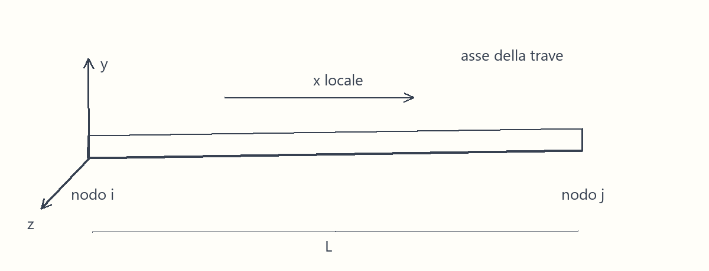

La linea del beam rappresenta un riferimento strutturale. Non usare la sola linea inferiore del disegno come asse senza verificare l'eccentricità rispetto alla sezione. Cambiare il verso i-j richiede controllare assi, carichi locali e convenzioni dei risultati.

### Sistema locale e globale

Il sistema globale permette di assemblare elementi orientati diversamente. Il sistema locale permette di descrivere la risposta assiale e le due flessioni della singola trave. La trasformazione tra i due è una rotazione delle componenti, non una modifica del fenomeno fisico. Le inerzie Iy e Iz devono corrispondere alla sezione orientata nei rispettivi assi locali.

Definisci sempre una terna destrorsa. L'asse x coincide normalmente con i-j; gli altri due assi dipendono dalla regola di orientamento adottata dal solutore. Una trave verticale richiede particolare attenzione: una regola basata su un vettore parallelo alla trave può diventare indeterminata. Visualizza la terna e controllala su un elemento rappresentativo prima di assegnare carichi locali a un gruppo.

### Gradi di libertà

Nel beam spaziale classico ogni nodo ha tre traslazioni e tre rotazioni. Le dodici componenti dell'elemento descrivono movimento assiale, due flessioni e torsione. Un modello piano ne conserva normalmente tre per nodo: due traslazioni e una rotazione. Formulazioni con ingobbamento possono aggiungere altre incognite: non assumere che tutti i beam abbiano esattamente gli stessi gradi di libertà.

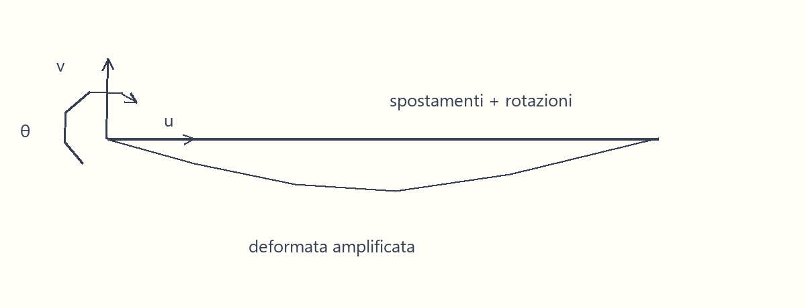

Una rotazione nodale è un'incognita cinematica. Non equivale sempre alla pendenza della linea deformata: questa uguaglianza vale nella cinematica Euler-Bernoulli, mentre nel modello Timoshenko la differenza rappresenta la deformazione a taglio.

### Rigidezza assiale

```math
k_a = \frac{EA}{L}
\delta = \frac{NL}{EA}
```

E è il modulo elastico, A l'area resistente e L la lunghezza; N è uno sforzo assiale costante. Con E in N/mm², A in mm² e L in mm, kₐ è in N/mm e δ in mm. La seconda espressione vale per un'asta prismatica elastica con forza costante. Raddoppiare la lunghezza dimezza la rigidezza e raddoppia l'allungamento, a parità di N, E e A.

Un'area sovrastimata irrigidisce il percorso assiale e può attirare carico da elementi paralleli. In un sistema iperstatico non basta che la verifica della singola sezione sia soddisfatta: la distribuzione delle azioni dipende dalle rigidezze relative.

### Dalla cinematica alla matrice

Nel problema flessionale piano Euler-Bernoulli le incognite di un elemento a due nodi sono spostamento trasversale e rotazione ai due estremi. L'interpolazione cubica di Hermite garantisce continuità di spostamento e pendenza. Indicando con $B$ la matrice delle derivate seconde delle funzioni di forma e con $K_e$ la matrice di rigidezza elementare:

```math
K_e=\int_0^LB^T EI B\,dx
```

La matrice trasforma spostamenti e rotazioni nodali nelle azioni nodali elastiche. Il carico distribuito deve entrare anche nel vettore nodale coerente: applicare soltanto metà della risultante a ogni nodo può perdere le coppie equivalenti. Un elemento libero possiede moti rigidi; la singolarità scompare soltanto con vincoli fisicamente sufficienti, non aumentando artificialmente la rigidezza.

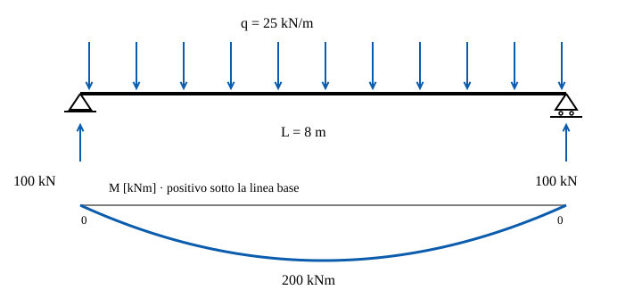

Nello schema, il momento positivo tende le fibre inferiori. L'area sotto il carico è 200 kN e coincide con la somma delle reazioni. Il diagramma nullo agli appoggi è una verifica indipendente dei rilasci terminali. L'esempio è statico, elastico e del primo ordine; non rappresenta fessurazione, viscosità o variazioni di rigidezza.

La formulazione variazionale e l'interpolazione sono quelle classiche dell'elemento trave di Euler–Bernoulli. Il segno di curvatura può differire fra testi: la relazione costitutiva deve essere letta con la stessa convenzione del momento, senza combinare definizioni provenienti da solutori diversi.

### Flessione

```math
\kappa = \frac{M}{EI}
\sigma = \frac{M}{W}
```

κ è la curvatura elastica, M il momento e I l'inerzia rispetto all'asse di flessione. W è il modulo resistente elastico relativo alla fibra considerata. Con M in Nmm e EI in Nmm², κ è in 1/mm; σ risulta in N/mm². La formula della tensione descrive una sezione omogenea in regime elastico e non sostituisce la verifica non lineare di una sezione in c.a.

Le componenti della matrice flessionale contengono termini proporzionali a EI/L³, EI/L² ed EI/L: traslazioni e rotazioni hanno unità differenti. Non confrontare direttamente i numeri di due termini senza considerare le relative incognite. Nei telai, la rigidezza flessionale governa anche la ripartizione dei momenti fra travi e pilastri.

### Taglio

Il taglio è la risultante delle tensioni tangenziali sulla sezione. Nel modello Timoshenko la rigidezza trasversale è rappresentata da GAs, dove G è il modulo a taglio e As un'area efficace dipendente dalla formulazione e dalla forma della sezione. L'area efficace non coincide necessariamente con l'area geometrica totale.

```math
\gamma = \frac{V}{GA_s}
```

V è la forza di taglio e γ la deformazione angolare, adimensionale. Trascurare questa deformazione può sottostimare gli spostamenti di travi corte, sezioni con anima deformabile o materiali con basso modulo a taglio. La presenza di un risultato V nel solutore non dimostra che la deformabilità a taglio sia stata inclusa: anche un beam Euler-Bernoulli fornisce il taglio per equilibrio.

### Torsione

```math
\theta = \frac{TL}{GJ}
```

Per una barra prismatica in torsione uniforme di Saint-Venant, T è il momento torcente e J la costante torsionale; con unità coerenti θ è una rotazione in radianti. J non coincide generalmente con il momento polare d'inerzia: l'identificazione è corretta per sezioni circolari, ma può essere gravemente errata per sezioni aperte sottili.

Il beam ordinario non descrive automaticamente bimomento, torsione non uniforme e ingobbamento impedito. Vicino a un incastro o a un diaframma può essere necessario un modello con ingobbamento oppure una modellazione locale shell. Se il carico non passa per il centro di taglio, controlla la torsione generata dall'eccentricità.

### Euler-Bernoulli e Timoshenko

Euler-Bernoulli assume che le sezioni restino piane e ortogonali all'asse deformato, trascurando la deformazione a taglio. Timoshenko mantiene una rotazione di sezione indipendente dalla pendenza della linea d'asse e include il contributo a taglio. La scelta dipende dalla precisione richiesta e dal rapporto fra contributi deformativi; non esiste un unico rapporto L/h che renda corretto ogni modello.

| Aspetto | Euler-Bernoulli | Timoshenko |
| --- | --- | --- |
| Cinematica | Rotazione legata alla pendenza | Rotazione indipendente |
| Taglio deformabile | Trascurato | Incluso mediante area efficace |
| Controllo | Adeguatezza della snellezza e delle ipotesi | Parametri di taglio e possibili fenomeni di locking |

Un elemento numerico mal formulato può diventare artificialmente rigido nel limite di trave snella: è il locking a taglio. Raffinare la mesh senza comprendere il fenomeno non è sempre sufficiente. Verifica il benchmark della formulazione e confronta una soluzione analitica coerente con le stesse ipotesi.

### Proprietà della sezione

L'area governa la risposta assiale; Iy e Iz governano le flessioni; J governa la torsione di Saint-Venant; le aree efficaci governano il taglio deformabile. Il baricentro e il centro di taglio descrivono riferimenti differenti. Per sezioni non simmetriche occorre considerare anche il prodotto d'inerzia o usare assi principali.

Nel c.a. l'inerzia geometrica integra non è automaticamente la rigidezza efficace di esercizio di una sezione fessurata. Per sezioni composte, la rigidezza dipende da materiali, omogeneizzazione, collaborazione e fasi. Specifica la rigidezza adottata nel modello globale e non scambiarla con la resistenza ultima calcolata separatamente.

### Orientamento

Ruotare una sezione rettangolare di 90° scambia i ruoli delle due inerzie. Nel caso di una sezione b × h, l'inerzia rispetto all'asse parallelo alla base è bh³/12: il cubo dell'altezza rende l'orientamento decisivo. Il disegno della sezione e la freccia del carico devono essere coerenti con gli assi usati per i risultati.

Controlla il segno dei momenti dopo ogni cambio di orientamento. Nella sezione in c.a. Anthea, il piano della sezione è x-y e Mx è associato alla coordinata y; non coincide automaticamente con la terna x-y-z di un beam, il cui x è longitudinale. Il trasferimento richiede una mappatura esplicita.

### Offset ed eccentricità

Un offset collega il nodo alla sezione terminale tramite un tratto rigido o una trasformazione cinematica. Non equivale a spostare soltanto il disegno. Trasferisce anche momenti quando la risultante di forza agisce fuori dal riferimento. Una forza F con eccentricità e introduce una coppia di modulo Fe nel caso piano.

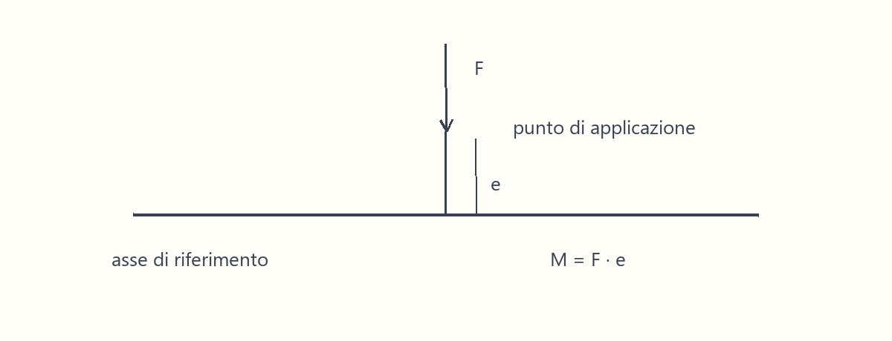

Usare contemporaneamente un offset rigido e una coppia già inclusa nei carichi può contare due volte l'eccentricità. Controlla il punto rispetto al quale sono fornite le azioni. Non modellare come rigidissimo un collegamento realmente deformabile solo per risolvere un problema di connettività.

### Releases

Una release elimina il trasferimento di una specifica azione terminale rendendo libero il grado di libertà coniugato. Una cerniera flessionale non elimina per forza taglio, sforzo normale e torsione. In un modello spaziale occorre dire quale rotazione è rilasciata e rispetto a quale asse.

Rilasciare la stessa rotazione su tutti gli elementi di un nodo senza un controllo dei vincoli può creare un meccanismo. Il messaggio di matrice singolare è una conseguenza del modello: non va eliminato aggiungendo molle arbitrarie. Disegna la cinematica consentita e controlla che non esista uno spostamento rigido senza energia.

### Discretizzazione

Inserisci nodi dove cambiano carico, sezione, connessione o vincolo. Per carichi uniformi usa il vettore di carico coerente previsto dall'elemento, anziché sostituire il carico con forze concentrate senza verificarne l'equivalenza. Una mesh più fitta migliora alcune approssimazioni, ma non corregge un vincolo sbagliato o un'ipotesi costitutiva inadatta.

Confronta almeno due discretizzazioni e osserva la stabilizzazione delle grandezze decisive: freccia, reazioni, momenti critici. Il numero di elementi necessario dipende dall'interpolazione e dal risultato cercato. Una soluzione nodale esatta in un caso particolare non garantisce la ricostruzione esatta di tutto il diagramma interno.

### Risultati FEM

Prima delle tensioni controlla deformata e reazioni. Le reazioni devono equilibrare le azioni esterne; la deformata deve rispettare i vincoli; il percorso dei carichi deve essere plausibile. Poi leggi N, Vy, Vz, T, My e Mz nel sistema dichiarato dal solutore.

Le azioni terminali, le azioni sulle facce di una sezione e le risultanti interne possono usare segni diversi. Un salto del diagramma di taglio può essere fisico in corrispondenza di una forza concentrata. Una discontinuità di momento senza coppia applicata richiede invece controllare la ricostruzione, il verso e la connettività.

### Convenzioni di segno

Indica su uno schizzo un momento positivo e le fibre che comprime. Definisci il verso positivo dello sforzo normale. Nell'interfaccia corrente della sezione in c.a. Anthea usa N negativo a compressione; gli archivi precedenti con compressione positiva vengono migrati dal workspace. Il motore legacy può adottare una convenzione diversa da quella esposta nella UI. Confronta il riferimento del solutore FEM e quello della scheda, converti il segno una volta nel passaggio dei dati e mantieni traccia del riferimento originale.

Le verifiche biassiali richiedono conservare l'accoppiamento fra N, Mx e My della stessa combinazione. Non comporre una terna prendendo separatamente i massimi assoluti da combinazioni diverse senza dichiarare la scelta conservativa e controllarne il significato fisico.

### Limiti del modello

Un beam non risolve automaticamente concentrazioni di tensione, diffusione su appoggi, instabilità locale di piastre, ovalizzazione o dettagli delle saldature. Un modello elastico del primo ordine non include da solo plasticità, fessurazione evolutiva, grandi rotazioni e instabilità geometrica. Ogni estensione richiede una formulazione e parametri coerenti.

Quando una zona locale governa, usa un modello dedicato e condizioni al contorno derivate dal modello globale. Il passaggio beam-shell-solid richiede compatibilità del trasferimento di forza e momento: collegare un solo nodo può non rappresentare il comportamento del giunto reale.

### Errori comuni

> ERRORI COMUNI
> Nodi coincidenti ma scollegati; elementi duplicati che raddoppiano la rigidezza; inerzie scambiate; J sostituito dal momento polare; release che generano un meccanismo; metri mescolati a millimetri; carico locale applicato nel verso globale; offset ed eccentricità conteggiati due volte.

Per trovare un errore riduci il modello al percorso coinvolto. Applica un carico unitario, visualizza la deformata e confronta le reazioni con l'equilibrio. Un risultato numerico convergente può essere perfettamente coerente con un modello fisicamente sbagliato.

### Regole pratiche

> REGOLA PRATICA
> Prima verifica equilibrio, connettività e assi; poi raffina la mesh. Usa una trave appoggiata o una mensola come controllo della catena unità-carichi-rigidezza. Queste sono procedure di controllo del modello e non verifiche normative.

Per la trave appoggiata prismatica elastica, il momento massimo cresce con L² e la freccia flessionale con L⁴ a carico lineare costante. Piccole modifiche della luce possono quindi influenzare gli spostamenti più dei momenti. Questo ordine di grandezza aiuta a individuare errori di scala, ma non sostituisce il calcolo del sistema effettivo.

### Esempio concettuale

Considera una trave semplicemente appoggiata di luce L = 8 m con carico uniforme q = 25 kN/m. Per questo esempio q è già un'azione di progetto assegnata: non stiamo ricavando una combinazione normativa. Le reazioni sono ciascuna qL/2 = 100 kN; la somma 200 kN equilibra il carico totale.

```math
M_{\max} = \frac{qL^2}{8} = \frac{25\cdot8^2}{8} = 200\ \mathrm{kN\,m}
V_{app} = \frac{qL}{2} = 100\ \mathrm{kN}
```

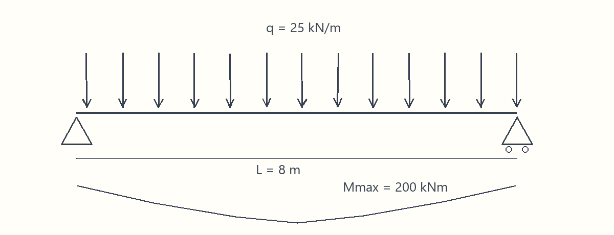

Per una sezione rettangolare integra b = 600 mm e h = 800 mm, $I = \frac{bh^3}{12} = 25{,}6\cdot10^9\ \mathrm{mm^4}$. Se si assume, solo per il controllo elastico del modello, E = 30.000 N/mm², la freccia flessionale è $v_{\max} = \frac{5qL^4}{384EI} \simeq 1{,}74\ \mathrm{mm}$, usando q = 25 N/mm e L = 8.000 mm. È la freccia del modello omogeneo non fessurato: non è una verifica SLE del c.a.

Confronta la reazione e il momento analitico con il modello beam. Poi trasferisci la terna N = 0, Mx = 200 kNm, My = 0 a una sezione in c.a. la cui altezza è lungo y. Il valore 200 kNm deve essere associato all'asse della sezione che produce compressione e trazione lungo l'altezza. Il segno definisce quale bordo è compresso.

### Interazione con Anthea

Il pulsante Apri esempio crea una Sezione in c.a. con geometria rettangolare 600 × 800 mm, materiale C35/45 e armature iniziali del modulo: 4Ø20 superiori, 6Ø24 inferiori, 2Ø16 per lato, staffe Ø10/200 e copriferro netto 70 mm. La sola combinazione plastica contiene N = 0, Mx = 200 kNm, My = 0. Le altre famiglie restano vuote, perché non sono state definite azioni di esercizio o accidentali.

Questi valori costituiscono un esempio didattico, non una proposta esecutiva. Modifica l'altezza mantenendo luce e azione assegnata; osserva come cambiano dominio resistente e deformazioni di sezione. Modifica poi il segno di Mx per vedere il ruolo delle diverse armature ai due bordi. Il modulo verifica sezioni, non risolve la trave generale FEM né determina automaticamente il carico q.

[Guida del modulo Sezione in c.a.](/wiki/guide/moduli/sezione-ca)

### Riepilogo

Un beam concentra il comportamento di una struttura allungata in una linea con proprietà di sezione. La qualità del risultato dipende da cinematica, collegamenti, orientamento, rigidezze e unità. Verifica prima il comportamento globale; trasferisci poi azioni e convenzioni a una verifica locale appropriata. Raffinare una discretizzazione corretta e scegliere una formulazione adeguata sono due controlli distinti.

### Argomenti correlati

[Elementi Shell](/wiki/manuale/fem-e-modellazione/elementi-shell)

[Releases e connettività](/wiki/manuale/fem-e-modellazione/releases-e-connettivita)

[Instabilità delle aste compresse](/wiki/manuale/acciaio/instabilita-delle-aste-compresse)

### Riferimenti

- Il capitolo spiega un modello meccanico e non introduce coefficienti di verifica normativa. Le prescrizioni dei materiali e gli stati limite si consultano nella guida teorica globale, nelle sezioni dei moduli corrispondenti.

## Elementi Shell

Una shell descrive una superficie strutturale con comportamento membranale e flessionale. È utile per solette, pareti e piastre quando lo spessore è piccolo rispetto alle dimensioni nel piano e quando la variazione delle azioni nella superficie è decisiva. La superficie media sostituisce il volume, mentre lo spessore partecipa alle rigidezze di membrana e flessione in modo differente.

### Membrana e flessione

Le risultanti membranali sono forze per unità di lunghezza; le risultanti flessionali sono momenti per unità di lunghezza. Non importare un momento di piastra espresso in kNm/m come momento totale di una trave. Occorre dichiarare la striscia resistente e integrare il risultato sul tratto interessato. La somma delle azioni sulle strisce deve restare coerente con equilibrio e percorso del carico.

### Assi e connessioni

La normale locale distingue le facce superiore e inferiore. Normali invertite possono cambiare la lettura dei segni senza cambiare la fisica. Controlla la continuità della mesh, le connessioni con beam e la rappresentazione degli appoggi. Un bordo vincolato su tutte le rotazioni può irrigidire artificialmente una soletta appoggiata.

### Errori e limiti

Un carico puntuale o un vincolo puntuale possono generare picchi che crescono al raffinarsi della mesh. La convergenza della reazione globale non garantisce la convergenza della tensione puntuale. Rappresenta la superficie di contatto reale quando la verifica locale lo richiede. Una shell non sostituisce automaticamente un modello tridimensionale dei nodi massicci.

### Riepilogo

Scegli la shell quando devi descrivere distribuzioni nella superficie; mantieni espliciti assi, spessore, unità delle risultanti e trasferimento ai dettagli. Anthea non dispone di un solutore shell generale: questa pagina aiuta a interpretare dati provenienti da un modello esterno.

### Controllo delle unità e fonte

Se il momento di piastra è uniforme e pari a 12 kNm/m, una striscia larga 2,5 m porta 30 kNm. Per una distribuzione variabile occorre integrare lungo la striscia. Le componenti di membrana vanno distinte da quelle flessionali; le convenzioni specifiche vanno lette nella documentazione del solutore di origine. Un carico concentrato può rendere la tensione locale dipendente dalla mesh.

## Releases e connettività

La connettività stabilisce quali incognite sono condivise fra elementi; una release stabilisce quali azioni non vengono trasmesse a un'estremità. Queste due decisioni determinano il percorso dei carichi prima ancora di assegnare una rigidezza.

### Controllare un nodo

Individua sul disegno le traslazioni e rotazioni possibili, quindi verifica se il modello permette proprio quei movimenti. Una cerniera ideale nel piano trasmette due forze e non trasmette il momento coniugato alla rotazione libera. Un link elastico trasmette una forza proporzionale allo spostamento relativo: una rigidezza enorme è un'approssimazione che può peggiorare il condizionamento numerico.

### Meccanismi e collegamenti rigidi

Se una parte può muoversi rigidamente senza deformare nessun elemento, il modello ha un meccanismo. Non correggerlo con una molla casuale. Verifica prima i vincoli fisici e le release. Al contrario, troppe connessioni rigide possono impedire deformazioni reali e generare azioni spurie. Un collegamento rigido deve trasferire anche i momenti prodotti dal braccio geometrico.

### Riepilogo

Confronta il modello numerico con uno schizzo cinematico. Usa un carico unitario per verificare il movimento consentito e la distribuzione delle reazioni. Conserva una descrizione delle ipotesi del nodo accanto ai risultati.

### Riferimento del modello

Nel modello a telaio piano ogni nodo ha due traslazioni e una rotazione; le rigidezze degli elementi si assemblano su queste incognite. Questa pagina riguarda l’interpretazione del modello esterno: non introduce un editor generale di release in Anthea.

## Instabilità delle aste compresse

Un'asta compressa può perdere stabilità senza che tutta la sezione raggiunga la resistenza del materiale. Una piccola deviazione laterale produce un momento aggiuntivo dovuto alla forza assiale; il momento aumenta la deviazione, che a sua volta amplifica il momento. La rigidezza flessionale contrasta questa retroazione.

### Modello di Eulero

Si considera un'asta rettilinea prismatica, elastica, caricata al baricentro, con rigidezza costante e piccoli spostamenti all'innesco dell'instabilità. La forza di compressione $N$ è positiva in questa pagina; non è la convenzione della scheda Sezione in c.a. Le estremità ideali impediscono la traslazione trasversale ma permettono la rotazione; una consente lo scorrimento assiale.

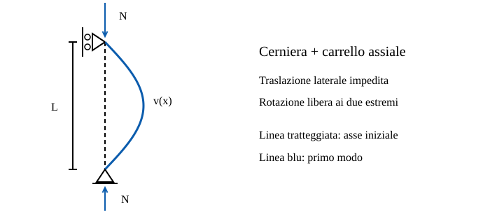

L'equilibrio linearizzato nella configurazione deformata conduce al problema agli autovalori seguente. $x$ misura la distanza lungo l'asta e $v$ lo spostamento trasversale; gli apici indicano derivate rispetto a $x$.

```math
EI v''''+N v''=0
v(0)=v(L)=v''(0)=v''(L)=0
v_n(x)=a_n\sin\left(\frac{n\pi x}{L}\right)
N_n=\frac{n^2\pi^2 EI}{L^2}
```

Il primo autovalore positivo corrisponde a $n=1$. L'ampiezza $a_n$ resta indeterminata nell'analisi lineare: un grafico del modo non è una previsione dello spostamento reale. La forma generalizzata con lunghezza efficace è:

```math
N_{cr} = \frac{\pi^2 EI}{L_0^2}
```

E è il modulo elastico, I l'inerzia nel piano della deformata e L₀ la lunghezza efficace. Con E in N/mm², I in mm⁴ e L₀ in mm, Ncr è in N. La formula descrive una biforcazione elastica di un'asta ideale; non è direttamente la resistenza di progetto di un'asta reale imperfetta. Raddoppiare L₀ riduce il carico critico a un quarto.

### Lunghezza libera di inflessione

L₀ rappresenta il vincolo efficace nel modo di instabilità considerato, non semplicemente la lunghezza disegnata. Per un'asta ideale isolata incernierata a entrambe le estremità coincide con la lunghezza fra cerniere. Per telai e vincoli elastici dipende dal comportamento del sistema. Un ritegno è efficace solo se ha rigidezza, resistenza e percorso del carico adeguati.

| Simbolo | Significato | Unità nell'esempio |
| --- | --- | --- |
| $E$ | Modulo elastico longitudinale | N/mm² |
| $I$ | Inerzia nel piano del modo | mm⁴ |
| $A$ | Area della sezione | mm² |
| $L$ | Distanza fra i vincoli | mm |
| $K$ | Fattore di lunghezza efficace | adimensionale |
| $L_0=KL$ | Lunghezza efficace | mm |
| $N_{cr}$ | Carico di biforcazione | N |
| $i=\sqrt{I/A}$ | Raggio d'inerzia | mm |
| $\lambda=L_0/i$ | Snellezza geometrica | adimensionale |

Per aste isolate con vincoli ideali, $K=1$ per cerniera-carrello, $K=2$ per incastro-estremo libero e $K=0{,}5$ per due incastri senza traslazione relativa. Questi valori non si trasferiscono automaticamente a una colonna di telaio: la rotazione dei nodi e la traslazione di piano modificano il modo.

### Snellezza e tensione critica

```math
\sigma_{cr}=\frac{N_{cr}}{A}=\frac{\pi^2E}{\lambda^2}
```

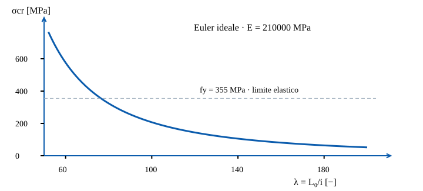

La tensione critica cala con il quadrato della snellezza. Il confronto con lo snervamento è un controllo di campo, non una curva normativa di resistenza: tensioni residue e imperfezioni riducono la capacità prima della previsione ideale.

### Esempio numerico verificabile

Si assegnano $E=210000\,\mathrm{N/mm^2}$, $I=8\cdot10^6\,\mathrm{mm^4}$, $A=4000\,\mathrm{mm^2}$, $L=4000\,\mathrm{mm}$ e $K=1$. L'inerzia è un dato didattico riferito al piano studiato, non una sezione commerciale selezionata.

```math
N_{cr}=\frac{\pi^2\cdot210000\cdot8\cdot10^6}{4000^2}
N_{cr}=1036308\,\mathrm{N}=1036{,}31\,\mathrm{kN}
i=44{,}72\,\mathrm{mm}
\lambda=89{,}44
\sigma_{cr}=259{,}08\,\mathrm{MPa}
```

Con $f_y=355\,\mathrm{MPa}$ la tensione critica resta sotto lo snervamento, condizione necessaria ma non sufficiente per applicare il modello ideale a un'asta reale. Se il medesimo elemento è una mensola con $K=2$, il carico critico scende a $259{,}08\,\mathrm{kN}$. Confondere i vincoli produce qui un errore di fattore quattro.

### Dalla teoria alla verifica

Disegna i ritegni nei due piani, scegli le rispettive inerzie e determina il modo governante. Solo dopo valuta la procedura normativa applicabile: imperfezioni, analisi del secondo ordine, classificazione della sezione e instabilità locale possono richiedere controlli distinti. L'instabilità flesso-torsionale, spesso indicata LTB, riguarda accoppiamento di spostamento laterale e torsione di un elemento inflesso: non si verifica sostituendo semplicemente un'inerzia nella formula di Euler.

La derivazione è il modello teorico classico della biforcazione elastica. Le verifiche dell'acciaio ricadono nel quadro NTC ed Eurocodice 3 adottato dal progetto; qui non sono assegnati coefficienti parziali o curve di buckling normative. Bibliografia per approfondire: Timoshenko e Gere, *Theory of Elastic Stability*, stabilità delle aste.

### Errori comuni

> ATTENZIONE
> Il carico critico elastico non include automaticamente imperfezioni, tensioni residue, plasticità e instabilità locale. La verifica normativa richiede il metodo applicabile al materiale e al sistema. La presente versione di Anthea non contiene un modulo autonomo Instabilità dell'acciaio.

### Riepilogo

Controlla il piano debole, i ritegni reali e il modo di instabilità. L'area da sola non descrive la vulnerabilità: due aste con la stessa area possono avere inerzie e capacità di stabilità molto differenti. Cerca anche i termini buckling, snellezza ed Euler nella Wiki per trovare i riferimenti presenti nelle guide globali.

## Fondamenti del percorso dei carichi

Il primo controllo di un modello strutturale è il percorso del carico dalla sua applicazione fino ai vincoli. Una soletta trasferisce il carico alle travi; le travi a pilastri o pareti; questi alle fondazioni e al terreno. Ogni passaggio richiede equilibrio e compatibilità delle deformazioni.

### Equilibrio e rigidezza

Le reazioni equilibrano risultanti e momenti dei carichi esterni. Nei sistemi isostatici l'equilibrio determina le reazioni; nei sistemi iperstatici intervengono anche rigidezze e compatibilità. Irrigidire un elemento può aumentare la quota di carico che gli compete, anche se il carico totale non cambia. Una verifica locale non dimostra quindi da sola la correttezza della ripartizione globale.

### Modello e verifica

Il modello calcola azioni e spostamenti nel quadro delle proprie ipotesi. La verifica confronta domande e capacità per specifici meccanismi e stati limite. Dichiarare materiale, geometria, vincoli, carichi, unità e convenzioni permette di controllare il trasferimento fra i due. Mantieni separati risultati elastici, predimensionamento e verifica di resistenza.

### Riepilogo

Prima di leggere un coefficiente di utilizzo, controlla dove passa il carico e quale meccanismo rappresenta il calcolo. Confronta sempre un equilibrio globale e un ordine di grandezza indipendente con i risultati del software.

## Azioni e combinazioni del modello

Una combinazione raccoglie azioni che possono agire insieme nel contesto dello stato limite considerato. Il valore di un carico assegnato non dice da solo se sia caratteristico, rappresentativo o di progetto. Prima di inserire N, M e V nel modulo, annota la provenienza della combinazione e i fattori già applicati.

### Percorso dal carico alla domanda

Il peso proprio dipende dalla geometria e dal peso per unità di volume. Un carico di superficie va trasformato in carico lineare dichiarando la larghezza tributaria. La trasformazione di unità non applica coefficienti di sicurezza: passare da kN/m a N/mm conserva lo stesso valore numerico, mentre passare da kNm a Nmm moltiplica per un milione.

La terna N-Mx-My deve provenire dalla stessa sezione e dalla stessa combinazione. Un inviluppo può essere utile per individuare sezioni critiche, ma gli estremi di componenti diverse non sono necessariamente simultanei. Conserva l'identificativo della combinazione originale per poter ricostruire il risultato.

### Stati limite distinti

Resistenza, deformazione, fessurazione e fatica rispondono a domande differenti. Una combinazione di progetto per resistenza non è automaticamente una combinazione di esercizio. Le famiglie di azione disponibili nel modulo vanno compilate solo quando sono state definite nel modello: non duplicare una terna in ogni famiglia per riempire le tabelle.

### Errori comuni e riferimenti

> ERRORI COMUNI
> Moltiplicare nuovamente un'azione già fattorizzata; includere due volte il peso proprio; confondere carico superficiale e lineare; usare un inviluppo di massimi indipendenti come se fosse una combinazione reale.

Per la definizione delle combinazioni usa il quadro normativo applicabile, i parametri nazionali e la destinazione d'uso. Questo capitolo non assegna coefficienti normativi. Il riferimento italiano di base è il DM 17 gennaio 2018; le opzioni e i limiti della singola verifica sono descritti nei capitoli dei moduli della guida globale.

Le combinazioni generate da ANTHEA seguono la NTC 2018, §2.5.3: coefficienti parziali della tabella 2.6.I (EQU, A1, A2) e coefficienti $\psi$ della tabella 2.5.I per categoria. La libreria conserva anche i valori raccomandati della EN 1990 (tabelle A1.1 e A1.2) per una futura scelta degli Eurocodici con una norma di progetto; oggi la norma delle combinazioni non si sceglie.

## Dinamica e sisma del modello

La risposta dinamica dipende da come massa e rigidezza sono distribuite e da come l'azione varia nel tempo. Un modello corretto per un carico statico può essere incompleto per un'analisi dinamica se mancano masse, collegamenti o gradi di libertà rilevanti.

### Massa rigidezza e modi

Una forma modale descrive un movimento possibile del sistema linearizzato; la frequenza associata dipende da rigidezza e massa. Nel singolo oscillatore elastico non smorzato, T = 2π√(m/k), con unità coerenti. Raddoppiare la massa aumenta il periodo di un fattore √2, mentre raddoppiare la rigidezza lo riduce dello stesso fattore. In un sistema con molti gradi di libertà bisogna considerare i modi che partecipano alla direzione del carico.

La deformata modale è scalata convenzionalmente: la sua ampiezza grafica non è uno spostamento sismico di progetto. Controlla le masse effettivamente assegnate, le direzioni dei modi e l'effetto dei vincoli. Una rotazione locale inattesa può rivelare una release o una connessione non coerente.

### Azione e risposta

Uno spettro collega la risposta di oscillatori alla loro frequenza e allo smorzamento assunto. Un accelerogramma descrive invece una storia temporale: passo, unità, durata e trattamento del segnale influenzano l'analisi. Lo smorzamento non va aggiunto soltanto per ridurre un picco indesiderato; deve rappresentare un'ipotesi motivata del modello.

### Limiti e applicazione

Un'analisi modale elastica non dimostra capacità dissipativa, duttilità dei dettagli o stabilità durante grandi spostamenti. Anthea non espone un solutore dinamico generale; eventuali procedure sismiche o Newmark dei muri hanno campo e input specifici, documentati nei relativi capitoli. Per spettro, combinazioni e verifiche usa la normativa applicabile, senza trasferire coefficienti da un meccanismo all'altro.

### Controllo dell’oscillatore

Per m = 1000 kg e k = 40000 N/m si ottengono frequenza angolare 6,3246 rad/s e periodo 0,99346 s. Con massa raddoppiata il periodo diventa 1,40496 s. Questo è un oscillatore elastico non smorzato, non lo spettro di progetto di un sito.

```math
\omega_n=\sqrt{\frac{k}{m}}
T=\frac{2\pi}{\omega_n}
```

È la soluzione classica dell'oscillatore semplice non smorzato. I coefficienti normativi e lo smorzamento vanno definiti separatamente.

## Fasi costruttive e percorso dei carichi

La struttura durante il montaggio può lavorare in modo diverso dalla struttura completata. Un puntello, un getto successivo o la collaborazione di una soletta modificano i vincoli e le rigidezze disponibili quando il carico viene applicato. Per questo l'ordine delle fasi fa parte del modello, non soltanto del programma dei lavori.

### Carichi e sezioni attive

In una trave composta, il peso del calcestruzzo fresco può essere portato dall'acciaio prima che la soletta collabori. I carichi successivi agiscono su una sezione diversa. Sommare tutti i carichi e applicarli direttamente alla sezione finale può sottostimare tensioni accumulate nella parte inizialmente resistente.

Dichiara per ciascuna fase elementi attivi, vincoli, materiali, carichi introdotti e carichi rimossi. Il disarmo e la rimozione di un appoggio provvisorio producono ridistribuzioni. La deformazione già maturata non è necessariamente cancellata dalla modifica del sistema.

### Fenomeni differiti

Ritiro e viscosità dipendono dal tempo e dalla storia di carico; nella sezione composta possono produrre tensioni interne anche senza aumentare la risultante esterna. Un coefficiente di omogeneizzazione unico non descrive automaticamente tutte le fasi. Controlla età, durata e metodo previsto dal modulo.

### Controlli e riepilogo

> REGOLA PRATICA
> Scrivi una tabella delle fasi prima di compilare il modello. Per ogni carico identifica la sezione che lo porta al momento dell'applicazione e il percorso fino agli appoggi disponibili.

Il modulo Sezione composta da ponte di Anthea documenta l'analisi per fasi nella guida globale. I dettagli costruttivi, i vincoli provvisori e le verifiche del montaggio richiedono comunque i dati del progetto reale. Una verifica favorevole della configurazione finale non implica che ogni fase intermedia sia sicura.

### Riferimento e campo

Il modello distingue la fase non puntellata, in cui l’acciaio sostiene il calcestruzzo fresco, dalla fase composta. Non sostituisce le norme applicabili al ponte né verifica puntelli, stabilità laterale o procedure di montaggio del progetto concreto.

## Cos'è un ponte?

Un ponte mantiene la continuità di un percorso sopra un ostacolo lasciando uno spazio libero sottostante. La scelta strutturale parte da questo spazio: posizione degli appoggi, franco richiesto, terreno e accesso al cantiere definiscono le possibilità prima del dimensionamento delle travi.

### Leggere l'opera prima del modello

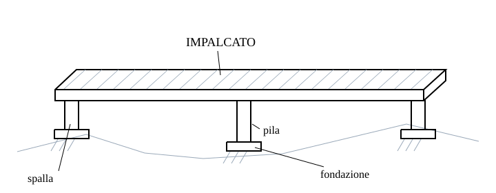

L'impalcato sostiene il piano viabile. Soletta, travi longitudinali, traversi e diaframmi ne distribuiscono le azioni; pile e spalle le trasferiscono alle fondazioni. Gli appoggi costituiscono l'interfaccia meccanica fra impalcato e sottostruttura. I giunti consentono movimenti relativi del piano viabile: non sono appoggi e non si modellano come sostegni verticali.

La luce si misura fra i riferimenti strutturali degli appoggi della campata; la lunghezza totale dell'opera comprende più campate e dipende dalla convenzione geometrica adottata. Nel disegno di calcolo annota entrambi i riferimenti: una quota architettonica fra facce non coincide necessariamente con la luce fra assi.

### Seguire il carico

Una ruota produce una domanda locale nella soletta; la soletta la ripartisce alle travi secondo rigidezze e geometria. Gli appoggi raccolgono reazioni concentrate, le pile portano azioni assiali e momenti, le fondazioni mobilitano il terreno. Il modello a trave equivalente condensa questo percorso, ma perde la distribuzione trasversale e gli effetti locali.

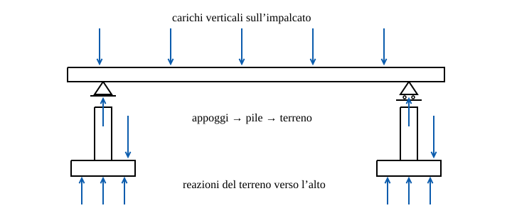

Per frenatura, temperatura e sisma il percorso cambia. Un appoggio mobile longitudinalmente non riceve nel modello ideale la stessa forza di un appoggio fisso; l'attrito e la rigidezza reali possono rendere meno netta questa distinzione. Occorre una pianta dei vincoli che mostri anche le direzioni libere. Un ritegno orizzontale senza fondazione capace di riceverne la reazione non completa il percorso resistente.

### Forma strutturale e conseguenze

| Sistema | Meccanismo prevalente | Decisione da esplicitare |
| --- | --- | --- |
| Travata | Flessione e taglio | Continuità, controventi e rigidezza trasversale |
| Arco | Compressione con possibili momenti | Destinazione della spinta orizzontale |
| Reticolare | Azioni assiali nelle aste del modello ideale | Eccentricità e comportamento dei nodi reali |
| Strallato | Stralli tesi e impalcato compresso/inflesso | Tesatura e sequenza di attivazione |
| Sospeso | Funi principali tese, pendini e trave irrigidente | Ancoraggi e risposta ai carichi non simmetrici |

Questa classificazione descrive il meccanismo, non prescrive intervalli universali di luce. Un cassone è una forma di sezione, non un sistema alternativo alla travata: può far parte di una travata, di un ponte strallato o di un ponte ad arco.

### Il ponte durante la costruzione

Prima del getto della soletta collaborante una trave metallica ha rigidezza, peso portato e ritegni diversi da quelli finali. Nei conci a sbalzo l'avanzamento modifica lo schema a ogni fase; la chiusura introduce continuità. Un'analisi della sola configurazione finale non ricostruisce la storia tensionale. Individua sezioni attive, appoggi provvisori e carichi di montaggio nella stessa sequenza temporale.

### Dettagli che decidono la vita utile

L'acqua raccolta da un giunto può raggiungere testate, appoggi e pulvini. Il progetto deve permettere drenaggio, ispezione e sostituzione degli appoggi con un percorso temporaneo dei carichi. Non si deduce la durabilità dal solo copriferro: contano esposizione, accessibilità, protezioni e manutenzione programmata.

Durante un'ispezione un quadro fessurativo o una corrosione osservata costituiscono evidenze; la capacità residua richiede rilievi, modello e verifiche. La stessa lesione può avere interpretazioni diverse in una fase costruttiva e nell'esercizio definitivo.

### Dall'anatomia al progetto in Anthea

Prima del predimensionamento prepara uno schema degli appoggi, una sezione trasversale e una sequenza delle fasi. Nel modulo Bridge Design verifica poi le ipotesi della famiglia scelta: il confronto di alternative non sostituisce le verifiche locali, geotecniche o sismiche. Prosegui con [il percorso dei carichi](wiki:load-path), [gli elementi beam](wiki:beam) e con il capitolo sulle fasi costruttive.

Testi e figure di questa pagina sono originali.

## Fessurazione del calcestruzzo armato

Il controllo di apertura delle fessure è una verifica di esercizio. Una sezione può soddisfare la resistenza ultima e avere fessure incompatibili con il requisito assegnato. Il calcolo richiede tensioni di esercizio, geometria dell'armatura e zona efficace di calcestruzzo teso; non basta conoscere il momento resistente.

### Meccanismo e campo

Alla fessura il contributo teso del calcestruzzo è interrotto; l'aderenza trasferisce forza fra acciaio e calcestruzzo nei tratti adiacenti. Perciò la deformazione media dell'acciaio fra le fessure non coincide necessariamente con la deformazione nella sezione fessurata. Il tension stiffening rappresenta questa collaborazione media.

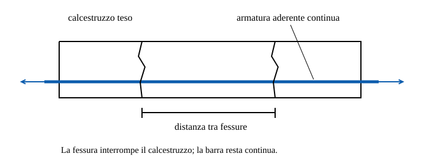

Le relazioni qui riportate riguardano la formulazione classica di EN 1992-1-1 (§7.3.4), per armatura ordinaria aderente, senza precompressione e con barre ravvicinate. È una relazione normativa empirico-meccanica, non una legge universale né una dichiarazione sull'edizione applicabile oggi al singolo progetto.

### Relazioni e simboli

```math
w_k=s_{r,max}(\varepsilon_{sm}-\varepsilon_{cm})
\rho_{eff}=\frac{A_s}{A_{c,eff}}
\alpha_e=\frac{E_s}{E_{cm}}
\Delta\varepsilon=\max\left(\frac{\sigma_s-k_t\frac{f_{ct,eff}}{\rho_{eff}}(1+\alpha_e\rho_{eff})}{E_s},\frac{0{,}6\sigma_s}{E_s}\right)
s_{r,max}=3{,}4c+0{,}425k_1k_2\frac{\phi}{\rho_{eff}}
```

| Simbolo | Definizione | Unità |
| --- | --- | --- |
| $w_k$ | Apertura caratteristica calcolata | mm |
| $s_{r,max}$ | Distanza massima convenzionale fra fessure | mm |
| $\Delta\varepsilon$ | Differenza delle deformazioni medie | adimensionale |
| $\sigma_s$ | Tensione di trazione nell'acciaio, sezione fessurata | MPa |
| $E_s,E_{cm}$ | Moduli elastici di acciaio e calcestruzzo | MPa |
| $f_{ct,eff}$ | Resistenza media a trazione al tempo di fessurazione | MPa |
| $A_s,A_{c,eff}$ | Area di armatura e area efficace tesa | mm² |
| $c,\phi$ | Copriferro dell'armatura considerata e diametro | mm |
| $k_t,k_1,k_2$ | Coefficienti di durata, aderenza e distribuzione deformativa | adimensionali |

Il copriferro della formula va riferito alle barre che controllano la fessura: non sostituire senza controllo il copriferro netto alla staffa impostato nella UI. In ANTHEA, con il campo «c barra» vuoto, c è il minimo copriferro libero delle barre efficaci verso la faccia tesa, misurato sulle barre. L'area efficace non è l'intera sezione né tutta la zona geometricamente tesa. Per flessione semplice della sezione rettangolare, la definizione classica limita l'altezza efficace con il minimo dei tre contributi seguenti, dove $d$ è l'altezza utile e $x$ la profondità dell'asse neutro dal bordo compresso:

```math
h_{c,eff}=\min\left(2{,}5(h-d),\frac{h-x}{3},\frac{h}{2}\right)
```

### Procedura per un caso ordinario

Identifica combinazione SLE, esposizione e requisito di apertura dal quadro normativo del progetto. Risolvi la sezione fessurata e determina l'armatura efficace. Controlla che l'interasse delle barre non superi $5(c+\phi/2)$ prima di usare la relazione di distanza qui mostrata. Per flessione semplice usa $k_2=0{,}5$, per trazione uniforme $k_2=1$; la trazione eccentrica con la sezione interamente tesa richiede la distribuzione delle deformazioni, $k_2=(\varepsilon_1+\varepsilon_2)/(2\varepsilon_1)$. Con l'asse neutro interno alla sezione, anche in presso- o tensoflessione, la sezione è inflessa e $k_2=0{,}5$, come in ANTHEA; sulle fasce interne dei fori ANTHEA usa invece la distribuzione locale delle deformazioni della fascia. Per barre ad aderenza migliorata $k_1=0{,}8$. Il coefficiente $k_t$ è 0,6 a breve e 0,4 a lunga durata nella formulazione citata.

### Esempio numerico

Dati assegnati: $\sigma_s=200\,\mathrm{MPa}$, $E_s=200000\,\mathrm{MPa}$, $E_{cm}=33000\,\mathrm{MPa}$, $f_{ct,eff}=2{,}9\,\mathrm{MPa}$, $\rho_{eff}=0{,}02$, $\phi=16\,\mathrm{mm}$, $c=30\,\mathrm{mm}$. Barre ad aderenza migliorata, flessione semplice, lunga durata e interasse 150 mm. L'area efficace è qui un dato assunto: l'esempio verifica le relazioni di apertura, non una sezione completa.

```math
\alpha_e=6{,}0606
\Delta\sigma=0{,}4\frac{2{,}9}{0{,}02}(1+6{,}0606\cdot0{,}02)=65{,}0303\,\mathrm{MPa}
\Delta\varepsilon=\max(0{,}00067485;0{,}00060000)=0{,}00067485
s_{r,max}=3{,}4\cdot30+0{,}425\cdot0{,}8\cdot0{,}5\frac{16}{0{,}02}=238\,\mathrm{mm}
w_k=238\cdot0{,}00067485=0{,}1606\,\mathrm{mm}
```

La soglia d'interasse è 190 mm: il ramo adottato è coerente con i 150 mm assegnati. Per un requisito ipotetico di 0,30 mm il valore calcolato sarebbe inferiore al limite; quel limite è un dato d'esempio, non una prescrizione valida per ogni ambiente. Il controllo non copre fessure da ritiro impedito, gradienti termici o dettagli non rappresentati.

### Limiti e confronto con il software

Armature rade, trazione integrale, sezioni non rettangolari, tendini e fasi iniziali richiedono le rispettive regole. Non estendere la formula ravvicinata a tutti questi casi. Nel motore Anthea esistono scelte implementative specifiche per regioni efficaci e ramo distante: la guida teorica della sezione le documenta separatamente, senza attribuirle automaticamente al testo normativo.

Apri [la guida del modulo](wiki:guida-sezione-ca) per le convenzioni degli input. Conserva nel report combinazione, parametri effettivi e ramo usato; un singolo numero di apertura non rende il risultato riproducibile.

## Capacità portante delle fondazioni superficiali

La capacità portante descrive il collasso del terreno sotto la fondazione. Non coincide con una pressione ammissibile universale: la stessa fondazione può raggiungere cedimenti incompatibili molto prima del collasso. Questa pagina sviluppa un riferimento statico per carico verticale centrato, terreno omogeneo e piano di posa orizzontale; non implementa un nuovo solutore Anthea.

### Geometria, drenaggio e azioni

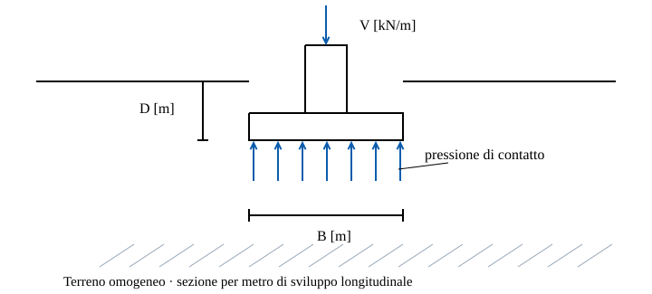

La risultante verticale deve comprendere i pesi pertinenti alla convenzione scelta. Distingui la pressione totale al contatto dalla pressione netta rispetto alla tensione preesistente alla quota di posa. Dichiarare una capacità netta e confrontarla con un'azione lorda altera il confronto. Prima dei coefficienti scegli il tipo di analisi: tensioni efficaci per condizioni drenate, tensioni totali e resistenza non drenata per il caso idealizzato non drenato.

### Struttura della relazione drenata

Per fondazione nastriforme ideale, terreno orizzontale e azione verticale centrata, la struttura classica della relazione è:

```math
q_{ult}=c'N_c+q'N_q+\frac{1}{2}\gamma'BN_\gamma
```

I tre termini rappresentano il contributo di coesione, sovraccarico efficace alla base e peso del terreno nel meccanismo. Le estensioni per forma, profondità, inclinazione del carico, base e pendio dipendono dal metodo scelto. In particolare $N_\gamma$ e i correttivi non vanno prelevati da autori diversi per costruire una formula ibrida. Qui non si propone una formulazione completa di Brinch Hansen.

| Simbolo | Definizione | Unità |
| --- | --- | --- |
| $q_{ult}$ | Pressione ultima lorda | kPa |
| $c'$ | Intercetta di resistenza in tensioni efficaci | kPa |
| $q'$ | Tensione verticale efficace alla quota di posa | kPa |
| $\gamma'$ | Peso efficace pertinente al terreno sotto base | kN/m³ |
| $B$ | Larghezza della fondazione nastriforme | m |
| $N_c,N_q,N_\gamma$ | Fattori del metodo dichiarato | adimensionali |
| $c_u$ | Resistenza non drenata | kPa |
| $D$ | Profondità del piano di posa | m |

Il simbolo $\gamma'$ non significa che tutta la zona sia necessariamente immersa: sopra falda occorre il peso appropriato, sotto falda il peso immerso. Una falda che attraversa il meccanismo richiede un trattamento coerente, non una media scelta senza giustificazione. Anche il sovraccarico alla base va costruito con tensioni efficaci nel caso drenato.

### Caso non drenato completamente specificato

Per una striscia su terreno omogeneo idealmente puramente coesivo, carico verticale centrato e correzioni geometriche non applicate, il riferimento limite è:

```math
\phi_u=0
N_q=1
N_\gamma=0
N_c=2+\pi
q_{ult,net}=(2+\pi)c_u
q_{ult,gross}=(2+\pi)c_u+q
```

Qui $q$ è il sovraccarico totale alla quota di posa, non $q'$ del modello drenato. Non sottrarre la pressione interstiziale una seconda volta da una resistenza espressa in tensioni totali. Il valore $2+\pi$ è riferito a questo modello limite e non si identifica con tutti i fattori chiamati $N_c$ in letteratura.

### Esempio per metro di fondazione

Assegna $c_u=50\,\mathrm{kPa}$, $B=2\,\mathrm{m}$, $D=1\,\mathrm{m}$ e peso totale del terreno sopra base $\gamma=18\,\mathrm{kN/m^3}$. Si modella l'interramento soltanto mediante sovraccarico uniforme, senza incremento di resistenza da profondità. La risultante applicata lorda è $V=400\,\mathrm{kN/m}$.

```math
q=\gamma D=18\,\mathrm{kPa}
q_{ult,net}=(2+\pi)50=257{,}08\,\mathrm{kPa}
q_{ult,gross}=257{,}08+18=275{,}08\,\mathrm{kPa}
q_{appl}=\frac{400}{2}=200\,\mathrm{kPa}
R_{ult}=q_{ult,gross}B=550{,}16\,\mathrm{kN/m}
```

La pressione applicata è inferiore alla pressione ultima ideale, ma questo confronto non costituisce una verifica SLU di progetto: non sono stati applicati coefficienti parziali, né esaminati eccentricità, scorrimento, stabilità globale e cedimenti. I valori permettono invece di controllare unità e distinzione lordo/netto in un modello elementare.

### Quando cambiare modello

Una lente debole sotto uno strato resistente può spostare il meccanismo e rendere inadeguata l'ipotesi omogenea. Un carico eccentrico modifica area efficace e contatto; il terreno non offre una trazione illimitata alla base. Un pendio vicino rompe la simmetria; il sisma aggiunge azioni inerziali e può modificare la resistenza. In questi casi serve una formulazione esplicitamente documentata per il problema.

Il riferimento tecnico consultato è FHWA GEC 6, *Shallow Foundations*, per fattori, convenzioni e campo. L'eventuale verifica italiana richiede NTC, Circolare e quadro Eurocodice 7 adottati nel progetto: FHWA non è una prescrizione italiana. Il modulo Muri di sostegno tratta la fondazione del muro con le proprie ipotesi; non è presentato come modulo universale per plinti.

## BIM e controllo dello scambio informativo

Un oggetto geometrico diventa utile nello scambio quando conserva identità, significato e proprietà verificabili. Il modello architettonico di una trave non definisce da solo asse analitico, rigidezza, svincoli e fase strutturale. Il passaggio al calcolo è una trasformazione controllata, non un cambio di formato.

### Definire prima il requisito

Per uno scambio di travi inizia dal risultato necessario: elenco degli elementi, materiale, sezione, posizione e identificativo persistente. Specifica unità, riferimento geografico, convenzione di orientamento e trattamento degli oggetti esclusi. Una proprietà assente deve restare distinguibile da un valore nullo. Lo zero assegnato automaticamente a una rigidezza mancante può produrre un meccanismo; un default non dichiarato può nascondere l'assenza dell'informazione.

### IFC e modello analitico

IFC descrive entità e relazioni in uno schema aperto buildingSMART. La classe di un elemento, le sue proprietà e la sua collocazione hanno ruoli differenti. La presenza di una geometria visualizzabile non dimostra che il ricevente abbia importato associazioni, unità o proprietà. Conserva il collegamento fra identificativo originale ed elemento analitico generato, compresi gli eventuali molti-a-uno.

| Controllo | Evidenza richiesta | Errore intercettato |
| --- | --- | --- |
| Unità | Lunghezza nota confrontata prima e dopo | Scala metri/millimetri |
| Posizionamento | Coordinate di almeno due punti e orientamento | Traslazione o rotazione inattesa |
| Identità | Mappa degli identificativi | Elementi duplicati o persi |
| Materiale | Proprietà e fonte | Nome senza parametri utilizzabili |
| Connettività | Nodi e relazioni analitiche | Solidi che si toccano ma aste scollegate |

### CDE e revisione

Un ambiente di condivisione dei dati, CDE, gestisce stati e responsabilità della documentazione. Il nome del file non basta a distinguere un modello di lavoro da una revisione autorizzata per lo scambio. Registra autore, revisione, scopo e data del pacchetto ricevuto; conserva un rapporto degli elementi modificati anziché sovrascrivere silenziosamente gli input di calcolo.

### Procedura di accettazione

Prova prima un campione con una trave ruotata, un materiale personalizzato e un elemento escluso. Confronta quantità e coordinate con il sorgente, poi verifica la mappa dei dati. Una clash detection geometrica non certifica equilibrio o validità meccanica. Lo schema informativo va controllato separatamente dal modello strutturale, discusso in [Elementi beam](wiki:beam).

Anthea conserva i suoi dati di progetto e modulo; questa pagina non dichiara disponibile un importatore IFC. Il riferimento per lo schema IFC è la documentazione ufficiale buildingSMART IFC 4.3. I requisiti contrattuali di scambio e il livello di fabbisogno informativo vanno concordati per l'attività concreta.

## Progettazione parametrica e controllo delle dipendenze

Un modello parametrico conserva la relazione fra dati e risultati. Se una luce cambia, devono aggiornarsi geometria, carichi dipendenti e quantità; una variabile non collegata resta invece un input separato. L'automazione è affidabile solo quando queste dipendenze sono esplicite e verificabili.

### Separare quattro passaggi

La generazione definisce geometria e identificativi. L'analisi determina la risposta per le ipotesi e le azioni assegnate. La verifica confronta domanda e capacità secondo il metodo pertinente. L'ottimizzazione ordina le alternative ammissibili rispetto a obiettivi dichiarati. Un valore basso di costo non dimostra che una soluzione sia ammissibile; una verifica favorevole non prova l'ottimalità.

### Un esempio di dipendenza

In una trave semplicemente appoggiata con carico uniforme assegnato $q$, il momento massimo cresce col quadrato della luce. Se invece $q$ include un peso proprio che cambia con la sezione, modificare la sezione richiede ricalcolare anche il carico. Una cache indicizzata solo dalla luce conserva allora risultati obsoleti.

```math
M_{max}=\frac{qL^2}{8}
\frac{M_{max}(1{,}1L)}{M_{max}(L)}=1{,}21
```

Il secondo rapporto vale soltanto a $q$ costante. Per $q=25\,\mathrm{kN/m}$ e $L=8\,\mathrm{m}$ il momento è 200 kNm; a 8,8 m diventa 242 kNm. Il 10% in più di luce introduce il 21% in più di domanda flessionale in questo modello. Il confronto discende dall'equilibrio della trave, non da una regola generale di dimensionamento.

### Dati strutturati e identità

In un grafo parametrico o in uno script, ogni record deve associare identificativo, unità e provenienza. Non accoppiare carichi e sezioni soltanto per posizione in una lista se un filtro può cambiarne l'ordine. Nelle strutture di dati ad albero anche il percorso del ramo è informazione: appiattire i rami può accoppiare campate e combinazioni estranee. Controlla le cardinalità prima e dopo ogni join o filtro.

### Riproducibilità e limiti

Salva versione degli input, versione del metodo, criteri di arresto e motivi di esclusione. Confronta un caso semplice con soluzione indipendente e ripeti il processo cambiando un parametro per volta. Le sensibilità dipendono dal punto di partenza; una graduatoria fra candidati campionati non è la prova di un minimo globale.

In Anthea il motore numerico resta nei progetti di calcolo e nelle librerie previste. La Wiki espone esempi didattici e collega i moduli, senza diventare una seconda implementazione del solutore. Per formulazione e benchmark della trave, prosegui con [Elementi beam](wiki:beam).

## Acciaio per armature: proprietà e diagrammi

Il materiale definisce la risposta delle barre; non verifica da solo una sezione. La scheda propone B450C, B450A, classi storiche FeB e un materiale personalizzato. Nel catalogo B450A ha εu = 25 ‰, cioè (Agt)k ≥ 2,5 % (NTC 2018 Tab. 11.3.Ic; EN 1992-1-1 Tab. C.1, classe A), e B450C 75 ‰. Le schede salvate con valori diversi dal catalogo, per esempio B450A con il 30 ‰ di un catalogo precedente, conservano i propri valori, che il calcolo usa, e dichiarano la differenza; riselezionando la classe si adottano i valori del catalogo. I valori storici di catalogo non sostituiscono le prove su una struttura esistente.

### Grandezze e unità

| Simbolo | Significato | Unità |
| --- | --- | --- |
| Es | Modulo elastico | MPa |
| fyk, fu | Snervamento caratteristico e resistenza ultima | MPa |
| γs | Coefficiente parziale assegnato | adimensionale |
| εyd, εu | Deformazione di snervamento di progetto e ultima | adimensionale nelle formule |

```math
f_{yd}=\frac{f_{yk}}{\gamma_s}
\varepsilon_{yd}=\frac{f_{yd}}{E_s}
```

Con fyk = 450 MPa, γs = 1,15 ed Es = 200000 MPa, fyd = 391,304 MPa ed εyd = 0,00195652, cioè 1,95652 per mille. Nei campi che chiedono per mille si inserisce quest'ultimo valore; una deformazione adimensionale non si incolla senza conversione.

### Diagramma e classe storica

Il grafico della scheda materiali rappresenta il legame caratteristico. Il diagramma utilizzato dal calcolo dipende anche dal coefficiente parziale e dalle opzioni della verifica. Per un materiale personalizzato occorrono dati coerenti di modulo, snervamento, resistenza ultima, deformazione ultima e incrudimento.

Con il diagramma Elastoplastico il ramo di progetto oltre εyd resta orizzontale a fyd. Con il diagramma Incrudente il ramo di progetto va da fyd in εyd a k·fyk/γs in εuk, con k = fu/fyk ed εuk la deformazione ultima del materiale (EN 1992-1-1 §3.2.7(2) e Fig. 3.8; per i trefoli §3.3.6(7) e Fig. 3.10); la deformazione ultima di progetto εud resta il limite delle verifiche. Per |ε| > εyd la legge di progetto è la curva caratteristica divisa per γs, letta nella deformazione corrispondente:

```math
\sigma_d(\varepsilon) = \frac{1}{\gamma_s}\,\sigma_k\left(\varepsilon_{yk}+(|\varepsilon|-\varepsilon_{yd})\frac{\varepsilon_{uk}-\varepsilon_{yk}}{\varepsilon_{uk}-\varepsilon_{yd}}\right)
```

Fino alla 1.14.3 il ramo incrudente di progetto era la curva caratteristica traslata lungo la retta elastica e abbassata di fyk − fyd, con l'incremento di incrudimento riferito a fyk: per B450C con k = 1,15 ed εuk = 7,5 % la tensione in εud superava di circa 8 MPa (2 %) quella della legge attuale. Il ramo orizzontale non cambia.

L'allungamento storico A5 non viene convertito automaticamente nella deformazione ultima εu. Se εu manca, una funzione che la richiede non è completa. La scelta di una classe FeB non dimostra la corrispondenza del materiale esistente ai valori nominali del catalogo.

### Trasferimento fra moduli

Le proprietà compatibili possono essere condivise nel progetto; geometria, barre e carichi restano dati separati. Il tubo CHS del micropalo usa una definizione specifica. Il momento automatico del palo orizzontale conserva un modello elastico perfettamente plastico: l'incrudimento del catalogo non diventa automaticamente resistenza del meccanismo di Broms.

Consulta [Materiali e durabilità](wiki:guida-materiali-e-durabilita) per la compilazione e [Capacità orizzontale con Broms](wiki:capacita-orizzontale-con-broms) per il ruolo del momento resistente.

## Profili di calcolo del calcestruzzo

Questa matrice descrive le implementazioni presenti nel software, non certifica la conformità dell’intero progetto o la vigenza di ogni edizione nazionale. Il selettore propone NTC 2018, Model Code 2010,
EN 1992-1-1 e le varianti UNI, DIN, DS e NS. CNR-DT 204 e TR34 restano leggibili
negli archivi storici, ma non sono proposti per nuovi calcoli: FRC e pavimentazioni
non fanno parte del modello di calcestruzzo ordinario qui descritto.

### Implementazioni

Le classi GPC.Model.Standards restano la sorgente dei coefficienti. Domini,
tensioni e piani di deformazione usano GPC Checker; geometrie e baricentri
usano GPC Geometry. Le formule specifiche dei profili sono in ANTHEA.Calculations, indipendente
 da WPF.

| Profilo | Taglio senza / con staffe | Apertura delle fessure |
| --- | --- | --- |
| NTC 2018 | §§4.1.2.3.5.1–2; formulazione esistente | NTC e Circolare 2019; frequente e quasi permanente |
| EN 1992-1-1 | Prima generazione, §§6.2.2–3 | §7.3.4; quasi permanente |
| UNI EN 1992-1-1 | DM 31/07/2012: ν nazionale; $\alpha_{cw} = 1$ per c.a. non precompresso | Formule EC2 e criteri ambientali italiani |
| DIN EN 1992-1-1 | CRd,c, vmin, ν1, z e intervallo di cotθ nazionali | Altezza efficace e distanza tra fessure DIN; $k_t = 0{,}4$ |
| DS EN 1992-1-1 | DK NA:2024; vmin e ν1 nazionali, $\cot\theta \leq 2$ cautelativo, duttilità almeno B | k3 e area efficace DK; sistemi fine e grossolano in trazione |
| NS EN 1992-1-1 | NA:2010: granulometria, trazione assiale, limite C60 a taglio | XD3/XS3 in frequente; $k_c = 1$ senza incremento favorevole |
| Model Code 2010 | Livello II: εx da N–M–V, Asl e granulometria | Lunghezza di trasferimento; durata breve/lunga; wlim assegnato |

Nel Model Code 2010 l'inclinazione minima delle bielle dipende dalla deformazione longitudinale: $\theta_{min} = 20^{\circ} + 10000\,\varepsilon_x$, al più 45° (fib Model Code 2010 §7.3.3.3), nel taglio con staffe e nella torsione. Quando la sezione è deformata cot θ massimo scende e con esso la resistenza delle staffe; un cot θ assegnato oltre il limite è rifiutato con il limite nel messaggio. Prima della 1.14.2 θmin valeva 20° per ogni εx. Nei profili EN 1992-1-1, UNI, DIN, DS e NS la resistenza degli elementi senza armatura a taglio è limitata anche da $V_{Ed} \leq 0{,}5\,b_w d\,\nu f_{cd}$ (EN 1992-1-1 §6.2.2(6)), con il ν del profilo e $\nu = 0{,}675$ nel DIN: il limite compare fra i dettagli come VEd,max. Con le formule implementate VRd,c resta sotto il limite, quindi nessun valore cambia.

DIN usa i parametri di prima generazione riscontrati nella documentazione NA:2011;
il materiale GPC dichiara NA:2013-04. Questa distinzione
è intenzionale: non è un'attestazione di copertura di ogni aggiornamento
 dell'annesso. NS è NA:2010. Non sono implementati EC2:2023, Model Code 2020
 o il progetto di aggiornamento delle appendici italiane.

Predefiniti impostati nell'adattatore: UNI $\alpha_{cc} = 0{,}85$; DIN $\alpha_{ct} = 0{,}85$;
NS $\alpha_{ct} = 0{,}85$ e $\varepsilon_{ud}/\varepsilon_{uk} = 0{,}4$. DS usa $\gamma_c = 1{,}45$ e $\gamma_s = 1{,}20$ della libreria GPC.
I coefficienti salvati restano assegnazioni dell'utente: consultare il confronto
con i predefiniti e usare il ripristino per aggiornare un vecchio foglio.

### Dati condivisi e aggiornamento

- Nel nuovo schema ogni combinazione conserva insieme N, Vx, Vy, T, Mx e My,
  nome, stato limite e riferimento elemento facoltativo. SLU e SLV alimentano
  domini, taglio e torsione dalla stessa riga; i tre stati SLE alimentano i
  controlli pertinenti. Non si costruiscono stati concomitanti da estremi
  indipendenti e non si riapplicano coefficienti alle azioni.
- Il criterio resistente Plastico o Elastico è scelto nella verifica,
  separatamente dallo stato limite e dal percorso di ricerca della resistenza.
  L’etichetta SLV non attiva da sola gerarchie sismiche o altri controlli
  dell’elemento non rappresentati nel modulo.
- Elemento identifica la provenienza delle azioni; non assegna una geometria
  differente. Tutte le righe sono verificate sulla sezione del foglio. I nomi
  delle combinazioni non sono usati come chiave per fondere le righe.
- I documenti precedenti mantengono il comportamento originario fino alla
  conversione esplicita. I vecchi gruppi Plastico/Elastico e Taglio richiedono
  l’assegnazione dello stato limite. Le componenti mancanti nel nuovo elenco
  devono essere compilate; non sono trasformate implicitamente in zero.
- N negativo a compressione. Mx è associato a Vy, My a Vx nel livello II MC.
  Le azioni sono già combinate/coefficientate: non vengono moltiplicate ancora.
  γc e γs operano sulle resistenze.
- dg è condiviso con Dettagli → Copriferro e durabilità; modificarlo invalida il
  taglio. Δe MC è distinto per asse e visibile solo per quel modello.
  Δe è la distanza della retta d'azione di N dalla metà di z, positiva verso il lembo teso a flessione e negativa verso quello compresso, come richiede il segno + di N(1/2 + Δe/z) nella (7.3-16) di Model Code 2010; il campo accetta valori negativi.
  Asl automatica richiede conferma dell'ancoraggio, anche con staffe nel Model Code;
  cambiare la geometria revoca la conferma.
- wlim è comune alle SLE. Vuoto: criterio del codice; MC e classi ambientali
  non tabulate richiedono un valore esplicito. NTC/UNI conservano i propri
  criteri e ignorano l'override. Modificare wlim aggiorna la verifica senza
  ricostruire l'equilibrio tensionale invariato.

### Geometrie

Rettangolo, T, cerchio, rettangolo cavo e cerchio cavo sono collegati a taglio
 e fessurazione. Nel taglio automatico si impiegano larghezza resistente minima
 e armatura efficace nei due versi. I fori sono sottratti. Per i cerchi occorre
scegliere il modello: le riduzioni per pile NTC non vengono trasferite agli altri
codici, che richiedono z/d assegnato e una schematizzazione verificata.

wk richiede analisi lineare con CLS teso escluso. Le fasce efficaci sono tagli
 geometrici della sezione reale, verificati separatamente senza sommare aree di
 facce diverse. La trazione uniforme/disuniforme è inclusa. DS usa il baricentro
 della fascia per il sistema fine e controlla anche il sistema grossolano, con
 intera area tesa e fattore 0,5 DK.

Le superfici interne hanno fasce di parete o anello limitate a metà spessore.
Nel rettangolo si limita anche l'estensione tangenziale alla faccia del foro:
le barre esterne agli angoli non diventano armatura della parete interna.
Un foro compresso non richiede verifica di apertura. Una superficie tesa senza
armatura efficace non soddisfa la verifica; senza interasse definito il controllo resta incompleto.
Un superamento noto resta negativo. Report e vista mostrano lo stesso inviluppo.
L'estensione a pareti/anelli è una schematizzazione geometrica del modulo,
esplicitata nelle tracce; non è una validazione sperimentale di tutte le cavità.

### Campo ancora non coperto

Il modulo non costituisce una verifica normativa completa. Restano esclusi:

- taglio CAP con componenti dei cavi e apertura con aderenza dei trefoli;
- torsione accoppiata e dettagli/ancoraggi nazionali diversi dal modello NTC
  disponibile; torsione automatica della T;
- armatura minima per deformazioni imposte, fatica, fuoco, gerarchia sismica,
  punzonamento, appoggi, perdite e secondo ordine;
- interazione generale Vx–Vy: le resistenze sono controllate separatamente;
- wk non lineare, barre lisce MC/DIN, durabilità nazionale completa e incremento
  favorevole del limite NS legato al copriferro;
- normative di seconda generazione e FRC.

Per usare il modulo consulta [Sezione in c.a.](wiki:guida-sezione-ca); per le formule implementate consulta [Teoria della sezione](wiki:sezione-in-calcestruzzo-armato).

Le edizioni indicate identificano il codice implementato. La scelta dell’edizione e dell’annesso nazionale applicabili all’opera resta un passaggio distinto. Le attribuzioni DIN/DK/NS richiedono riscontro sull’annesso applicabile prima dell’uso progettuale: questa pagina descrive il comportamento del codice, non una validazione indipendente di tutti gli annessi.


## Dalle indagini geotecniche ai parametri del modello

Un parametro geotecnico è significativo soltanto insieme a stato tensionale, drenaggio, deformazione e volume di terreno rappresentato. Una correlazione può dare un numero plausibile senza rappresentare il meccanismo che si sta verificando. Le indagini devono quindi essere lette come informazioni su un modello geologico e geotecnico, non come un catalogo automatico di resistenze.

### Tensioni efficaci e condizioni di drenaggio

Per il terreno saturo, σ′ = σ − u separa tensione totale e pressione interstiziale. In condizioni drenate si impiegano parametri efficaci coerenti, ad esempio τf = c′ + σ′n tan φ′. Una descrizione non drenata in tensioni totali può usare su per il problema e percorso di carico considerati: non si deve sommare arbitrariamente su alla resistenza efficace. La scelta dipende dal rapporto fra durata dell’azione e tempi di dissipazione, non soltanto dal nome litologico.

Per una falda idrostatica a piano campagna, γsat = 20 kN/m³, γw = 9,81 kN/m³ e z = 6 m, σv = 120 kPa, u = 58,86 kPa e σ′v = 61,14 kPa. Con c′ = 0 e φ′ = 30 gradi, una superficie orizzontale soggetta a tale tensione normale efficace avrebbe τf ≈ 35,30 kPa nel criterio di Mohr-Coulomb. Usare 120 kPa al posto di 61,14 kPa quasi raddoppierebbe il contributo di attrito. L’esempio riguarda il criterio locale, non la capacità portante di una fondazione.

### Che cosa misurano CPT e SPT

La CPT distingue resistenza alla punta e attrito laterale; una CPTu aggiunge pressione interstiziale e può richiedere correzioni della resistenza di punta. I rapporti normalizzati dipendono dalle tensioni di riferimento. Lo SPT restituisce un conteggio di colpi nelle condizioni della prova: energia, attrezzatura, diametro del foro, aste e sovraccarico possono richiedere correzioni prima dell’uso in una specifica correlazione. Il valore grezzo non è intercambiabile con N60 o con un valore normalizzato alla pressione di riferimento.

Una discontinuità nei segnali può suggerire un cambio di unità geotecnica, ma l’interpretazione va confrontata con sondaggi, campioni, falda e storia geologica. Strati sottili e terreni cementati richiedono particolare attenzione. Una correlazione empirica deve conservare autore, campo di calibrazione e unità.

### Dal profilo alle verifiche ANTHEA

Per pali e micropali distinguere strati attraversati e tratto resistente, resistenza di base e laterale, compressione e trazione. Nel palo elastico il modulo di reazione è una rigidezza del modello d’interazione: non è il modulo di Young del terreno. Per i muri, il modello locale attuale richiede riempimento granulare con c′ = 0; inserire una stratigrafia non estende automaticamente il modello a un’argilla non drenata.

Il testo e l’esempio sono una trattazione originale.

### Proseguire nella Wiki

- [Capacità portante delle fondazioni superficiali](wiki:bearing-capacity)

## Cedimenti edometrici tempi di consolidazione e drenaggi

La verifica di resistenza non determina il cedimento. Il cedimento dipende da distribuzione dell’incremento di tensione, compressibilità, storia di carico e tempo. La prova edometrica riproduce una compressione con deformazione laterale impedita: è coerente con una schematizzazione monodimensionale, non con ogni configurazione tridimensionale della fondazione.

### Integrazione per strati

Assumendo un modulo edometrico Eoed costante nell’intervallo di tensione del singolo strato, la deformazione è Δσ′/Eoed e il contributo al cedimento è H Δσ′/Eoed. Per uno strato di 2 m con incremento efficace medio 60 kPa ed Eoed = 12000 kPa, s = 0,010 m, cioè 10 mm. Usare lo stesso modulo su un percorso che supera la tensione di preconsolidazione può sottostimare la compressibilità: occorre seguire la curva di prova o un modello appropriato.

Gli incrementi di tensione non sono uniformi sotto una fondazione finita. Suddividere il terreno in strati serve anche a rappresentarne l’attenuazione con la profondità. La distorsione angolare dipende dai cedimenti differenziali e dalla distanza, mentre una traslazione uniforme ha effetti diversi sulla sovrastruttura.

### Il ruolo della lunghezza drenante

Nel modello classico monodimensionale con coefficiente cv costante, il fattore di tempo è Tv = cv t/Hdr². Hdr è il massimo percorso di drenaggio: per uno strato di spessore H con drenaggio sopra e sotto vale H/2, mentre con una sola faccia drenante vale H. A parità di grado medio di consolidazione, raddoppiare Hdr quadruplica il tempo. Per un incremento iniziale uniforme, al 90% si usa il valore classico Tv ≈ 0,848.

Esempio: strato H = 4 m, cv = 10⁻⁷ m²/s. Con doppio drenaggio Hdr = 2 m, t90 ≈ 33,92 milioni di secondi, circa 393 giorni. Con drenaggio da una sola faccia si passa a circa 1570 giorni. La costruzione per fasi e cv variabile modificano questa stima; il cedimento secondario non è incluso nella soluzione di consolidazione primaria.

### Acqua e opere di sostegno

La previsione del drenaggio deve restare distinta dal comportamento idraulico reale: intasamento, recapito insufficiente o guasto possono cambiare la falda. La spinta dell’acqua non si elimina scegliendo una tensione efficace del terreno. In ANTHEA i cedimenti del muro richiedono l’attivazione del calcolo e dati propri; non sono dedotti dall’esito favorevole a portanza.

Riferimento bibliografico: FHWA GEC 6, Shallow Foundations. Esempi originali con ipotesi esplicite.

### Proseguire nella Wiki

- [Dalle indagini geotecniche ai parametri del modello](wiki:geotecnica-parametri)
- [Capacità portante delle fondazioni superficiali](wiki:bearing-capacity)

## Profilo di velocità risposta locale e liquefazione

Una misura geofisica vincola un modello del sottosuolo, ma raramente ne identifica uno solo. Un profilo di Vs compatibile con la dispersione delle onde superficiali non è automaticamente l’unica stratigrafia possibile. Profondità esplorata, intervallo delle frequenze, modi interpretati e informazioni indipendenti determinano la qualità dell’inversione.

### MASW e HVSR rispondono a domande diverse

La MASW utilizza la dispersione; l’HVSR descrive un rapporto spettrale fra componenti del moto registrato. La presenza di un picco può aiutare a individuare contrasti, ma la sua interpretazione non equivale senza ulteriori ipotesi a una funzione di amplificazione del sito. La combinazione con sondaggi e altre misure restringe le soluzioni ammissibili. Un buon adattamento numerico ai dati non elimina la non unicità.

Per un singolo strato omogeneo sopra un substrato molto più rigido, il modello ideale a propagazione verticale suggerisce f0 ≈ Vs/(4H). Con Vs = 200 m/s e H = 20 m si ottiene 2,5 Hz. Anche Vs = 300 m/s e H = 30 m producono lo stesso valore: una sola frequenza non determina separatamente velocità e spessore. La stratificazione reale, lo smorzamento e i contrasti finiti richiedono modelli più completi.

### Dal piccolo al grande livello deformativo

Vs e densità permettono di stimare Gmax = ρVs² nel campo delle piccole deformazioni. Con ρ = 1900 kg/m³ e Vs = 200 m/s, Gmax = 76 MPa. Non è il modulo secante da usare indiscriminatamente sotto un carico statico importante: rigidezza e smorzamento cambiano con la deformazione. Un’analisi equivalente lineare o non lineare deve documentare curve, input e trattamento del segnale.

### Liquefazione e sovrappressioni

Il problema riguarda la perdita di tensione efficace conseguente all’accumulo di sovrappressioni in condizioni cicliche suscettibili. Nel confronto semplificato domanda–resistenza, CSR e CRR devono appartenere alla stessa procedura e alle stesse condizioni di riferimento; magnitudo, pressione di confinamento, contenuto di fini e normalizzazioni non si possono combinare prendendo fattori da correlazioni diverse. La granulometria da sola non chiude la verifica.

ANTHEA non esegue automaticamente inversione MASW/HVSR, risposta sismica locale o liquefazione. Il loro esito può condizionare l’applicabilità dei moduli geotecnici. L’esempio a un solo strato è redatto per illustrare il limite dell’identificazione, non per interpretare una prova reale.

### Proseguire nella Wiki

- [Dinamica e sisma del modello](wiki:dinamica-e-sisma-del-modello)

## Pali in gruppo interazione e rigidezza della fondazione

Il comportamento di una palificata non si ricava moltiplicando ogni risultato del palo singolo per il numero di pali. Capacità ultima, cedimenti, rigidezza orizzontale e ripartizione delle azioni sono problemi distinti. Un coefficiente di efficienza relativo alla resistenza non è automaticamente un moltiplicatore della rigidezza.

### Equilibrio del plinto e compatibilità

Nel modello ideale di plinto rigido con pali verticali di uguale rigidezza assiale, disposti simmetricamente rispetto agli assi principali, la forza sul palo i può essere scritta come N/n più contributi proporzionali alle coordinate. Per flessione attorno a un solo asse, Ni = N/n + M yi/Σyj². La formula presuppone la compatibilità rigida del plinto, linearità e uguale rigidezza; non descrive da sola non linearità, pali inclinati, terreno a contatto o interazione fra pali.

Quattro pali a y = ±1,5 m, due per lato, con N = 4000 kN e M = 1200 kNm hanno Σy² = 9 m². Le azioni diventano 1200 kN sui due pali da un lato e 800 kN sugli altri. La somma è 4000 kN e il momento è 1200 kNm: questi due controlli devono riuscire prima di interpretare le resistenze. Se una combinazione produce trazione, vanno verificati sia il palo sia il collegamento al plinto.

### Carichi orizzontali e fila schermata

Lo spostamento della testa e la rotazione del plinto controllano la deformata. L’interazione tra pali modifica la reazione del terreno; direzione del carico, interassi e posizione nella fila possono rendere differenti i pali interni e di bordo. Un’efficienza complessiva non restituisce necessariamente momenti e tagli di ciascun palo.

Nel modulo elastico di ANTHEA controllare EJ, modulo di reazione, discretizzazione e vincoli. Nel modulo di efficienza orizzontale leggere il campo della correlazione selezionata; nel palo verticale distinguere riduzioni di gruppo da coefficienti parziali e fattori di correlazione. L’uso successivo di questi strumenti richiede un modello coerente di ripartizione.

Riferimento bibliografico: FHWA GEC 9, fondazioni profonde caricate lateralmente, FHWA-HIF-18-031. Esempio di equilibrio originale.

### Proseguire nella Wiki

- [Risposta elastica del palo orizzontale](wiki:palo-elastico)
- [Efficienza orizzontale della palificata](wiki:guida-palificata-orizzontale)

## Muri di sostegno metodi disponibili e perimetro del modello

Nel modulo muri di ANTHEA le verifiche locali, la stabilità globale, le resistenze strutturali e gli spostamenti sono valutazioni separate. Un esito favorevole allo scorrimento non dimostra l’assenza di una superficie di scivolamento profonda; una fessura accettabile nel fusto non garantisce la capacità della fondazione. Questa distinzione serve anche per leggere correttamente il campo di ciascuna verifica.

### Il campo geometrico del modello locale

La configurazione attuale è una sezione piana per metro di sviluppo, con paramento di monte verticale e riempimento orizzontale granulare c′ = 0. Sono disponibili muro a mensola in c.a. e muro a gravità trapezoidale. Le stratigrafie di monte e valle descrivono terreni e falda; non abilitano automaticamente ogni geometria della superficie di spinta. Le formulazioni pseudostatiche operano con le ulteriori restrizioni indicate nel modulo.

In Rankine, per terreno granulare orizzontale e parete liscia, Ka = (1 − sin φ)/(1 + sin φ). Con φ = 30 gradi vale 1/3. Per H = 4 m e γ = 18 kN/m³, la risultante triangolare vale 48 kN/m ed è applicata a H/3 dal piede. Una falda alta 4 m aggiungerebbe, nell’idealizzazione idrostatica, circa 78,48 kN/m di pressione dell’acqua, mentre la componente del terreno andrebbe ricalcolata in tensioni efficaci. Non è corretto mantenere il peso saturo nella spinta efficace e poi aggiungere l’acqua.

### Bishop e spostamento permanente

La ricerca Bishop usa superfici circolari e un equilibrio a conci semplificato: numero dei conci, dominio di ricerca, falda e stratigrafia influenzano il risultato. Allargare il dominio e controllare superfici prossime al bordo aiuta a riconoscere un minimo condizionato dalla ricerca. Non è una verifica di cinematismi non circolari o di ogni possibile rottura progressiva.

Il Newmark implementato richiede accelerogrammi e soglia di scorrimento assegnata. Lo spostamento si accumula durante gli intervalli di moto del blocco idealizzato, con arresto coerente; non si ottiene integrando due volte l’intero accelerogramma senza condizioni di scorrimento. Soglia, orientamento, scala e stato limite del segnale vanno documentati. Questo metodo non coincide con una formula empirica di spostamento basata su parametri sintetici.

### Funzioni disponibili e limiti del modulo

| Ambito | Stato in ANTHEA |
| --- | --- |
| Muri in c.a. e a gravità, verifiche locali e globali | Presenti entro il campo del modello; Bishop richiede i propri dati e attivazione |
| Pressoflessione, taglio e fessurazione | Presenti; leggere completezza di materiali, armature e combinazioni |
| Terrapieno inclinato, geometria e parametri di spinta più generali | Copertura parziale: il modello locale resta a monte verticale, riempimento orizzontale e c′ = 0 |
| Parametri sismici ricavati dalla località e spettro | Il modulo muri usa kh e kv assegnati oppure ag/g e F0 inseriti; non integra la selezione geografica e lo spettro completo |
| Spostamento secondo Richards ed Elms | Non implementato; è disponibile Newmark con input propri |
| Esecutivi DXF e DWG | Non disponibili; tavola e distinta attuali sono un predimensionamento con esportazioni documentali e immagine |
| Documentazione di progetto e manutenzione | Report e distinta presenti; mancano relazioni specialistiche complete e piano di manutenzione |

La tabella descrive il campo del codice corrente. Il campo è dichiarato nei modelli RetainingWall; leggere anche gli avvisi del foglio corrente.

### Proseguire nella Wiki

- [Muri di sostegno con stratigrafie di monte e valle](wiki:guida-muri-di-sostegno-con-stratigrafie-di-monte-e-valle)
- [Dalle indagini geotecniche ai parametri del modello](wiki:geotecnica-parametri)
- [Cedimenti edometrici tempi di consolidazione e drenaggi](wiki:cedimenti-consolidazione)

## Ripercorrere un esempio strutturale con controlli indipendenti

Un esempio svolto è utile quando permette di ricostruire il calcolo, non soltanto di copiarne le formule. Questa pagina propone un metodo di lettura e alcuni controlli indipendenti da applicare a esempi, dispense o calcoli di confronto prima di usarli con ANTHEA.

### Ricostruire un risultato senza copiare le sole formule

Prima di seguire il procedimento, annotare geometria, vincoli, combinazioni, convenzioni e norma. Poi riprodurre un passaggio d’equilibrio e uno di compatibilità. Per una trave, verificare somma delle forze e dei momenti; per una sezione, ricostruire risultanti delle tensioni; per un telaio, controllare il numero e il significato dei gradi di libertà. Il confronto è valido solo se modello e input coincidono.

In un esempio di trave composta, separare acciaio solo, getto, collaborazione, ritiro e viscosità. In un esempio di dominio N–M, controllare il segno della compressione, le deformazioni limite e la discretizzazione. In una connessione, identificare l’intero percorso del carico: bulloni, piatti, saldature e parti collegate possono governare in modi diversi.

### Due controlli rapidi utili

Per una mensola elastica con carico P in punta, L = 3 m, E = 210 GPa e I = 8 × 10⁻⁵ m⁴, con P = 10 kN si hanno momento all’incastro di 30 kNm e spostamento PL³/(3EI) ≈ 5,36 mm. Una differenza di tre ordini di grandezza suggerisce prima di tutto un errore fra m e mm o fra Pa e MPa.

Per l’asta compressa ideale con vincoli incernierati, Ncr = π²EI/L²: con gli stessi E, I e L risulta circa 18423 kN. Questo è un carico critico elastico ideale, non la resistenza di progetto della membratura. Sostituire la lunghezza libera d’inflessione con metà del valore quadruplica Ncr: la scelta dei vincoli pesa più di molti arrotondamenti.

### Norme e campo dell’esempio

Un esempio svolto può riferirsi a NTC2008, ACI318, Eurocodici o a un altro programma di calcolo. Il nome dell’argomento non rende equivalenti coefficienti, classi di sezione, domini e criteri di verifica. Il rimando a un modulo ANTHEA segnala un tema comune; non promette la riproduzione automatica di ogni esempio. Temi come punzonamento, connessioni, legno o macchine vibranti restano utili alla formazione anche quando non esiste un modulo corrispondente.

Gli esempi numerici di questa pagina sono originali.

### Proseguire nella Wiki

- [Elementi Beam](wiki:beam)
- [Instabilità delle aste compresse](wiki:euler)
- [Sezione composta da ponte](wiki:sezione-composta-da-ponte)

## Taglio nel calcestruzzo armato e scelta del traliccio

L’inclinazione del puntone cambia contemporaneamente la forza nelle staffe e la compressione nel calcestruzzo. Aumentare cot θ aiuta il ramo delle staffe, ma riduce quello del puntone: il valore più favorevole dipende da quale meccanismo governa. Questo approfondimento sviluppa il caso con armatura trasversale verticale, z = 0,9d e modello a inclinazione variabile; non estende automaticamente il risultato a torsione, sisma o sezioni prive di staffe.

### Due meccanismi che devono resistere insieme

Posto x = cot θ, Asw è l’area dei rami efficaci della staffa e s il passo. Le espressioni delle NTC 2018 §4.1.2.3.5.2, specializzate a staffe verticali, possono essere scritte come segue. Nella notazione adottata ν = 0,5 è il fattore della resistenza del calcestruzzo usato dalla formulazione NTC citata; αc dipende dallo stato di compressione e non va assunto sempre unitario.

```math
A=z\frac{A_{sw}}{s}f_{yd}
B=z b_w\alpha_c\nu f_{cd}
V_{Rsd}=Ax
V_{Rcd}=B\frac{x}{1+x^2}
V_{Rd}=\min(V_{Rsd},V_{Rcd})
```

Con le grandezze geometriche in mm e le tensioni in MPa, A e B sono in N. Il campo della formulazione citata è 1 ≤ x ≤ 2,5. Non basta verificare le staffe: occorre controllare anche il puntone e i dettagli costruttivi, compresi ancoraggio e armatura longitudinale richiesta dal meccanismo resistente.

### Perché la scelta ottimale non è sempre quarantacinque gradi

Nel campo x ≥ 1 il primo ramo cresce e il secondo non cresce. L’intersezione, se reale, è data da x² = B/A − 1. Se B/A ≤ 2 governa il puntone già per x = 1, quindi il massimo si trova all’estremo x = 1. Se 2 < B/A < 7,25 il massimo coincide con l’intersezione. Se B/A ≥ 7,25 il ramo delle staffe governa fino a x = 2,5, che diventa l’estremo ottimale. Vale per A > 0 e B > 0: con staffe assenti questo problema non descrive la verifica senza armatura a taglio.

La massimizzazione è un confronto fra modelli di resistenza nello stesso stato limite. Non autorizza a cambiare θ separatamente in verifiche che richiedono un traliccio coerente, né a ignorare le prescrizioni del comportamento dissipativo.

### Esempio numerico con due quantità di staffe

Si assumono bw = 300 mm, d = 500 mm, z = 450 mm, fck = 30 MPa, αcc = 0,85, γc = 1,5, fyk = 450 MPa, γs = 1,15, αc = 1. Risultano fcd = 17 MPa, fyd = 391,30 MPa e B = 1147,50 kN.

| Staffatura | Asw | A | x ottimale | VRd |
| --- | --- | --- | --- | --- |
| Due rami Ø8 ogni 200 mm | 100,53 mm² | 88,51 kN | 2,50 | 221,28 kN |
| Due rami Ø10 ogni 100 mm | 157,08 mm² | 276,60 kN | 1,774 | circa 490,80 kN |

Nel primo caso l’intersezione sarebbe oltre x = 2,5: non è ammissibile usarla. A x = 2,5 il puntone porta circa 395,69 kN, ma le staffe limitano la resistenza a 221,28 kN. Nel secondo caso l’intersezione cade nel campo ammesso. Imporre sempre x = 2,5 darebbe ancora circa 395,69 kN, inferiore al massimo compatibile: più staffe non implica che convenga mantenere l’inclinazione più bassa del puntone.

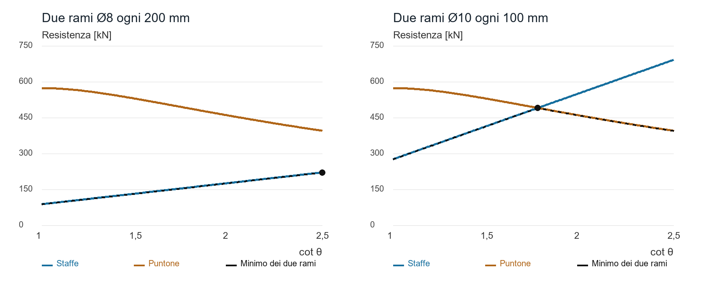

### Come leggere il risultato in ANTHEA

Nel modulo della sezione in c.a. controllare separatamente bw, d, Asw, passo, inclinazione delle staffe, criterio e cot θ per ciascuna direzione. Un valore geometrico suggerito deve essere coerente con la disposizione effettiva delle barre. Confrontare il taglio richiesto con entrambi i rami resistenti e leggere gli avvisi del profilo normativo scelto. Il calcolo di una sezione non sostituisce il progetto del dettaglio lungo l’elemento.

La fessura inclinata attraversa un tratto finito di trave: è per questo che la resistenza coinvolge un insieme di staffe e un flusso di compressione, mentre la flessione ordinaria viene spesso ricondotta all’equilibrio di una sola sezione. Vicino a carichi concentrati, appoggi o brusche discontinuità geometriche può essere necessario un modello a puntoni e tiranti dedicato.

Fonte: NTC 2018, §4.1.2.3.5. Sviluppo algebrico, grafico ed esempi numerici di questa pagina sono redatti per ANTHEA.

### Proseguire nella Wiki

- [Sezione in calcestruzzo armato](wiki:sezione-in-calcestruzzo-armato)

## Solette da ponte e percorso locale delle azioni

La soletta distribuisce le azioni delle ruote e trasferisce le reazioni alle travi. Il suo comportamento locale non coincide con quello della trave principale: direzione dell’armatura, interasse degli appoggi, sbalzi e area caricata controllano modelli differenti. Una striscia di un metro è utile per capire l’equilibrio, ma non rappresenta automaticamente la distribuzione bidimensionale di una ruota.

### Piastra continua e mensola laterale

Tra le travi, la soletta lavora come piastra con rigidezze e vincoli da identificare. Sullo sbalzo il momento negativo tende la faccia superiore: l’armatura principale deve attraversare il collegamento con la parte interna e avere ancoraggio adeguato. La barriera può introdurre azioni concentrate, momento e torsione; la sua classe e il modo di trasferimento al cordolo determinano una verifica locale distinta dal traffico ordinario.

Le azioni da impalcato vanno separate secondo natura e fase: peso del getto, pavimentazione, cordoli, veicoli, frenatura, temperatura e azioni eccezionali non sono intercambiabili. Un modello a graticcio deve riprodurre anche la rigidezza trasversale; assegnare tutta la rigidezza flessionale alle travi longitudinali può falsare la ripartizione.

### Esempio di controllo manuale dello sbalzo

Per una striscia idealizzata larga 1 m, sbalzo a = 1,20 m, carico lineare q = 8 kN/m e forza al bordo P = 30 kN, già riferiti alla stessa combinazione, l’equilibrio al vincolo fornisce:

```math
V=qa+P
M=\frac{qa^2}{2}+Pa
```

Si ottengono V = 39,60 kN e |M| = 41,76 kNm. Con h = 250 mm, copriferro al ferro più esterno 45 mm e barra principale Ø16, se questa è effettivamente la barra esterna, d = 250 − 45 − 8 = 197 mm. Assumendo preliminarmente z = 0,9d e fyd = 391,30 MPa, As = M/(z fyd) risulta circa 602 mm²/m. La formula è una stima di armatura a flessione semplice; vanno poi verificati equilibrio della sezione, minimi, fessure, taglio, dettagli e disposizione reale dei diversi strati.

Questi carichi sono inventati per il controllo manuale e non costituiscono un modello di traffico normativo. In particolare P non rappresenta una forza di urto della barriera. La larghezza efficace di diffusione di una ruota deve provenire dal modello adottato.

### Durabilità e dettagli che cambiano il calcolo

Il copriferro maggiore può migliorare la protezione delle armature ma riduce d a spessore costante. Lo spessore del pacchetto impermeabilizzazione–pavimentazione modifica peso e quote. Ristagni presso giunti, scarichi e cordoli aumentano l’importanza del dettaglio di drenaggio. Il disegno deve mostrare continuità dell’armatura superiore, interferenze e possibilità concreta di getto.

ANTHEA consente di verificare la sezione in c.a. soggetta alle azioni ricavate dal modello. Bridge Design fornisce un’impostazione concettuale dell’impalcato: non sostituisce una verifica locale completa della piastra sotto ruote o barriera.

### Proseguire nella Wiki

- [Cos'è un ponte?](wiki:bridge)
- [Taglio nel calcestruzzo armato e scelta del traliccio](wiki:taglio-traliccio)

## Travi metalliche da ponte fra montaggio fatica e sezione composta

Una trave metallica da ponte attraversa più sistemi resistenti durante la costruzione. Prima della maturazione della soletta porta carichi con la sola sezione in acciaio; dopo l’attivazione della connessione può rispondere come sezione composta. La verifica finale deve conservare memoria della fase in cui ciascun carico è stato applicato.

### Sommare le tensioni delle fasi

In un esempio elastico semplificato, la tensione nella stessa fibra d’acciaio si ricava sommando i contributi. W1 e W2 sono i moduli resistenti riferiti proprio a quella fibra e allo stesso materiale, con omogeneizzazione coerente.

```math
\sigma_s=\frac{M_1}{W_1}+\frac{M_2}{W_2}
```

Per L = 30 m, q1 = 25 kN/m applicato prima della collaborazione e q2 = 15 kN/m dopo la collaborazione, si hanno M1 = 2812,50 kNm e M2 = 1687,50 kNm. Con W1 = 0,020 m³ e W2 = 0,040 m³ risulta σs = 182,81 MPa. Applicare erroneamente tutto il carico alla sezione composta darebbe 112,50 MPa: una sottostima di circa il 38%. Si tratta di un esempio lineare senza puntellazione, ritiro o viscosità, non di una sezione verificata.

### Stabilità durante il getto

Il vincolo laterale della piattabanda compressa dipende da controventi e collegamenti effettivamente presenti in ciascuna fase. La soletta fresca non garantisce da sola il ritegno della trave. La sequenza di getto può modificare torsione, imperfezioni e lunghezze non controventate; il montaggio richiede quindi verifiche proprie. Anche gli irrigidimenti d’anima e la diffusione delle reazioni agli appoggi hanno un ruolo locale che il solo controllo della tensione normale non risolve.

### La fatica è sensibile al dettaglio

Una connessione saldata e una lamiera continua con la stessa tensione nominale non hanno necessariamente la stessa resistenza a fatica. Contano categoria del dettaglio, intervallo di tensione, numero di cicli e modo di valutare le tensioni. Su un ramo idealizzato della curva S–N con esponente m, N è proporzionale a Δσ elevato a −m. Con m = 3, passare da 60 a 80 MPa riduce il numero di cicli a (60/80)³ = 0,422 del precedente. Il valore m = 3 è qui un’ipotesi illustrativa, non una scelta valida per ogni dettaglio e regime.

Il controllo richiede lo spettro delle escursioni dovute al traffico e le regole della norma adottata. Non basta sostituire il carico massimo SLU nella formula della fatica. In ANTHEA la costruzione delle fasi della sezione composta serve a separare i contributi; non equivale a una verifica completa di fatica del ponte o di stabilità durante il montaggio.

Esempio numerico originale.

### Proseguire nella Wiki

- [Sezione composta da ponte](wiki:sezione-composta-da-ponte)
- [Instabilità delle aste compresse](wiki:euler)

## Precompressione delle travi da ponte e perdite nel tempo

La precompressione introduce una forza e, quando il cavo è eccentrico, un momento che modifica lo stato tensionale prima dell’arrivo di una parte dei carichi esterni. La forza iniziale non coincide con quella al trasferimento né con quella efficace a lungo termine. Il progetto deve seguire queste fasi e le corrispondenti proprietà del calcestruzzo.

### Equilibrio della sezione non fessurata

Si considera una sezione simmetrica, compressione positiva, cavo sotto il baricentro con eccentricità e positiva e momento esterno M positivo che comprime la fibra superiore. Nell’ipotesi elastica non fessurata:

```math
\sigma_{sup}=\frac{P}{A}-\frac{Pe}{W}+\frac{M}{W}
\sigma_{inf}=\frac{P}{A}+\frac{Pe}{W}-\frac{M}{W}
```

Una sezione rettangolare b = 0,60 m e h = 1,20 m ha A = 0,72 m² e W = 0,144 m³. Con P = 3000 kN, e = 0,35 m e M = 1000 kNm, si ottengono σsup = 3,82 MPa e σinf = 4,51 MPa, entrambe di compressione. Se P scende a 2400 kN a parità delle altre condizioni, le tensioni diventano circa 4,44 e 2,22 MPa. Le perdite riducono la compressione media ma non necessariamente quella di ogni singola fibra, perché diminuisce anche il momento Pe.

### Perdite immediate e differite

L’accorciamento elastico al trasferimento interagisce con il calcestruzzo. Ritiro, viscosità e rilassamento modificano la forza nel tempo e possono richiedere un’analisi accoppiata. Nei sistemi post-tesi intervengono inoltre attrito lungo il tracciato e rientro degli ancoraggi; il numero e la sequenza delle tesature influenzano i contributi. Applicare una percentuale globale senza documentarne il campo non consente di ricostruire la distribuzione lungo la trave.

### Controlli oltre la tensione longitudinale

Servono verifiche al trasferimento, durante sollevamento e montaggio, in esercizio e allo SLU. Le zone di ancoraggio possono presentare trazioni trasversali; taglio e torsione interagiscono con lo stato di compressione. Freccia e controfreccia dipendono dal tempo, dalla sequenza e dai vincoli. Una controfreccia geometrica non elimina le tensioni che l’hanno prodotta.

ANTHEA non dispone di un modulo generale di progetto dei cavi, delle perdite o delle zone di ancoraggio dei ponti precompressi. Questa pagina amplia la teoria del ponte e ne distingue il perimetro dalle funzioni della sezione composta e dal predimensionamento concettuale.

### Proseguire nella Wiki

- [Cos'è un ponte?](wiki:bridge)
- [Calcestruzzo armature e copriferro](wiki:calcestruzzo-armature-e-copriferro)

## Cassoni sottili torsione uniforme e distorsione

Una sezione chiusa è efficiente nel trasmettere torsione perché può sviluppare un flusso tangenziale continuo lungo il contorno. Questa proprietà non elimina distorsione, instabilità locale delle lamiere o effetti di estremità. Occorre distinguere la torsione uniforme di Saint-Venant dalle deformazioni che cambiano la forma della sezione.

### Modello di una cella chiusa sottile

Per una cella unica, contorno chiuso, materiale elastico uniforme e torsione sufficientemente lontana dalle discontinuità, le relazioni di Bredt-Batho collegano momento torcente T, area racchiusa dalla linea media Am, spessore t e flusso q. L’integrale segue il perimetro della linea media.

```math
q=\frac{T}{2A_m}
\tau=\frac{q}{t}
J=\frac{4A_m^2}{\oint ds/t}
\frac{d\theta}{dx}=\frac{T}{GJ}
```

J è la costante torsionale, non il momento polare di inerzia utilizzabile indistintamente per ogni forma. Per celle multiple occorre imporre anche la compatibilità delle rotazioni e trattare i flussi sulle pareti condivise.

### Esempio con unità coerenti

Per un rettangolo sulla linea media di 4 × 2 m, spessore uniforme t = 20 mm, Am = 8 m² e perimetro 12 m. Con T = 1000 kNm e G = 80 GPa si ottengono q = 62,50 kN/m, τ = 3,125 MPa e J = 0,4267 m⁴. La rotazione unitaria è circa 2,93 × 10⁻⁵ rad/m; su 30 m con T costante vale circa 0,0504 gradi.

Non è la rotazione di un ponte reale: l’esempio trascura variazione di T, irrigidimenti, diaframmi, vincoli di estremità, variazioni di spessore e distorsione. Il valore contenuto della tensione tangenziale non dimostra che la lamiera sia stabile.

### Che cosa fanno diaframmi e irrigidimenti

Carichi eccentrici possono tendere a deformare il rettangolo trasversale in una forma romboidale. I diaframmi contrastano questa distorsione e distribuiscono le reazioni. Gli irrigidimenti longitudinali e trasversali governano campi locali di lamiera e lunghezze efficaci. Un elemento beam con sola rigidezza GJ non rappresenta tutti questi meccanismi; un modello a guscio richiede mesh, collegamenti e vincoli capaci di riprodurli.

Una curiosità utile: aprire una fessura longitudinale ideale nel contorno può ridurre drasticamente la rigidezza torsionale, anche se area di acciaio e ingombro cambiano poco. La chiusura del flusso è una proprietà topologica del percorso resistente, non soltanto una questione di quantità di materiale.

In ANTHEA questa trattazione è documentazione tecnica. I moduli attuali non forniscono una verifica completa di cassoni multicellulari, distorsione o instabilità delle piastre. Riferimento bibliografico: AISC e NSBA, Steel Bridge Design Handbook.

### Proseguire nella Wiki

- [Cos'è un ponte?](wiki:bridge)
- [Elementi Beam](wiki:beam)

## Stralli equilibrio rigidezza geometrica e vibrazioni

Uno strallo trasmette trazione lungo il proprio asse e introduce simultaneamente forze verticali e orizzontali. La geometria decide quanto sforzo serve per sostenere una data componente verticale e quanta compressione viene trasferita all’impalcato. La configurazione di equilibrio e lo stato di tesatura fanno parte del modello.

### Inclinazione e azioni sull’impalcato

Per un cavo rettilineo ideale inclinato di α rispetto all’orizzontale:

```math
T=\frac{V}{\sin\alpha}
H=V\cot\alpha
```

Con V = 1000 kN, a 30 gradi servono T = 2000 kN e H = 1732 kN. A 60 gradi T scende a circa 1155 kN e H a 577 kN. Per confrontare due configurazioni progettuali occorre però tenere conto anche di lunghezza, altezza dell’antenna, posizione degli ancoraggi e distribuzione delle forze negli altri stralli.

Se gli altri spostamenti dell’ancoraggio sono impediti e si considera soltanto l’allungamento assiale lineare di una barra tesa, la rigidezza verticale materiale è (EA/L) sin²α. Un cavo reale aggiunge effetti di freccia, pretensione e rigidezza geometrica; può perdere tensione e non lavora come un puntone compresso. Usare soltanto la proiezione di EA/L è quindi una semplificazione circoscritta.

### Un ordine di grandezza dinamico

Per la corda tesa ideale con massa lineare μ e trazione uniforme T, la prima frequenza è:

```math
f_1=\frac{1}{2L}\sqrt{\frac{T}{\mu}}
```

Con L = 100 m, T = 2 MN e μ = 50 kg/m risulta f1 = 1 Hz. Una variazione della tensione cambia la frequenza: a parità del resto, raddoppiare T la moltiplica per √2. Curvatura del cavo, rigidezza flessionale, condizioni degli ancoraggi e dispositivi esterni possono modificare questa stima.

### Vibrazioni e manutenzione

Pioggia e vento possono attivare meccanismi aeroelastici che la sola frequenza propria non descrive. Trattamenti della superficie, smorzatori e collegamenti fra cavi affrontano fenomeni differenti; un collegamento può anche creare nuovi modi locali. Ispezionabilità degli ancoraggi, protezione dalla corrosione e possibilità di sostituzione devono essere considerate insieme alla risposta resistente.

ANTHEA non calcola attualmente l’equilibrio non lineare o la dinamica di un sistema di stralli.

### Proseguire nella Wiki

- [Cos'è un ponte?](wiki:bridge)
- [Dinamica e sisma del modello](wiki:dinamica-e-sisma-del-modello)

## Freccia controfreccia temperatura e appoggi dei ponti

La deformabilità influenza comfort, quote della pavimentazione, pendenze di drenaggio, giunti e funzionamento degli appoggi. Il superamento di una resistenza e l’incompatibilità di uno spostamento sono problemi distinti. Occorre inoltre separare la deformazione istantanea da viscosità, ritiro, assestamenti e sequenza costruttiva.

### Sensibilità alla luce

Per una trave prismatica semplicemente appoggiata, piccole deformazioni, EI costante e carico uniforme q, la freccia in mezzeria è:

```math
w_{max}=\frac{5qL^4}{384EI}
```

Con q = 30 kN/m, L = 30 m, E = 210 GPa e I = 0,30 m⁴ si ottengono circa 5,02 mm. Aumentando la luce del 10%, senza cambiare le altre grandezze, la freccia diventa circa 7,35 mm: cresce del 46,4% perché dipende da L alla quarta potenza. La formula non descrive automaticamente una trave composta a rigidezza variabile o una sezione fessurata.

### Movimento termico e schema dei vincoli

Una variazione uniforme della temperatura produce, in assenza di impedimenti:

```math
\Delta L=\alpha L\Delta T
```

Con α = 12 × 10⁻⁶ /K, L = 120 m e ΔT = 35 K, il movimento relativo fra estremità è 50,4 mm. Se il punto fisso è al centro e il comportamento è simmetrico, ciascuna estremità si muove di circa 25,2 mm rispetto a esso. Questo valore non comprende tolleranze, rotazioni, ritiro, viscosità e altre azioni da includere nel dimensionamento effettivo del giunto.

Nel caso ideale di impedimento assiale completo e risposta elastica, la tensione termica ha modulo EαΔT, pari a 88,2 MPa con E = 210 GPa. Un gradiente termico nello spessore introduce invece curvatura e possibili azioni da vincolo. Confondere temperatura uniforme e gradiente porta a errori di schema.

### Appoggi e costruzione

Un appoggio deve trasmettere le azioni previste e permettere i movimenti assegnati. Attrito, rotazione, spostamento, stabilità e sostituibilità vanno coordinati; il punto fisso influenza la distribuzione di frenatura e temperatura. Le quote di posa e la temperatura al montaggio determinano la posizione iniziale nel campo di escursione.

Le NTC 2018 §5.1.4.7 richiedono: «Le verifiche di sicurezza vanno svolte anche per le singole fasi di costruzione dell’opera». La fase di getto e quella di rimozione dei sostegni temporanei possono governare anche quando la configurazione definitiva è soddisfacente. La controfreccia compensa una quota attesa, non annulla lo stato tensionale.

In ANTHEA le fasi della sezione composta aiutano a organizzare azioni e rigidezze. L’esempio di Bridge Design va letto con i propri limiti: non rappresenta un progetto completo di appoggi o giunti. Fonti: NTC 2018, §§5.1.4.5 e 5.1.4.7.

### Proseguire nella Wiki

- [Cos'è un ponte?](wiki:bridge)
- [Travi metalliche da ponte fra montaggio fatica e sezione composta](wiki:ponti-acciaio-fasi)

## Biblioteca tecnica lezioni con esempi svolti

La biblioteca raccoglie le lezioni tecniche di ANTHEA su geotecnica, calcestruzzo armato e ponti. Ogni pagina sviluppa esempi numerici originali e dichiara ipotesi, unità, limiti e funzioni effettivamente disponibili nei moduli.

### Nuove lezioni con esempi svolti

- [Dalle indagini geotecniche ai parametri del modello](wiki:geotecnica-parametri)
- [Cedimenti edometrici tempi di consolidazione e drenaggi](wiki:cedimenti-consolidazione)
- [Profilo di velocità risposta locale e liquefazione](wiki:geofisica-liquefazione)
- [Pali in gruppo interazione e rigidezza della fondazione](wiki:geotecnica-gruppi)
- [Muri di sostegno metodi disponibili e perimetro del modello](wiki:muri-metodi-perimetro)
- [Ripercorrere un esempio strutturale con controlli indipendenti](wiki:esempi-controlli-indipendenti)
- [Taglio nel calcestruzzo armato e scelta del traliccio](wiki:taglio-traliccio)
- [Solette da ponte e percorso locale delle azioni](wiki:ponti-solette)
- [Travi metalliche da ponte fra montaggio fatica e sezione composta](wiki:ponti-acciaio-fasi)
- [Precompressione delle travi da ponte e perdite nel tempo](wiki:ponti-precompressione)
- [Cassoni sottili torsione uniforme e distorsione](wiki:ponti-cassoni)
- [Stralli equilibrio rigidezza geometrica e vibrazioni](wiki:ponti-stralli)
- [Freccia controfreccia temperatura e appoggi dei ponti](wiki:ponti-deformazioni)

### Come confrontare le fonti

Prima di trasferire un procedimento al progetto, controllare edizione normativa, campo geometrico, unità, segni, stato limite e ipotesi costitutive. NTC, Eurocodici, AASHTO e ACI non costituiscono un unico insieme di coefficienti. Un testo riferito a una norma diversa da quella del progetto può restare utile per il modello meccanico, non per i coefficienti.

Un collegamento a un modulo indica pertinenza tecnica, non l’implementazione automatica di tutto l’argomento. Le pagine contrassegnate come da completare nei riscontri conservano questo stato anche quando sono leggibili e ricercabili. Per comprendere il risultato del programma, partire dalla guida del modulo e dai suoi limiti correnti.

### Proseguire nella Wiki

- [Tracciabilità, fonti e archivio](wiki:tracciabilita-e-riferimenti)
- [Esempi trasversali e lettura critica](wiki:esempi-trasversali-e-lettura-critica)

## Fondazioni superficiali

Il modello valuta il carico limite di una fondazione rigida su terreno resistente omogeneo. Base e piano campagna sono orizzontali. La verifica riguarda una singola combinazione statica e non comprende scorrimento, cedimenti, stabilità globale o resistenza strutturale. Le condizioni drenate descrivono la resistenza mediante c′ e φ′; quelle non drenate mediante $c_u$, con $\varphi = 0$.

### Convenzioni e area efficace

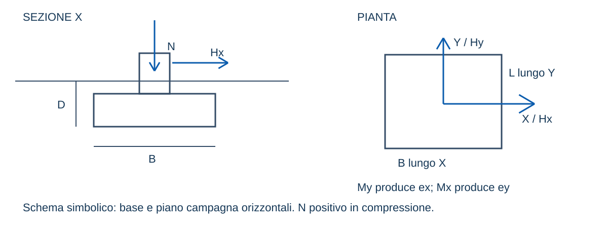

Le unità del foglio sono m, kN, kNm, kPa e gradi. B e L sono i lati lungo X e Y; D è la profondità di posa. N positivo è la risultante normale compressiva al piano di posa; Hx e Hy sono le componenti tangenziali. Il modello usa H come modulo della risultante e conserva l'associazione tra azioni e lati quando ordina le dimensioni efficaci.

$$ e_x=M_y/N
$$ e_y=M_x/N

$$ B'=B-2|e_x|
$$ L'=L-2|e_y|
$$ A'=B'L'

Le due dimensioni devono essere positive. Il metodo dell'area efficace è una rappresentazione del carico limite e non un diagramma elastico delle pressioni. Per il cerchio centrato $A' = \pi B^2/4$; il caso eccentrico circolare è escluso. Per la striscia si usa un metro di sviluppo e rapporto di forma nullo. Si pone $r = B'/L'$ dopo aver ordinato i lati; il lato minore governa il termine di peso. Eccentricità maggiori di un terzo del lato originale generano l'avviso previsto dalla EN 1997-1 §6.5.4; la portanza da sola non conclude il progetto.

### Falda domanda e coefficienti parziali

Il confinamento q è il sovraccarico esterno più la tensione verticale alla quota di posa: efficace nel drenato, totale nel non drenato. Sopra la falda si usa γ; sotto si usa γsat − γw nel drenato e γsat nel non drenato. Nel termine di peso si assume il peso efficace medio nello spessore B′ sotto la base, interpolando secondo la parte di tale spessore sopra e sotto la falda. È un'approssimazione per falda idrostatica, senza gradienti di filtrazione né sovrapressioni interstiziali.

La domanda N include tutti i pesi e le pertinenti azioni idrauliche. In condizioni drenate N è efficace, al netto della sottospinta. In condizioni non drenate si usa N totale, senza sottrarre la pressione interstiziale alla base, coerentemente con q totale della EN 1997-1 D.3. Non trasferire la stessa risultante tra le due analisi senza riesaminare la convenzione: con coefficienti parziali sulla resistenza lo spostamento della pressione interstiziale fra i due membri non è neutro.

Il profilo implementato è NTC 2018, DM 17 gennaio 2018, §6.4.2.1, Approccio 2 A1+M1+R3. I coefficienti M1 sono unitari e γR per carico limite è 2,3 (tabella 6.4.I). Le azioni A1 sono fornite già combinate: il foglio non applica un secondo fattore alle risultanti. Il riferimento Eurocodice 7 identifica esclusivamente le espressioni dell'allegato D della EN 1997-1:2004/AC:2009; non dichiara una verifica secondo la seconda generazione né applica un allegato nazionale europeo diverso dal profilo NTC scelto.

$$ R_d=A'q_{lim}/\gamma_R
$$ E_d=N
$$ \eta=E_d/R_d

La verifica usa $q_{lim}$ lordo. Il valore netto $q_{lim} - q$ è esposto separatamente e non sostituisce il valore lordo nel confronto. Se Rd è nullo l'indice non è definito e la verifica con N positivo non è soddisfatta. La modalità caratteristica pone $\gamma_R = 1$ e restituisce un confronto privo di dichiarazione normativa.

### Espressione drenata e fattori di capacità portante

$$ q_{lim}=c'N_cs_cd_ci_c+qN_qs_qd_qi_q+\frac{1}{2}\gamma B'N_\gamma s_\gamma d_\gamma i_\gamma

I fattori di inclinazione di base e piano campagna valgono uno perché tali piani sono orizzontali. Non sono opzioni implicite per fondazioni su pendio. Per Meyerhof, Hansen, Vesić ed Eurocodice 7:

$$ N_q=e^{\pi\tan\varphi}\tan^2(\pi/4+\varphi/2)
$$ N_c=(N_q-1)/\tan\varphi

| Metodo | $N_\gamma$ |
|---|---|
| Meyerhof | $(N_q - 1)\tan(1{,}4\,\varphi)$ |
| Hansen | $1{,}5\,(N_q - 1)\tan\varphi$ |
| Vesić | $2\,(N_q + 1)\tan\varphi$ |
| Eurocodice 7 | $2\,(N_q - 1)\tan\varphi$ |

Per angoli molto piccoli il codice valuta esponenziale meno uno e logaritmo di uno più x con espressioni numericamente stabili. Il limite di $N_c$ è $\pi + 2$. Il ramo drenato generalizzato richiede $\varphi'$ positivo; per $\varphi = 0$ il foglio richiede il ramo non drenato con cu esplicito. Non è quindi disponibile una distinta analisi drenata a resistenza puramente coesiva. Sono ammessi angoli fino a 50°.

### Forma e profondità

Eurocodice 7 usa i fattori di forma seguenti e fattori di profondità unitari. La base deve essere sufficientemente ruvida, $\delta \geq \varphi'/2$. Per la geometria circolare centrata $r = 1$.

```math
s_q = 1 + r\sin\varphi
s_c = 1 + \frac{r\sin\varphi\,N_q}{N_q - 1}
s_\gamma = 1 - 0{,}3\,r
```

Per Hansen il foglio adotta la variante correlata, per Vesić la propria; non sono combinazioni intercambiabili. Hansen, poi Vesić:

```math
s_q = 1 + r\sin\varphi
s_c = 1 + \frac{(s_q - 1)\,N_q}{N_q - 1}
s_\gamma = 1 - 0{,}4\,r
s_q = 1 + r\tan\varphi
s_c = 1 + \frac{r\,N_q}{N_c}
s_\gamma = 1 - 0{,}4\,r
```

Definito $k = D/B$ per $D/B$ non maggiore di uno, e $k = \arctan(D/B)$ oltre tale limite, per Hansen e Vesić si applicano:

```math
d_q = 1 + 2\tan\varphi\,(1 - \sin\varphi)^2\,k
d_c = 1 + 2\,(1 - \sin\varphi)^2\,k\left(\tan\varphi + \frac{1}{N_c}\right)
d_\gamma = 1
```

$B$ in questo rapporto è la larghezza geometrica corrispondente al lato efficace minore. La legge empirica di k è discontinua in D/B = 1: il foglio la conserva senza introdurre raccordi arbitrari. Disabilitando i fattori di profondità si pone k = 0.

Meyerhof usa $K_p = \tan^2(\pi/4 + \varphi/2)$ e i fattori seguenti; le ultime due righe valgono per $\varphi \geq 10$°:

```math
s_c = 1 + 0{,}2\,K_p\,r
d_c = 1 + 0{,}2\sqrt{K_p}\,D/B
s_q = s_\gamma = 1 + 0{,}1\,K_p\,r
d_q = d_\gamma = 1 + 0{,}1\sqrt{K_p}\,D/B
```

 Fra zero e 10° gli incrementi q e γ sono interpolati linearmente fra zero e il valore a 10°, secondo USACE EM 1110-1-1905, tabella 4-3. Non si interpola Nc o Nq. Non si associa tale serie di fattori di forma a carichi inclinati su una fondazione finita.

La relazione correlata tra singoli fattori c e q non dimostra l'equivalenza di un prodotto di più correzioni: compaiono termini incrociati. Per questo il foglio identifica la variante scelta e non presenta una differenza tra varianti come errore universale della teoria.

### Inclinazione delle azioni

Per Eurocodice 7 e Vesić si definiscono, negli assi ordinati:

```math
m_B = \frac{2 + r}{1 + r}
m_L = \frac{1 + 2r}{1 + r}
m = m_B\left(\frac{H_x}{H}\right)^2 + m_L\left(\frac{H_y}{H}\right)^2
```

Per $H$ nullo i fattori valgono uno; per la striscia $m = 2$.

$$ a=H/(N+A'c'\cot\varphi)
$$ i_q=(1-a)^m
$$ i_\gamma=(1-a)^{m+1}

$$ i_c=i_q-(1-i_q)/(N_q-1)

Per una resistenza positiva si richiede $a < 1$ e $i_c \geq 0$. Azioni oltre questi limiti esauriscono il dominio resistente: la resistenza restituita è nulla, con avviso ed esito negativo nel profilo normativo. Per Meyerhof sulla striscia, con $\theta = \arctan(H/N)$, valgono le relazioni seguenti, la seconda se $\theta \leq \varphi$ e altrimenti $i_\gamma = 0$:

```math
i_c = i_q = \left(1 - \frac{\theta}{\pi/2}\right)^2
i_\gamma = \left(1 - \frac{\theta}{\varphi}\right)^2
```

 Gli angoli nelle formule sono radianti. Brinch Hansen con azioni tangenziali segue le espressioni del paragrafo «Brinch Hansen con carico inclinato».

### Condizioni non drenate

Per Eurocodice 7, con $H \leq A' c_u$:

```math
q_{lim} = c_u\,N_c\,s_c\,i_c + q
N_c = \pi + 2
s_c = 1 + 0{,}2\,r
i_c = \frac{1}{2}\left(1 + \sqrt{1 - \frac{H}{A' c_u}}\right)
```

Per Vesić si usano $s_c = 1 + 0{,}2\,r$, $d_c = 1 + 0{,}4\,k$ e $i_c = 1 - m H/(A' c_u N_c)$, non negativo, in forma moltiplicativa. Meyerhof usa $s_c = 1 + 0{,}2\,r$, $d_c = 1 + 0{,}2\,D/B$ e il fattore di inclinazione sopra descritto, limitato alla striscia quando $H$ non è nullo. A differenza di Eurocodice 7, Vesić, Hansen e Terzaghi, che sommano $q$, Meyerhof applica l'inclinazione anche al sovraccarico, $q_{lim} = c_u N_c s_c d_c i_c + q\,i_q$ con $i_q = i_c = (1 - \theta/(\pi/2))^2$, in continuità con il ramo drenato (Meyerhof, 1963; USACE EM 1110-1-1905, tabella 4-3).

Brinch Hansen con carico verticale usa invece una forma additiva:

$$ q_{lim}=c_u(\pi+2)(1+0{,}2r+0{,}4k)+q

I valori s′ e d′ della tabella additiva sono gli incrementi 0,2r e 0,4k, mentre i′ = 0. La stessa tabella espone il fattore 1 + s′ + d′ − i′. Moltiplicarli sarebbe un errore. Con carico inclinato la forma additiva è quella del paragrafo «Brinch Hansen con carico inclinato».

### Brinch Hansen con carico inclinato

Con un'azione orizzontale il metodo di Brinch Hansen calcola la pressione limite per rottura nella direzione di $B'$ e in quella di $L'$ e adotta la minore; nella fondazione nastriforme c'è solo la direzione di $B'$, nel cerchio l'azione orizzontale si considera diretta come $B'$. $H$ è la componente considerata, $H_B$ parallela a $B'$ oppure $H_L$ parallela a $L'$, $A' = B'L'$ è l'area efficace e base e piano campagna sono orizzontali. In condizioni drenate i fattori di inclinazione sono:

```math
x = \frac{H}{N + A' c' \cot\varphi'}
i_q = (1 - 0{,}5\,x)^5
i_\gamma = (1 - 0{,}7\,x)^5
i_c = i_q - \frac{1 - i_q}{N_q - 1}
```

Per la rottura nella direzione di $B'$ i fattori di forma e di profondità sono i seguenti, con $k = D/B$ e $k = \arctan(D/B)$ oltre uno; $s_\gamma$ non scende sotto 0,6:

```math
s_q = 1 + i_{q,B}\,\frac{B'}{L'}\sin\varphi'
s_c = s_q - \frac{1 - s_q}{N_q - 1}
s_\gamma = 1 - 0{,}4\,\frac{i_{\gamma,B}\,B'}{i_{\gamma,L}\,L'}
d_q = 1 + 2\tan\varphi'\,(1 - \sin\varphi')^2\,k
d_c = d_q - \frac{1 - d_q}{N_q - 1}
d_\gamma = 1
```

Per la rottura nella direzione di $L'$ valgono le stesse espressioni con $B'$ e $L'$ scambiati e i fattori di inclinazione di $H_L$; la profondità usa $D/L'$ e il termine di peso resta $0{,}5\,\gamma B' N_\gamma$. In ciascuna direzione si calcola la pressione limite e si adotta la minore:

```math
q_{lim} = c' N_c s_c d_c i_c + q N_q s_q d_q i_q + 0{,}5\,\gamma B' N_\gamma s_\gamma d_\gamma i_\gamma
```

In condizioni non drenate la forma è additiva; le espressioni seguenti valgono nella direzione di $B'$, mentre nella direzione di $L'$ si usano $i'_c$ con $H_L$, $s'_c = 0{,}2\,i'_c\,L'/B'$ e $d'_c$ con $D/L'$, e si adotta il minore dei due valori:

```math
q_{lim} = (\pi + 2)\,c_u\,(1 + s'_c + d'_c - i'_c) + q
i'_c = 0{,}5 - 0{,}5\sqrt{1 - \frac{H}{A' c_u}}
s'_c = 0{,}2\,i'_c\,\frac{B'}{L'}
d'_c = 0{,}4\,k
```

Un fattore di inclinazione negativo nel drenato, o una componente orizzontale maggiore di $A' c_u$ nel non drenato, indica che l'azione tangenziale supera la resistenza della formula: la capacità portante si assume nulla e la verifica non è soddisfatta.

> Limite del metodo · Discontinuità con il carico verticale
> Metodo: con $H = 0$ valgono le espressioni del carico verticale, $s'_c = 0{,}2\,B'/L'$ nel non drenato e fattori di forma senza inclinazione nel drenato.
> Programma: per $H \rightarrow 0$ il calcolo inclinato non tende sempre a quei valori; nel non drenato la correzione di forma $0{,}2\,i'_c\,B'/L'$ si annulla con $i'_c$, e la rottura nella direzione di $L'$ si calcola anche con $H_L = 0$, con forma $L'/B'$ e profondità $D/L'$.
> Effetto: con un'azione orizzontale piccola la pressione limite può essere sensibilmente minore di quella del carico verticale, a favore di sicurezza; ANTHEA applica il metodo così com'è e riporta negli avvisi il valore con $H = 0$.

Esempi con $B = 2$ m, $L = 3$ m, $D = 1$ m, $N = 600$ kN e $\gamma = 18$ kN/m³. Drenato con $\varphi' = 30$° e $c' = 0$: 704,29 kPa con $H = 0$ e 522,63 kPa con $H = 60$ kN lungo B, nella direzione di $B'$ (798,16 kPa nella direzione di $L'$). Non drenato con $c_u = 75$ kPa: 532,16 kPa con $H = 0$ e 455,04 kPa con $H = 60$ kN lungo B e anche con un'azione orizzontale di pochi newton, nella direzione di $L'$:

```math
q_{lim} = (\pi + 2) \cdot 75 \cdot (1 + 0{,}4/3) + 18 = 455{,}04
```

Bibliografia del metodo: J. Brinch Hansen, A revised and extended formula for bearing capacity, Danish Geotechnical Institute, Bulletin 28, 1970; U.S. Army Corps of Engineers, EM 1110-1-1905, Bearing Capacity of Soils, 1992, tabella 4-5.

### Terzaghi e rottura locale

Il ramo Terzaghi è limitato a striscia, quadrato e cerchio con carico verticale centrato e D/B non maggiore di uno. Per $\varphi$ positivo la base è ruvida e:

```math
N_q = \frac{\exp\left[(3\pi/2 - \varphi)\tan\varphi\right]}{1 - \sin\varphi}
N_c = \frac{N_q - 1}{\tan\varphi}
```

$N_\gamma$ è interpolato linearmente nella tabella 4-1 di USACE EM 1110-1-1905 (1992), per 0°–50°. Non si usa un'espressione interpolante non documentata. Per $\varphi = 0$ si adottano $N_q = 1$, $N_\gamma = 0$, $N_c = 1 + 3\pi/2$ per base ruvida oppure $N_c = \pi + 2$ per base liscia.

I fattori sc sono 1 per striscia e 1,3 per quadrato e cerchio; sγ vale rispettivamente 1, 0,8 e 0,6. Gli altri fattori sono unitari. Nγ è spesso determinante nei terreni incoerenti e non viene trascurato.

La riduzione di Terzaghi per rottura locale (prime due relazioni) e quella per densità relativa di Vesić, solo per sabbie con $c' = 0$ e $0 \leq D_r \leq 2/3$ (terza), sono:

```math
c'_{rid} = \frac{2}{3}\,c'
\tan\varphi_{rid} = \frac{2}{3}\tan\varphi'
\tan\varphi_{rid} = \left(\frac{2}{3} + D_r - \frac{3}{4}D_r^2\right)\tan\varphi'
```

 Sono riduzioni dei parametri selezionate consapevolmente; il modello non calcola fattori di compressibilità da modulo di taglio, deformazione volumetrica o indice di rigidezza.

### Stratigrafia e materiali comuni

Il profilo usa terreno, strato e sondaggio comuni ai moduli geotecnici. Le quote sono riferite al piano campagna; i pesi sopra il piano di posa vengono integrati per strato. In drenato si sottrae la pressione interstiziale idrostatica; in non drenato il confinamento resta totale. In caso di interfaccia coincidente con la base si assume il materiale immediatamente sottostante. Profili identici traslati rispetto a un diverso riferimento altimetrico danno lo stesso risultato.

La resistenza richiede proprietà omogenee sotto la base e l'ipotesi esplicita di semispazio. Il fondo disegnato è il limite dei dati inseriti, non un confine resistente rigido. Nessun parametro medio sostituisce materiali diversi. La classe del calcestruzzo e il suo legame sono dati comuni del progetto; non intervengono nel modello geotecnico e non generano automaticamente peso o verifiche strutturali.

Una risultante esterna alla base annulla l’area efficace e la resistenza del metodo, salvo le ipotesi non supportate che restano rifiutate. N/A′ con area nulla e N/R con resistenza nulla restano indefiniti. Il confronto caratteristico conserva la propria etichetta e non costituisce un esito normativo. Il calcolo non estende le formule oltre il loro dominio per ottenere resistenze favorevoli.

### Pressioni di contatto e area efficace

Per una fondazione rettangolare rigida si adotta una distribuzione convenzionale affine, annullata dove il terreno sarebbe teso. Le coordinate x e y sono centrate sull'impronta geometrica. I coefficienti a, b e c sono determinati imponendo equilibrio della forza e dei due momenti sulla parte compressa Ac.

$$ p(x,y)=\max(0,a+bx+cy)

$$ \int_{A_c}p\,dA=N
$$ \int_{A_c}xp\,dA=M_y
$$ \int_{A_c}yp\,dA=M_x

Il calcolo integra esattamente area, momenti primi e secondi del poligono di contatto; risolve il sistema con coordinate e pressioni normalizzate e controlla il residuo di equilibrio. Una mancata convergenza viene segnalata e la mappa non viene mostrata. Il disegno campiona la soluzione su una griglia; i valori estremi derivano dai vertici e non dalla risoluzione grafica.

A contatto completo la relazione restituisce:

```math
p = \frac{N}{BL}\left(1 + \frac{12\,e_x\,x}{B^2} + \frac{12\,e_y\,y}{L^2}\right)
```

 Se una parte perde contatto non si tronca semplicemente questa prima distribuzione: si risolvono nuovamente a, b e c sulla zona compressa. Per eccentricità lungo X superiore a $B/6$ la soluzione monoassiale triangolare ha larghezza compressa $3\,(B/2 - |e_x|)$, mentre la larghezza efficace vale $B - 2|e_x|$. La distinzione spiega perché Ac e A′ differiscono.

La distribuzione è coerente con una piastra rigida su appoggio elastico locale uniforme senza trazione, a meno di una rigidezza moltiplicativa che non serve a determinarne le pressioni. Non è la soluzione elastica di un semispazio, non usa moduli del terreno e non consente di dedurre cedimenti. Per il cerchio, ammesso solo con risultante centrata, la pressione è uniforme. Per la striscia si considera un metro di lunghezza. La portanza confronta N con A′qlim/γR; pmax non sostituisce N/A′ in questa verifica.

### Schema illustrativo del meccanismo di rottura

La vista Rottura rappresenta il riferimento di Prandtl per una striscia su terreno omogeneo privo di peso. Non è ottenuta ottimizzando una superficie per Terzaghi, Meyerhof, Hansen, Vesić o Eurocodice 7. Si usa il lato efficace nella sezione scelta e l'angolo adottato nel calcolo; in non drenato φ = 0. Il cuneo centrale è inclinato di $\alpha = \pi/4 + \varphi/2$; la zona passiva termina con inclinazione $\beta = \pi/4 - \varphi/2$. Nel ventaglio:

$$ r=r_0e^{\theta\tan\varphi}
$$ r_0=\frac{B'}{2\cos\alpha}
$$ 0\leq\theta\leq\pi/2

Le sezioni X e Y sono rappresentazioni separate, non una superficie tridimensionale. Il disegno non incorpora peso proprio del terreno, profondità di posa o componenti tangenziali; non dimostra l'estensione della zona di rottura reale né giustifica una profondità d'indagine. La dipendenza della geometria critica dal peso del terreno impedisce di interpretare questo riferimento come superficie universale per il termine Nγ.

### Limiti e riferimenti tecnici

La scelta di φ′ e cu deve derivare dall'indagine e dal meccanismo pertinente; il foglio non converte automaticamente resistenza di picco in critica né ricava parametri da prove. Non sono coperti terreno resistente eterogeneo sotto la base, base inclinata, pendio, falda in pressione, trazione, interazione tra fondazioni, sisma o carico ciclico. Un rapporto di utilizzo favorevole non sana queste condizioni. Un metodo non supportato deve essere verificato separatamente con un modello appropriato.

Riferimenti: Terzaghi, Theoretical Soil Mechanics (1943); Meyerhof, Some Recent Research on the Bearing Capacity of Foundations (1963); Brinch Hansen, A Revised and Extended Formula for Bearing Capacity, Bulletin 28 (1970); Vesić, Bearing Capacity of Shallow Foundations, Foundation Engineering Handbook (1975); USACE EM 1110-1-1905, Bearing Capacity of Soils (1992), capitolo 4; Hjiaj, Lyamin e Sloan, Numerical limit analysis solutions for the bearing capacity factor Nγ, International Journal of Solids and Structures 42 (2005), 1681–1704, DOI 10.1016/j.ijsolstr.2004.08.002; EN 1997-1:2004/AC:2009, allegato D; DM 17 gennaio 2018, §§6.2 e 6.4.2. La [procedura del foglio](wiki:guida-fondazioni-superficiali) contiene un esempio numerico verificato.

## Reologia del calcestruzzo

Lo strumento considera viscosità lineare e maturazione del modulo secante del calcestruzzo ordinario secondo EN 1992-1-1:2004, §§3.1.2, 3.1.3(3), 3.1.4 e allegato B. L'umidità è costante e la temperatura di riferimento è 20 °C. L'età è misurata dal getto; si considera una sola età di applicazione del carico. Ritiro, storie termiche e variazioni del carico non fanno parte di questo calcolo.

### Coefficiente di viscosità e limite analitico

$$ \varphi(t,t_0)=\varphi_0\left(\frac{t-t_0}{\beta_H+t-t_0}\right)^{0{,}3}

L'espressione vale per t maggiore di t₀; prima del carico il coefficiente è zero. Il limite è analitico, indipendente dall'età finale scelta per il grafico:

$$ \varphi(\infty,t_0)=\varphi_0=\varphi_{RH}\,\beta(f_{cm})\,\beta(t_{0,adj})

I fattori di umidità, resistenza, dimensione nominale e sviluppo temporale sono quelli delle espressioni B.2–B.9. La resistenza media a 28 giorni è $f_{cm} = f_{ck} + 8$ MPa. La dimensione nominale $h_0 = 2A_c/u$ usa area di calcestruzzo e perimetro esposto all'essiccamento, con unità coerenti. La correzione dell'età di carico per il cemento è:

$$ t_{0,adj}=\max\left(0{,}5,\ t_0\left[1+\frac{9}{2+t_0^{1{,}2}}\right]^{\alpha}\right)

L'esponente α vale −1, 0 e 1 rispettivamente per cemento S, N e R. L'età corretta entra nel fattore β(t₀); la durata $t - t_0$ resta cronologica. Il coefficiente $\varphi$ è riferito al modulo tangente $E_c = 1{,}05\,E_{cm,28}$. L'espressione non restituisce direttamente una deformazione: nel campo lineare, la deformazione viscosa dipende anche dalla tensione e dal modulo di riferimento.

### Maturazione del modulo elastico

Il modulo secante riusa la legge di maturazione del materiale:

$$ \beta_{cc}(t)=\exp\left[s\left(1-\sqrt{\frac{28}{t}}\right)\right]
$$ f_{cm}(t)=\beta_{cc}(t)f_{cm}

$$ E_{cm}(t)=\left(\frac{f_{cm}(t)}{f_{cm}}\right)^{0{,}3}E_{cm,28}
$$ k_E(t)=\frac{E_{cm}(t)}{E_{cm,28}}

Il coefficiente s vale 0,38, 0,25 e 0,20 rispettivamente per cemento S, N e R. Si usa il modulo nominale del materiale EN 1992 con aggregato di riferimento; la finestra non introduce una correzione per il tipo di aggregato. A 28 giorni $k_E = 1$. Il rapporto può superare 1 alle età successive e non rappresenta un fattore di riduzione per viscosità. La resistenza e il modulo nel tempo non sono intercambiabili con la legge di deformazione differita.

### Esempio e campo di applicazione

Con fck = 25 MPa, cemento N, RH = 50 %, h₀ = 200 mm e t₀ = 7 giorni, un riferimento indipendente dà $\varphi_\infty = 3{,}4427042105$ ed $E_{cm,28} = 31475{,}806210$ MPa.

| Età t in giorni | φ(t, t₀) | Ecm(t) in MPa | Ecm(t) / Ecm,28 |
| --- | --- | --- | --- |
| 0,5 | 0 | 19355,383269 | 0,614929 |
| 7 | 0 | 29201,474188 | 0,927743 |
| 17 | 1,029049 | 30813,898916 | 0,978971 |
| 28 | 1,278108 | 31475,806210 | 1 |
| 365 | 2,603961 | 33229,779639 | 1,055724 |

Gli ingressi accettati sono fck fra 12 e 90 MPa, RH fra 40 e 100 %, h₀ positivo, t₀ almeno 0,5 giorni ed età di lettura positiva. Questi controlli non sostituiscono la verifica delle ipotesi fisiche: la viscosità non lineare per tensioni elevate, la maturazione a temperatura diversa e la variabilità ambientale richiedono metodi ulteriori. L'uso del modello lineare va verificato rispetto al livello tensionale al carico, con la soglia normativa di 0,45 fck(t₀). L'andamento alle primissime età richiede particolare cautela e dati pertinenti al calcestruzzo impiegato.

Le curve sono campionate solo per la rappresentazione; ogni lettura puntuale è valutata direttamente. La media, l'interpolazione grafica e la scala degli assi non alterano i valori calcolati. La [procedura operativa](wiki:guida-reologia-calcestruzzo) chiarisce come leggere e trasferire consapevolmente i risultati.

### Getti sottili nelle verifiche di sezione

Per l'opzione di getto in opera inferiore a 50 mm, le verifiche NTC e UNI EN 1992 con appendice italiana applicano la riduzione prevista del 20 % ai limiti pertinenti del calcestruzzo e al coefficiente αcc, quindi a fcd. Le altre norme conservano la propria regola. Questa scelta delle verifiche di sezione non modifica le curve di reologia dello strumento, che dipendono dagli ingressi esplicitamente indicati.

## Risultati dei modelli per fasi

Un risultato di costruzione è identificato dal caso della sorgente, dalla fase, dal passo e dalla revisione del modello. Per gli spostamenti si aggiunge il riferimento restituito dal solutore. Due risultati con lo stesso nome di caso e fasi diverse non rappresentano lo stesso stato e devono restare distinti.

### Stato totale e incremento

Una fase può cambiare rigidezza, vincoli, geometria resistente o età dei materiali. La presenza di un'analisi geometricamente lineare non dimostra, da sola, che gli stati costruttivi siano sovrapponibili come casi statici. La lettura conserva la provenienza e non attribuisce automaticamente questa proprietà.

Il riferimento Accumulative identifica spostamenti accumulati forniti dalla sorgente. Current e Real conservano la propria etichetta e non sono interpretati come incrementi sommabili. Anche per le sollecitazioni il carattere cumulativo rimane non dichiarato finché non è stabilito dai dati della sorgente. Un inviluppo fra fasi, quando implementato, dovrà conservare la fase governante e il vettore concomitante; non potrà essere trattato come uno stato simultaneo.

### Copertura e rappresentazione

La durata di una fase, l'età di attivazione di un elemento e il tempo del passo di output sono grandezze diverse. Il catalogo conserva durata e operazioni sui gruppi; la selezione dei risultati usa le etichette esatte dei passi. Non si ricava la numerazione dei passi dalla durata o dal loro ordine apparente.

L'assenza di un risultato può dipendere dall'inattività dell'oggetto, da un output non richiesto o da dati non disponibili. Non equivale a una sollecitazione o a uno spostamento nullo. La vista associa soltanto i campioni disponibili agli oggetti identificati, con le stesse convenzioni di unità e assi usate per i casi statici. I vincoli temporanei non diventano vincoli permanenti per il solo fatto di comparire nelle tabelle del modello.

In questa versione la geometria completa è un contesto grafico; non è la ricostruzione del sistema resistente attivo nella fase. L'importazione non esegue un'analisi per fasi, non calcola viscosità o ritiro del modello e non aggiorna la rigidezza degli elementi. La finestra di reologia è uno strumento separato di supporto al progettista. Il confronto dei risultati stage con un modello reale rimane una verifica aperta; le prove disponibili riguardano identità, protocollo, unità, segni e conservazione dei dati sintetici.

## Geometria e rappresentazione delle sezioni

La sezione grafica deriva dalla stessa geometria delle librerie che espone area, baricentro e inerzie. I contorni mantengono regioni materiali, fori e rientranze. La triangolazione destinata al disegno è costruita su copie dei contorni; non sostituisce né modifica la discretizzazione usata nei calcoli della sezione.

### Riferimento locale e punto di inserimento

Il piano della sezione è rappresentato con gli assi locali Y e Z dell'asta. Le coordinate del contorno sono espresse in millimetri; la scena del modello usa metri. Il punto O identifica il riferimento dell'asta all'interno o all'esterno del contorno. L'estrusione utilizza le coordinate relative a O e la terna locale importata, quando disponibile. Il riferimento geometrico non coincide necessariamente con G, il baricentro.

Un offset non interpretabile è un dato non risolto, distinto da un offset nullo. La rappresentazione conserva l'asse quando non è possibile collocare correttamente il volume, anche in presenza di offset di estremità non normalizzati. Un contorno numericamente definito non basta a ricostruire una sezione rastremata o la sua variazione per fase.

### Sezioni composte e significato delle proprietà

Per una sezione formata da materiali diversi, l'unione fisica delle parti consente di rappresentare gli ingombri e le quantità geometriche. Non costituisce una sezione omogeneizzata: area, baricentro e inerzie geometriche non incorporano rapporti dei moduli elastici, viscosità, ritiro o una fase di analisi. Questi parametri rimangono dati separati quando disponibili.

Un riferimento superiore o inferiore può essere collocato sul contorno fisico se è univoco. Un riferimento al baricentro elastico della composta richiede invece la definizione meccanica pertinente; il baricentro geometrico non lo sostituisce. Le proprietà riportano la disponibilità dichiarata dalla libreria: assegnata, calcolata geometricamente, approssimata, numerica differita o assente. L'assenza è distinta dal valore zero.

Il campo di colore sulle aste estruse conserva i campioni della sollecitazione lungo l'asse. La stessa ordinata è riportata sul perimetro a quella stazione; non è una ricostruzione della tensione nel materiale. Fra campioni si usa un'interpolazione grafica. Le zone non coperte dai risultati non ricevono valori estrapolati.

## Analisi per fasi delle paratie

L'anteprima grafica della sezione legge gli input del caso e della fase selezionati. Rappresenta le quote verticali e ritaglia gli strati alla quota corrente del terreno; mostra soltanto i sostegni e le azioni esplicitamente appartenenti alla fase. Non integra pressioni, non calcola deformazioni e non trasferisce risultati fra storie indipendenti. La geometria resta modificabile nello stesso pannello che mostra il disegno.

Spessore grafico della parete, lunghezza dei sostegni e lunghezza delle frecce sono simbolici. L'angolo del sostegno orienta un simbolo e non ne determina la lunghezza fisica. La linea d'acqua del modello è un livello assegnato: con filtrazione FEM identifica il carico idraulico imposto, non una superficie freatica ricostruita. Questi simboli non attestano l'applicabilità dei modelli di terreno, della fascia equivalente o delle verifiche strutturali. La validazione ingegneristica appartiene al calcolo GPC; il disegno segnala separatamente i dati geometrici non rappresentabili.

Il modulo in sviluppo usa una trave piana di Eulero–Bernoulli a piccoli spostamenti, con rigidezza flessionale per tratti e due letti indipendenti di molle elastoplastiche. Questa revisione descrive i metodi collaudati e il loro campo di validità. La parete è verticale, gli strati e i piani campagna sono orizzontali per ciascun lato; non si attribuisce al modello monodimensionale una risposta tridimensionale.

### Unità larghezza e convenzioni

Le unità interne sono N, mm, MPa, N/mm³ e radianti. La quota z cresce verso l'alto, lo spostamento orizzontale è positivo verso destra. La larghezza b rappresentata dalla trave è esplicita. Una pressione p in MPa produce il carico lineare $p\,b$ in N/mm; l'integrazione con le funzioni di forma produce forze e coppie nodali generalizzate. Pressione, carico lineare e forza nodale non sono intercambiabili.

Per una fila unica di elementi identici, di interasse s, si adotta una ripartizione uniforme esplicitamente confermata:

```formula
(EI)_{fascia}=EI_{elemento}\frac{b}{s}
\{N,V,M\}_{elemento}=\frac{s}{b}\{N,V,M\}_{fascia}
```

L'ipotesi richiede un trasferimento delle pressioni al fronte rappresentato. Non dimostra il comportamento di pali distanziati senza collegamento, più file, pali secanti o effetto arco. Il sostegno restituisce la forza del singolo elemento; il suo contributo all'equilibrio della fascia è scalato con $b/s$.

Nella parete N è positivo a compressione. Design conserva caso, fase, quota, sezione e lato e converte N e M nelle convenzioni di Concrete; nessuna terna resistente è costruita con massimi non concomitanti. La forza normale deriva dall'equilibrio dei carichi verticali, del peso lineare assegnato e delle componenti dei sostegni. Il nucleo attuale non calcola deformazioni assiali, attrito assiale terreno–parete o secondo ordine. Il peso lineare non riceve una correzione implicita per galleggiamento.

### Stato iniziale e pressioni limite

Per terreno drenato, parete liscia e sovraccarico uniforme si riusano i coefficienti di Rankine. Con tensione verticale efficace σ′v, coesione efficace c′ e coefficienti Ka, Kp:

```formula
p_a=\max(0,K_a\sigma'_v-2c'\sqrt{K_a})
p_p=K_p\sigma'_v+2c'\sqrt{K_p}
p_0=K_0\sigma'_v
```

La pressione interstiziale u si aggiunge una sola volta alle pressioni efficaci; l'acqua sopra il terreno contribuisce anche alla tensione verticale totale. K0 è un input positivo e documentato. Lo stato iniziale fuori dai limiti attivo/passivo è rifiutato senza correzioni silenziose.

Nel caso non drenato in tensioni totali si usano $\varphi = 0$ e $c_u$ assegnato: i limiti sono $\max(0,\ \sigma_v - 2c_u)$ e $\sigma_v + 2c_u$. La pressione iniziale è K0σ′v+u; l'acqua non viene riaggiunta alla legge totale. Non si simula la generazione o dissipazione delle sovrappressioni interstiziali durante lo scavo.

Con v spostamento entrante nel terreno, vp offset plastico e kh modulo di reazione assegnato, la legge di ciascun punto è:

```formula
p_{trial}=p_0+k_h(v-v_p)
p=\min(p_p,\max(p_a,p_{trial}))
v_{p,new}=v-\frac{p-p_0}{k_h}
```

L'ultimo aggiornamento si applica quando si supera un limite; all'interno del dominio elastico vp resta invariato. Scarico e ricarico hanno lo stesso kh. Il modello conserva memoria plastica ma non rappresenta leggi avanzate di rigidezza a piccole deformazioni, dipendenza dalla storia geologica o isteresi della permeabilità.

### Discretizzazione incrementi ed equilibrio

Gli elementi Hermite hanno traslazione e rotazione nodale, con quattro punti di Gauss. La mesh include interfacce, sostegni, carichi concentrati ed estremi degli intervalli distribuiti di tutte le fasi. Rotazioni e matrice sono scalate per migliorare il condizionamento. Il solutore usa Newton, ricerca lineare sull'energia potenziale (condizione di Armijo) e riduzione adattiva dell'incremento; stato di prova e stato confermato sono distinti. Con molle e sostegni elastoplastici l'energia è convessa e derivabile una volta: ogni direzione di Newton con tangente definita positiva la riduce, anche nei punti angolosi della plasticità, dove il massimo modulo del residuo può non diminuire. La tolleranza relativa si riferisce al massimo fra carichi, reazioni del terreno e dei sostegni e forze interne di flessione, perché l'arrotondamento dei termini di rigidezza cresce con $EI/h^3$ negli elementi corti. Non introduce molle fittizie per impedire un meccanismo.

Ogni fase descrive una configurazione completa. Pressioni, limiti, rigidezze e carichi sono interpolati fra configurazioni: è un rilascio o un'applicazione incrementale, non la simulazione di un fronte di scavo continuamente mobile. La prima fase costruisce lo stato iniziale; le successive conservano spostamenti e offset dei punti ancora attivi. Un riporto nuovo prende come riferimento la deformata raggiunta.

Un sostegno installato si riferisce allo spostamento della fase precedente; il bloccaggio o la pretensione si applicano progressivamente. La rimozione riduce il contributo e cancella la storia del sostegno; una reinstallazione è nuova. L'ordine di installazione e scavo richiede fasi separate quando fisicamente rilevante. Il semplice cambio di EI non introduce automaticamente fessurazione, plasticità o ridistribuzione dipendente dal materiale della sezione.

Con s verso resistente, α inclinazione, u spostamento del nodo, uinst spostamento all'installazione, ep allungamento plastico ed Np capacità plastica, la forza assiale del singolo elemento è:

```formula
e=s\cdot\cos\alpha\cdot(u-u_{\text{inst}})
N=P_0+\frac{EA}{L}(e-e_p)
```

N è limitata a [0, Np] per tiranti e puntoni e a [−Np, Np] per il vincolo bilaterale; la reazione sulla fascia è $-s\cos\alpha\,N\,b/i$, con b larghezza della fascia e i interasse. Un tirante o un puntone la cui forza di prova diventa negativa resta scarico, con $N = 0$, senza modificare ep: riprende carico quando lo spostamento torna al punto di forza nulla. Solo il raggiungimento di Np modifica ep, come allungamento permanente. P₀ è la pretensione in vigore nella fase. Nella tabella delle presenze una cella vuota conserva il valore che il sostegno aveva nella fase precedente; all'installazione o alla reinstallazione dopo una rimozione vale 0. Un valore assegnato sostituisce P₀ e 0 la rilascia; nella transizione P₀ varia linearmente fra i valori delle due fasi. Una riduzione rispetto alla fase precedente è accettata come scelta esplicita ed è segnalata nel disegno e nei risultati.

Esempio: mensola di 6 m incastrata al piede, $EI = 200000$ kNm², forza $H = 10$ kN in testa in tutte le fasi, tirante orizzontale in testa con $EA/L = 10000$ kN/m e $b = i = 1$ m. Con $k_c = 3EI/L^3 = 2777{,}8$ kN/m e $k_a = EA/L$, in F1 senza tirante $u_1 = H/k_c = 3{,}60$ mm. In F2 il tirante è installato con $P_0 = 50$ kN:

```formula
u_2=\frac{H-P_0+k_a u_1}{k_c+k_a}=-0{,}313\ \text{mm}
N_2=P_0+k_a(u_2-u_1)=10{,}87\ \text{kN}
```

In F3, con la cella vuota, P₀ resta 50 kN e lo stato non cambia. Con $P_0 = 0$ il tirante si scarica ($N = 0$) e la testa torna a +3,60 mm; con 80 kN la testa arriva a −2,661 mm e $N = 17{,}39$ kN.

La convergenza è controllata mediante residuo, equilibrio e incrementi; il mancato equilibrio o un sistema singolare producono esiti espliciti. Una fase fallita viene annullata interamente e il risultato conserva solo le fasi concluse. Ogni analisi possiede una storia indipendente. Il numero di incrementi e la mesh vanno sottoposti a sensibilità: una tolleranza algebrica stretta non dimostra convergenza rispetto alla discretizzazione.

V e M sono recuperati integrando i carichi interpolati ai punti di Gauss. Si conservano i due lati dei nodi e si ricercano gli zeri di V per campionare gli estremi di M. L'interpolazione grafica fra campioni non è una nuova soluzione locale della legge costitutiva.

### Carichi distribuiti per intervalli

Un intervallo ha quote $z_t > z_b$ e intensità $q_t$, $q_b$ sull'intera fascia. Il campo è lineare fra gli estremi e nullo all'esterno:

```formula
q(z)=q_t+(q_b-q_t)\frac{z_t-z}{z_t-z_b}
```

Le sovrapposizioni si sommano. La quadratura integra il prodotto tra q lineare e funzioni cubiche di Hermite; il carico non viene concentrato nel nodo più vicino. Ogni fase assegna l'intero campo: un intervallo omesso è rimosso durante la transizione. Si interpola il carico della storia, senza sommare risultati di analisi non lineari.

Il diagramma q netto comprende la differenza delle pressioni dei due letti di molle moltiplicata per b, oltre ai carichi strutturali distribuiti. Alle discontinuità restano distinti i valori unilaterali; V e M sono continui in assenza di forze o coppie concentrate.

Per la prova indipendente: mensola lunga 6000 mm, $EI = 2 \cdot 10^{14}$ Nmm², carico da 1 a 4 N/mm fra le profondità 1000 e 4500 mm. L'integrazione razionale della funzione di Green dà in testa $u = 0{,}9843932291666667$ mm e al piede $V = 8750$ N e $M = 25375000$ Nmm. La fascia di 2500 mm non moltiplica nuovamente queste intensità già assegnate alla struttura. Sono stati confrontati anche carichi uniformi, triangolari, sovrapposti e a risultante nulla, con tredici sezioni per caso.

### Filtrazione stazionaria e trasferimento delle pressioni

Il campo idraulico è bidimensionale, discretizzato con triangoli conformi P1. Carico h e coordinate sono in mm; il tensore simmetrico positivo definito K è in mm/s. Con γw peso per unità di volume dell'acqua:

```formula
\nabla\cdot(K\nabla h)=0
\mathbf{q}=-K\nabla h
u=\gamma_w(h-z)
```

Le portate sono per unità di lunghezza fuori piano. I bordi possono avere carico imposto, flusso imposto o drenaggio atmosferico; un bordo non assegnato è impermeabile. Sul bordo drenante attivo $h = z$ e il flusso è uscente; quello asciutto ha flusso nullo. Ogni componente connessa deve avere un riferimento piezometrico.

La legge non satura di van Genuchten–Mualem usa $\psi = h - z$, $\alpha > 0$, $n > 1$ e $m = 1 - 1/n$. Per $\psi < 0$:

```formula
S_e=[1+(\alpha|\psi|)^n]^{-m}
k_r=S_e^{1/2}[1-(1-S_e^{1/m})^m]^2
```

Per $\psi \geq 0$ si assume $S_e = k_r = 1$; il tensore è moltiplicato per kr. Non si introduce una permeabilità minima nascosta. Picard con controllo del residuo e insieme attivo delle superfici drenanti risolve la non linearità; i sistemi lineari usano gradiente coniugato precondizionato. Il controllo comprende variazione di h, residuo nodale e bilancio globale. Un campo non convergente non viene pubblicato come pressione utilizzabile.

Il dominio generato per la paratia contiene due colonne stratificate, parete impermeabile di spessore finito, lati esterni a carico imposto e fondo impermeabile. Si controllano distanza dei bordi, quota del fondo e mesh. Il trasferimento meccanico campiona il campo P1 senza estrapolare attraverso vuoti e conserva gli attraversamenti di $u = 0$. La suzione può essere trascurata solo esplicitamente; non aumenta implicitamente la resistenza. I pesi possono seguire la falda assegnata oppure la classificazione binaria $\gamma_{sat}$ per $u > 0$ e $\gamma_{naturale}$ altrove. Non è un'analisi accoppiata di consolidazione.

### Sollevamento idraulico e sifonamento

Il profilo disponibile è quello nazionale italiano NTC 2018, D.M.17 gennaio 2018, §6.2.4.2, situazione persistente o transitoria. UPL confronta risultanti caratteristiche verso l'alto e verso il basso, con fattori espliciti per categoria e favorevolezza, ed eventuale resistenza già di progetto Rd documentata. Pesi e pressioni sulle facce del corpo devono evitare il doppio conteggio del galleggiamento. Rd non viene ridotta una seconda volta.

HYD distingue efflusso libero e frontiera caricata. Il primo richiede terreno saturo e flusso prevalentemente verticale; il gradiente critico è:

```formula
i_c=\frac{\gamma_{sat}-\gamma_w}{\gamma_w}
```

Si confronta il gradiente ascendente con $i_c/\gamma_R$: $\gamma_R = 3$ per il gradiente medio e 2 per quello di efflusso, nel campo normativo implementato. Per frontiera caricata si confronta $\max(0,\ u - u_{idrostatica})$ con metà della tensione verticale efficace in assenza di filtrazione. La classificazione della frontiera e l'applicabilità sono input motivati, non deduzioni automatiche dal FEM.

Agli spigoli il gradiente può essere singolare: occorrono percorso o volume fisico e controllo di sensibilità. UPL/HYD non sostituiscono instabilità non drenata del fondo, erosione interna o stabilità globale.

### Stabilità globale del complesso terreno e parete

Si riusa la ricerca circolare con equilibrio di Bishop delle librerie geotecniche, con la stessa regola dei muri per i conci: $N' < 0$ scarta la superficie solo nei conci con attrito, mentre con $\varphi = 0$ la resistenza $c\,l$ non dipende da $N'$. Il campo integrato corrente riguarda la parete continua rettangolare, con superfici passanti sotto tutto il corpo. Il volume della parete sostituisce quello del terreno e il suo peso deriva dai segmenti. Le reazioni delle molle locali non sono azioni esterne aggiuntive del complesso. Sostegni esterni, pali discontinui, acqua sopra il piano campagna e superfici che attraversano la parete richiedono estensioni distinte.

Per NTC 2018 §6.5.3.1.2, la verifica globale usa A2+M2+R2; la resistenza locale della paratia ha il proprio campo A1+M1+R1 e A2+M2+R1. Le azioni globali devono essere caratteristiche, classificate e documentate. Categoria, favorevolezza e ψ sono espliciti; $\gamma\,\psi$ si applica una sola volta.

Un carico lineare da $q_t$ a $q_b$ su lunghezza $L = z_t - z_b$ della parete continua viene trasferito, per unità di fronte, come forza H e coppia C al punto medio:

```formula
H=\frac{(q_t+q_b)L}{2b}
C=\frac{(q_b-q_t)L^2}{12b}
```

Si conservano risultante e momento rispetto a ogni centro di scorrimento, senza dividere per H. Un campo a risultante nulla conserva quindi la sua coppia. Entrambi i segni vengono adattati alla direzione della valle. Il trasferimento vale perché l'intero tratto caricato resta nel corpo scivolante ammesso.

Con pressioni FEM si campionano le basi dei conci e gli intervalli di peso, escludendo i corpi impermeabili dalle colonne di terreno. Una ricerca al bordo del dominio, non convergente o sensibile al numero di conci non viene trasformata in verifica soddisfatta. Fase, combinazione, geometria e diagnostica restano associate al risultato.

### Verifiche delle sezioni e dei sostegni

Concrete riceve le azioni concomitanti di ciascun taglio. Sono disponibili fasce rettangolari ordinarie e pali circolari con corona uniforme di barre; la geometria del palo usa copriferro esterno alla staffa e raggio delle barre R−c−φst−φL/2. EI usa il cerchio lordo analitico, mentre l'integrazione resistente usa un contorno poligonale dichiarato, predefinito a 64 lati. La sensibilità 64→128 è distinta dall'errore del solutore della paratia.

Il percorso circolare copre calcestruzzo ordinario C16–C50, SLU statici N–M e taglio con modello equivalente confermato, oltre agli SLE caratteristico, frequente e quasi permanente previsti dal profilo. Nel taglio le barre formano un anello continuo, come nei pali di fondazione: $d = R + 2r_s/\pi$, armatura tesa $A_s/2$ e $b_w = D$. Il copriferro di fessurazione si riferisce alle barre longitudinali. Resistenza nominale e dettagli trave/pilastro sono controlli separati; i minimi sismici dei pali di fondazione non sono applicati automaticamente alla paratia. La rigidezza globale resta elastica anche quando si verificano sezioni fessurate o resistenti.

Steel verifica sostegni assiali circolari pieni o CHS e resistenza locale N–M–V di sezioni CHS integre di classe 1–2, nel profilo statico NTC e campo di materiale dichiarato. La capacità plastica N–M dell'anello conserva N assegnato. Per taglio elevato si riduce cautelativamente la tensione resistente dell'intera sezione; non si dichiara la massima capacità teorica possibile. Instabilità della parete, collegamenti e classi non supportate restano distinti.

Per lo sfilamento terreno–bulbo, Bustamante–Doix fornisce qs in funzione della pressione limite pressiometrica pl. La pressione d'iniezione pi resta un parametro tecnologico distinto. Per tratti cementati Li e diametro efficace $D_s = \alpha D$:

```formula
R_{a,c}=\sum_i\pi D_{s,i}L_iq_{s,i}(p_l)
R_{a,k}=\min\left(\frac{\overline{R_a}}{\xi_{medio}},\frac{\min(R_a)}{\xi_{minimo}}\right)
R_{a,d}=\frac{R_{a,k}}{\gamma_R}
```

Il tratto libero è escluso, non si aggiunge portanza di punta e non si estrapolano gli abachi. I campioni sono profili completi o prove preliminari, con coefficienti distinti del profilo NTC §6.6; non si combinano minimi di strati appartenenti a indagini diverse. Il campo corrente è limitato a bulbi isolati e confinati, con almeno 5 m di ricoprimento da tutte le superfici libere e 4 m di tratto cementato: sono limiti dell'implementazione dichiarata. Una previsione sufficiente senza conferma sperimentale richiesta resta preliminare; un superamento della capacità resta non soddisfatto. Acciaio, aderenza acciaio–miscela, testa, gruppo, durabilità e collaudo richiedono controlli propri.

### Ricerca discreta dell'infissione

La variabile di ricerca d è positiva sotto la quota di riferimento zr; quote e profondità interne sono in mm. La quota del piede è:

```formula
z_{piede}=z_r-d
```

Si esplorano tutti i valori fra minimo e massimo con il passo costruttivo assegnato, includendo l'estremo superiore anche quando non coincide con un multiplo del passo. Non si assumono monotonia della risposta, unicità dell'intervallo ammissibile o equivalenza fra raffinamento della griglia e raffinamento della mesh strutturale. Il risultato dimostra eventualmente un minimo sulla griglia finita, non un ottimo continuo.

Per ogni candidato si ricostruiscono geometria, fasi, pressioni e verifiche. Non si trasferisce lo stato plastico da un candidato al successivo; all'interno della singola storia si conserva invece tutta la memoria fra le fasi. Le pressioni FEM vengono ricalcolate perché il piede modifica il dominio di filtrazione. Non si spostano vincoli artificiali al piede e non si rimuovono sostegni o azioni incompatibili con la nuova geometria.

Il criterio esplicito di spostamento considera il valore assoluto in testa di tutte le fasi concluse, con limite ulim assegnato e documentato:

```formula
u_{Ed}=\max_s|u_{testa,s}|
\eta_u=\frac{u_{Ed}}{u_{lim}}
```

Non è un limite lungo tutta la deformata né una prescrizione normativa implicita. Le altre verifiche richieste vengono aggregate conservando fase, quota, domanda, capacità e metodo del controllo governante, senza ricalcolare coefficienti o resistenze. Una famiglia richiesta priva di esiti è Non valutata. Le verifiche di dettaglio del c.a. partecipano al giudizio separatamente dalla resistenza nominale.

Un candidato è accettabile soltanto con storie complete e tutti i criteri assegnati soddisfatti. Un superamento dimostrato esclude il candidato; una mancata convergenza da sola non prova l'inammissibilità. Per dichiarare il minimo devono risultare sicuramente non soddisfatti tutti i candidati meno profondi. Un'incertezza a profondità maggiore non impedisce di dimostrare un minimo già individuato. L'annullamento rende il risultato non definitivo.

Il coordinatore GPC e il foglio ricercano su tutte le storie indipendenti assegnate, con criteri e limiti espliciti per ciascun caso. La copertura di tutte le combinazioni necessarie e delle verifiche non richieste resta distinta. Non si combinano sollecitazioni non lineari di storie diverse.

L'atteso indipendente è una trave libera alle estremità su fondazione elastica uniforme: $EI = 2 \cdot 10^{14}$ Nmm², $k = 2$ N/mm², forza in testa $H = 10000$ N, momento nullo alle due estremità e taglio nullo al piede. Con x positivo dalla testa verso il basso:

```formula
EI\,u''''+ku=0
\beta=\left(\frac{k}{4EI}\right)^{1/4}
```

La soluzione combina $\cosh(\beta x)\cos(\beta x)$, $\cosh(\beta x)\sin(\beta x)$, $\sinh(\beta x)\cos(\beta x)$ e $\sinh(\beta x)\sin(\beta x)$, imponendo le quattro condizioni al contorno. Il calcolo indipendente a 60 e 80 cifre produce gli stessi attesi arrotondati; l'integrazione separata delle reazioni controlla forze e momenti. Per L da 3500 a 10000 mm, passo 500 mm e limite 3,25 mm, il primo valore accettabile è 6500 mm. Una seconda storia $H = 15000$ N con limite 4,5 mm sposta il minimo comune a 7500 mm.

Il collaudo separa convergenza della discretizzazione da 6 a 24 elementi e accuratezza con 96 elementi, perché il recupero delle azioni può raggiungere prima il limite dell'arrotondamento. Tolleranze assolute del benchmark: $u = 2 \cdot 10^{-6}$ mm, $\theta = 2 \cdot 10^{-9}$ rad, $M = 5$ Nmm e $V = 0{,}01$ N; equilibrio globale entro 0,01 N e 100 Nmm. Queste tolleranze verificano l'algoritmo su quel caso e non sono limiti di progetto.

### Campi recuperati e inviluppi con provenienza

Ogni fase conclusa conserva i campi polinomiali dei singoli elementi. La coordinata locale t cresce dalla sommità zt al fondo zb dell'elemento:

```formula
t=\frac{z_t-z}{z_t-z_b}
```

Lo spostamento di Hermite è cubico e la rotazione è la sua derivata rispetto alla profondità. Carico netto e pressioni sono recuperati con un polinomio cubico dai quattro punti di Gauss; l'integrazione con le azioni di estremità equilibrate restituisce taglio quartico e momento quintico. N è lineare nel tratto per il peso proprio; le azioni concentrate e i sostegni introducono salti ai nodi. Il campionamento usa questi campi conservati, senza interpolare le righe delle tabelle né rieseguire l'equilibrio. Gli indicatori plastici rimangono riferiti al punto d'integrazione più vicino, non a una frontiera continua ricostruita.

Per la grandezza f, il minimo e il massimo alla stessa quota e sullo stesso lato sono selezionati fra osservazioni effettive del caso c e della fase s:

```formula
f_{min}(z)=\min_{c,s} f_{c,s}(z)
f_{max}(z)=\max_{c,s} f_{c,s}(z)
```

Ogni valore selezionato conserva caso, fase, sezione, quota, lato e l'intera osservazione concomitante. L'inviluppo non è un nuovo caso di carico: non somma risposte non lineari e non costruisce una terna N–M–V con massimi di origini diverse. I verificatori continuano a usare le azioni delle fasi originarie. L'API GPC ammette più storie indipendenti con identici estremi geometrici e larghezza di fascia; il foglio riunisce le fasi di tutti i casi assegnati. Mesh differenti sono ammesse, piedi e larghezze differenti sono rifiutati.

Il campionamento unisce i nodi di tutti i campi, entrambi i limiti sopra e sotto le discontinuità, suddivisioni regolari e le radici delle derivate dei polinomi della grandezza osservata. Conserva quindi gli estremi esterni globali del campo recuperato, anche se interni agli elementi. Il disegno interpola queste stazioni: non ricerca ogni intersezione fra curve di fasi diverse e non attribuisce una provenienza unica al segmento disegnato. La provenienza è quella del singolo punto. Il foglio usa due suddivisioni per intervallo comune oltre agli estremi interni; ciò non sostituisce la verifica di convergenza della mesh strutturale.

L'inviluppo di storie incomplete è parziale e include soltanto le fasi concluse, con elenco dei casi interrotti. I dati non disponibili non vengono sostituiti da zeri o verifiche soddisfatte. I report leggono lo stesso risultato conservato dall'interfaccia.

Il riferimento indipendente integra con numeri razionali la curvatura della mensola da 6000 mm, $EI = 2 \cdot 10^{14}$ Nmm², con forze, coppie e azioni assiali concentrate. Si controllano 49 quote, i due lati interni, tre fasi in due casi e le azioni concomitanti. Le tolleranze assolute sono $2 \cdot 10^{-8}$ mm, $2 \cdot 10^{-11}$ rad, $2 \cdot 10^{-7}$ N su $N$, $2 \cdot 10^{-5}$ N su $V$ e 0,05 Nmm su M. Una prova distinta usa $H = 10000$ N e $q = -4$ N/mm: $M(x) = 10000\,x - 2x^2$ raggiunge $12{,}5 \cdot 10^6$ Nmm a $x = 2500$ mm, fuori dai nodi e dalla griglia uniforme del disegno. Sono tolleranze di collaudo, non limiti di progetto.

### Storie indipendenti e combinazioni assegnate

Ogni caso parte dal proprio stato iniziale. La memoria elastoplastica, gli spostamenti e i riferimenti d'installazione si trasferiscono fra le fasi dello stesso caso, senza passare a un'altra storia. La pretensione di un sostegno che resta presente si trasferisce alla fase successiva quando la sua cella è vuota; un valore assegnato la sostituisce e 0 la rilascia. Un sostegno omesso viene rimosso e, se reinstallato, riparte senza pretensione. La filtrazione e i verificatori ricevono le fasi e le azioni dello stesso caso. La diversa classificazione SLU/SLE seleziona il controllo richiesto, senza moltiplicare implicitamente le azioni.

La modellazione comune comprende geometria, materiali, sezioni, terreni e definizione dei sostegni. Le righe associate al caso definiscono invece scavi, riporti, falde, carichi, attivazioni e verifiche geotecniche per fase. Non è ancora implementata la generazione automatica delle combinazioni normative o dei diversi insiemi di parametri geotecnici: le azioni sono assegnate dall'utente con fonte e coefficienti dichiarati; insiemi geotecnici differenti richiedono documenti distinti. Non si scalano né si sommano le risposte non lineari.

La ricerca discreta richiede a ogni candidato tutte le storie e tutte le famiglie di verifica richieste. Il limite di spostamento può essere differente per caso. Il minimo comune di 7500 mm del benchmark precedente è verificato attraverso l'intero percorso applicativo, oltre al coordinatore numerico. L'isolamento è controllato confrontando ogni storia del gruppo con la sua esecuzione separata, anche dopo plasticizzazione e inversione del carico, e confrontando i risultati trasferiti a Concrete, Steel, tiranti, filtrazione, UPL/HYD e stabilità globale.

Lo stato del gruppo distingue convergenza di tutte le storie da completezza delle verifiche progettuali. Un caso interrotto rende il gruppo incompleto e l'inviluppo parziale, anche se altri casi sono convergenti. Una storia senza soluzione meccanica non viene eliminata dal riepilogo. Le verifiche prive di dati o fuori dal proprio campo restano non valutate. I report leggono gli stessi risultati conservati; la selezione grafica di un caso non restringe la relazione complessiva.

### Prove indipendenti e limiti residui

Le prove comprendono trave analitica, fondazione elastica, memoria plastica e pretensione, pressioni con falda, equilibrio di forze e momenti, raffinamento della mesh e degli incrementi, Darcy affine e stratificato, campi idraulici non saturi, annullamento e mancata convergenza. Il trasferimento a Concrete e Steel è verificato separatamente. Gli attesi indipendenti non sono rigenerati dai risultati del motore; la corrispondenza numerica di un benchmark non estende il suo campo fisico.

Restano da completare altre famiglie geometriche, interazione fra pareti, cedimenti ed effetto arco, cerniere e plasticità strutturale, stabilità geotecnica del fondo e tampone, generazione automatica delle combinazioni, criteri aggiuntivi, progetto automatico e procedure sismiche avanzate. Le norme non disponibili restituiscono un esito riconoscibile. Non è dichiarato un supporto generale di Eurocodici e annessi, ACI o AISC sulla sola presenza del nome nell'interfaccia.

### Riferimenti del metodo

Italia, D.M.17 gennaio 2018, Norme tecniche per le costruzioni, capitoli 4 e 6, G.U.20 febbraio 2018. I profili qui descritti sono nazionali; non sovrappongono coefficienti di altri annessi.

M.Th. van Genuchten, 1980, A closed-form equation for predicting the hydraulic conductivity of unsaturated soils. USACE, EM 1110-2-1901, Seepage Analysis and Control for Dams, 1986, per i principi della filtrazione, senza assumerlo come profilo normativo italiano.

C. Viggiani, Fondazioni, §13.1.6, per gli abachi e il campo documentato di Bustamante–Doix. La precisione numerica con cui sono lette le curve non rappresenta la precisione empirica del metodo.
